# FitBud · architecture diagrams (reverse-engineered)

All diagrams are Mermaid source (GitHub renders them; paste into mermaid.live to edit). Every node name is the name used in the code or config. Evidence tags: **[C]** confirmed in code/config, **[I]** inferred, **[U]** unknown. Component inventory, assumptions and discrepancies are in [README.md](README.md).

Naming used throughout: **Trainer Web SPA** (`apps/trainer-web/src`), **Web Worker** (`fitbud-web-<env>`, `apps/trainer-web/worker`), **API Worker** (`fitbud-api-<env>`, `apps/api/src/index.ts`), **Mobile App** (`apps/mobile`, role-aware Expo app), **D1 `DB`**, **R2 `MEDIA`**, **Queue `REMINDER_QUEUE`**, **DO `RelationshipRealtimeRoom`**, **Cron Trigger** (`*/5 * * * *`).

Contents: A1 lifecycle · A2 exception swimlane · A3 state machines · B1 C4 context · B2 C4 container · B3 API components · B4 service dependencies · B5 external integrations · C1 cloud architecture · C2 trust and network boundaries · C3 CI/CD · D1–D7 sequences · D8 data flow · D9 ER diagrams · D10 event-driven view.

---

## A1 · End-to-end application lifecycle (BPMN-style, swimlanes)

Human steps are rectangles in the Trainer and Trainee lanes; automated steps are in the System lane. Dashed = asynchronous. Sources: `routes/invitations.ts`, `onboarding.ts`, `configurations.ts`, `plans.ts`, `workouts.ts`, `meals.ts`, `checkins.ts`, `exceptions.ts`, `relationships.ts`, `jobs/*`. **[C]**

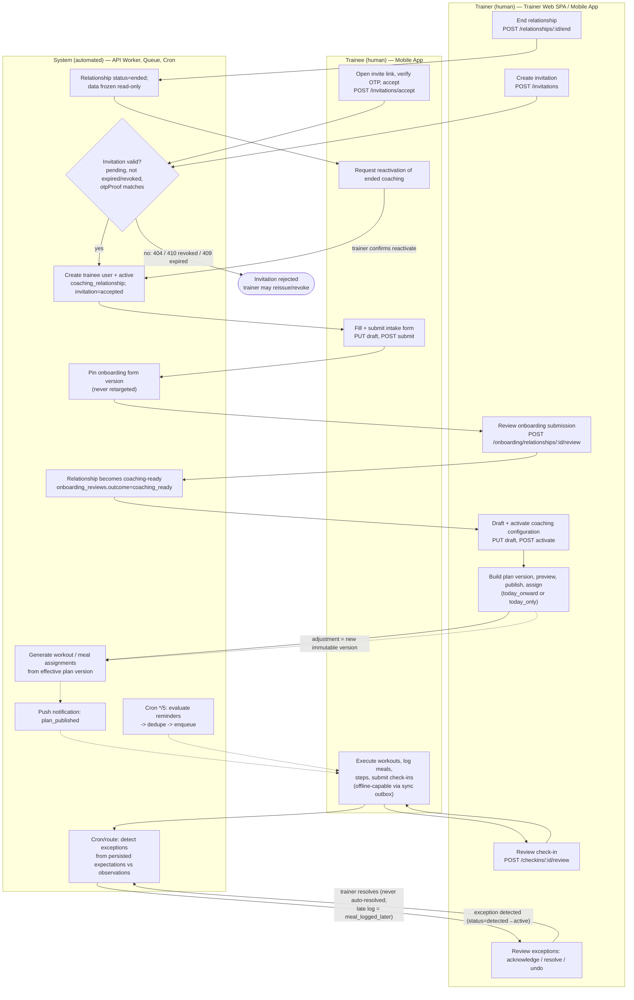

---

## A2 · Exception handling (swimlane with decision and failure paths)

States and rules from `domain/exceptions.ts`, `routes/exceptions*.ts`, `packages/core`. Exception `type` ∈ {missed_workout, skipped_workout, overdue_meal, skipped_meal, meal_deviation, meal_logged_later, overdue_checkin}; severity ∈ {critical, attention}. **[C]**

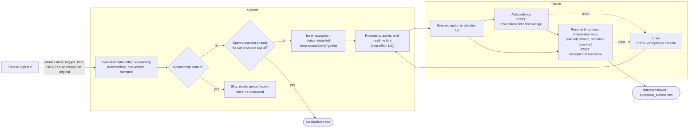

---

## A3 · State transition diagrams

Enums are the Drizzle `enum:` values in `apps/api/src/db/schema.ts` (line numbers in README inventory). Transition arrows are **[C]** where a route or domain function performs them, **[I]** where derived from enum values only (marked `*`).

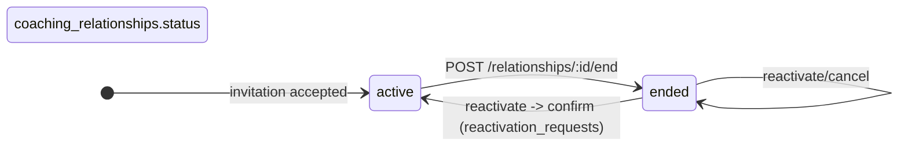

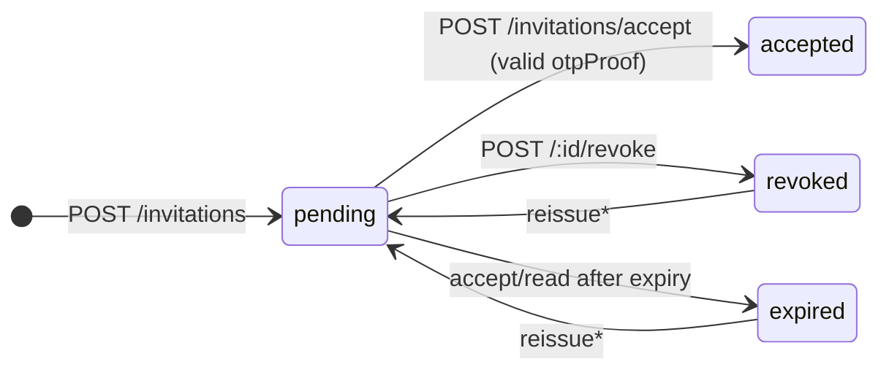

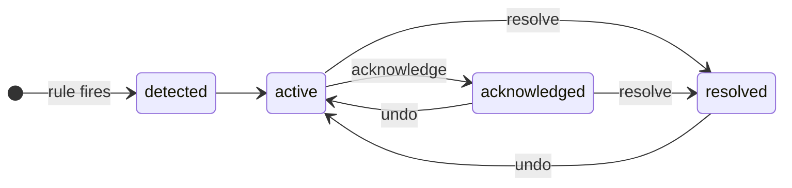

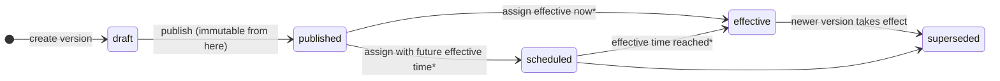

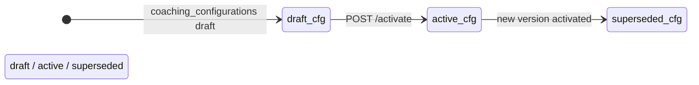

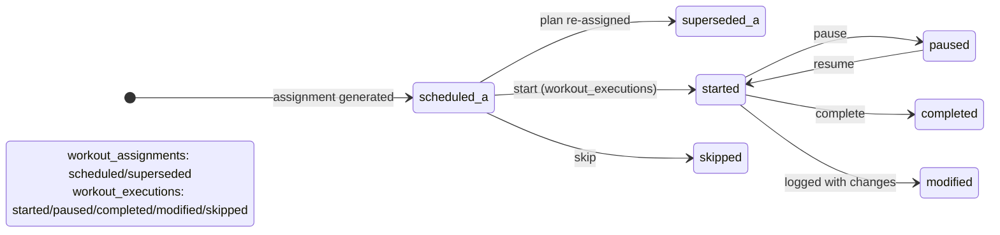

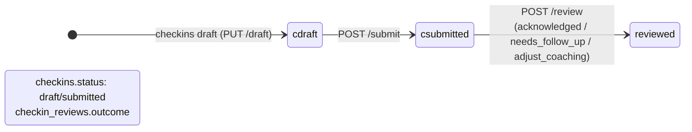

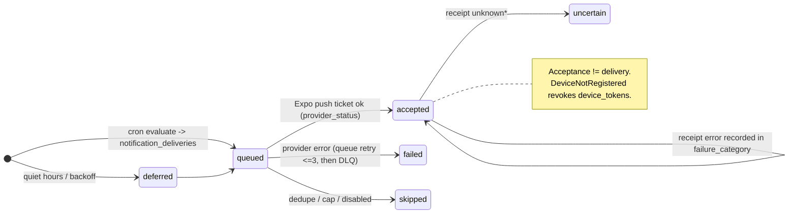

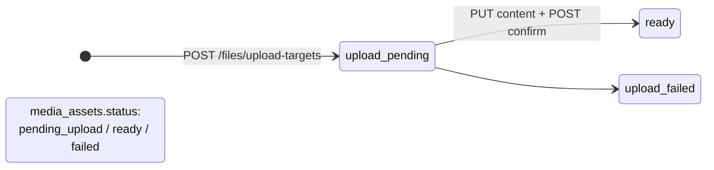

```mermaid
stateDiagram-v2
  direction LR
  [*] --> acct_active
  acct_active --> acct_archived: POST /account/deletion
  acct_archived --> acct_active: POST /account/reactivation
  acct_archived --> [*]: cron.account_purge after purgeAfter
  acct_active --> acct_disabled
  note right of acct_archived: Only GET /account/status, POST /account/reactivation,<br/>DELETE /auth/session reachable; others 403 ACCOUNT_ARCHIVED
```

---

## B1 · C4 System Context

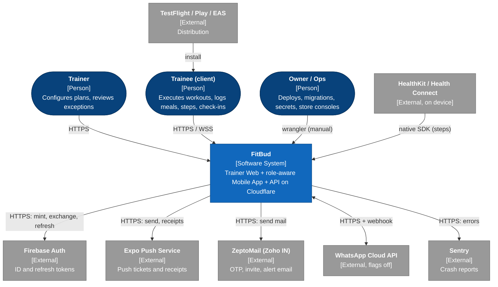

---

## B2 · C4 Container

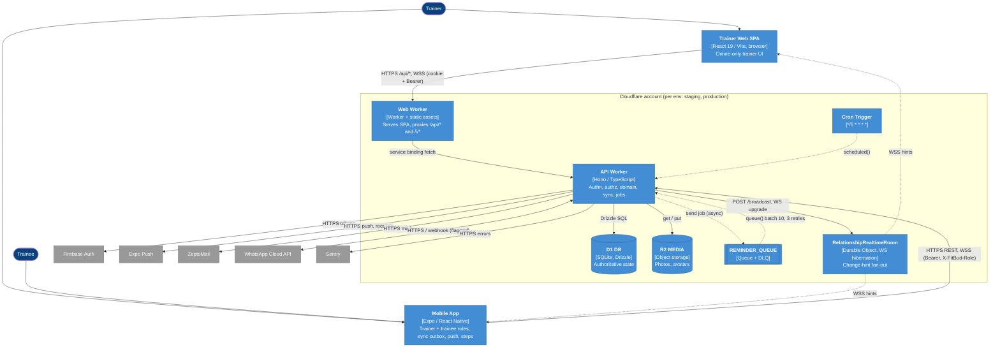

---

## B3 · Component architecture — API Worker (`apps/api/src`)

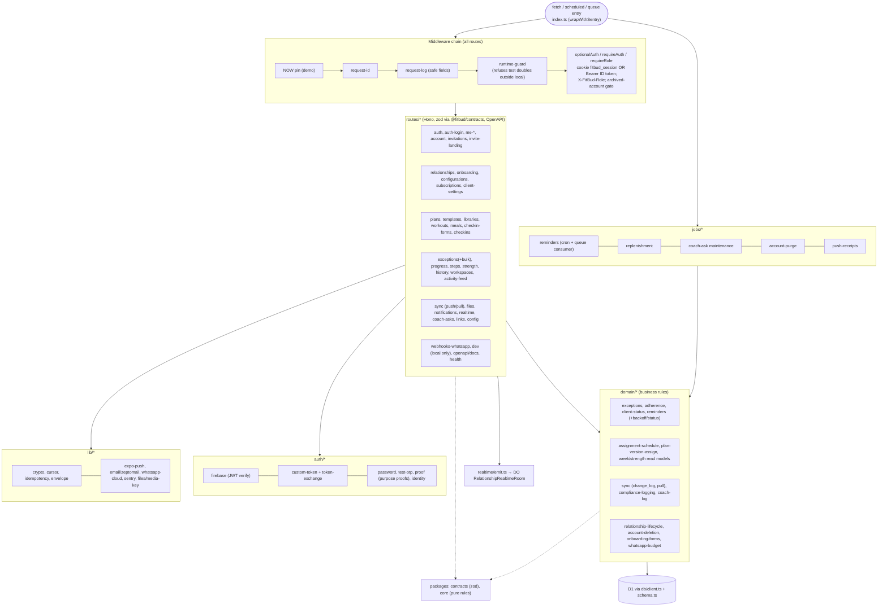

---

## B4 · Service dependency diagram

Solid = synchronous, dashed = asynchronous. Dependency direction = "calls / imports". Package rule from AGENTS.md: apps depend on packages, never on another app. **[C]** from `package.json` workspaces and imports; inter-service calls from code.

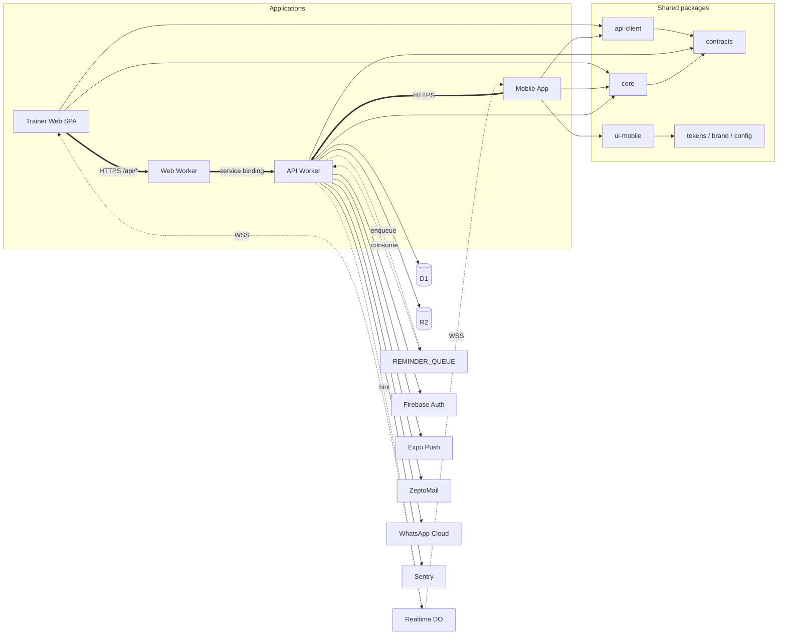

---

## B5 · External integration diagram

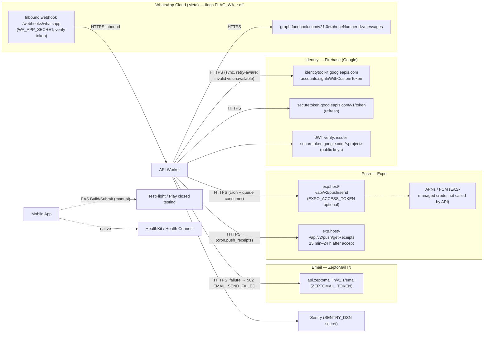

---

## C1 · Cloud architecture (Cloudflare — AWS conventions do not apply)

No AWS, VPC, subnet, AZ or security-group resources exist in the repository **[C]**. The platform is Cloudflare Workers; the placement is global/edge and managed by Cloudflare **[I]**. The closest equivalent of "network access relationships" is the set of **bindings** shown here.

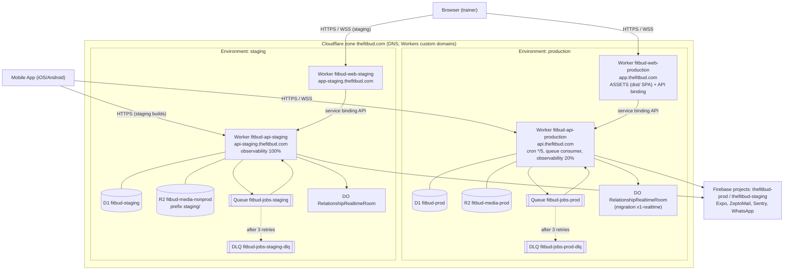

Local development: `wrangler dev` with `--persist-to .wrangler/state` (own D1 per worktree), `AUTH_MODE=test`, `PUSH_PROVIDER_MODE=test`, `EMAIL_PROVIDER=dev_sink`, queue `fitbud-jobs-dev` without DLQ. **[C]**

---

## C2 · Trust boundaries and network topology

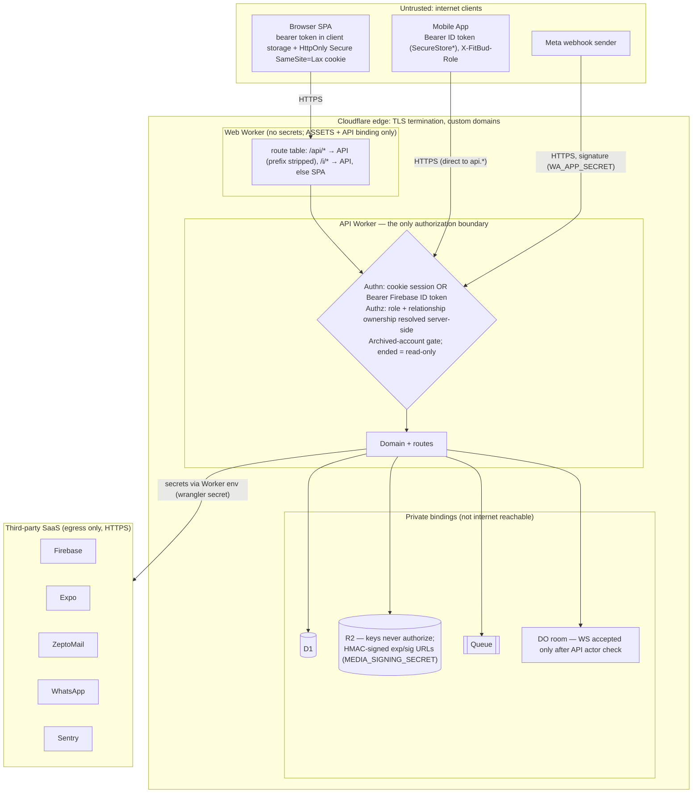

Secrets are Worker secrets, never in the repo: `MEDIA_SIGNING_SECRET`, `FIREBASE_SERVICE_ACCOUNT_JSON`, `ZEPTOMAIL_TOKEN`, `EXPO_ACCESS_TOKEN`, `SENTRY_DSN`, `WA_*`, `QA_TEST_OTP_CODE` (names from `types.ts` and `staging-setup.md`). Public by design: `FIREBASE_WEB_API_KEY`. **[C]**

---

## C3 · CI/CD and deployment flow

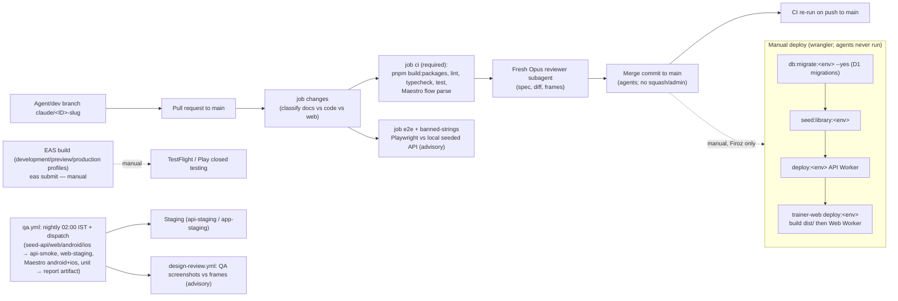

No workflow deploys to Cloudflare **[C]**. The only remote writes in CI are the QA seed jobs on staging (environment `staging-qa`, from `main`).

---

## D1 · Sequence — trainer web sign-in (password) and session

```mermaid
sequenceDiagram
  autonumber
  actor T as Trainer
  participant SPA as Trainer Web SPA
  participant W as Web Worker
  participant A as API Worker
  participant D as D1
  participant F as Firebase Auth
  T->>SPA: identifier + password
  SPA->>W: POST /api/auth/login
  W->>A: service binding POST /auth/login
  A->>D: bump auth_rate_limits (ip hash)
  alt rate limited
    A-->>SPA: 429 RATE_LIMITED
  end
  A->>D: load user_identities (hash, lockedUntil)
  A->>A: verifyPassword
  alt invalid / unknown / locked
    A->>D: failed_login_count++ (lock 15 min at 10)
    A-->>SPA: 401 INVALID_CREDENTIALS (generic)
  else valid
    A->>F: signInWithCustomToken (minted custom token)
    F-->>A: idToken + refreshToken
    A-->>SPA: 200 tokens
    SPA->>W: POST /api/auth/session {idToken, timezone}
    W->>A: forward
    A->>F: verify JWT (issuer securetoken.google.com/project)
    A->>D: find/create user, ensure trainer role + profile
    A-->>SPA: 200 + Set-Cookie fitbud_session (HttpOnly, Secure, Lax)
    SPA->>W: GET /api/me
    A-->>SPA: actor, roles
    alt trainee-only account
      A-->>SPA: 403 FORBIDDEN_ROLE on /auth/session (client keeps bearer, shows trainee gate)
    end
  end
```

Parameters in parentheses (15, 30, 10, 15 min) are from `auth-login.ts`; the exact window semantics of `bumpRateLimit(…,15,30)` are **[U]** without reading the helper. **[C]**

---

## D2 · Sequence — invitation → OTP → acceptance (trainee, mobile)

```mermaid
sequenceDiagram
  autonumber
  actor Tr as Trainer
  actor Te as Trainee
  participant App as Mobile App
  participant A as API Worker
  participant D as D1
  participant Z as ZeptoMail
  Tr->>A: POST /invitations (identifier, form version pinned)
  A->>D: insert client_invitations status=pending
  A->>Z: invite email (E-INV) [or wa.me prefill by trainer]
  Te->>App: opens link /i/:token (landing served by API via Web Worker)
  App->>A: POST /auth/otp/start
  A->>D: auth_otps (code hash, rate limit)
  A->>Z: OTP email (E-OTP) (staging may use fixed QA code)
  Te->>App: enters code
  App->>A: POST /auth/otp/verify
  alt wrong/expired code
    A-->>App: 401 OTP_INVALID (attempts++)
  else ok
    A-->>App: purpose proof "invite" (otpProof)
  end
  App->>A: POST /invitations/accept {token, otpProof, ...}
  A->>D: load invitation
  alt not found 404 / revoked 410 / expired 409 / already accepted 409
    A-->>App: static error code
  else pending
    A->>A: verifyPurposeProof
    A->>D: create user+trainee profile, coaching_relationship=active, invitation=accepted
    A->>A: mintAuthToken → Firebase signInWithCustomToken
    A-->>App: tokens (Bearer)
  end
```

---

## D3 · Sequence — offline workout logging via sync push (idempotent)

```mermaid
sequenceDiagram
  autonumber
  actor Te as Trainee
  participant App as Mobile App (sync engine + outbox)
  participant A as API Worker /sync
  participant R as Domain route (internal dispatch)
  participant D as D1
  participant DO as RelationshipRealtimeRoom
  participant Tr as Trainer Web SPA
  Te->>App: complete set / workout (offline)
  App->>App: write local record, enqueue outbox (mutationId = idempotency key)
  Note over App: on reconnect
  App->>A: POST /sync/push [{mutationId, operation, payload}]
  A->>D: lookup sync_mutations(actor, mutationId)
  alt already stored
    A-->>App: already_applied (stored result)
  else new
    A->>R: mapMutationToRequest → in-process POST /workouts/executions/:id/sets/:id/complete
    R->>D: write execution rows + change_log(upsert) + recordVersion
    R-->>DO: queueRealtimeHint (best-effort, fire-and-forget)
    A->>D: persist sync_mutations result
    A-->>App: applied | conflicted (409) | rejected
  end
  App->>A: GET /sync/pull?cursor=…
  A->>D: change_log since cursor (opaque cursor)
  A-->>App: upserts / tombstones + new cursor
  App->>App: apply transactionally, then advance cursor
  DO-->>Tr: WSS hint (ids, type, serverVersion) → SPA refetches REST
```

Persistence on native is **not SQLite** in current code (see README D-02). Supported operations: workout.start/pause/resume/set complete/skip/complete/skip, meal.confirm/deviate/skip, checkin.save_draft/submit, measurement.create (subset listed in `routes/sync.ts`). **[C]**

---

## D4 · Sequence — reminder evaluation → queue → Expo push → receipts

```mermaid
sequenceDiagram
  autonumber
  participant C as Cron Trigger (*/5)
  participant A as API Worker scheduled()
  participant D as D1
  participant Q as REMINDER_QUEUE
  participant QC as API Worker queue()
  participant E as Expo Push
  participant M as Mobile App
  C->>A: scheduled(at)
  A->>A: runScheduledJobs (each job isolated, first error rethrown)
  A->>D: evaluate schedules + completion state (authoritative)
  A->>A: quiet hours, daily cap, backoff, category prefs, dedupe key
  A->>D: insert notifications + notification_deliveries (unique dedupe_key)
  A-)Q: send({notificationId, deliveryId})
  Q-)QC: batch ≤10
  QC->>D: load delivery + active device_tokens
  QC->>E: POST push/send (routing-only payload)
  alt provider accepted
    QC->>D: provider_status=accepted (≠ completed)
    QC-->>Q: ack
  else error
    QC-->>Q: retry (max 3) → DLQ
  end
  E-)M: APNs/FCM push
  Note over A,E: later cron.push_receipts (15 min–24 h)
  A->>E: POST getReceipts
  A->>D: failure_category, DeviceNotRegistered revokes token
```

Other cron jobs in the same tick, in order: `cron.reminders`, `cron.replenishment`, `cron.coach_ask`, `cron.account_purge`, `cron.push_receipts`. **[C]**

---

## D5 · Sequence — plan publish and assign

```mermaid
sequenceDiagram
  autonumber
  actor T as Trainer
  participant S as Trainer Web SPA
  participant A as API Worker
  participant D as D1
  participant DO as Realtime DO
  T->>S: edit draft plan version
  S->>A: PUT /plans/:id/versions/:vid (optimistic concurrency)
  alt version conflict
    A-->>S: 409 (no silent overwrite)
  end
  S->>A: POST …/consistency, …/preview
  S->>A: POST …/publish
  A->>D: version draft→published (immutable)
  S->>A: POST …/assign {window: today_onward | today_only}
  A->>D: supersede overlapping assignments, generate workout/meal assignments
  A->>D: change_log(effective_plan, assignments) + notifications(plan_published)
  A-->>DO: hint
  A-->>S: 200
```

Detailed ordering inside `plan-version-assign.ts` is **[I]** (route names and table writes confirmed, step order inferred).

---

## D6 · Sequence — realtime hint channel

```mermaid
sequenceDiagram
  autonumber
  participant C as Client (SPA or Mobile)
  participant A as API Worker
  participant DO as RelationshipRealtimeRoom (id = relationshipId)
  C->>A: GET /realtime/relationships/:id/connection
  A-->>C: ws URL (authorization check)
  C->>A: GET /realtime/relationships/:id/ws (Upgrade, cookie or ?access_token)
  A->>A: resolve actor, verify relationship ownership
  A->>DO: forward Upgrade + x-fitbud-user-id
  DO-->>C: 101 (hibernation WebSocket)
  Note over A,DO: later, any mutation
  A->>DO: POST /broadcast {eventId, eventType, entityType, entityId, serverVersion}
  DO-->>C: fan-out
  C->>A: refetch REST / sync (authoritative)
  Note over C,DO: ping/pong auto-response, client-to-server app messages ignored
```

---

## D7 · Sequence — media upload (photo)

```mermaid
sequenceDiagram
  autonumber
  participant M as Mobile App
  participant A as API Worker
  participant D as D1
  participant R as R2 MEDIA
  M->>A: POST /files/upload-targets (kind, owner link)
  A->>D: media_assets status=pending_upload
  A-->>M: target URL with signed exp+sig (HMAC MEDIA_SIGNING_SECRET)
  M->>A: PUT /files/:id/content (session or signed query)
  A->>R: put (key via mediaKey(): env prefix + id)
  M->>A: POST /files/:id/confirm
  A->>D: status=ready (else failed)
  Note over M,A: structured mutation referencing the media id is sent separately (outbox upload queue)
  M->>A: GET /files/:id/download-target → GET /files/:id/content
  A->>D: ownership check via coaching relationship
  A->>R: get → stream
```

Bytes pass **through** the API Worker (no direct R2 presigned URL is used) — inferred from the `content` routes **[I]**.

---

## D8 · Data flow diagram (level 1)

```mermaid
flowchart LR
  TR(["Trainer"]) 
  TE(["Trainee"])
  subgraph P["API Worker processes"]
    P1["1 Authenticate / authorize"]
    P2["2 Onboard (invite, intake, review)"]
    P3["3 Plan & configure (versions, assign)"]
    P4["4 Capture execution (workouts, meals, steps, check-ins, media)"]
    P5["5 Sync (push/pull)"]
    P6["6 Detect exceptions + status"]
    P7["7 Notify (reminders, inbox, push, realtime)"]
  end
  DS1[("D1: identity & relationships")]
  DS2[("D1: plans, assignments, expectations")]
  DS3[("D1: executions, compliance, check-ins, progress")]
  DS4[("D1: exceptions, interventions, notes")]
  DS5[("D1: change_log, sync_mutations, idempotency")]
  DS6[("D1: notifications, deliveries, device_tokens")]
  DS7[("R2 MEDIA")]
  EXT1["Firebase"]; EXT2["Expo"]; EXT3["ZeptoMail"]
  TR --> P1 ; TE --> P1
  P1 <--> EXT1
  P1 --> DS1
  TR --> P2 --> DS1
  P2 --> EXT3
  TR --> P3 --> DS2
  TE --> P4 --> DS3
  P4 --> DS7
  P4 --> DS5
  TE <--> P5 <--> DS5
  DS2 --> P6
  DS3 --> P6 --> DS4 --> TR
  DS2 --> P7
  DS3 --> P7 --> DS6
  P7 --> EXT2 --> TE
  P3 --> DS6
```

---

## D9 · Database ER diagrams (Crow's Foot)

133 foreign keys exist across 88 tables (`schema.ts`); the diagrams below group them by domain with key columns only. Most owned tables reference `coaching_relationships.id` (28 FKs) or `users.id` (49 FKs) — the ownership paths used for authorization **[C]**.

### D9a Identity and relationship core

```mermaid
erDiagram
  users ||--o{ user_roles : has
  users ||--o| trainer_profiles : is
  users ||--o| trainee_profiles : is
  users ||--o{ user_identities : "login ids"
  users ||--o{ web_sessions : has
  users ||--o{ device_tokens : registers
  users ||--o{ client_invitations : "trainer sends"
  client_invitations ||--o| coaching_relationships : "accepted into"
  users ||--o{ coaching_relationships : "trainer / trainee"
  coaching_relationships ||--o{ subscription_versions : bills
  coaching_relationships ||--o{ payment_records : tracks
  coaching_relationships ||--o{ coaching_configurations : configures
  coaching_relationships ||--o{ reactivation_requests : has
  users { text id PK "account_state: active|disabled|archived" text firebase_uid text timezone text purge_after }
  coaching_relationships { text id PK text status "active|ended" text trainer_id FK text trainee_id FK }
  client_invitations { text id PK text status "pending|accepted|expired|revoked" }
  subscription_versions { text id PK text plan_frequency "weekly..yearly" text renewal_frequency }
  payment_records { text id PK text status "paid|unpaid" text method "cash|upi|bank" }
```

### D9b Onboarding, plans, expectations

```mermaid
erDiagram
  onboarding_form_templates ||--o{ onboarding_form_versions : versions
  onboarding_form_versions ||--o{ onboarding_form_responses : "pinned by"
  coaching_relationships ||--o{ onboarding_form_responses : submits
  onboarding_form_responses ||--o| onboarding_reviews : "reviewed (coaching_ready)"
  coaching_relationships ||--o{ plans : owns
  plans ||--o{ plan_versions : versions
  plan_versions ||--o{ workout_assignments : generates
  plan_versions ||--o{ meal_assignments : generates
  coaching_configurations ||--o{ workout_expectations : defines
  coaching_configurations ||--o{ nutrition_expectations : defines
  coaching_configurations ||--o{ checkin_schedules : defines
  coaching_configurations ||--o{ tracking_requirements : defines
  users ||--o{ plan_templates : "trainer owns (global|trainer)"
  plan_versions { text id PK text status "draft|published|scheduled|effective|superseded" text origin "blank|previous_version|template|adjustment" }
```

### D9c Execution, compliance, check-ins, progress

```mermaid
erDiagram
  workout_assignments ||--o{ workout_executions : executed
  workout_executions ||--o{ exercise_executions : contains
  exercise_executions ||--o{ set_executions : contains
  meal_assignments ||--o| meal_compliance : logged
  coaching_relationships ||--o{ checkins : has
  checkin_form_templates ||--o{ checkin_form_versions : versions
  checkin_form_versions ||--o{ checkins : "pinned"
  coaching_relationships ||--o{ checkin_schedules : schedules
  checkins ||--o| checkin_reviews : reviewed
  coaching_relationships ||--o{ measurements : records
  coaching_relationships ||--o{ progress_entries : records
  coaching_relationships ||--o{ daily_steps : "steps (apple_health|health_connect|manual)"
  media_assets ||--o{ progress_entries : attached
  coaching_relationships ||--o{ log_edit_events : "audit (target_type: workout_execution|meal_compliance|measurement, no FK)"
  workout_executions { text id PK text status "started|paused|completed|modified|skipped" text logged_by_role "trainee|coach" }
  meal_compliance { text id PK text status "confirmed|modified|skipped" text deviation_kind }
```

### D9d Exceptions, notifications, sync

```mermaid
erDiagram
  coaching_relationships ||--o{ exceptions : raises
  exceptions ||--o{ exception_actions : "acknowledge|resolve"
  exceptions ||--o{ interventions : "note|plan_adjustment|schedule_checkin"
  interventions }o--o| plan_versions : "resulting version"
  coaching_relationships ||--o{ trainer_notes : has
  checkins ||--o{ trainer_notes : "optional"
  coaching_relationships ||--o{ coach_asks : "asked coach"
  coaching_relationships ||--o{ reminder_rules : configures
  users ||--o{ notification_preferences : sets
  notifications ||--o{ notification_deliveries : "push channel"
  notification_deliveries }o--o| device_tokens : "sent to"
  coaching_relationships ||--o{ change_log : "sequence (upsert|tombstone)"
  users ||--o{ sync_mutations : "applied|already_applied|rejected|conflicted"
  idempotency_records { text key_hash "no FK; keyed by actor + key hash" }
  exceptions { text id PK text type "7 types" text severity "critical|attention" text status "detected|active|acknowledged|resolved" text rule_version text source_entity_type text source_entity_id }
  notification_deliveries { text id PK text state "queued|accepted|failed|skipped|uncertain" text dedupe_key }
```

### D9e Library (reference data) and WhatsApp (built, flagged off)

```mermaid
erDiagram
  library_sources ||--o{ exercise_library_items : source
  library_sources ||--o{ food_library_items : source
  exercise_library_items ||--o{ exercise_library_muscles : tagged
  exercise_library_items ||--o{ exercise_library_media : "media (by id)"
  library_sources ||--o{ exercise_library_media : source
  food_library_items ||--o{ food_library_servings : servings
  food_library_items ||--o{ food_library_nutrients : nutrients
  coaching_relationships ||--o{ trainee_custom_foods : "custom foods (no FK to library)"
  coaching_relationships ||--o{ whatsapp_messages : sends
  whatsapp_messages ||--o{ whatsapp_ledger : costs
```

---

## D10 · Event-driven architecture

```mermaid
flowchart LR
  subgraph SRC["Event sources"]
    S1["Cron Trigger */5 (time)"]
    S2["HTTP mutations (workouts, meals, checkins, plans, exceptions)"]
    S3["Expo receipts (poll)"]
    S4["WhatsApp webhook (inbound)"]
  end
  subgraph BUS["Messaging"]
    Q["Queue REMINDER_QUEUE<br/>{notificationId, deliveryId}<br/>max_batch 10, retries 3, DLQ"]
    DO["DO room per relationship<br/>{eventId, eventType, entityType, entityId, relationshipId, serverVersion}"]
    CL[("change_log (pull-based event log, cursor)")]
  end
  subgraph CON["Consumers"]
    C1["API queue() → Expo push"]
    C2["SPA / Mobile realtime hooks → refetch"]
    C3["Mobile sync pull → local apply"]
    C4["domain: whatsapp_webhook_events, opt-outs"]
  end
  S1 -. "evaluate" .-> Q
  S2 -- "append" --> CL
  S2 -. "best-effort hint" .-> DO
  S3 -. "update delivery" .-> CL
  Q -. "at-least-once; dedupe_key unique" .-> C1
  DO -. "at-most-once hint" .-> C2
  CL --> C3
  S4 --> C4
```

Delivery semantics: queue = at-least-once with unique `dedupe_key` for at-most-once push **[C]** (`reminders.at-most-once.test.ts`); realtime = best-effort hint, correctness never depends on it; change_log = durable, cursor-based **[C]**.
