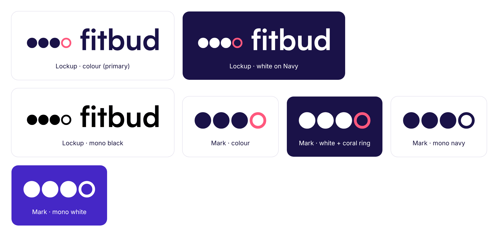
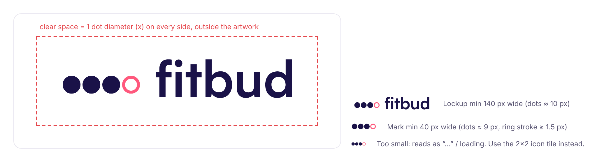
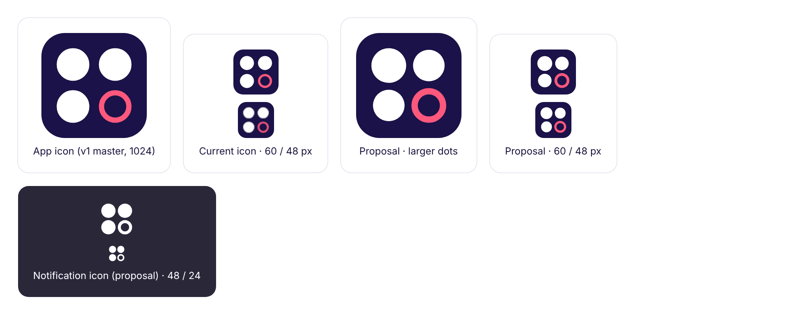
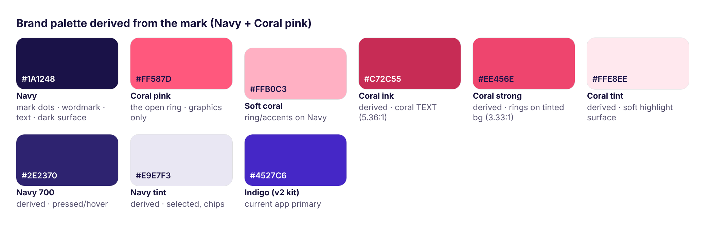
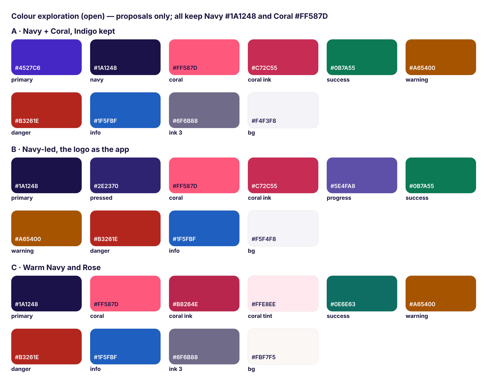
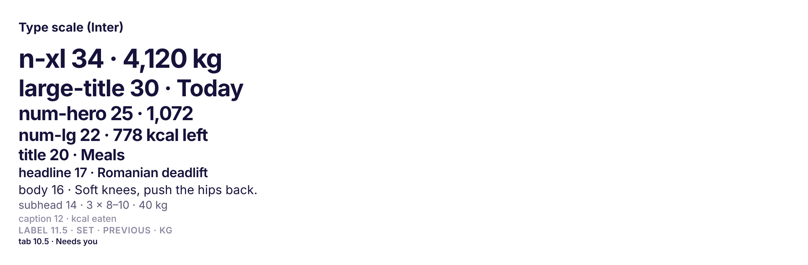

# FitBud design system v2: Honest Week (four-dot mark)

Status: **working draft for the refinement pass**, 14 Nov 2026. The logo (the v1 R2-B four-dot Honest Week mark), type and spacing are the base. **The colours are provisional** (see §3.4): Firoz will explore them with Claude.

Sources: the four-dot mark and icon SVGs and PNGs, the v1 brand book (R2-B, palette, voice, motion), `typography.md`, and the v2 kit (`src/kit.css`, `src/kit.py`, `src/kit_trainer.py`).

## 1. The logo: Honest Week (the v1 R2-B four-dot mark)

**Which mark this is.** Firoz chose the **original v1 runner-up "R2-B Honest Week"**:
- **The mark:** three filled Navy dots and one open Coral-pink ring in a row, next to the "fitbud" wordmark.
- **The app icon:** a 2×2 grid of three white dots and one Coral ring on Navy.
- **Sources:** `runnerup-honest-week-mark.svg` (the file Firoz has open; identical to the one in the v1 brand assets), `runnerup-honest-week-icon.svg` with its 1024, 180 and 48 px PNGs, and the v1 brand book §4.1–4.4.
- **Not this mark:** the v2 "strip wordmark" (capsules under the name) and the v1 final "Guided Ring" b-mark. The strip files are kept only for reference in `assets/logo/not-chosen-v2-strip/`.

**Exact colours, sampled from the SVGs:**

| Colour | Hex | Where it appears in the SVGs |
|---|---|---|
| **Navy** | `#1A1248` | Filled dots (fill and stroke) in the mark; icon background |
| **Coral pink** | `#FF587D` | The open ring (stroke only) in the mark and the icon |
| White | `#FFFFFF` | Icon dots |

**Meaning: counts, not scores.**
- The mark is an honest tally of the week. Three dots are days done.
- **The open ring is the honest gap:** today, or the day still to do. It's empty because it hasn't happened yet, not because you failed. It's never filled in red and never a percentage.
- That's the product's stance in one glyph: show the count, name what's left, no streaks and no guilt.
- The ring is also the one warm, Coral moment in the mark. It points at the next step.

**Geometry (from the SVG, 100-unit box).**
- Dots: radius 9, stroke 3.6, so the outer diameter is 21.6.
- Centres at x = 14, 38, 62, 86, so the gap between dots is 2.4.
- The ring has the same outer diameter, with a 3.6 stroke and an open centre.
- Icon (2×2): radius 13 dots with a 5 stroke at (30, 30), (70, 30), (30, 70); ring at (70, 70); on a Navy square.

**The lockup with the wordmark.**
- The wordmark is **lowercase "fitbud" in Satoshi Bold (700), tracking −1%, outlined to paths, in Navy.** I confirmed the font from:
  - the v1 book ("Satoshi Bold, outlined to paths")
  - the R2-B lockup source (`font-family:Satoshi; font-weight:700; letter-spacing:-.01em`)
  - the outlined v1 wordmark files
- The lockup reuses the outlined v1 wordmark with a **Navy i-dot**, not the coral i-dot from the Guided Ring system: the ring is the only Coral in the logo.
- Proportions:
  - dot outer diameter ≈ 0.7 × the wordmark x-height
  - dots centred on the x-height
  - mark-to-word gap ≈ 0.9 dot diameter
- Satoshi is used **only** in logo artwork, never as UI text.

**Files** (`assets/logo/`):

| File | Use |
|---|---|
| `honest-week-lockup-colour.svg` | **Primary:** Navy dots, Coral ring, Navy wordmark, on white or light surfaces |
| `honest-week-lockup-white.svg` | On Navy: white dots and wordmark, Coral ring |
| `honest-week-lockup-mono-black.svg` | One-colour print: the ring stays an outline |
| `honest-week-mark-colour.svg` and `-colour-512.png` | Mark on its own (original file, unchanged) |
| `honest-week-mark-white.svg` | Mark on Navy: white dots, Coral ring |
| `honest-week-mark-mono-navy.svg`, `-mono-black.svg`, `-mono-white.svg` | Single colour: the ring is an outline in the same colour |
| `honest-week-app-icon.svg` and `-1024/-180/-48.png` | App icon, v1 master (full-bleed square; the stores apply the mask) |
| `honest-week-app-icon-proposal-large-dots.svg` | **Proposal:** larger dots and ring for 48 px legibility (see §2) |
| `honest-week-notification-icon-proposal.svg` | **Proposal:** Android status-bar icon. Monochrome white on transparent, 2×2 with the ring as an outline, 96×96 for 24 dp. |
| `not-chosen-v2-strip/` | The v2 strip wordmark, kept for reference only. Don't use. |

**Clear space and minimum sizes.**

- **Clear space:** x on every side, where x is one dot's outer diameter.
- **Minimum lockup width:** 140 px (dots about 10 px).
- **Minimum mark width:** 40 px, so the ring stroke stays at least 1.5 px. Below that, the row reads as "…" or a loading indicator: use the 2×2 icon tile instead.
- **Print:** lockup at least 30 mm wide.

**App and notification icons.**

- **iOS:** the 1024 master, with no transparency.
- **Android adaptive icon:**
  - background layer: Navy
  - foreground: the dots inside the 66 dp safe zone
  - monochrome layer: the notification-style glyph
- **Notification icon:** white only. The ring is identified by its outline, not by colour, because Android tints it.

**Do**
- Keep 3 filled and 1 open, in this order: done, done, done, open.
- Keep the ring Coral `#FF587D` on light or Navy backgrounds. Use Soft Coral `#FFB0C3` if the ring must sit on Indigo.
- Keep exact circles and the spacing from the SVG.
- Use the white version only on Navy (or a Navy scrim over photos).

**Don't**
- Animate the logo's count to real data, or change the count (no 4 of 4, no 2 of 4).
- Fill the ring, or colour it red, green or a gradient.
- Swap the ring's position.
- Add a fifth dot or make it 7 dots (SevenGrid-like).
- Rotate it vertically.
- Use it as a loading spinner or a pagination control.
- Put it on Indigo with the Coral ring (2.94:1).
- Retype the wordmark, or use the coral i-dot alongside the ring.

## 2. Known risks of this mark (from the v1 book) and mitigations

| Risk (v1 book R2-B cons) | Mitigation |
|---|---|
| **The dots read as "loading", "typing" or pagination** | Never place the mark where a spinner, typing indicator or page dots could be: splash, pull-to-refresh, carousels. Use a real spinner or skeletons for loading. Never animate the dots in sequence. Pagination in the app uses a different shape (a short bar), not dots. |
| **A data glyph with no human warmth, saying nothing about coaching** | Warmth comes from the Coral ring, voice and photography: always pair the logo with the coach's name in context ("Rahul reviewed your check-in"). In marketing, use the tagline "Show up. We'll keep count." or "Progress, guided." and real people. |
| **4 small dots get busy at 48 px** | The proposed icon uses larger dots (radius 16.5 vs 13), a thicker ring (6 vs 5) and smaller gaps, so it reads as four clear shapes. Below 40 px use the icon, not the horizontal mark. Test at 29, 40 and 48 px on real home screens. |
| **The 2×2 icon looks like a launcher "apps" grid** | The Coral open ring is the distinguishing feature, so never render it mono on the home screen. Keep the Navy background (launcher grids are usually light or translucent). Consider testing a rounded inner group with a slight asymmetry: the ring larger than the dots. |
| **Weaker recognition than a letterform** (v1 book: "Choose it only if you want a purely typographic and data-led brand") | The lockup is primary: the wordmark carries the name until the mark is known. Use the dots consistently everywhere (week rows, check-in counts), so the mark is reinforced in product. |

**Tie the mark to the product.** The ring motif connects to the app's rings: the Diet ring, the week dots on Today and Workout, and the check-in counts.
- Done = a filled dot.
- Today or still to do = an open ring, with the Coral reserved for "today".
- Rest = a dash.
- Missed = a quiet grey outline, **never red**.
- Progress rings in the app are Navy or Indigo strokes. Coral appears only as the "today" or "next" marker, never as a progress fill or an error.

## 3. Colour

The palette now **derives from the mark: Navy + Coral pink**. The v2 kit still uses Indigo as the app primary (§3.2). **All colours are provisional.** Firoz will explore them with Claude (§3.4).

### 3.1 Brand colours (from the mark) and derived roles

| Name | Hex | Role | Contrast |
|---|---|---|---|
| **Navy** | `#1A1248` | Mark dots, wordmark, primary text-on-light, dark surfaces | On white 17.16:1 · white on it 17.16:1 |
| **Coral pink** | `#FF587D` | The open ring; the "today" or "next" marker; one celebration accent. **Graphics only.** | On white **3.02:1** (non-text only) · on Navy 5.67:1 · on app bg #F4F3F8 **2.74:1 (fails 3:1)** · on Indigo 2.94:1 (not allowed) |
| Soft coral | `#FFB0C3` | Ring or accent on Navy or Indigo | On Navy 10.01:1 |
| Coral ink *(derived)* | `#C72C55` | When Coral must be **text** (e.g. a "Today" label) | On white 5.36:1 · on #FFEEF2 4.79:1 |
| Coral strong *(derived)* | `#EE456E` | Coral graphics on tinted backgrounds | On #F4F3F8 3.33:1 · on #FBF7F5 3.45:1 |
| Coral tint *(derived)* | `#FFE8EE` | Soft highlight surface (Navy text on it 14.73:1) | — |
| Navy 700 *(derived)* | `#2E2370` | Pressed or hover on Navy | White on it 13.2:1 |
| Navy tint *(derived)* | `#E9E7F3` | Selected chips and rows | Navy on it 14.04:1 |

**Coral rules**
- **No Coral for small text:** it fails at 3.02:1; use Coral ink.
- **No white text on Coral:** 3.02:1. Navy text on Coral is 5.67:1 and fine for a rare accent button.
- **Coral never signals error.** Danger is a separate red (`#C9372C` today, `#B3261E` proposed), always paired with an icon and a word.
- Keep Coral under 10% of any screen, as a dot or a line, never a field behind text.

### 3.2 Current app tokens (v2 `kit.css`, as rendered in the mocks)

| Role | Token | Hex | Notes |
|---|---|---|---|
| Primary | `--brand` | `#4527C6` | Indigo: buttons, active tab, links. White on it 8.90:1. **Not in the mark;** keep or drop (§3.4). |
| Primary ink and tints | `--brand-ink`, `--brand-tint`, `--brand-tint2` | `#3A1FB0`, `#EEEAFF`, `#DCD4FF` | |
| Navy | `--navy` | `#1B1546` | Close to brand Navy; align it to `#1A1248` |
| Text | `--ink`, `--ink2`, `--ink3`, `--ink4` | `#16123A`, `#5A5672`, `#8F8BA6`, `#B9B6CB` | ink3 is **3.28:1: fails** for small labels |
| Background, surface, fill | `--bg`, `--card`, `--fill`, `--fill2` | `#F4F3F8`, `#FFFFFF`, `#EFEEF5`, `#E7E5F0` | |
| Coach target (ghost) | `--ghost` | `#9C8CEB` | **2.85:1: fails** |
| Success | `--done` | `#0A8A5C` | 4.37:1: large text and icons only |
| Warning | `--warn` | `#B25E09` | 4.67:1 |
| Danger | `--crit` | `#C9372C` | 5.16:1 |
| Info | `--info` | `#2457B8` | 6.71:1 |
| PR | `--pr` | `#A9780A` | **3.9:1: fails** for small text |
| Macros | `--protein`, `--carbs`, `--fat` | `#2C1F86`, `#8A73FF`, `#14838C` | Bars only |

The kit has **no Coral token yet.** Add `--coral #FF587D`, `--coral-ink #C72C55` and `--coral-strong #EE456E` for the "today" ring and markers.

### 3.3 Contrast check (WCAG 2.x)

| Pair | Ratio | Verdict |
|---|---|---|
| Navy on white | 17.16 | AAA |
| White on Navy | 17.16 | AAA |
| Coral on white | 3.02 | Non-text only (≥ 3:1). **Fails for text.** |
| Coral on #F4F3F8 (app bg) | 2.74 | **Fails even for graphics.** Use Coral strong, or put the ring on a white card. |
| Coral on Navy | 5.67 | AA text |
| Navy on Coral | 5.67 | AA |
| White on Coral | 3.02 | **Not allowed** |
| Coral on Indigo | 2.94 | **Not allowed** |
| Soft coral on Navy | 10.01 | AAA |
| Coral ink `#C72C55` on white | 5.36 | AA |
| Coral strong `#EE456E` on #F4F3F8 | 3.33 | Graphics |
| Indigo on white | 8.90 | AAA |
| ink3 `#8F8BA6` on white → proposed `#6F6B88` | 3.28 → 5.08 | Fix |
| ghost `#9C8CEB` → proposed `#7259D9` | 2.85 → 5.06 | Fix |
| PR `#A9780A` → proposed `#9A6700` | 3.9 → 4.87 | Fix |
| success `#0A8A5C` → proposed `#0B7A55` | 4.37 → 5.34 | Fix |
| danger `#B3261E` on white | 6.54 | AA |
| warning `#A65400` on white | 5.4 | AA |
| info `#1F5FBF` on white | 6.09 | AA |

### 3.4 Colour exploration (open): proposals only

The palette is **provisional**. Firoz will explore the app colours with Claude. All three directions **keep Navy `#1A1248` and Coral `#FF587D` exactly**, as the mark requires. These are **proposals, not decisions.**

| Direction | Primary | Navy | Coral (graphics) | Coral text | Success | Warning | Danger | Info | Ink 3 | Background |
|---|---|---|---|---|---|---|---|---|---|---|
| **A · Navy + Coral, Indigo kept** | `#4527C6` | `#1A1248` | `#FF587D` | `#C72C55` | `#0B7A55` | `#A65400` | `#B3261E` | `#1F5FBF` | `#6F6B88` | `#F4F3F8` |
| **B · Navy-led, the logo as the app** | `#1A1248` (pressed `#2E2370`) | `#1A1248` | `#FF587D` | `#C72C55` | `#0B7A55` | `#A65400` | `#B3261E` | `#1F5FBF` | `#6F6B88` | `#F5F4F8` |
| **C · Warm Navy and Rose** | `#1A1248` | `#1A1248` | `#FF587D` (tint `#FFE8EE`) | `#B8264E` | `#0E6E63` | `#A65400` | `#B3261E` | `#1F5FBF` | `#6F6B88` | `#FBF7F5` |

- **A · Navy + Coral, Indigo kept:** smallest change to the 180 mocks. Navy and Coral come in for the mark, text and "today"; Indigo stays for actions. Never put Coral next to Indigo; use Soft Coral there.
- **B · Navy-led, the logo as the app:** Navy buttons and active tabs make the app look like its logo: serious, calm and premium. A muted violet `#5E4FA8` (6.65:1) replaces Indigo for progress rings and charts. Coral marks "today" and "next".
- **C · Warm Navy and Rose:** answers the mark's "no warmth" weakness with a warm chalk background, a Coral tint for highlight cards (coach note, PR, "today") and teal success that sits gently beside rose. Coral graphics on the chalk background need Coral strong `#EE456E` (3.45:1).

**Contrast of the proposals** (on white unless noted):
- **Text colours:** all pass AA. Coral ink is 5.36 (`#B8264E` is 6.13), success 5.34 (teal 6.12), warning 5.4, danger 6.54, info 6.09, ink3 5.08.
- **On the coloured backgrounds:**
  - B's background `#F5F4F8`: ink3 4.64, Navy 15.67.
  - C's chalk `#FBF7F5`: ink3 4.77, teal 5.75, Coral ink 5.03.
- **Coral graphics:** pure Coral on all three backgrounds is below 3:1 (2.70–2.84). It must sit on white cards or Navy, or use Coral strong.
- **Watch out:** Coral ink and danger red are close in hue. Coral ink is only for the "today" or "next" label; danger always comes with an icon and a word.

**How to evaluate:** recolour five anchor screens in each direction: TR-06a Today, W-03 active workout, TR-07a Diet, TM-01a Needs you, TM-04b Nudge. Check them on a phone outdoors and in a dim gym, re-check contrast, then pick one and update the `kit.css` tokens only.

## 4. Type

- **Inter** (SIL OFL) for all UI, with tabular numbers (`tnum`) for every number.
- Satoshi appears **only** inside the logo artwork. Never mix it into UI text; that was one of v1's problems.

| Token | Size / line | Weight | Tracking | Use |
|---|---|---|---|---|
| `n-xl` | 34 / 40 | 700 | −1.1 | Summary hero numbers (workout volume) |
| `large-title` | 30 / 36 | 700 | −0.6 | Screen titles |
| `num-hero` | 25 / 30 | 700 | −0.9 | Ring centre |
| `num-lg` | 22 / 26 | 700 | −0.5 | Card headline numbers |
| `title` | 20 / 25 | 700 | −0.35 | Section headers |
| `headline` | 17 / 22 | 600 | −0.25 | Nav title, exercise name, group header |
| `num-md` | 17 / 22 | 600 | −0.25 | Set values, kcal per meal |
| `body` / `body-strong` | 16 / 21 | 400 / 600 | −0.15 | Row primary |
| `subhead` | 14 / 19 | 400 | −0.05 | Row secondary, coach cue |
| `num-sm` | 14 / 19 | 600 | −0.1 | Macro values |
| `caption` | 12 / 16 | 500 | 0 | Units, times |
| `label` | 11.5 / 15 | 600 caps | +0.5 | Table headers |
| `tab` | 10.5 / 13 | 600 | +0.1 | Tab bar |

**Rules**
- A number is at least one weight step heavier than its label, and its unit drops to caption colour.
- Numbers must fit at their real size with real data (4-digit kcal, "104 / 102 g"): shrink to fit down to 0.7×, never wrap.
- Support Dynamic Type up to about 1.2× on numbers.

## 5. Spacing, grid and radii

- **4 pt base:** 4, 8, 12, **16 (screen margin, card padding)**, 20, 24, 32.
- **Layout:**
  - one column at 393 pt width, 16 pt margins
  - set table columns: set, previous, kg, reps, ✓
  - two-up and four-up summary tiles on trainer screens
- **Heights:**
  - set row 48
  - set input 36
  - meal row about 62
  - client row about 76
  - exercise header 56
  - button 50 (small 38)
  - chip 34
  - pill 32
  - input 50
  - search 40
  - tab capsule 62 (inset 16 at the sides, 22 at the bottom)
  - rest bar 60
- **Radii:**
  - card 18
  - group and meal 16
  - button 14 (small 12)
  - input 12
  - tag 6
  - chips and pills fully round
  - tab capsule 31
  - icon tile 9
  - app icon squircle about 22% of its size
- **Tap targets** are at least 44×44. A set input sits inside a 48 pt row, and the whole cell is the target.
- **Density:** prefer grouped lists (one card, divided rows) over a card per row. This was a v1 complaint.

## 6. Elevation

| Level | Use | Shadow (kit) |
|---|---|---|
| 0 | Background, grouped list content | none |
| 1 | Card, group | `0 1px 2px rgba(22,18,58,.04), 0 0 0 .5px rgba(22,18,58,.06)` |
| 2 | Primary button | `0 6px 16px rgba(69,39,198,.22)` |
| 3 | Floating tab bar, minibar, rest bar | `0 8px 28px rgba(22,18,58,.14)` + a 0.5 px hairline, 88% white with blur |
| 4 | Sheet and dialog over a scrim | The scrim dims the **live screen** behind it. Never a blank page (a 13 Nov device bug). |

## 7. Iconography

- **Lucide** icons (ISC), 1.75–2 px stroke, 20–24 pt, rounded joins. One family only; don't mix in filled icon sets.
- Icons support a label; they never replace it, except for universal ones (back, close, ⋯, search, bell).
- **Exercise imagery is a gap:** v2 uses generic icons. Refinement should propose an exercise thumbnail style: line or duotone, our own drawings, not copied.
- Don't copy icons, illustrations, fonts or logos from reference apps.

## 8. Components (from the kit)

Each one has a function in `src/kit.py` or `src/kit_trainer.py`, and its CSS class in `src/kit.css`.

**Navigation**
- status bar
- nav bar with back or title
- large header
- floating tab bar (trainee: Today, Workout, Diet, Progress, More; trainer: Needs you, Clients, Check-ins, More) with count badges and dots

**Actions**
- buttons (primary, secondary, outline, danger, disabled, small)
- pills
- chips (default, on, tint)
- segmented control
- stepper
- toggle
- circle icon buttons

**Content**
- list rows and groups
- section headers
- tags
- avatars (trainee, coach)
- banners (info, warn, crit, done)
- toasts
- empty states
- skeletons
- sync pill ("Saved on phone", "Waiting to send")

**Overlays**
- sheet over a scrim
- dialog
- keypad (numeric with ±2.5, alpha)

**Fitness**
- week dots (filled = done, open ring = today, dash = rest)
- ring
- macro bars
- diet summary
- meal row
- due-meal card
- workout card
- workout stats
- exercise header
- set header and set row (pending, active, done, PR, skipped, trainee-added)
- rest bar
- minibar

**Trainer**
- severity chips
- Needs-you card
- group header
- summary tiles
- client header
- week dots
- stat rows
- two-button sticky footer
- WhatsApp bubble (Reply on WhatsApp preview)

## 9. Motion and haptics (placeholders, to be designed)

- **Easing** `cubic-bezier(.2,.8,.2,1)`:
  - set-done check 150 ms
  - meal confirm 200 ms
  - sheet and drawer 200 ms
  - logo sting about 420 ms (the three dots appear, then the ring draws; never loop it like a loader)
- No confetti, no bounce, no counting-up numbers.
- **Reduced motion:** crossfade.
- **Haptics** (to specify):
  - light impact on set done
  - success notification at the end of rest
  - selection tick on keypad and stepper
  - warning on a destructive confirm
- Swipe actions need a designed reveal: v2 shows a frozen half-swipe that hides the set number.

## 10. Voice and tone

Clear, encouraging, human, brief.

- **Name the coach** ("Rahul will review this").
- No guilt after a miss ("Yesterday got away from you. Today's a fresh start."), and no exclamation marks in reminders.
- Errors reassure first ("Couldn't refresh. Your logs are saved on your phone.").
- **Words we use:** coach, plan, log, check-in, this week, next up, reviewed.
- **Words we avoid:** crush, beast, no excuses, transformation, streak, risk, compliance %, "AI coach".
- The trainer UI states the rule, never "at risk".
- Trainee copy may have Hinglish variants later. The trainer UI is English for MVP.
- **Nudge** copy is a push: title "{Coach} nudged you", body is the coach's short text (see `NUDGE-AND-WHATSAPP.md`).

## 11. Accessibility

- Text contrast meets AA (4.5:1, or 3:1 for large text and non-text). Fix the four failing tokens in §3.3.
- Never rely on colour alone. Day states are filled dot vs open ring (and a dash for rest), so they work in mono and for colour-blind users.
- Dynamic Type: layouts reflow to about 1.3× body. Numbers shrink to fit rather than wrap. Test at the largest setting on Today, Diet and the active workout.
- Tap targets are at least 44×44 pt. Destructive actions confirm with an undo.
- VoiceOver and TalkBack labels:
  - set rows ("Set 2, 40 kilos, 10 reps, done")
  - the week dots ("4 of 7 days done this week")
  - the ring ("1,072 of 1,850 kilocalories")
- Respect Reduce Motion. Haptics are never the only feedback.
