# FitBud UI/UX Implementation Guide

**Version:** 1.2 · **Date:** Saturday 17 October 2026, evening (IST). v1.0 was 14 Oct. v1.1 (17 Oct, afternoon) folded in the user's answers to the open questions and their navigation changes. v1.2 (17 Oct, evening) adds the user's second set of decisions: WhatsApp built but switched off, email-only OTP for now, no auto-sending on anyone's behalf, Home rows, and OQ-25 to OQ-31. All are recorded as **[DECISION · user 17 Oct]** and listed in §5.4 "Resolved decisions" · **Owner:** dev fitbud · **Audience:** the implementing coding agent, plus design and product reviewers.
**Status:** This guide is the agent-facing source of truth for UI and UX. It sits under the Confluence product contract (see §1.2 "Authority"), so it never overrides product behaviour defined there. Where this guide adds behaviour the contract doesn't cover (for example the reminder engine refinements, the "asked coach" marker and WhatsApp deep links), the item is labelled **[DECISION · user 14 Oct]** or **[PROPOSED]**. Each one also appears in the open-questions list (§5.4) so it can be written back to Confluence.

**Inputs this guide was built from**

| Input | What was used |
|---|---|
| Confluence space `FM` (thefitbud.atlassian.net). Local exports are in `/workspace/fitbud-ux/sources/` | Project Details, UX and Screen Architecture, Workflows and States (decisions A–G and the 10 Oct clarifications), Current State and Iteration Guide, Iteration A Trainer UI Contract Decisions. Technical Architecture and SLOs was re-read in full on 14 Oct. A CQL check on 14 Oct showed that no FM page has changed since 10 Oct 2026, so the local exports are current. |
| Earlier research | `/workspace/fitbud-ux/FitBud_UIUX_Research.md` (Figma audit, competitor teardown, retention research) and `/workspace/fitbud-impl/FitBud_Trainer_Web_Gap_Analysis.md` (53 implemented screenshots, Figma vs implemented) |
| Figma | Trainee `lIUv0KzTaIEb61aYRePzB5` (8 frames) and trainer `WxSw4jGGeOigNmc6RKFhfh` (10 frames), using the exported screenshots in `/workspace/fitbud-ux/screens/`. A fresh Figma call on 14 Oct hit the Starter-plan MCP rate limit, so no new frames were pulled (see Appendix A). |
| Code | Repo `thefitbud` on branch `feat/iteration-a-backend` at `ae1cfa6` (11 Oct 2026). It was read on the user's PC with read-only PowerShell, and no git state was changed. Route tables, screen files, contracts (`packages/contracts`), reminder constants (`packages/core/src/reminder.ts`) and theme tokens (`packages/ui-mobile/src/theme.ts`) were all inspected. |
| Web research | Competitor help centres, platform guidelines (Material 3, Apple HIG, Android, Expo, WhatsApp, WCAG) and behaviour research. Every URL is listed in §6, and URLs were checked on 14 Oct where possible. |

---

## v1.2 changes (17 Oct 2026, evening)

Page numbers refer to this PDF.

| # | Change | Where (section · page) |
|---|---|---|
| 1 | **Sign-in:** password (mobile or email) and **email OTP** are live. The WhatsApp OTP is fully built but behind the flag `wa_otp` (off), and shows as a disabled "Coming soon" option. No SMS. System email is sent from a configurable sender, `tech@thefitbud.com` for now. | D18, D30 · p. 8 · §1.6.11 · p. 20 · TW-01 · p. 25 · TR-01 · p. 86 · TR-02 · p. 88 · TW-07 · p. 40 · §3.1 · p. 122 · §3.1a · p. 124 |
| 2 | **Automated WhatsApp** (the Cloud API client, template registry with Meta approval status, budget ledger, cap and alerts) is fully built behind `wa_automation` (off). Only push and user-tapped `wa.me` links work today. Template copy is strictly utility, with a lint checklist. Settings show "Coming soon". | D10, D17 · p. 8 · §4.2 · p. 143 · §4.5 · p. 146 · §4.6 · p. 148 · TR-05 · p. 90 · TR-16 · p. 109 · TW-11 · p. 47 · TW-31 · p. 75 · §3.5 · p. 129 · §3.2 · p. 126 · §3.6 · p. 132 · §4.4 · p. 146 |
| 3 | **Never auto-send on a person's behalf.** Re-engagement and every trainer message are `wa.me` prefills that the person sends. The wording is now "written as the trainer" or "trainer-signed text". Text only, no voice notes. | D31 · p. 8 · TW-04 · p. 30 · §4.2 · p. 143 |
| 4 | **Home "Needs attention": one row per client on web** (rows, not cards), with a rationale, wireframe and keyboard model. Cards stay on trainer mobile. | D32 · p. 8 · TW-04 · p. 30 · TM-01 · p. 80 |
| 5 | **OQ answers:** OQ-25 and OQ-31 defaults accepted; OQ-26 removes the optional-item late window; OQ-27 utility-only copy; OQ-28 alerts built; OQ-29 a reply-within-a-day promise; OQ-30 steps not shared, plus a go/no-go evaluation. | §5.4 · p. 153 · §3.7 · p. 135 · §1.6.10 · p. 19 · TR-25 · p. 118 · TR-07 · p. 96 · TR-10 · p. 102 · TW-28 · p. 72 · TM-07 · p. 83 · TR-20 · p. 113 |
| 6 | Roadmap, backlog, acceptance criteria, Appendix B and Confluence conflicts (C-13 to C-15) updated | §5.1 · p. 150 · §5.2 · p. 150 · §5.5 · p. 156 · §5.3 · p. 153 · §6 refs R95–R100 · p. 158 · App. A · p. 164 · App. B · p. 164 · App. C · p. 166 |

---

## Contents

1. How to use this guide · global UX principles and decisions · design system · navigation and IA maps
2. Screen catalogue: trainer web (TW-xx), trainer mobile (TM-xx), trainee mobile (TR-xx)
3. Cross-cutting flows: onboarding, the daily logging loop, the exception loop, the check-in loop, the WhatsApp round trip, and the reminder engine decision table
4. Notification specification
5. Implementation roadmap, the full P0/P1/P2 backlog, and open questions
6. References library
7. Appendices: access notes, the screenshot index, and the code map

---

# 1. Foundations

## 1.1 How to use this guide

1. **Work by screen ID.** Each screen has a stable ID: `TW-` for trainer web, `TM-` for trainer mobile and `TR-` for trainee mobile. Use the ID in branch names, PR titles and commit messages (for example `feat(trainee): TR-07 meal logging one-tap confirm`).
2. **Every screen section uses the same 13-part template:** purpose and user · entry points and route · current state · what's wrong or missing · target design · states · interactions and edge cases · notifications and deep links · references (adopt, adapt, avoid) · UX decisions and why · implementation approach · acceptance criteria · priority.
3. **The status labels** mean the following:
   - **Implemented**: code exists on `feat/iteration-a-backend`. The screen may still need rework, as described in that section.
   - **Figma-only**: designed, but not built.
   - **Missing**: needed by the contract, but neither designed nor built.
   - **New-proposed**: this guide proposes the screen to deliver a 14 Oct decision. It needs product sign-off where marked.
4. **The priorities** mean the following:
   - **P0**: the core loop doesn't work, or the contract is violated. Build it first.
   - **P1**: needed for beta quality.
   - **P2**: valuable, but can follow the beta.
5. **Order of authority when sources disagree:**
   1. The Confluence product contract (Workflows and States beats UX and Screen Architecture beats the Iteration A addendum).
   2. The user decisions in this guide, labelled [DECISION · user 14 Oct].
   3. The rest of this guide.
   4. Figma visuals.
   5. Older Stitch references.

   Code and tests describe what *is* implemented. They don't decide what *should* be built.
6. **Never add a value the API can't return.** Each screen's "Implementation approach" lists any API gap as `API-NEW` (new endpoint or field) or `API-CHG` (a change). Don't build UI against an `API-NEW` item until the endpoint exists. A stub with a feature flag is acceptable.
7. **Copy.** All user-facing strings go through the copy catalogue (§1.9). Strings in this guide are English (en-IN) source strings. Hinglish samples are given where they matter, and they are style guidance, not final translations.
8. **Definition of done for any screen:**
   - every acceptance criterion is ticked;
   - every state (loading, empty, error, offline, partial) is implemented;
   - axe and the React Native accessibility checks pass;
   - the screen has no raw ISO timestamps or UUIDs;
   - every dynamic value is traced to an API field in the PR description.

## 1.2 Authority and what this guide is not

- This guide **does not reopen accepted behaviour**: the derived client status, the four-state adherence enum, Critical, Attention and On track activity severity, Acknowledge versus Resolve, versioned and immutable plans, the assignment windows, and so on. It only decides how that behaviour is presented.
- Where a 14 Oct user decision **refines** an accepted policy, the guide says so explicitly and lists it for Confluence write-back. One example is the reminder timing defaults, which decision C leaves as "system-policy defaults to tune".
- Nothing here has been published to Confluence or Figma.

## 1.3 Global UX principles (each with rationale)

| # | Principle | What it means in the UI | Why |
|---|---|---|---|
| P1 | **Answer the role's one question first** | Trainer screens open on "who needs me, why, what next". Trainee screens open on "what do I do now". | These are the two questions in UX and Screen Architecture §2. Everything else is secondary. |
| P2 | **Honest by construction** | Every number, state and label maps to a persisted or deterministic field. There are no % scores, risk labels, sleep or HRV values, "live sync" claims or usage counts. | This is contract rule UX §12. The 13 Oct audit found 40+ Figma elements with no backend source. Trust is FitBud's differentiator against competitors with opaque scores and sync failures. |
| P3 | **Figma density, code semantics** | Adopt Figma's hierarchy: strong headline, bounded sections, compact rows and iconography. Keep the code's data model: four adherence states, derived status, plan versions, and Acknowledge separate from Resolve. | This is the user's decision of 14 Oct. The gap analysis showed the implementation is honest but flat, while Figma is dense but untruthful. |
| P4 | **One dominant action per card or screen** | Each card shows who or what, why it matters, one useful piece of context, one primary action and at most one secondary action. Any further actions go in a "⋯" overflow menu. | This is UX §11, and it removes pill and button overload. |
| P5 | **Normal path in one tap, detail only for deviations** | "Eaten as planned", "Done" on the current set, and a check-in pre-filled from the last values. | Project principle: "Keep the normal trainee path short". MyFitnessPal and FITTR complaints centre on taps and friction ([R33], [R37]). |
| P6 | **Bounded lists, progressive disclosure** | Home shows the top 5 per group with "View all". Long forms become accordions with summaries. | The implemented Home was 2,630 px with 50 cards. Guidance on information-density levels is in UX §10. |
| P7 | **Reminders serve logging, not engagement metrics** | Push only when the item is still unlogged. Respect quiet hours, apply hard caps, merge reminders and back off. Send no promotional pushes. | 14 Oct decision. HealthifyMe users switch off "pushy" notifications ([R36]). HeartSteps shows prompts work briefly and near the moment of action ([R64]). |
| P8 | **WhatsApp is a door, not a room** | Use context-specific `wa.me` deep links with a prefilled message and a link back to the exact FitBud item. There is no in-app chat. FitBud records only an "asked coach" marker. | This follows the non-goals (no in-app chat, don't replace WhatsApp) and the 14 Oct decision. Trainers already live in WhatsApp. |
| P9 | **Consistency over streaks** | Show a weekly consistency count ("3 of 4 workouts this week"). Use "never miss twice" recovery copy. No leaderboards. | Research suggests missed days are recoverable ([R62]). Daily streaks punish planned rest days. Gamification is a non-goal. |
| P10 | **Show that the coach is there** | Show visible review signs: "Coach reviewed your check-in · Tue", "Coach answered" on asked items, and trainer notes on summaries. | Users churn when coach follow-up feels absent (HealthifyMe and FITTR complaints). The accountability loop is the retention engine. |
| P11 | **Offline is a normal state** | Trainee writes go to the outbox first. Show a quiet sync indicator, and never lose a log. | The architecture is offline-first (Tech Arch §9). Sync failures are the top complaint about competitors ([R25]). |
| P12 | **Calm colour semantics** | Error red is for Critical, amber for Attention, green for On track and neutral grey for No recent data. Coral is a brand accent only, **never** a warning. State always pairs an icon with text, never colour alone. | UX §15–16 rule, plus accessibility. |
| P13 | **India-first** | Use household measures, veg and non-veg swaps, the `en-IN` number format, trainee-local time, Hinglish-ready copy and WhatsApp-native sharing. | This is the target market, and trainers juggle WhatsApp today. |
| P14 | **Explain, don't decide** | The UI states the deterministic reason ("2 required workouts missed: Mon, Wed") and offers the trainer's options. It never recommends a coaching action. | Non-goal: AI coaching or automatic decisions. |

## 1.4 Product decisions baked into this guide

The decisions below are binding for implementation. "Source" shows where each decision comes from.

| ID | Decision | Source | Rationale |
|---|---|---|---|
| D1 | **No in-app chat.** WhatsApp is reached through context-specific `wa.me` links that prefill the message and include an https deep link back to the exact item. | User 14 Oct; Project Details §8 | Trainers already coach on WhatsApp, and chat is an explicit non-goal. |
| D2 | **"Asked coach" marker.** When a trainee opens WhatsApp from an item, FitBud records an ask marker on that item (item, time, optional topic chip). The trainer sees the marker and can **Mark answered** (resolve) or **Add note** in FitBud. Message content is never stored. | User 14 Oct · [PROPOSED] data model, see TR-18 and TW-32 | It closes the loop without building chat, and it keeps sensitive message content out of FitBud. |
| D3 | **Deep links open the exact screen.** One role-aware https link format, `https://{appHost}/go/{kind}/{id}`, opens the trainee item in the trainee app and the client item in the trainer app or web. | User 14 Oct | WhatsApp only linkifies https URLs, so a custom `fitbud://` scheme wouldn't be clickable there. |
| D4 | **Push for in-the-moment logging, only if the item is unlogged.** | User 14 Oct; decision C | Reminders exist to get a log, not to drive opens. |
| D5 | **Workout reminder** fires 60–90 min (default 75) after the trainee's preferred workout time, or the learned time if none is set, with **18:00** as the fallback. **No blanket 06:00 reminder.** | User 14 Oct · changes `WORKOUT_REMINDER_LOCAL_TIMES = ["06:00","18:00"]` in `packages/core/src/reminder.ts` | A 6 AM reminder before a session that's normally done at 7 PM is noise. Learned timing fits real behaviour. |
| D6 | **Meal reminder:** one per meal, 30–45 min (default 40) *after* mealtime, with a one-tap **"Eaten as planned"** notification action and **one snooze** (30 min). | User 14 Oct · changes `MEAL_REMINDER_ADVANCE_MINUTES = 45` and `MEAL_REMINDER_FOLLOW_UP_MINUTES = [30,60]` | Logging happens after eating. One reminder per meal plus one snooze keeps the daily total under the cap. |
| D7 | **End-of-day summary:** one only, at the earlier of (last scheduled meal + 60 min) and 21:30. Nothing is delivered after 22:00. | User 14 Oct · changes `DAILY_SUMMARY_LOCAL_TIME = "21:00"` | It closes the day while the trainee still remembers, and stays out of sleep time. |
| D8 | **Caps:** at most 4–5 pushes a day (hard cap 5). Quiet hours default to 22:00–07:00. Reminders within 30 min of each other are merged. Back off for self-loggers and for people who keep ignoring a reminder. | User 14 Oct | Prevents notification fatigue and opt-out, the HealthifyMe pattern. |
| D9 | **Tone: "never miss twice", no guilt.** | User 14 Oct | Lapses are recoverable. Guilt drives uninstalls. |
| D10 | **WhatsApp is for rare messages.** There are two kinds. **(a) Person-sent `wa.me` prefills**, live now: trainee asks, trainer invites, check-in follow-ups and the **day-3 re-engagement** (trainer-signed text, the trainer presses Send, D31). **(b) FitBud-sent utility messages** through the Cloud API: a reminder fallback for trainees with push off or inconsistent logging, plus plan, check-in and renewal events. These are **built but switched off** (`wa_automation`, D17). At most one FitBud-sent message a day per trainee. | User 14 Oct; refined by D17 (user 17 Oct, Q1) and **D31 (user 17 Oct, evening)** | It's a high-attention channel, so it must stay rare. `wa.me` links are free. See §3.5, §4.2, §4.5 and §4.6. |
| D11 | **Onboarding asks for the channel preference** (App by default), collects explicit WhatsApp opt-in consent, and guides the user through OEM battery optimisation. | User 14 Oct · see TR-05 | Indian Android OEMs kill background apps ([R54]). Meta and the DPDP Act require explicit opt-in ([R44], [R60]). |
| D12 | **Trainers can see each client's reminder responsiveness.** | User 14 Oct · see TW-31 | Trainers can tell "didn't do it" from "didn't see it", and adjust coaching rather than nagging. |
| D13 | **Weekly consistency count instead of a daily streak. No leaderboards. Visible trainer-review signs.** | User 14 Oct | See P9 and P10. |
| D14 | **Keep the code's data model and honesty:** four adherence states, derived status, versioned plans, and Acknowledge separate from Resolve. Adopt Figma's visual density. | User 14 Oct | See P3. |
| D15 | **Remove banned or unsupported elements** (the full list is in §1.5). | User 14 Oct; UX §12 | Contract compliance. |
| D16 | **Trainer mobile is in scope** for quick use: the attention feed, client lookup and status, **a recent-activity feed inside the Clients tab (TM-09)**, check-ins, exception actions, asked-coach items and nudges. Deep plan editing stays on web. | Project Details §5 and §7; UX §7; user 17 Oct (nav 2) | MVP scope. |
| D17 | **WhatsApp Cloud API with a hard budget: fully built, switched off.** *v1.2 (user 17 Oct, evening):* everything below is implemented and tested, but it sits behind the server flags `wa_automation` and `wa_otp`, **both off**. A business SIM and a WhatsApp Business account aren't set up yet. Until the flags turn on, only push and user-tapped `wa.me` links work, and every WhatsApp setting shows "Coming soon" (§1.6.11). Every template needs Meta's approval before first use, and the template registry tracks that status (§4.6). Copy is strictly utility, with no CTA and no marketing framing (OQ-27). FitBud integrates Meta's WhatsApp Cloud API directly. It pays only for messages it starts: **authentication** templates (login OTPs) and **utility** templates (reminders), about **₹0.136 each including GST** (₹0.115 list rate plus 18% GST, Meta India rate card from 1 Oct 2026, [R77] [R78]). Budget is **₹500 a month for 50 trainers**, with a **₹1,000 hard cap**. Every send is recorded in a cost ledger. At 100% of budget, only required-item reminders and OTPs continue. At the cap, all FitBud-started WhatsApp stops for the rest of the calendar month (IST): reminders fall back to push only, OTPs go by email only, and admins get an alert. Marketing-category templates are never used. Opt-in is explicit and recorded (TR-05). | User 17 Oct (Q1) | Predictable cost, and WhatsApp reaches the trainees push can't reach. Password is the default login, so OTP volume is low. Nearly all spend is reminders. Full spec in §4.5. |
| D18 | **Password login by default; OTP as an alternative.** Sign in with mobile number *or* email, plus password. "Sign in with a code instead" sends a 6-digit OTP. **Live now: email OTP only.** The WhatsApp leg (one code to both WhatsApp and email at once, and either copy works) is **fully built behind `wa_otp` (off)**. The UI shows a disabled "WhatsApp · Coming soon" option with a short note. **No SMS OTP**, and no SMS fallback. Forgot password uses the same OTP. | User 17 Oct (Q11); **v1.2: user 17 Oct, evening** | Passwords avoid per-login cost and delivery failures. Dual-channel OTP covers WhatsApp outages and full inboxes. See TW-01, TR-01 and §3.1a. |
| D19 | **Support by email.** There's no help site. Every "Help" or "Contact support" link opens a `mailto:tech@thefitbud.com` in the default mail app, with a prefilled subject and a context block (app and version, platform, role, screen ID, request ID when there was an error). It never includes health data. | User 17 Oct (Q12) | Zero build cost. The context lets support act without a back-and-forth. See §1.6.10. |
| D20 | **Trainer notes are private unless marked "Visible to client".** A visible note shows in the trainee's Today "From your coach" card (and on the item it's attached to, such as a check-in) and sends push **P-NOTE** ("Rahul has a note for you!"). Unmarked notes stay private to the trainer. | User 17 Oct (Q14) | It gives the coach a voice in the app without building chat. See TW-34 and TR-06. |
| D21 | **Ending and restarting coaching.** If the *same* trainer and trainee restart, the relationship is **reactivated and restored**, with history, configuration and the trainer's notes back as they were. A *different* trainer always starts with **a new invite and a blank workspace**: nothing from the previous trainer is shared, and onboarding isn't reused. The trainee keeps their full progress and coaching history in the app. | User 17 Oct (Q15) | Reactivation is fast for returning clients. New trainers get a clean privacy boundary. See TW-30, TR-22 and §3.8. |
| D22 | **The trainee's timezone runs the app.** Reminders, day boundaries, "today", logging windows, assignment dates and quiet hours all use the trainee's timezone. Trainers see the time difference in the client's persistent header and whenever they schedule check-ins or plan a call. Trainers absorb the extra work. | User 17 Oct (Q16) | Logging and reminders have to match the trainee's real day. See §3.9. |
| D23 | **Late logging stays open until the exception is resolved.** A past assigned item that wasn't logged can still be logged as **late** after its day has passed, until the trainer resolves the related exception. Acknowledging doesn't lock it. Resolving does. | User 17 Oct (Q17) | Honest records beat lost ones. The trainer decides when the matter is closed. See §3.7. |
| D24 | **Trainees can change their meal times.** A trainee can move each meal slot's time (TR-24). The trainer gets an activity entry and a "Custom meal times" indicator on the client view. Reminders and meal windows follow the new times. | User 17 Oct (Q20) | Reminders need to match real eating times, and the coach stays informed. |
| D25 | **Kcal is visible to trainees, per meal and for the whole day.** Today shows nutrition rings for kcal, protein, carbs and fat, logged against assigned (numbers, never % text). Diet shows kcal per meal and per day. | User 17 Oct (Q7; nav 3) | Trainees asked to see intake against plan. The rings show nutrition totals, not an adherence score (§1.5 note). |
| D26 | **Templates use a secondary tab bar of six type tabs:** Workouts · Diets · Full plans · Check-ins · Onboarding · Libraries. The **scope filter** (All · FitBud bases · Mine) and the **Use / Fork** actions stay inside each tab. | User 17 Oct (nav 1); guide decision | Each type is a different object with its own editor and actions, which is what tabs are for. Filter pills suit narrowing one homogeneous list. The current code already renders families as tabs, so the effort is close to zero. Full reasoning in TW-23. |
| D27 | **The trainee Today tab gains** a date navigator, a Today's workout card with a direct **Start workout**, nutrition rings plus a "next meal to log" card, and an **optional step count** (Health Connect or HealthKit, hidden without permission, never sent to the server, **never shared with the trainer**). Steps are in MVP only if they pass the go/no-go spike in TR-25 (D35); otherwise they move after MVP. Past days are read-only except for late logging (D23). Future days are a read-only preview. | User 17 Oct (nav 3) | One screen answers "what now" and "how am I doing today". See TR-06 and TR-25. |
| D28 | **"Something different" can log actual foods from the food library**, with search, quantity and unit, and macros calculated by the same rules as plans. Foods that aren't found become custom items with unknown nutrients. The actual totals feed the rings and the trainer's views. | User 17 Oct (nav 4) | Accurate intake without leaving the meal flow. See TR-08 and TR-26. |
| D29 | **A trainer-set review-time expectation ("I review within 48 h") is out of MVP scope.** | User 17 Oct (Q19) | Optional, not required. The default check-in copy is "Rahul will review this." |
| D30 | **System email.** Every system email (OTP, invites, password reset, budget and admin alerts) is sent from one configurable sender: `SYSTEM_EMAIL_FROM`, which defaults to `FitBud <tech@thefitbud.com>`. Reply-to defaults to the same address (`SYSTEM_EMAIL_REPLY_TO`). Admin alert recipients come from `ADMIN_ALERT_EMAILS`, which defaults to `tech@thefitbud.com`. | User 17 Oct, evening | One address for now, and it can change without a deploy. The email provider and domain authentication are OQ-32. |
| D31 | **FitBud never auto-sends on a person's behalf.** Anything a trainer or trainee "sends" (re-engagement, invites, follow-ups, asks) opens `wa.me` with a prefilled **text** template, and the person presses Send in their own WhatsApp. Day-3 re-engagement is a **trainer-initiated prefill**, not an automated message. The wording is "written as the trainer" or "trainer-signed text". It's text only: no voice notes and no audio. FitBud-sent messages (D17) are always signed as FitBud, never as the trainer. | User 17 Oct, evening | It keeps trust and consent with the person whose name is on the message, and it avoids Meta policy risk. "Trainer's voice" was ambiguous, so it's been removed everywhere. |
| D32 | **Home "Needs attention" on trainer web is a list of rows, one per client, not cards.** Each row has one status chip, the avatar and name, the issue in plain words, its age and one primary action. Rows are ordered by severity, then age. About 8 rows show, then "View all". It's fully keyboard-navigable. **Trainer mobile keeps cards** (TM-01). | User 17 Oct, evening | The full rationale, comparing rows and cards, is in TW-04 §10. In short: triage is scanning and comparing many similar items, which rows do better (higher density, aligned columns, a predictable action position, keyboard use). Cards suit heterogeneous content and touch on small screens. |
| D33 | **Support reply promise.** Help shows a short promise in FitBud's voice: "We'll get back to you within a day." It's backed by an internal target of one working day for `tech@thefitbud.com`. | User 17 Oct, evening (OQ-29) | Sets expectations for the mailto-only support channel. The copy options are in §1.6.10. |
| D34 | **Optional items aren't late-loggable.** The late-logging rule (D23) applies only to items that have an exception, until the trainer resolves it. There's no separate window for optional items. | User 17 Oct, evening (OQ-26) | It keeps one simple rule. |
| D35 | **Steps go/no-go.** Steps are never shared with the trainer (OQ-30). They're in MVP only if reading today's step count is straightforward with Expo-compatible libraries on both platforms, as judged by the TR-25 spike criteria. Otherwise they move to after MVP. | User 17 Oct, evening (OQ-30) | Native health integrations carry build and store-review cost. MVP shouldn't absorb that unless it's cheap. |

## 1.5 Removal list (banned or unsupported elements)

Remove these from Figma and never implement them. Reviewers should reject any PR that adds one.

| Element | Where it appears | Why it's banned | Replace with |
|---|---|---|---|
| Numeric adherence or compliance % (for example "72% Fair", "Diet adherence 74%", "76% Target" ring, "94% Comp. Rate", "53% On Plan") | Figma: trainer Home, Clients, Overview; trainee Today, Diet, Yesterday | Iteration A §3 and decision D: no numeric score | Counts ("17 of 21 meals logged") and the four-state adherence chip. **Exception (D25):** the trainee **nutrition rings** on Today are allowed. They show logged vs assigned kcal and macros as numbers ("1,240 / 1,850 kcal"), never a % label, never red or green, and they're not an adherence or compliance score. **Confluence flag C-9.** |
| Risk labels ("Dropout Risk", "Flagged", "Macro Underflow", "Acute Flares", "Fatigue High") | Figma trainer Home and Clients; Stitch client detail | Opaque risk, banned | Activity severity (Critical or Attention) plus the deterministic reason sentence |
| Sleep, HRV, biofeedback, "Soreness, Sleep & HRV Sync", "Sleep & Rest (7-day avg)" | Figma Overview, Plan Builder, Check-in | No wearable integration (non-goal) | Self-report questions only if they're in the check-in template |
| Hydration and water tracker | Figma Today and Diet | Not in `tracking_requirements` | Nothing (OQ-9 if hydration is wanted) |
| Steps as a required, synced or trainer-visible metric | Figma Today | Wearable integration is a non-goal (Project Details §8) | Only the **optional, on-device** step card (TR-25, behind the go/no-go in D35). It needs permission, is hidden when that's not granted, and is never sent to FitBud or shown to the trainer. **Confluence flag C-10.** |
| "WhatsApp Live Sync", "Telemetry Synchronized", "Real-time adherence pulse" | Figma Home and Overview | No such integration. WhatsApp is a redirect. | Nothing. Show the real freshness ("Updated 2 min ago") only if useful. |
| Usage counts ("Used 18 times", "42 prescriptions active", "High Retention", "850 Verified items") | Figma Templates | Copies don't alias templates, so the counts aren't derivable | Created and updated dates, family and owner |
| "Verified", "Photo Proof", "Finalized & Verified" | Figma Templates and Yesterday's diet | Photos are not proof (UX §9) | "Photo added" |
| "Ask Coach Rahul About This Diet" (chat) | Figma Assigned Diet | In-app chat is a non-goal | The TR-18 "Ask on WhatsApp" flow |
| Grocery list, Broadcast cohort announcement, Schedule calendar session, Scheduled coaching session rows, Voice memo, Media and video vault, Custom recipe | Figma | Out of scope | Nothing |
| "Priority Trainer Queue: reviews within 4 hours" | Figma Check-in | Invented service promise | "Your coach will review this" |
| Stimulus analytics, weekly sets volume inspector, fatigue indices | Figma Plan Builder | Banned by Iteration A §10 | Prescription fields only |
| "Mesocycle", "Deload week scheduled", "Load progression rules", "Hormonal base", "Clinical intervention", "commercial coaching mandate" | Figma | Not modelled, and jargon | Trainer instruction text and neutral history kinds |
| Daily streak chip ("5-Day Streak") | Figma Today and Diet | No streak entity, and it punishes rest days | Weekly consistency (TR-06) |
| Per-meal "Set Reminder" | Figma Diet | FitBud owns reminder timing (decision C) | TR-16 reminder settings |
| Client "Paused" or "Archived" badges, "Low Adherence <60%" filter | Figma Clients | No such status | Derived lifecycle plus adherence filters |
| Bulk message, Export roster, leaderboards, badges | Figma Clients | Out of scope | Nothing |
| Trainee-facing "Active Plan V2" | Figma Today; implemented TodayTab plan card | Version numbers are trainer jargon | Plan title only |
| Strength progression charts | Figma Progress | Deferred in the contract | Weight and measurement trends, photo compare |
| Dev copy shown to users ("No gamification.", "Selected role · userId", "deterministic exceptions only", "Plan builder stays on web.", "(outside FitBud)") | Implemented mobile screens | Internal language leaking into the UI | Human copy (see each screen) |
| "Active Coaching" live dot in the brand lockup | Implemented AppShell | Implies a live status that doesn't exist | Trainer name and role |

## 1.6 Design system

### 1.6.1 Tokens

These are the canonical brand tokens from UX §15, already present in `packages/ui-mobile/src/theme.ts` and `apps/trainer-web/src/styles.css`. Add the **semantic layer** below to both. On web, put it in `styles.css` `:root` as CSS custom properties. On mobile, add a `semantic` export in `theme.ts`.

| Token | Value | Use |
|---|---|---|
| `brand.deepNavy` | `#1A1248` | Headings, primary text on light, dark surfaces |
| `brand.indigo` | `#4527C6` | Primary buttons, selection, links, focus ring |
| `brand.coral` | `#FF587D` | **Brand accent only:** logo gradient, celebration micro-moments, onboarding hero. **Never** a status, warning or error colour. |
| `brand.softCoral` | `#FFB0C3` | Decorative only |
| `brand.paleLavender` | `#EDEAFF` | Selected row or tab background, info-neutral panels |
| `brand.gradient` | `#4527C6 → #FF587D` | Logo, sign-in hero, invite landing. Nowhere else. |
| `ink.900` / `ink.700` / `ink.500` / `ink.200` | `#0F1115` / `#25262B` / `#5B616B` / `#E6E8EB` | Text and borders |
| `surface.page` | Web `#F3F5FB`, mobile `#F6F5FB` | Canvas |
| `surface.card` | `#FFFFFF` | Cards |
| `border.default` | `#E7E9F2` | Card and table borders |

**Semantic status colours.** Use a tinted background with dark text and an icon. Ratios were computed against WCAG 2.2 ([R57]).

| Semantic | Icon | Fill | Text or icon colour | Contrast | Used for |
|---|---|---|---|---|---|
| `critical` | ⛔ octagon-alert | `#FEF2F2` | `#B91C1C` | 5.91:1 | Activity severity Critical, error states, destructive actions |
| `attention` | ⚠ triangle-alert | `#FFFBEB` | `#B45309` | 4.84:1 | Activity severity Attention, overdue, renewal due or expired |
| `positive` | ✓ circle-check | `#ECFDF5` | `#047857` | 5.21:1 | On track, completed, confirmed, synced |
| `info` | ℹ info | `#EFF6FF` | `#1D4ED8` | 6.16:1 | Informational banners, "Asked coach", upcoming |
| `neutral` | ○ circle-dashed | `#F3F4F6` | `#374151` | 9.37:1 | No recent data, not available, pending, scheduled, ended |
| `brand-selected` | n/a | `#EDEAFF` | `#4527C6` | 7.55:1 | Selected filter, active tab, reviewed marker |

**Nutrition ring colours** are non-semantic: they never mean good or bad, and going over the assigned amount stays the same colour. kcal is `#4527C6` (indigo), protein `#1A1248` (deep navy), carbs `#7C6CF0` (light indigo) and fat `#0E7490` (cyan 700), each on a `#E6E8EB` track. The numbers always appear next to the ring, so colour never carries meaning on its own.

**Contrast rules** (computed 14 Oct):
- White text on coral is 3.02:1, which fails AA for body text. White on amber `#F59E0B` is 2.15:1 and white on green `#10B981` is 2.54:1, so **never put white text on these fills**.
- White on indigo is 8.9:1, so indigo stays the only filled primary button colour.
- A filled destructive button uses `#B91C1C` with white text (6.47:1). Don't use `#EF4444` for it (3.76:1).
- WhatsApp buttons are **neutral secondary buttons** (white with an `ink.200` border) carrying the WhatsApp glyph in its official mark colours. Never fill a button with WhatsApp green, and never use WhatsApp green as a FitBud status colour (UX §15).

**Spacing:** 4 px base, rhythm 4 · 8 · 12 · 16 · 24 · 32 · 40, matching the existing `spacing` tokens xs to xxxl.

**Radii:**
- Web: cards 16 px (reduced from the current 20 px for density), tables and inputs 10 px, buttons 10 px. Pills (999) for status chips and filters only.
- Mobile: cards 20, controls 16, and tactile primary actions 16 or full-round for the set "Done" button.

**Elevation:** Level 0 is a flat page. Level 1 is a card with `0 1px 2px rgb(26 18 72 / 6%)` plus a border. Level 2 is a popover or drawer with `0 8px 24px rgb(26 18 72 / 10%)`. Level 3 is a modal with a scrim at 40% deepNavy.

**Iconography:** use one set, Lucide (`lucide-react` for web, `lucide-react-native` for mobile), at 1.75 px stroke, 16 px inline, 20 px in navigation and 24 px in mobile tabs. This replaces the ad-hoc inline SVGs in `AppShell.tsx`.

### 1.6.2 Typography

Satoshi (400, 500, 600 and 700) is already loaded on web through Fontshare. **Mobile doesn't load Satoshi yet**: `theme.ts` has no `fontFamily`, so add it with `expo-font`. Satoshi has no Devanagari glyphs, so the fallback stack is `Satoshi, "Noto Sans", "Noto Sans Devanagari", system-ui, sans-serif`.

| Style | Web (px, size/line) | Mobile (pt) | Weight | Use |
|---|---|---|---|---|
| Display | 28/36 | 28/34 | 700 | Page title on Home and Today only |
| H1 | 24/32 | 24/30 | 700 | Screen titles |
| H2 | 18/26 | 20/26 | 600 | Section titles |
| H3 | 15/22 | 17/24 | 600 | Card titles |
| Body | 14/20 | 16/24 | 400 | Default text. Mobile body is never below 16. |
| Body-sm | 13/18 | 14/20 | 400 | Secondary metadata |
| Label | 13/16 | 14/18 | 500 | Form labels, chips |
| Caption | 12/16 | 12/16 | 500 | Timestamps, helper text |
| Numeral-XL | n/a | 40/44 tabular | 700 | Active set weight and reps |
| Numeral-L | 24/28 tabular | 28/32 tabular | 700 | Count tiles |

Use `font-variant-numeric: tabular-nums` (web) and `fontVariant: ['tabular-nums']` (React Native) on all numbers in tables, timers and set rows.

### 1.6.3 Component library

The web components live in `apps/trainer-web/src/components/` (new sub-folders as noted). The mobile components live in `apps/mobile/src/components/`. Where both platforms share logic (label maps, formatters), put it in `packages/core` (pure TypeScript, no React).

| Component | Platforms | Spec | Replaces or extends |
|---|---|---|---|
| `StatusChip` | web, mobile | `kind` ∈ {lifecycle, adherence, severity, checkin, renewal, meal, workout, sync, ask} and `value` = the API enum. It renders an icon, a label from `packages/core/src/labels.ts` [new] and the semantic colour. There's one chip per concept, with at most two chips per row (lifecycle plus adherence). | Web `StatusBadge.tsx` and mobile `StatusChip.tsx` (tone-only, no icon) |
| `ReasonLine` | both | The deterministic reason sentence built from `exception.type`, `details` and local dates: "Missed workout · Mon 12 Oct". Never shows a raw ISO string. | Raw `summary` strings |
| `AttentionRow` | web | Avatar initials · name · `ReasonLine` (most severe reason, plus "+N more") · since · `StatusChip(severity)` · Acknowledged marker · primary action (Review) · ⋯ overflow (Acknowledge, Nudge, Open client, WhatsApp) | The Home `exception-card` |
| `ClientRow` | web | Name · goalShort · lifecycle chip · adherence chip · next check-in · effective plan (truncated, with a tooltip) · one action | `ClientsPage` table row |
| `WorkspaceHeader` | web | Line 1: name, lifecycle chip, adherence chip. Line 2: meta (goalShort · plan title · next check-in · age·gender · renewal chip). Right side: one primary CTA plus ⋯. | The run-on meta string in `ClientWorkspaceLayout.tsx` |
| `Tabs` | web | Underline tabs with an optional count badge. Keyboard: ←/→ moves between tabs, Home and End jump to the ends. | Existing tab links |
| `FilterBar` | web | One row: search, then multi-select dropdown pills (Status, Adherence, Goal) with live counts and a "Clear" link. Selected pills use `brand-selected`. | The three text-row facets |
| `StickyActionBar` | web, mobile | A bottom bar for the screen's primary decision (check-in review outcome, builder publish, meal sheet confirm). | Actions sitting below the fold |
| `Drawer` | web | A right-side panel 480–560 px wide, used for exception detail, asked-coach detail and quick previews. It has a deep-linkable URL param. | The full-page `/exceptions/:id` (kept as a deep-link fallback) |
| `Modal` | web | Centred, max width 640, used for Assign plan, Fork template and End relationship. | n/a |
| `BottomSheet` | mobile | A Material 3 modal bottom sheet ([R49]): drag handle, scrim, dismiss with a swipe or back. Used for meal deviation, the ask-coach topic, snooze and filter. | The full-screen `MealDeviationScreen` |
| `Toast` / `Snackbar` | both | 4 s, with an optional Undo. Use it for confirmations ("Lunch logged · Undo") ([R50]). | Silent saves |
| `EmptyState` | both | Icon, a one-line title, one sentence that names who owns the next step, and one action ([R67]). | The plain "No …" text |
| `ErrorState` | both | What failed, a Retry button and a "Details" disclosure holding the request id. **It never signs the user out on a network error.** | The `AuthProvider` sign-out on API failure |
| `Skeleton` | both | Row and card skeletons shown after 300 ms ([R68]). | "Loading…" text |
| `SyncIndicator` | mobile | A top-bar glyph with four states: *Saved on phone* (cloud-off, neutral) · *Syncing* (spinner) · *Synced* (check, shown for 2 s, then hidden) · *Sync problem* (attention, opens TR-19). | n/a (`SyncProvider` has no UI) |
| `AskedCoachMarker` | both | An `info` chip reading "Asked coach · 2 h", or "Coach answered" in positive once resolved. | n/a [new] |
| `ReviewedMarker` | both | Trainer side: "Acknowledged · you, 10:12". Trainee side: "Coach reviewed · Tue". | n/a [new] |
| `NutritionRings` | mobile (trainee), web (trainer, compact) | Four rings: kcal (large) plus protein, carbs and fat (small). Each shows "logged / assigned", for example "1,240 / 1,850 kcal" or "62 / 90 g". The logged total is "≥ value" when any logged item has unknown nutrients. A ring past 100% shows a full ring plus an overflow arc in the same colour, and the label reads "+180 kcal over plan" in neutral text. No % text. | n/a [new] |
| `DateNavigator` | mobile (trainee) | ‹ previous · date label ("Today", "Yesterday", "Thu 15 Oct") with a calendar icon · next ›. The calendar opens a month sheet with a dot on days that have unlogged late-loggable items. A "Back to today" pill appears when away from today. | n/a [new] |
| `FoodSearch` | mobile (trainee), web (builder drawer) | A search field with Recent and Frequent sections, results showing name, classification and serving chips, then a `QuantityPicker` (unit chips plus a stepper) with live kcal and macros. Full spec in TR-26. | n/a [new] |
| `NoteCard` / `NoteComposer` | web, mobile | Composer: text, a **"Visible to client"** switch (off by default) and Save. Card: the note text, author, time and a visibility badge ("Private" in neutral, "Visible to client" in info). Spec in TW-34. | n/a [new] |
| `TimezoneBadge` | web, mobile (trainer) | "Priya's time 6:10 am · 5 h 30 m behind you". It's hidden when the offsets are equal. | n/a [new] |
| `SupportLink` | web, mobile | Builds the `mailto:` per §1.6.10. | Static "Help & Support" text |
| `WeeklyConsistency` | mobile, web | Mon to Sun dots for this week. Each dot is done, partial, missed (outlined), rest (a dash) or future (faint). Under the dots is a count line: "3 of 4 workouts · 17 of 21 meals". | The Figma streak chip |
| `TrendChart` / `Sparkline` | web, mobile | A line chart of a stored measurement series. It shows "No data yet" rather than zero, and breaks the line on gaps. Web uses a small library (for example `recharts`) or SVG. Mobile uses `react-native-svg`. | `MeasurementTrend.tsx` (extend it) |
| `PhotoCompare` | web, mobile | Two stored photos side by side with dates, chosen from the gallery. | n/a |
| `DateWindowPicker` | web | Three radio cards (Next 7 days, Next calendar week, Custom dates) plus a date-mapping preview grid. | n/a |
| `FormRenderer` | mobile, web preview | Renders the six MVP field types (short text, long text, single choice, multiple choice, number, yes/no) plus measurement and photo blocks for check-ins. | `IntakeScreen` fields and the hard-coded `CheckinScreen` fields |
| `SetRow` | mobile | States: assigned · active · completed · modified · skipped. Shows prescribed values, plus the previous values as a caption. | `ActiveWorkoutScreen` rows |
| `Stepper` | mobile | ± with long-press repeat. Steps are 2.5 kg, 1 rep and 0.1 kg (body weight). Once a value differs from the prescription, the row shows a "Modified" tag. | Text inputs |
| `MealCard` | mobile | States: scheduled, due, pending, confirmed, modified, skipped, logged later, overdue. Badges: photo requested, asked coach. Primary: "Eaten as planned". Secondary: "Something different". | `DietTab` rows |
| `WhatsAppButton` | both | A neutral secondary button. If no number exists it's disabled, with a tooltip saying why. Builds the `wa.me` link through `packages/core/src/whatsapp.ts`. | Duplicated helpers in web `lib/whatsapp.ts` and mobile `trainer/whatsapp.ts` |
| `NotificationRow` | mobile | Icon by type, a one-line title, relative time and a read state. Tapping it routes by deep link. | n/a |

### 1.6.4 Shared formatting rules (P0)

Add `packages/core/src/format.ts` [new] and use it everywhere. The gap analysis found raw ISO strings such as `2026-10-07T14:56:05.25Z`.

| Function | Output example (en-IN) | Rule |
|---|---|---|
| `formatCivilDate(localDate)` | "Mon, 12 Oct" (current year), "12 Oct 2025" (any other year) | For `localDate` strings. No timezone shift is applied. |
| `formatInstant(iso, tz)` | "13 Oct, 12:18 pm" | Always uses the viewer's timezone. Trainer views of trainee activity show the trainee-local time, with "(client time)" when the two zones differ. |
| `formatRelative(iso, now)` | "2 h ago", "Yesterday", "in 3 days" | Prefer this in lists, with the absolute time in a tooltip or accessibility label. |
| `formatWindow(start, end, tz)` | "Due by Wed 14 Oct, 11:59 pm" | For check-in and meal windows. |
| `formatCount(n, unit)` | "1 meal", "3 meals" | Uses ICU plurals through the copy catalogue. |
| `formatNumber(n)` | "1,280" or "1,00,000" | `Intl.NumberFormat('en-IN')` ([R59]) |
| `formatWeight(kg, unit)` | "74.2 kg" | Stored in kg. Display unit is a user preference (kg or lb). |
| `formatTimeDiff(viewerTz, subjectTz, now)` | "5 h 30 m behind you" or "Same time as you" | Used by `TimezoneBadge` and the check-in scheduling pickers (D22) |
| `formatKcal(n, unknown)` | "1,240 kcal" or "≥ 1,240 kcal" | Unknown nutrients never become 0 |

Never render: UUIDs, `ruleVersion` strings like `mvp.v2`, enum literals with underscores, or `Z` timestamps.

### 1.6.5 States (applies to every screen)

| State | Visual | Rule |
|---|---|---|
| Loading (first) | A skeleton matching the layout | Show it after 300 ms. Below that, show nothing, to avoid a flash. |
| Loading (refresh) | Keep the content, and show a thin top progress bar (web) or pull-to-refresh spinner (mobile) | Never blank out data that's already on screen. |
| Empty | `EmptyState`, naming the owner of the next step | One action only. Copy is in each screen section. |
| Error | `ErrorState`: inline per section where possible, full page only when the primary read fails | 401 goes to sign-in. Network failures and 5xx show Retry. 404 shows "Not found" with a Back link. 409 (version conflict) shows "This changed elsewhere. Reload to see the latest." |
| Offline (mobile) | `SyncIndicator` plus an inline note on actions that need the network | Outbox-capable actions (meal confirm, set done, check-in draft) work offline. Network-only actions are disabled, with "Needs internet". |
| Offline (web) | A top banner: "You're offline. Changes can't be saved." Disable mutating buttons. | Trainer web is online-only (Tech Arch §6). |
| Partial | Each section loads independently. A failed section shows an inline error while the others render. | For example, the workspace header loads but the activity list fails. |
| Read-only (ended relationship) | A neutral banner, "Coaching ended on 3 Oct. History is read-only.", and all mutating controls hidden | Decision G |
| Permission-limited (mobile) | An inline "Notifications are off" card with "Turn on" | No repeated system prompts ([R52]) |

### 1.6.6 Accessibility

- Meet WCAG 2.2 AA on web. On mobile, apply the equivalent platform guidance.
- **Target sizes:** at least 24×24 CSS px on web ([R56]). On mobile, at least 48×48 dp, primary actions at least 56 dp, and the set "Done" button at least 72 dp.
- **Colour:** never the only carrier of meaning. Every `StatusChip` has an icon and text.
- **Keyboard (web):**
  - Every action is reachable with Tab, and the skip-link is already present in `AppShell`.
  - Lists support J/K to move, Enter to open, A to acknowledge and N to nudge, with a visible shortcuts help on `?`.
  - Drawers and modals trap focus and return it on close. Esc closes them.
- **Screen readers:**
  - Rows read as a sentence: "Priya Sharma. Needs attention. Missed workout Monday 12 October. Critical. Not acknowledged."
  - Set rows read as: "Set 2 of 4, 70 kilograms, 10 reps, not done."
  - Live regions announce toasts and the rest timer every 30 s, not every second.
- **Dynamic Type and font scaling:** Today, Diet and the active workout must work at 200% scaling. Rows wrap rather than truncate. Fixed-height containers are banned.
- **Reduced motion:** respect `prefers-reduced-motion` and the OS setting. Use opacity transitions instead of motion.
- **Language:** set `lang` and `accessibilityLanguage` per string locale so Hinglish isn't read with a Hindi engine.

### 1.6.7 Responsiveness

| Surface | Breakpoints | Layout |
|---|---|---|
| Trainer web | ≥1280: a 240 px sidebar plus content (max 1200) · 1024–1279: a 72 px icon rail ([R48]) · 768–1023: a collapsible rail with drawers overlaying · <768: a top bar plus a bottom navigation bar of 5 items ([R47]). Tables become stacked cards. | This fixes the current 390 px failures (the sidebar stacks, Home overflows, the Check-ins label is clipped). The 390 px trainer **web** is a fallback. Trainers on phones should use trainer mobile (TM). |
| Trainer mobile and trainee mobile | Phones 360–430 pt wide · tablets get a centred max-width column of 600 (`supportsTablet` is true in `app.json`) | Portrait only (`app.json` orientation). |
| Plan builder (TW-13, TW-14) | ≥1280: three panes · 1024–1279: two panes, with the library as a toggle drawer · <1024: read-only preview plus "Open on a larger screen" | Deep editing is web-optimised (UX §7). |

### 1.6.8 Motion

Motion is only for state change:
- Set completion: a 150 ms check plus a light haptic.
- Rest timer: a ring progress bar.
- Meal confirm: the card collapses into its confirmed state in 200 ms, then a toast appears.
- Drawer: a 200 ms slide.

Avoid confetti, bouncing counters and decorative motion. The workout summary gets **one** subtle celebration (a coral accent line), which is the only place coral appears near completion.

### 1.6.9 Copy, tone, i18n and Hinglish readiness

**Voice.** Clear, encouraging, human and brief. For trainees it reads like a supportive coach: second person, active voice, no guilt. For trainers it reads like a precise assistant: facts first, no hype.

**Tone rules**

1. **Never miss twice.** After a miss, focus forward: "Yesterday got away from you. Today's a fresh start." Avoid "You failed / you missed / don't break your streak".
2. Never shame, and never use exclamation marks in reminders.
3. Name the item and the next step: "Lunch isn't logged yet. Tap if you ate as planned."
4. Trainer copy states the rule: "2 required workouts missed this week (Mon, Wed)". Avoid "Client is at risk".
5. No internal jargon in the UI: never "deterministic", "exception" (trainer UI says "Needs attention"), "relationship", "assignment", "idempotency", "payload" or "outside FitBud".

**Glossary** (UI word on the left, model term on the right)

| UI (trainer) | UI (trainee) | Model |
|---|---|---|
| Needs attention item | (not shown) | exception (active) |
| Reviewed | n/a | exception acknowledged |
| Resolved | n/a | exception resolved |
| Nudge | Reminder from your coach | activity_nudge |
| Plan · Version 3 | Your plan | plan / plan_version |
| Client | n/a | coaching relationship (trainee side) |
| Coach | Coach | trainer |
| Logged · Logged late · Not logged · Skipped · Changed | Same | meal compliance states |
| Check-in due · Overdue · Submitted · Reviewed | Same | checkin derived states |

**i18n implementation**
- Add a new package, `packages/copy`, holding plain TypeScript message catalogues:
  - `en-IN.ts` is the source.
  - `hi-Latn.ts` is Hinglish, phase 2 and trainee-first.
  - `hi.ts` is Devanagari, later.
- Messages use ICU syntax for plurals and selects. Use one runtime on both platforms, for example `i18next` with `react-i18next` on web and mobile, or FormatJS. Pick one and use it everywhere.
- **Rules:**
  - No string concatenation.
  - Allow 30–40% expansion.
  - Trainer-entered content (food names, instructions, plan titles) is **never translated**, so render it as entered.
  - Push copy is resolved **server-side** in the recipient's locale, because the push is built on the API. Add a `locale` field to the user's preferences [API-NEW].
- **Hinglish style:** Roman script, short sentences, English for fitness nouns ("workout", "set", "check-in") and Hindi for the verbs and politeness. For example: "Lunch ho gaya? Plan ke hisaab se khaya toh ek tap mein log karo." Test with real trainees. A sample appears beside each notification in §4.

### 1.6.10 Support links (D19)

Every Help, "Contact support" or error "Report a problem" entry uses `SupportLink`, which opens the user's default mail app:

```
mailto:tech@thefitbud.com?subject=<encoded subject>&body=<encoded body>
```

| Field | Content |
|---|---|
| Subject | `FitBud support · <app> · <screen ID>`, for example `FitBud support · Trainee app · TR-07 Diet` |
| Body | A blank line for the user to write in, then a separator and the context block: app (Trainer web, Trainer app or Trainee app), version and build, platform and OS version, role, screen ID and name, local time with timezone, and the request ID (only on error screens). |
| Never included | Names of clients, health data, food or weight values, notes, tokens or the user's password. The user ID is a short hash only. |

**Implementation:**
- Shared builder `packages/core/src/support.ts` → `buildSupportMailto({app, version, platform, role, screenId, requestId?})`. Encode with `encodeURIComponent` per RFC 6068 [R83] and keep the URL under about 1,800 characters.
- Web opens it with `window.location.href`. Mobile uses `Linking.openURL`, getting the version from `expo-application` [R85].
- **No mail app:** if `Linking.canOpenURL` returns false, show a sheet with the address `tech@thefitbud.com` and **Copy address** and **Copy details** buttons.

**Reply promise (D33, OQ-29).** One line sits under every Help entry, in FitBud's voice (we, warm and short). Option A is the default. The trainer UI stays English. Hinglish is for the trainee app when `hi-Latn` ships.

| Option | English (en-IN) | Hinglish (hi-Latn) |
|---|---|---|
| **A (default)** | "We'll get back to you within a day." | "Hum ek din ke andar aapko reply karenge." |
| B | "Write to us anytime. We reply within a day." | "Kabhi bhi likhiye. Hum ek din mein jawab dete hain." |
| C | "Stuck? Email us and we'll get back to you within a day." | "Kahin atak gaye? Email kariye, hum ek din ke andar reply karenge." |

- The internal target is one working day for the `tech@thefitbud.com` inbox.
- Don't show a time ("within 24 hours") or a staff name.
- The line also appears on the no-mail-app sheet.

### 1.6.11 Feature flags and system email (D17, D18, D30)

FitBud has two **server-side** flags: KV or D1 config, read at send time and exposed to the clients through `GET /config` (API-NEW: `{flags:{wa_otp:boolean, wa_automation:boolean}, supportEmail}`). Clients cache the config for 1 h and refresh on foreground. **Both flags are off.**

| Flag | Off (today) | On (later) | Turn-on prerequisites |
|---|---|---|---|
| `wa_otp` | Codes go **by email only**. Sign-in, forgot-password and invite screens show a disabled option, **"WhatsApp · Coming soon"**, with the note: "Codes on WhatsApp are coming soon. For now we'll email your code; check spam if you don't see it." | Codes go to WhatsApp and email at once (§3.1a) | A business SIM and number registered on the Cloud API, a verified WhatsApp Business account, the approved `fitbud_otp` authentication template (§4.6) and the budget guard live |
| `wa_automation` | **No FitBud-sent WhatsApp.** Reminders are push and inbox only. No opt-in is collected. Every WhatsApp reminder setting shows **"Coming soon"** (TR-05, TR-16, TW-11, TW-31), with the note: "WhatsApp reminders are coming soon. For now we'll remind you in the app." | W-FB, W-PLAN, W-CHK and W-RENEW per §4.2, subject to opt-in, the daily cap and the budget (§4.5) | Everything `wa_otp` needs, plus the utility templates **approved** in the registry, the webhook endpoint verified, and the admin alert recipients set |

**Rules:**
- The code paths ship and are tested with the flags in both states (unit tests, plus a Cloud API sandbox or mock in CI). With a flag off, the send functions return `{skipped:'flag_off'}` before reserving any budget.
- A flag turns on only when every template that path uses is **Approved** (§4.6). The server refuses to send an unapproved template even with the flag on.
- A third, client-side flag, `steps_enabled`, defaults off and is turned on only if the TR-25 spike is Go (D35).
- `wa.me` links (trainee asks, trainer invites, re-engagement, follow-ups) **don't depend on any flag**. They're always live (D31).

**System email (D30):** the provider is set by config (`EMAIL_PROVIDER`, OQ-32). The sender is `SYSTEM_EMAIL_FROM` (default `FitBud <tech@thefitbud.com>`), the reply-to is `SYSTEM_EMAIL_REPLY_TO` (default the same), and the alert recipients are `ADMIN_ALERT_EMAILS` (default `tech@thefitbud.com`).

| Email | Trigger | Subject (en-IN) |
|---|---|---|
| E-OTP | Code sign-in, forgot password, invite verification | "Your FitBud code: 482913" |
| E-INV | The trainer chooses **Email invite** in TW-07, in addition to `wa.me` and Copy link | "Rahul invited you to coaching on FitBud" |
| E-PWD | Password changed | "Your FitBud password was changed" |
| E-ALERT | Admin alerts (WhatsApp budget, reconciliation, template rejected) | "FitBud alert: WhatsApp spend at 80%" |

## 1.7 Navigation and information architecture

### 1.7.1 Trainer web IA (target)

The target primary navigation is Home · Clients · Check-ins · Templates · More (UX §5). The current navigation reads "Templates & Libraries" and has no More item.

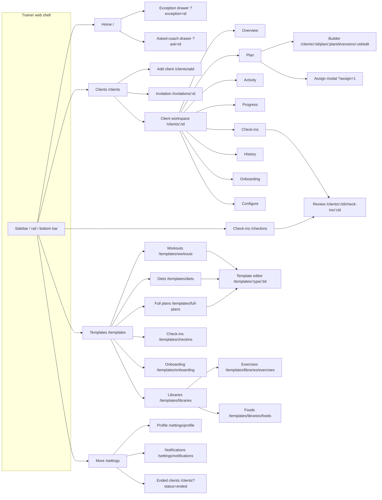

**Route table.** ✅ means the route exists in `apps/trainer-web/src/App.tsx`. 🆕 means it's proposed.

| Route | Screen | Status |
|---|---|---|
| `/sign-in` | TW-01 Sign in | ✅ |
| `/welcome` | TW-02 Trainer first-run | 🆕 |
| `/` (`?exception=:id`, `?ask=:id`, `?group=`) | TW-04 Home, plus the TW-05 and TW-32 drawers | ✅ (+ params 🆕) |
| `/exceptions/:exceptionId` | TW-05 fallback full page. Keep it for deep links, and have it render Home with the drawer open. | ✅ |
| `/clients` (`?q=&status=&adherence=&goal=&renewal=`) | TW-06 Roster | ✅ (+ `renewal` 🆕) |
| `/clients/add` | TW-07 Add client | ✅ |
| `/invitations/:invitationId` | TW-08 Pending invitation | 🆕 |
| `/clients/:rid` and `/overview` | TW-09 Overview | ✅ |
| `/clients/:rid/onboarding` | TW-10 Onboarding review | ✅ |
| `/clients/:rid/configure` | TW-11 Configuration (the tab label is "Configure") | ✅ |
| `/clients/:rid/plan` (`?assign=1`) | TW-12 Plan, plus the TW-16 Assign modal | ✅ (+ param 🆕) |
| `/clients/:rid/plan/:planId/versions/:versionId/edit` | TW-13 and TW-14 builders | 🆕 |
| `/clients/:rid/activity` (`?item=:type::id`) | TW-17 Activity | ✅ (+ param 🆕) |
| `/clients/:rid/progress` | TW-18 Progress | ✅ |
| `/clients/:rid/check-ins` | TW-19 Client check-ins | ✅ |
| `/clients/:rid/check-ins/:checkinId` | TW-20 Check-in review | ✅ |
| `/clients/:rid/history` | TW-21 History | ✅ |
| `/checkins` (`?view=due\|overdue\|submitted\|reviewed`) | TW-22 Inbox | ✅ (+ param 🆕) |
| `/templates` → redirects to `/templates/workouts` | TW-23 Templates hub | ✅ (+ redirect 🆕) |
| `/templates/:type` (`?scope=all\|bases\|mine&q=`), where type ∈ `workouts`, `diets`, `full-plans`, `checkins`, `onboarding`, `libraries` | TW-23 type tabs (D26) | 🆕 |
| `/templates/onboarding/:tid` | TW-24 Onboarding form builder | 🆕 route (the UI exists inline) |
| `/templates/checkins/:tid` | TW-25 Check-in form builder | 🆕 |
| `/templates/workouts/:tid`, `/templates/diets/:tid`, `/templates/full-plans/:tid` | TW-13 and TW-14 in template mode. API `templateType` maps to `workout`, `nutrition` and `combined`. | 🆕 |
| `/templates/libraries/exercises`, `/templates/libraries/foods` | TW-26 Libraries | 🆕 route (the UI exists inline) |
| `/settings`, `/settings/profile`, `/settings/notifications` | TW-28, TW-29 | 🆕 |
| `/go/:kind/:id` | The universal deep-link resolver (§3.5) | 🆕 |
| `*` | Not found. Change the current silent redirect to `/` into a TW-33 404 with a link home. | ✅ (change) |

### 1.7.2 Trainer mobile IA (target)

The mobile app currently has no navigation library. `TrainerShell.tsx` and `TraineeShell.tsx` switch tabs with `useState` and overlays, so there is no back stack and no deep linking. **Target: adopt React Navigation 7** (native stack plus bottom tabs) with a `linking` config ([R46]), or Expo Router. This guide assumes React Navigation, because the app isn't Expo Router–structured (`index.js` plus `App.tsx`). See OQ-6.

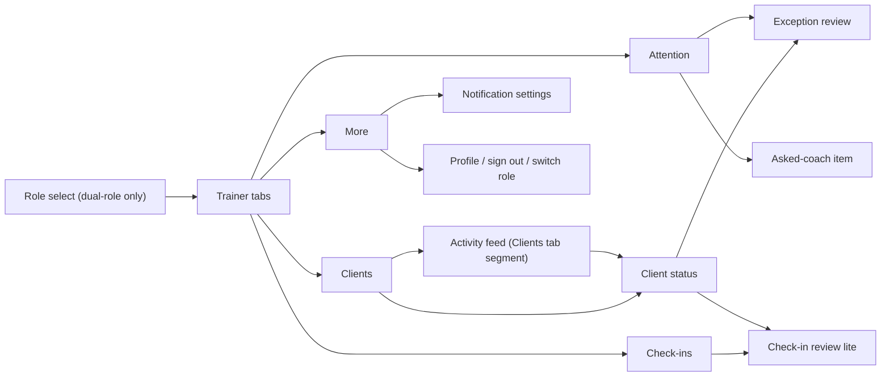

### 1.7.3 Trainee mobile IA (target)

The tabs are Today · Workout · Diet · Progress · More (UX §8). Check-ins appear in context from Today.

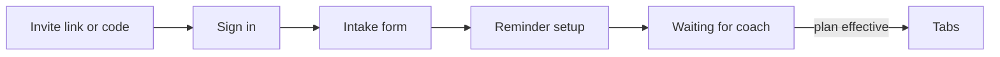

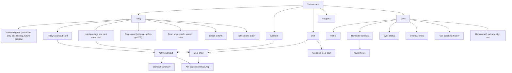

**Mobile route names** (React Navigation screen names, with the deep-link path each one maps to)

| Name | Path (`fitbud://` and `https://{appHost}/app/…`) | Screen |
|---|---|---|
| `Invite` | `/invite/:token` | TR-02 |
| `Intake` | `/intake` | TR-03 |
| `ReminderSetup` | `/setup/reminders` | TR-05 |
| `Waiting` | `/waiting` | TR-04 |
| `Today` (`date?`) | `/today/:date?` (YYYY-MM-DD, trainee-local) | TR-06 |
| `Diet` (`date?`) | `/diet/:date?` | TR-07 |
| `MealSheet` | `/meal/:assignmentId` | TR-08 (opens over Diet) |
| `MealPlan` | `/plan/diet` | TR-09 |
| `Workout` | `/workout/:assignmentId?` | TR-10 |
| `ActiveWorkout` | `/workout/:assignmentId/active` | TR-11 |
| `WorkoutSummary` | `/workout/:executionId/summary` | TR-12 |
| `Progress` | `/progress` | TR-13 |
| `Checkin` | `/checkin/:checkinId` | TR-14 |
| `Notifications` | `/notifications` | TR-15 |
| `ReminderSettings` | `/settings/reminders` | TR-16 |
| `QuietHours` | `/settings/quiet-hours` | TR-17 |
| `Sync` | `/settings/sync` | TR-19 |
| `Profile` | `/settings/profile` | TR-20 |
| `MealTimes` | `/settings/meal-times` | TR-24 |
| `FoodSearch` | `/meal/:assignmentId/foods` (modal) | TR-26 |
| `StepsSettings` | `/settings/steps` | TR-25 |
| `SignIn` · `CodeSignIn` · `ForgotPassword` · `SetPassword` | `/auth`, `/auth/code`, `/auth/forgot`, `/auth/set-password` | TR-01 |
| `PastCoaching` | `/settings/history` | TR-20 |
| `TrainerActivity` | `/coach/activity` | TM-09 |
| `TrainerAttention` · `TrainerClient` · `TrainerException` · `TrainerCheckin` · `TrainerAsk` | `/coach/attention`, `/coach/client/:rid`, `/coach/exception/:id`, `/coach/checkin/:id`, `/coach/ask/:id` | TM-01 to TM-06 |


# 2. Screen catalogue

**Reading each section:**
- "Current state" cites screenshot files. `shots/…` and `sbs/…` are in `/workspace/fitbud-impl/`. `screens/…` are the Figma exports in `/workspace/fitbud-ux/`. The embedded copies are in `/workspace/fitbud-guide/img/`.
- There are **no running screenshots of the Expo app**, because the mobile app was not run for this guide. For TM and TR screens, "current state" comes from reading the source files on `feat/iteration-a-backend`.
- API routes follow the Confluence endpoint catalogue (Current State and Iteration Guide, "Endpoint catalog"). `API-NEW` marks an endpoint or field this guide needs that doesn't exist yet. **Sub-action paths** (for example `…/acknowledge`, `…/resolve`, `…/inbox`) follow the catalogue's action names. The catalogue lists the actions but not every literal path, so confirm the exact path in `apps/api/src/routes/<area>.ts` (or the OpenAPI document at `apps/api/src/openapi/document.ts`) before wiring. Always call the API through `packages/api-client`.

## 2.1 Trainer web (TW)

### TW-01 · Sign in

> **Status:** Implemented (test identity only) · **Priority:** P0 (production auth) · **Route:** `/sign-in`, `/sign-in/code`, `/forgot-password`, `/set-password` · **Files:** `apps/trainer-web/src/pages/SignInPage.tsx` (inferred from `App.tsx` route), `AuthProvider` · **API:** `POST /auth/session`, `GET /me`, `DELETE /auth/session`; API-NEW `POST /auth/login`, `/auth/otp/start`, `/auth/otp/verify`, `/auth/password/reset`, `/auth/password/set` (§3.1a) · **Decision:** D18

1. **Purpose and user.** The trainer gets into their workspace. Most trainers sign in on a laptop, and some on a tablet.
2. **Entry points.** A direct URL, a redirect when the user has no session, sign-out, and session expiry (401).
3. **Current state.** `shots/d1440_01_signin.png`. An email field turns into a test identity. There's no password and no Firebase.

   {.shot}

4. **What's wrong or missing.**
   - Production sign-in isn't wired.
   - Any API failure, including a network failure, signs the user out (gap analysis, P0 #3).
   - There's no "Trainer accounts only" explanation for trainee emails.
   - There's no forgot-password or code sign-in.
   - The page has no brand moment.
5. **Target design** (D18).
   - **Layout:** split screen at ≥1024. The left half carries the brand gradient, the logo, the "Progress, guided." tagline and one line of value ("See who needs you today"). The right half is a 400 px form card. Below 1024 the page is a single column with no gradient panel.
   - **Default form, password:**
     - **Mobile number or email** (one field). If the input is all digits, show a +91 prefix hint. Normalise with `normalizeWhatsappE164`.
     - **Password**, with a show/hide toggle.
     - **Sign in** (primary).
     - Links: **Forgot password?** and **Sign in with a code instead**.
     - Small print: "Trainer accounts only. Clients use the FitBud app."
     - Footer: **Need help?**, which opens the support `mailto` (§1.6.10).
   - **Code sign-in (alternative):**
     - Step 1: the identifier and a **"Send code to"** choice:
       - **Email** (selected, the only live option);
       - **WhatsApp**, disabled, with a **"Coming soon"** chip and the note "Codes on WhatsApp are coming soon. For now we'll email your code; check spam if you don't see it." This applies while `wa_otp` is off (§1.6.11, D18).
       - When the flag is on, the choice disappears and the copy becomes "We'll send the same 6-digit code to your WhatsApp and your email. Use whichever arrives first."
     - Step 2: a 6-box code input (`autocomplete="one-time-code"`), "Sent to r•••@gmail.com" (with the flag on: "Sent to WhatsApp ••••1234 and r•••@gmail.com"), **Resend in 60 s**, and "Use password instead".
     - If the account has only one channel on file, name that one.
     - **No SMS option**, and no SMS fallback.
   - **Forgot password:** the same code (by email today; email plus WhatsApp once `wa_otp` is on), then **New password** (minimum 8 characters, a strength hint, no composition rules per NIST [R82]), then you're signed in.
   - **First sign-in for provisioned trainers:** sign in with a code, then a prompt to **Set a password** (you can skip it once).
   - **Data:** credentials or the code go to the FitBud auth endpoints (§3.1a), which return a Firebase custom token. The client calls `signInWithCustomToken`, then `POST /auth/session` with the ID token sets the HTTP-only session cookie. `GET /me` returns the roles.
   - **Copy:** title "Welcome back, coach". Errors are covered under States.
6. **States.**
   - *Loading:* the button shows a spinner and inputs are disabled.
   - *Error, wrong credentials:* "That mobile number or email and password don't match." The copy is generic, so it never reveals which part is wrong.
   - *Error, too many attempts:* "Too many tries. Wait 15 minutes or sign in with a code."
   - *Error, code wrong or expired:* "That code didn't work. Check the latest message or resend."
   - *Code sent (always shown, even for unknown identifiers):* "If an account exists, we've sent a code."
   - *WhatsApp leg unavailable* (flag off, which is today's state; budget cap, §4.5; or no mobile on file): the code goes by email only, with the copy "Sent to your email."
   - *Error, network:* "Can't reach FitBud. Check your connection and try again." Stay on the page and keep what was typed.
   - *Role:* a trainee-only role gets "This account is set up as a client. Open the FitBud app on your phone." plus the store links.
   - *Offline:* a banner, with submit disabled.
7. **Interactions and edge cases.**
   - Pressing Enter submits.
   - Password managers work (`autocomplete="username"` / `current-password` / `new-password`).
   - Pasting a 6-digit code fills all the boxes.
   - Session expiry mid-task sends the user to sign-in with `?next=` and then back to the same URL.
   - An account with both roles signs in to the trainer workspace.
8. **Notifications and deep links.**
   - `/go/...` links reached without a session go through sign-in, then continue to the original target (§3.5).
   - The OTP messages are **E-OTP** (email, live; sender `SYSTEM_EMAIL_FROM`, D30) and **W-OTP** (WhatsApp authentication template, built but behind `wa_otp`), see §1.6.11 and §4.2.
9. **References.**
   - Adopt: Firebase custom tokens [R80] https://firebase.google.com/docs/auth/admin/create-custom-tokens and Firebase password authentication [R81] https://firebase.google.com/docs/auth/web/password-auth
   - Adopt: NIST SP 800-63B password and OTP guidance [R82] https://pages.nist.gov/800-63-3/sp800-63b.html and the OWASP authentication and forgot-password cheat sheets [R84]
   - Adopt: WhatsApp authentication templates, with a copy-code button [R79] https://developers.facebook.com/docs/whatsapp/business-management-api/authentication-templates
   - Avoid: OTP-only login with no fallback. Cult.fit users report OTP failures [R39].
10. **UX decisions and why.**
    - Password by default means no per-login cost and no delivery dependency.
    - Email is the live code channel. The WhatsApp option is visible but disabled ("Coming soon"), so users learn it's planned without hitting a dead end. Once it's on, either channel can rescue a sign-in (D18).
    - Distinguish 401 from network errors so a flaky connection never logs the trainer out mid-review.
    - The brand gradient appears only here, on the trainee invite landing page and in onboarding (UX §15).
11. **Implementation.**
    - New `pages/auth/{SignInPage,CodeSignInPage,ForgotPasswordPage,SetPasswordPage}.tsx`.
    - API-NEW (§3.1a): `POST /auth/login`, `POST /auth/otp/start`, `POST /auth/otp/verify`, `POST /auth/password/reset`, `POST /auth/password/set`.
    - In `AuthProvider`, only a 401 response from `/me` clears the session. A `TypeError` or 5xx shows `ErrorState` with Retry.
    - Keep the test-identity path behind `import.meta.env.DEV`.
12. **Acceptance criteria.**
    - [ ] Signing in with a mobile number and password works, and so does email and password.
    - [ ] With `wa_otp` off (today): code sign-in emails the code from the configured sender, and the WhatsApp option is visibly disabled with "Coming soon" and the note.
    - [ ] With `wa_otp` on (tested in staging): one code goes to both WhatsApp and email, and either copy works. Only one code is valid at a time.
    - [ ] There's no SMS path anywhere.
    - [ ] At the WhatsApp budget cap, the code arrives by email only and the UI says so.
    - [ ] The responses never reveal whether an account exists.
    - [ ] Stopping the API while signed in shows an error state, not the sign-in page.
    - [ ] A 401 redirects to `/sign-in?next=<path>` and returns there after sign-in.
    - [ ] Trainee-only accounts see the client message.
    - [ ] The test identity is hidden in production builds.
13. **Priority:** P0.

---

### TW-02 · Trainer first-run onboarding

> **Status:** New-proposed · **Priority:** P1 · **Route:** `/welcome` · **Files:** `pages/WelcomePage.tsx` [new] · **API:** `GET /me`, `PUT /me/trainer-profile` [API-NEW: display name, WhatsApp business number, timezone], `GET /templates?scope=global`

1. **Purpose and user.** A new trainer reaches the first invite in under 3 minutes. They set up their profile, pick defaults and invite one client.
2. **Entry points.** The first sign-in when `trainer_profiles.display_name` is empty, or no client exists and the trainer hasn't dismissed `/welcome`.
3. **Current state.** None. New trainers land on an empty Home.
4. **What's wrong or missing.**
   - There's no guidance.
   - The trainer's own WhatsApp number isn't captured, but the trainee "Ask on WhatsApp" flow (TR-18) needs it.
   - The timezone is implicit.
5. **Target design.** A three-step card wizard with a progress bar.
   - **Step 1, "Your coaching profile":** display name (shown to clients), WhatsApp number (+91 prefilled, used for client "Ask coach" links), and timezone (detected, editable).
   - **Step 2, "Your starting templates":** a list of the global bases (onboarding form, check-in form, workout, nutrition), each read-only, with the note "You can use these as they are or make your own copy later." The only action is "Continue". Forking isn't forced.
   - **Step 3, "Invite your first client":** the TW-07 form embedded inline, with "Skip for now".
   - At the end: "You're set. FitBud will show you who needs attention here." The trainer lands on Home.
6. **States.**
   - Loading skeleton.
   - Save errors appear inline per field.
   - Leaving partway keeps the draft and returns the trainer to the step they were on.
7. **Interactions and edge cases.**
   - The WhatsApp number is validated with `normalizeWhatsappE164` from `packages/core/src/whatsapp.ts`. That function adds 91 to a 10-digit number.
   - The step can be skipped. TR-18 then degrades to "Your coach hasn't added WhatsApp" if no number exists.
8. **Notifications.** None.
9. **References.**
   - Adapt: the Everfit onboarding flow [R13] https://help.everfit.io/en/articles/8440572-introducing-onboarding-flow
   - Avoid: long setup tours (Fitbod's 20-screen onboarding [R40] works for consumers, not for professionals).
10. **UX decisions and why.**
    - The first invite is the activation moment, so the wizard ends on it.
    - The trainer's WhatsApp number is needed for D1. Today the number lives only on invitations (the client's number).
11. **Implementation.**
    - API-NEW: trainer profile fields `whatsappE164` and `timezone`. Check whether `users.timezone` already exists (it does per the data model: "Timezone is stored separately") and reuse it.
    - Route guard: a `RequireProfile` wrapper in `App.tsx`.
12. **Acceptance criteria.**
    - [ ] A brand-new trainer sees `/welcome` and can finish it in 3 steps or skip.
    - [ ] The WhatsApp number is normalised and saved.
    - [ ] The timezone is saved and later drives renewal states.
13. **Priority:** P1.

---

### TW-03 · App shell and navigation

> **Status:** Implemented (needs rework) · **Priority:** P0 (responsive) · **Files:** `apps/trainer-web/src/layout/AppShell.tsx`, `styles.css` · **Routes:** all authenticated routes

1. **Purpose.** Gives the trainer persistent orientation, global search and access to the five areas.
2. **Entry.** Every authenticated route.
3. **Current state.**
   - Sidebar order: Home, Clients, Templates & Libraries, Check-ins.
   - "Help & Support" is static text.
   - The bell links to `#attention-heading`.
   - Search goes to `/clients?q=`.
   - A brand lockup "FitBud Coach · Active Coaching" with a live dot.
   - At 390 px the sidebar stacks above the content and "Check-ins" is clipped (`shots/m390_02_home.png`).
   - The sidebar background ends at about 640 px on tall pages.
4. **What's wrong or missing.**
   - The navigation order and labels don't match UX §5.
   - There's no More or Settings entry.
   - The live dot implies a live status that doesn't exist.
   - The layout isn't responsive.
   - The bell has no notification surface.
5. **Target design.**
   - **Sidebar (≥1280, 240 px, sticky, full height):**
     - Logo.
     - Nav items: Home (badge = active attention count *when the API returns a total*; otherwise no badge), Clients, Check-ins (badge = submitted awaiting review), Templates, More.
     - At the bottom: the trainer's name and initials linking to `/settings/profile`, and **Help**, which opens the support `mailto:tech@thefitbud.com` with the screen context (D19, §1.6.10).
   - **Top bar:**
     - Page title.
     - Global search, which opens a command palette (⌘K or `/`) that searches clients by name and goal through `GET /clients?q=`, with Enter opening the workspace.
     - A **bell** that opens a 360 px popover listing trainer notifications (asked-coach items, check-ins submitted, renewals), each linking by deep link.
   - **Rail (1024–1279):** icons with tooltips.
   - **<768:** a top bar with the title and search icon, plus a **bottom navigation bar** of five items ([R47]).
6. **States.**
   - Offline: a banner at the top of the content area.
   - Counts are hidden while they load. Never show "0" before the data arrives.
7. **Interactions.**
   - Keyboard shortcuts: G then H goes Home, G then C to Clients, G then K to Check-ins, G then T to Templates, `/` focuses search, `?` opens the help sheet.
   - Navigation items show `aria-current="page"`.
8. **Notifications.** The bell popover is the web surface for trainer-side events (§4.3). Mark-read goes through `POST /notifications/:id/read`. The exact path follows the existing "mark read" route in `routes/notifications.ts`.
9. **References.**
   - Adopt: Material 3 navigation rail [R48] https://m3.material.io/components/navigation-rail/overview and navigation bar [R47] https://m3.material.io/components/navigation-bar/guidelines
   - Adopt: the TrueCoach dashboard's left navigation density [R1] https://truecoach.co/features/dashboard/
10. **UX decisions.**
    - The order Home, Clients, Check-ins, Templates, More follows UX §5 and puts daily tasks first.
    - Libraries live under Templates (as a sub-tab), not in the top-level navigation.
    - Remove the "Active Coaching" dot (banned, see §1.5).
11. **Implementation.**
    - Rework `AppShell.tsx` into `Sidebar`, `TopBar`, `BottomNav` and `CommandPalette` components.
    - Use CSS `position: sticky; height: 100dvh` for the sidebar.
    - Breakpoints use container queries or media queries at 768, 1024 and 1280.
    - Bell data: `GET /notifications?audience=trainer` [API-CHG: the list currently serves the recipient's own notifications, so check that trainer-recipient notifications exist for check-in submitted and asked-coach. If they don't, add those types, see §4.3].
12. **Acceptance criteria.**
    - [ ] No horizontal scroll at 360, 390, 768, 1024 or 1440.
    - [ ] The sidebar background fills the full viewport height on long pages.
    - [ ] The navigation order and labels match the target, and More reaches `/settings`.
    - [ ] The command palette finds a client by partial name in under 300 ms after the API responds.
    - [ ] The live dot is removed.
13. **Priority:** P0 (responsive, navigation order), P1 (bell, palette).

---

### TW-04 · Home triage

> **Status:** Implemented (needs rework) · **Priority:** P0 · **Route:** `/` · **Files:** `pages/HomePage.tsx`, `styles/home.css` · **API:** `GET /exceptions/attention` (limit 50), `GET /subscriptions/attention`, `GET /checkins/inbox` (trainer inbox route), `GET /relationships`, `GET /invitations`, plus `GET /coach-asks?status=open` [API-NEW, see TW-32]

1. **Purpose and user.** The trainer's first screen each morning, plus quick checks during the day. It answers "who needs me, why, and what do I do next".
2. **Entry.** Sign-in, the navigation, the bell, and push or email links to `/`.
3. **Current state.** `shots/d1440_02_home.png` and `m390_02_home.png`, with the side-by-side in `sbs/home.png`.
   - A greeting, 3 KPI tiles, filter chips (All / Needs Attention 50 / Today's Work 26), then an unbounded list of exception cards (50) with repeated "Active / Critical / Missed workout" pills.
   - The page is about 2,630 px tall and overflows at 390.

   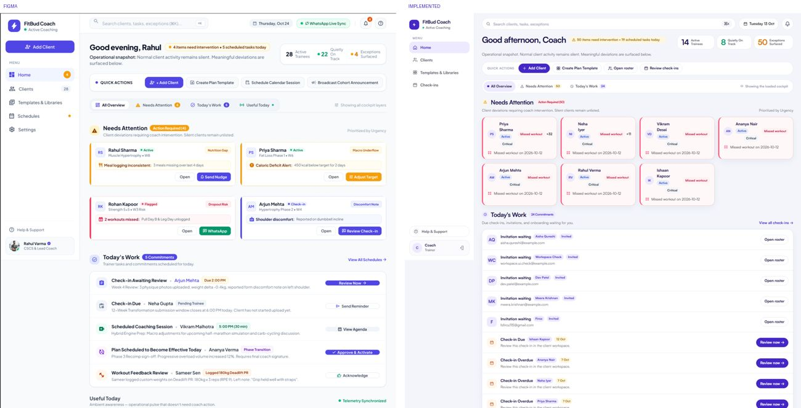{.shot}

4. **What's wrong or missing.**
   - It's unbounded: there's no grouping by client and no "View all".
   - There are no Acknowledged, Renewals or Asked-coach groups.
   - Pills repeat on every card.
   - The KPI tiles push the queue down.
   - Figma's version has banned elements: Live Sync, Dropout Risk and % rates.
5. **Target design.**
   - **Header row:**
     - H1 "Today", with the local date in the caption ("Wed, 14 Oct").
     - On the right, three **count tiles** that act as filters: *Needs attention N* · *Check-ins to review N* · *Renewals due N*. Clicking a tile filters the page.
     - Counts come only from API totals or bounded lists. Show "50+" when a list hits its cap.
   - **Sections** in fixed priority order. Needs attention shows up to **8** rows; the other sections show up to 5. Each ends with "View all (N)".
     1. **Needs attention, not yet reviewed: a row list, one row per client (D32).**
        - **Row anatomy**, left to right, in fixed columns so the eye scans straight down:
          1. **Avatar and name**: initials, then "Priya Sharma" (semibold).
          2. **The issue in plain words**: the most severe open reason as a sentence, for example "Missed 2 workouts (Mon, Wed)", "Lunch and Dinner not logged yesterday" or "Check-in 2 days overdue". If the client has more, add "+2 more" in muted text, with the full list in a tooltip.
          3. **One status chip**: the severity, *Critical* or *Attention*, with an icon. Only one chip per row: no lifecycle, adherence or "Active" chips here.
          4. **Age**: "since 2 d", meaning the time since the oldest open item for that client. The absolute date is in the tooltip.
          5. **One primary action**: **Review** (a button), which opens the TW-05 drawer on the most severe item. Secondary actions live in ⋯ (Acknowledge, Nudge, Open client, WhatsApp).
        - **Ordering:** severity (Critical before Attention), then age (oldest first), then name. The ordering is deterministic and shown in the section header's tooltip: "Sorted by severity, then how long it's been open."
        - **Cap:** about **8 rows**, then "View all (23)" opens the full list (`/?group=attention&all=1`), which uses the same rows, is paged and has a filter by severity.
        - **Wireframe (1280 px):**

          ```
          Needs attention · 23                    Sorted: severity, then age (i)
          ┌────────────────────────────────────────────────────────────────────┐
          │ (PS) Priya S.  Missed 2 workouts  +1  [Critical]   3 d  [Review] ⋯ │
          │ (AK) Arjun K.  Check-in 2 d overdue   [Critical]   2 d  [Review] ⋯ │
          │ (NR) Neha R.   Lunch, Dinner missed   [Attention]  1 d  [Review] ⋯ │
          │ …  up to 8 rows                                                    │
          └────────────────────────────────────────────────────────────────────┘
          View all (23) →
          ```

          Rows are 56 px tall with a 1 px divider, and the whole row is a hover target (`surface.hover`). The focused row has a 2 px indigo focus ring. Below 768 px the row wraps to two lines: name plus chip on the first, then issue plus age plus action. It's still a row, not a card.
        - **Keyboard** (WAI-ARIA grid pattern [R96]): the list is one tab stop.
          - ↑ and ↓ (or J and K) move between rows. Home and End jump to the first and last row.
          - Enter opens Review. A acknowledges, with Undo. N nudges. O opens the client. `.` opens the ⋯ menu.
          - Esc closes the drawer and returns focus to the same row.
          - Focus is restored after a refetch.
          - Screen readers hear "Priya Sharma, Critical, missed 2 workouts Monday and Wednesday, plus 1 more, open 3 days. Review button."
     2. **Asked you on WhatsApp** (TW-32). Rows read "Priya asked about *Lunch · Tue*". Primary: **Mark answered**. Overflow: Add note, Open item.
     3. **Check-ins to review.** Shows submitted check-ins awaiting a review, each with **Review** as the primary action.
     4. **Renewals.** Shows upcoming, due and expired renewals as a chip plus the date. Primary: **Open settings**, which opens TW-11. No amounts.
     5. **Reviewed, still open.** Acknowledged exceptions, collapsed by default ("4 reviewed items still open"). Each row shows the `ReviewedMarker`, with **Resolve** as the primary action.
     6. **Getting started.** Pending invitations and onboarding submitted for review, shown compactly. Primary actions: **Review intake** or **Resend invite** (the latter through WhatsApp or by copying the link).
     7. **Re-engage on WhatsApp** (D10, D31). Lists clients with no logs for 2–3 days whose reminders went unanswered.
        - Primary: **Open WhatsApp**, which opens `wa.me` with a **trainer-signed text** prefilled (W-RE-M, §4.2): a text message written as the trainer, which the trainer can edit. **FitBud never sends it.** The trainer presses Send in their own WhatsApp, so it costs nothing. It's text only, with no voice notes.
        - Opening WhatsApp records "Opened WhatsApp · today", so the row stays hidden for 3 days. FitBud can't know whether the message was sent, so it never says "Sent".
        - There's no automated re-engagement message, even when `wa_automation` is on (D31).
        - Max 5 rows.
   - Remove the greeting copy and the separate KPI tile row. The count tiles replace both.
   - **Copy:**
     - Empty all-clear: "You're all caught up. Nothing needs your attention right now."
     - Section empty states are hidden entirely (sections only appear when they have items).
6. **States.**
   - Skeletons per section.
   - A section error shows inline ("Couldn't load check-ins · Retry") while the other sections render.
   - Offline banner.
   - Partial: if the attention feed is capped at 50, show "Showing the 50 most recent. View all" linking to a full list view (`/?group=attention&all=1`).
7. **Interactions and edge cases.**
   - Grouping happens on the client (`traineeDisplayName` plus `relationshipId`) over the first page of attention items.
   - **Acknowledge from the overflow** is optimistic: the row moves to "Reviewed" with an undo toast.
   - Keyboard: J/K, Enter and A.
   - Clients whose relationship has ended never appear.
   - Realtime events are refetch hints only (Tech Arch). Refetch quietly, and keep the scroll position.
8. **Notifications and deep links.**
   - Trainer push and bell items deep-link to `/?exception=:id` (opens the drawer), `/?ask=:id` and `/clients/:rid/check-ins/:cid`.
   - The `/go/exception/:id` resolver maps to these.
9. **References.**
   - Adopt: the TrueCoach "Needs Attention" and "Due Soon" dashboard [R1] https://truecoach.co/features/dashboard/: a client-per-line triage list with the reason and a single action.
   - Adopt: the Everfit check-in dashboard's client-list triage [R6] https://help.everfit.io/en/articles/16000579-check-in-dashboard-manage-your-client-list: a tabular list, one client per row, sortable by status. See the image below.
   - Adapt: the Trainerize Client Insights dashboard [R17] https://help.trainerize.com/hc/en-us/articles/46648417703956-Using-the-Client-Insights-Dashboard. Use its grouping of clients by state; avoid its compliance-% tiles, which are banned here.
   - Adopt: the NN/g definition of cards [R95] https://www.nngroup.com/articles/cards-component/ (cards suit heterogeneous, browsable content, not scanning comparable items) and Material 3 lists and cards [R97].
   - Adopt: the WAI-ARIA Authoring Practices grid pattern and keyboard interface [R96] https://www.w3.org/WAI/ARIA/apg/patterns/grid/

   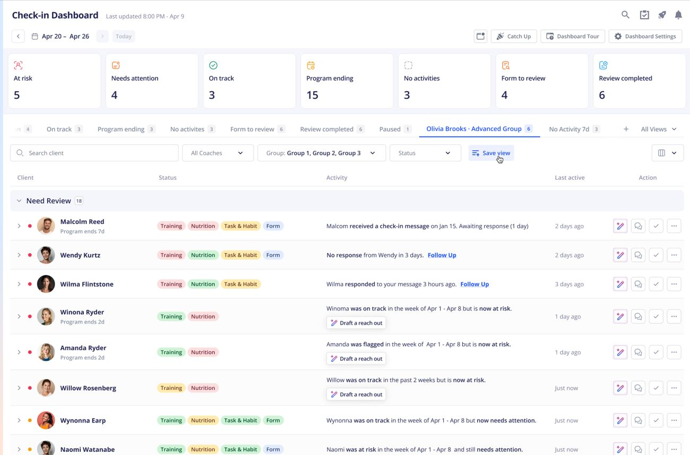{.shot}

10. **UX decisions and why.**
    - Grouping by client cuts 50 rows to about 15 and matches how trainers think ("Priya", not "exception 32").
    - **Rows, not cards, for web Needs attention (D32).** The comparison:

      | Criterion | Rows (chosen for web) | Cards |
      |---|---|---|
      | The task | Triage means scanning and **comparing many items of the same shape** to pick the next one. Lists are built for this. | Cards suit **heterogeneous** or browsable content, with each item read on its own [R95]. |
      | Density | About 8 clients in 500 px at 1280 px, with no scroll on a laptop | About 3–4 cards in the same space. The old Home was 2,630 px with 50 cards. |
      | Scannability | Fixed columns: name, issue, chip and age line up vertically, so the eye runs down one column at a time | Fields float inside each card, so the eye zig-zags |
      | Action position | The primary action sits in the same x position on every row, so it's muscle memory | It moves with the card's content height |
      | Visual noise | One chip per row, no borders or shadows per item | Card chrome repeats per item. The implemented version repeated three pills on each card. |
      | Keyboard | A natural grid model (↑↓, Enter) [R96] | Usually tab-through, which is slower |
      | Small screens and touch | Wraps to two lines at < 768 px. Acceptable for web. | **Better on phones:** large tap targets and swipe. **So trainer mobile keeps cards (TM-01).** |
      | Competitors | TrueCoach and Everfit use list or table triage [R1] [R6]. Trainerize groups clients by state [R17]. | Mostly marketing dashboards and the Figma mock (with banned % tiles) |

      The trade-off is less room for rich context (photos, sparklines) in each row. That context is one click away in the TW-05 drawer, which is where the decision is made.
    - One chip per row keeps severity as the only colour signal, which follows P12.
    - Fixed section priority means no sorting decisions for the trainer.
    - Re-engagement as trainer-signed text that the trainer sends themselves keeps WhatsApp outreach deliberate, rare and genuinely from the trainer (D10, D31).
    - The "Reviewed" section is collapsed so acknowledged items stay visible, as the contract requires, without dominating the page.
11. **Implementation.**
    - Split `HomePage.tsx` into `AttentionSection`, `AskSection`, `CheckinSection`, `RenewalSection`, `ReviewedSection`, `GettingStartedSection` and `ReengageSection`.
    - Each section uses its own query hook (independent loading and error).
    - API-NEW: `GET /exceptions/attention?groupBy=relationship` would be ideal (it returns counts per client). Without it, group on the client and show "50+".
    - API-NEW for Re-engage: `GET /notifications/reengagement-candidates`, returning clients with no trainee log for 48 h or more and 3 or more consecutive unanswered reminders, from the responsiveness read model (TW-31).
    - Remove the `limit=50` cards-only rendering.
12. **Acceptance criteria.**
    - [ ] Needs attention is a row list (not cards) with at most 8 rows, then "View all (N)". Other sections show at most 5.
    - [ ] One row per client, with exactly one status chip, ordered by severity, then age, then name.
    - [ ] Each row shows the avatar and name, the issue in plain words, the age and one primary action, in fixed columns.
    - [ ] Keyboard: ↑ and ↓ (and J and K), Enter, A, N, O and Esc work, and focus returns to the row after the drawer closes. axe reports no issues.
    - [ ] Re-engage opens `wa.me` with editable trainer-signed text, and nothing is ever sent by FitBud.
    - [ ] Acknowledge from the overflow moves the row to Reviewed without a page reload, with Undo.
    - [ ] There are no % values, no risk labels and no sync claims.
    - [ ] It works at 390 px with no horizontal scroll.
    - [ ] The Re-engage section never lists a client more than once in 3 days.
    - [ ] Every timestamp is relative, with the absolute time in a tooltip.
13. **Priority:** P0 (bounded, grouped, responsive, formatted). P1 (Asked-coach, Re-engage, Renewals).

---

### TW-05 · Exception detail: acknowledge and resolve drawer

> **Status:** Implemented (partial) · **Priority:** P0 · **Route:** `/?exception=:id` (drawer) and `/exceptions/:exceptionId` (full-page fallback) · **Files:** `pages/ExceptionDetailPage.tsx` (Acknowledge plus `resolveException`, around L101) · **API:** `GET /exceptions/:id`, `POST /exceptions/:id/acknowledge`, `POST /exceptions/:id/resolve`, `GET/POST /exceptions/:id/interventions`, plus nudge `{activityType, activityId}`

1. **Purpose.** Understand one problem, then acknowledge it (I've seen it) or resolve it (it's handled), with an optional note, plan adjustment or nudge.
2. **Entry.** Home rows, the Overview's open exception, the Activity feed, the bell, and push.
3. **Current state.** `shots/d1440_07_exception_detail.png` and `m390_07_exception_detail.png`.
   - The page shows Acknowledge and "Publish plan adjustment".
   - It shows a raw source UUID and "Rule mvp.v2".
   - Resolve exists in code but wasn't visible in the captured state.

   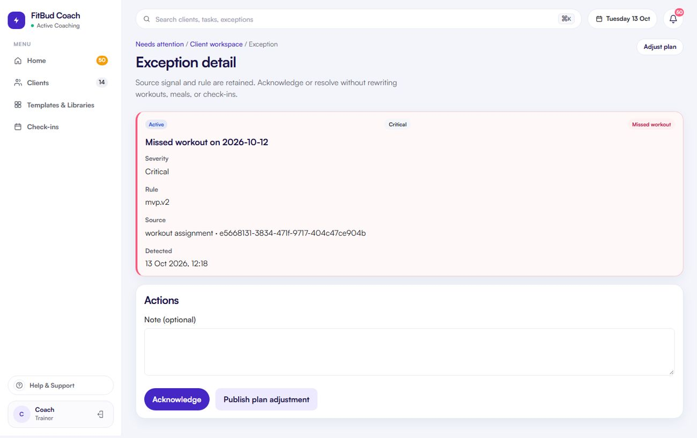{.shot}

4. **What's wrong or missing.**
   - Internal identifiers are exposed.
   - There's no source context, for example what the meal or workout was.
   - The difference between Acknowledge and Resolve isn't explained.
   - There's no nudge here.
   - It's a full page, so the trainer loses their place on Home.
5. **Target design.** A **right-hand drawer, 520 px wide.**
   - **Header:** client name, a severity chip and a close button.
   - **Body:**
     1. Reason sentence (H3): "Missed required workout · Upper body A · Mon 12 Oct".
     2. Source card: what was planned (a workout summary or the meal items), the window ("Due by 11:59 pm"), and what was logged (nothing, "Skipped" with a reason, or "Changed" with the deviation text and photo thumbnail).
     3. Signals: an `AskedCoachMarker` if the client asked on WhatsApp, and a reminder line ("Reminder sent 7:15 pm · not opened") from the responsiveness data (TW-31).
     4. Timeline: detected, acknowledged (by whom and when), notes.
   - **Sticky footer:**
     - **Primary**, which depends on state: *Mark reviewed* (acknowledge) when the item is active, or *Resolve* when it's acknowledged.
     - Secondary: *Nudge* (only if the activity is still actionable and not resolved).
     - Overflow ⋯: Add note, Adjust plan (opens TW-12 with context), WhatsApp client, Open client.
   - **Copy:**
     - Helper under the buttons: "*Mark reviewed* keeps this on the list as seen. *Resolve* closes it. The original log isn't changed."
     - Resolve opens an inline note field (optional), with outcome chips: "Talked to client", "Plan adjusted", "No action needed".
6. **States.**
   - Loading skeleton.
   - 404: "This item no longer exists". It may have been superseded by a plan change.
   - Already resolved: a read-only view showing "Resolved by you · 13 Oct" and no actions.
   - Ended relationship: read-only, with a banner.
   - Nudge rate-limited (`ACTIVITY_NUDGE_HOURLY_LIMIT = 3`): the button is disabled with "You can nudge again in 40 min".
   - The client has quiet hours on: "Nudge will arrive after 7:00 am (client's quiet hours)."
7. **Interactions.**
   - Esc closes the drawer.
   - Arrow up and down move to the previous or next Home item while the drawer stays open (a triage flow).
   - Actions are idempotent, with keys reused on retry.
   - Undo for Mark reviewed lasts 5 s (a client-side delay before the POST, or a compensating action if the API supports it. Today it doesn't, so use the delay).
8. **Notifications and deep links.** `/go/exception/:id` goes to `/?exception=:id`. The full-page route renders Home with the drawer open.
9. **References.**
   - Adapt: TrueCoach "Needs attention" actions [R1].
   - Adopt: the drawer pattern for detail without losing context (no specific external page, so this is FitBud's own decision).
   - Avoid: the merged "Acknowledge & Adjust" from the Stitch reference (`sbs/client_detail_stitch.png`).
10. **UX decisions.**
    - Two distinct verbs with helper copy enforce the contract (Acknowledge is not Resolve).
    - The drawer keeps triage speed: a trainer can clear 10 items without page loads.
    - Show reminder context so the trainer doesn't nudge someone who never got the reminder.
11. **Implementation.**
    - New `components/drawers/ExceptionDrawer.tsx`, reusing the data loading from `ExceptionDetailPage.tsx`.
    - `ExceptionDetailPage` renders `<HomePage drawer="exception">`.
    - Remove `sourceId` and `ruleVersion` from the UI.
    - API-CHG: the detail response should embed a source summary (planned item title, window, logged result). Without that, fetch the source by `domainEntityType` and id.
12. **Acceptance criteria.**
    - [ ] No UUID or rule version is visible.
    - [ ] Mark reviewed and Resolve are separate, and the helper copy is present.
    - [ ] Resolve accepts an optional note, saved as an intervention of kind `resolve` (and `note` when text is entered).
    - [ ] Nudge respects the rate limit and quiet hours, with explanatory copy.
    - [ ] The drawer works with the keyboard, and focus is trapped.
13. **Priority:** P0.

---

### TW-06 · Client roster

> **Status:** Implemented (needs polish) · **Priority:** P1 · **Route:** `/clients?q=&status=&adherence=&goal=` · **Files:** `pages/ClientsPage.tsx` (`listClients`, "Client Roster"), `styles/clients.css` · **API:** `GET /clients` (repeatable `status`, `adherenceState`, `goal`, plus `q`, `cursor`, `limit` 30/50)

1. **Purpose.** Find a client and see each client's state at a glance.
2. **Entry.** Navigation, search, and the Home "View all" link.
3. **Current state.** `shots/d1440_03_clients.png`, `m390_03_clients.png` and `sbs/clients.png`.
   - 14 rows.
   - Facets are three rows of plain text.
   - "No short goal" and "No effective plan" are repeated in bold.

   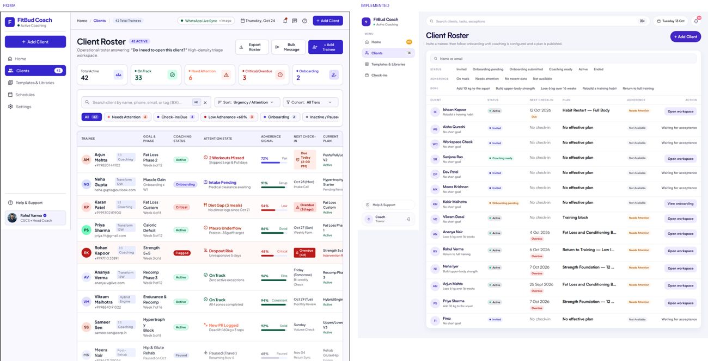{.shot}

4. **What's wrong or missing.**
   - The filters take up a lot of height and have no visible selected state at rest.
   - Empty values are noisy.
   - Truncated plan names have no tooltip.
   - At 390 the table doesn't reflow.
   - Ended clients aren't separated out.
   - There's no renewal filter.
5. **Target design.**
   - **Header:** H1 "Clients" with the count ("14 active"), and a primary **Add client** button.
   - **FilterBar:** a search box, then pills for Status (Invited, Onboarding, Ready to coach, Active), Adherence (On track, Needs attention, No recent data, Not available), Goal and Renewal (Upcoming, Due, Expired). Each option shows a live count once the API supports it (API-NEW: facet counts). Selected pills are filled lavender, and a **Clear** link resets them.
   - A segmented control: **Current · Ended** (`status=ended`, see TW-30).
   - **Table columns:**
     - Client: initials avatar, name, and goalShort in the caption.
     - Status chip.
     - Adherence chip.
     - Next check-in, in relative form.
     - Plan, truncated with a `title` attribute.
     - Renewal chip, only when it isn't current.
     - Action: one contextual button. Pending invite: *Resend invite*. Onboarding submitted: *Review intake*. Coaching ready: *Set up plan*. Active: *Open*.
   - Empty values show a muted "—".
   - **<768:** stacked cards with name, chips, the next check-in and the action.
6. **States.**
   - Skeleton rows.
   - Empty with no clients: "No clients yet. Invite your first client to start coaching." with an **Add client** button.
   - Empty after filtering: "No clients match these filters" with **Clear filters**.
   - Error with Retry, replacing the current API-error panel (`shots/d1440_97_clients_api_error.png`).
   - Pagination: "Load more" (cursor) at the bottom.
7. **Interactions.**
   - Filters update the URL query, so the browser back button restores them.
   - The cursor resets when a filter changes (already contracted).
   - Row click opens the workspace. Invited rows can't open a workspace. They open the TW-08 invitation detail instead.
   - Keyboard: ↑/↓ moves through rows, Enter opens.
8. **Notifications.** None.
9. **References.**
   - Adopt: Everfit client-list filters and segments [R8] https://help.everfit.io/en/articles/3365958-client-list-filter-and-segment-clients
   - Avoid: Figma's adherence % bars, Flagged and Paused, and Bulk message and Export (§1.5).
10. **UX decisions.**
    - One contextual action per row follows UX §11.
    - "Ended" is a separate view rather than a status mixed into active work.
11. **Implementation.**
    - Rewrite `ClientsPage.tsx` around `GET /clients` only. Per the Current State guide, the screen still reads invitations and relationships separately in one place, so reconcile that.
    - Move to a shared `FilterBar` and `ClientRow`.
    - API-NEW: the `renewal` filter and facet counts.
12. **Acceptance criteria.**
    - [ ] The filters fit on one row at 1280.
    - [ ] Filter state lives in the URL.
    - [ ] Empty values show "—".
    - [ ] Every row has exactly one action.
    - [ ] Cards stack at 390.
    - [ ] Ended clients appear only in the Ended view.
13. **Priority:** P1 (P0 for the 390 px reflow).

---

### TW-07 · Add client (invite)

> **Status:** Implemented · **Priority:** P1 · **Route:** `/clients/add` (`/clients/new` redirects) · **Files:** `pages/AddClientPage.tsx` · **API:** `POST /invitations` (email, displayName, WhatsApp digits, optional `onboardingFormTemplateId`), `GET /onboarding/form-templates`

1. **Purpose.** Invite a client with the right onboarding form.
2. **Entry.** The Clients header, Home "Getting started", the first-run wizard, and the empty roster.
3. **Current state.** `shots/d1440_04_clients_add.png`. A four-step stepper (Invite · Trainee accepts · Onboarding form · Review and configure). Template pinning and a preview of the latest version are present.

   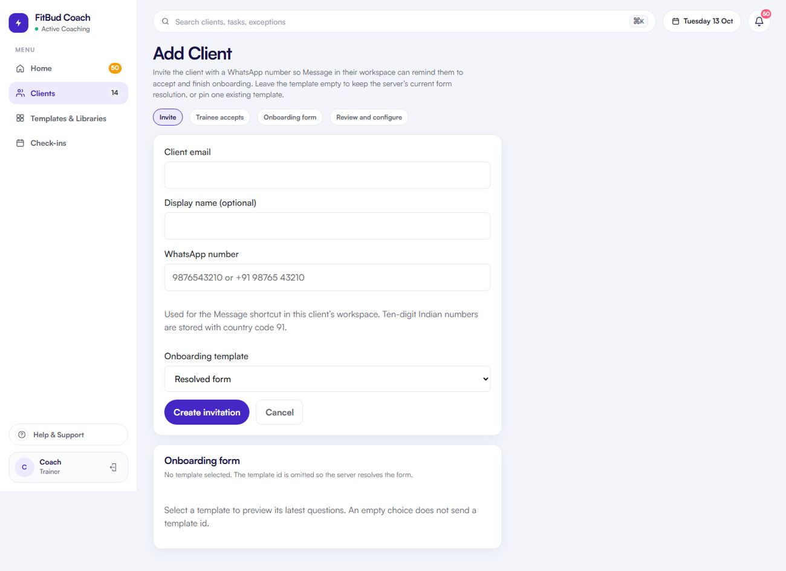{.shot}

4. **What's wrong or missing.**
   - After creation there's no share step. The raw token is returned **once** and must be delivered.
   - There's no QR code.
   - There's no invite link URL; the mobile `AcceptInviteScreen` expects a pasted token.
   - The WhatsApp number can't be edited later (a documented gap).
5. **Target design.**
   - **Left column:** the form.
     - Client name.
     - Email (required, because it's one of the two OTP channels and the account email, D18).
     - Mobile / WhatsApp number (+91 prefilled, strongly recommended). Helper: "Your client can sign in with this number, and you can message them on WhatsApp from FitBud." (When the WhatsApp flags are on, the helper adds "…and get sign-in codes and reminders on WhatsApp.") It's stored as the client's sign-in mobile and contact number. It can be edited later (OQ-24 default).
     - Onboarding form: a select with "FitBud standard intake (global)" as the default, plus the trainer's own forms. A "Preview" link opens the trainee-view preview in a modal.
   - **Right column:** a "What happens next" stepper, kept from today.
   - **After submit, a success panel replaces the form:**
     - "Invite ready for Priya".
     - Primary: **Send on WhatsApp**, opening wa.me with the prefilled invite (§4.4 W-INV).
     - The prefill is **trainer-signed text** that the trainer can edit. FitBud never sends it on the trainer's behalf (D31).
     - Secondary: **Copy invite link**, **Email invite** (E-INV, sent from `SYSTEM_EMAIL_FROM`, D30) and a **QR code** (for in-person gym sign-up).
     - A note: "This link works once and expires in 14 days. Your client will set a password when they join."
     - A link to "Invite another client".
6. **States.**
   - Submitting.
   - A duplicate active invite for the same email: "Priya already has a pending invite · Resend instead".
   - **The email or mobile belongs to a client you coached before** (ended relationship with you): "Priya coached with you until 3 Oct. Reactivate instead? Her history and your notes come back." The primary action becomes **Reactivate**, which runs the TW-30 flow (D21).
   - The client is currently coached by another trainer: "This client already has an active coach." The invite is still created. On acceptance the trainee is asked to end the other coaching first (one active relationship, decision G).
   - A validation error appears inline.
   - Offline: disabled.
7. **Edge cases.**
   - Losing the token: if the trainer navigates away before sharing, TW-08 offers "Create a new link" (API-NEW: re-issue the token, invalidating the old one).
   - With no WhatsApp number, only Copy, Email invite and QR are offered.
8. **Deep links.** The invite link is `https://{appHost}/i/{token}` [API-NEW host, OQ-2]. It opens the app if installed (TR-02); otherwise a web landing page with store links that carries the token through install (deferred deep link, or manual paste as a fallback).
9. **References.**
   - Adopt: the Everfit public client invite link [R14] https://help.everfit.io/en/articles/5369004-public-client-invite-link
   - Adapt: Trainerize "How to add clients" [R19] https://help.trainerize.com/hc/en-us/articles/208689066-How-To-Add-Clients-To-ABC-Trainerize
   - Reference: WhatsApp click to chat [R41] https://faq.whatsapp.com/5913398998672934/?locale=en_US
10. **UX decisions.**
    - Most Indian trainers onboard over WhatsApp, so sending the link is the primary action after create.
    - The QR code covers walk-in gym clients.
11. **Implementation.**
    - Add `InviteShareCard` in `components/invite/`.
    - Build the wa.me link with the shared `packages/core/src/whatsapp.ts` helper.
    - Generate the QR code client-side, for example with `qrcode` (an npm package).
    - API-NEW: return an `inviteUrl` (built on the server from a configured host) instead of making the client concatenate it.
12. **Acceptance criteria.**
    - [ ] After create, the trainer can send the invite on WhatsApp in one click, and the message contains the link.
    - [ ] Copy link and QR code work.
    - [ ] A duplicate email is handled.
    - [ ] Template pinning is unchanged.
13. **Priority:** P1 (P0 for the link URL, since the trainee flow depends on it).

---

### TW-08 · Pending invitation detail

> **Status:** New-proposed · **Priority:** P2 · **Route:** `/invitations/:invitationId` · **Files:** `pages/InvitationPage.tsx` [new] · **API:** `GET /invitations/:invitationId`; re-issue or revoke [API-NEW]

1. **Purpose.** Manage an invite that hasn't been accepted yet. Invited clients have no workspace (contract: "Do not invent a workspace id for a pending invite").
2. **Entry.** An invited roster row, or a Home "Getting started" row.
3. **Current state.** Roster rows show "Waiting for acceptance" with a WhatsApp Remind button. There's no detail view.
4. **What's wrong or missing.** The trainer can't see the pinned form, when the invite was sent, or how to resend or revoke it.
5. **Target design.**
   - A compact page. The card shows name, email, WhatsApp, "Invited 12 Oct", the pinned onboarding form name and version ("FitBud standard intake · v3", with Preview), and a status chip (Invited).
   - Actions:
     - Primary: **Remind on WhatsApp**, prefilled (§4.4 W-INV-R).
     - Secondary: *Copy new link* (re-issue).
     - Overflow: *Revoke invite*, after a confirm step.
6. **States.**
   - Accepted already: redirect to the client workspace.
   - Revoked: read-only, with "Revoked on…".
7. **Edge cases.** Re-issuing invalidates the old token. The confirm copy says so: "The old link will stop working."
8. **Deep links.** None.
9. **References.** No strong external reference. It's a FitBud-specific need.
10. **UX decisions.** Keeps the invitation and relationship models separate, matching the contract.
11. **Implementation.** API-NEW: `POST /invitations/:id/reissue` and `POST /invitations/:id/revoke`.
12. **Acceptance criteria.**
    - [ ] The pinned form version is shown.
    - [ ] Re-issue returns a new link and the old one fails.
    - [ ] An accepted invite redirects to the workspace.
13. **Priority:** P2.


---

### TW-09a · Client workspace header (shared by all workspace tabs)

> **Status:** Implemented (needs rework) · **Priority:** P0 · **Files:** `pages/ClientWorkspaceLayout.tsx`, `styles/workspace.css` · **API:** `GET /workspaces/relationships/:relationshipId` (header: display name, onboardingStatus, goalShort, adherenceState, traineeProfile age/gender, effective plan, renewal state)

1. **Purpose.** Keeps the trainer oriented across tabs: who the client is, their state, and the one next action.
2. **Entry.** Any `/clients/:rid/*` route.
3. **Current state.** The header has the correct contracted fields, but the meta line is one long run-on string (`sbs/overview.png`). Tabs: Overview, Plan, Activity, Progress, Check-ins, History (Onboarding and Configure open from the More menu). An unknown id still shows "Client 00000000" with Message enabled (`shots/d1440_98_client_not_found.png`).
4. **What's wrong or missing.** The hierarchy is weak. Message is enabled on errors. There's no asked-coach or reminder signal. Mobile layout is missing.
5. **Target design.**
   - **Row 1:** avatar initials · **name** (H1) · lifecycle chip · adherence chip.
   - **Row 2:** meta in body-sm, separated by ·: goalShort · plan title (linked to Plan) · "Next check-in Fri 16 Oct" · "34 · Female" (only when present) · renewal chip (only when not current).
   - **Row 3, time and schedule signals (D22, D24):**
     - `TimezoneBadge`, for example "🕐 Priya's time 6:10 am · 5 h 30 m behind you". It's hidden when the offsets are equal, and refreshes every minute.
     - A **"Custom meal times"** chip when the trainee has changed any meal time (D24). It links to the Plan tab's week strip, which shows plan time against client time.
   - **Right:** one **primary** CTA chosen by state:

     | State | Primary CTA |
     |---|---|
     | Onboarding submitted | Review intake |
     | Coaching ready | Set up coaching |
     | Active, open check-in submission | Review check-in |
     | Active, open Critical exception | Review issue |
     | Otherwise | Adjust plan |
     | Ended (this trainer) | **Reactivate coaching** (TW-30, D21) |

   - **Secondary:** a **WhatsApp** button (disabled with the tooltip "No WhatsApp number on file" when the number is missing).
   - **Overflow ⋯:** Configure coaching, Onboarding answers, Reminder settings for this client, **Add note** (TW-34), End coaching (TW-30).
   - **Tabs:** Overview · Plan · Activity · Progress · Check-ins · History. A count badge shows only on Check-ins (submitted awaiting review).
   - Never show an exception count in the header (contract).
6. **States.**
   - Header skeleton.
   - 404: replace the whole workspace with "Client not found" and a "Back to clients" button. No fake header, no Message button.
   - Ended: a neutral banner under the header ("Coaching ended 3 Oct. Read-only."), with all mutating CTAs hidden except **Reactivate coaching**.
7. **Interactions.** The header stays sticky on scroll and collapses to one line (name and chips) after 120 px of scroll.
8. **Deep links.** `/go/client/:rid` opens Overview.
9. **References.** Adapt the persistent client header from the TrueCoach client profile [R1]. Avoid the Stitch header's biometrics (`sbs/client_detail_stitch.png`).
10. **UX decisions.** The state-driven single CTA follows UX §14. WhatsApp stays secondary and is never the primary action (UX §15).
11. **Implementation.**
    - New `components/workspace/WorkspaceHeader.tsx`.
    - Derive the CTA in a pure function `primaryActionFor(header)` in `packages/core` so trainer mobile can reuse it.
    - Stop the retry on 404 (gap analysis: 4 failed requests).
    - API-CHG: the workspace header adds `traineeTimezone` (IANA name) and `hasCustomMealTimes` (boolean). The trainer's timezone comes from `GET /me`.
12. **Acceptance criteria.**
    - [ ] Meta items are separate spans, and missing values are omitted rather than shown as "No …".
    - [ ] A 404 shows no header.
    - [ ] Ended hides the CTA.
    - [ ] Exactly one primary CTA.
    - [ ] The time difference shows when the timezones differ, and is hidden when they're the same.
    - [ ] The "Custom meal times" chip appears within one refresh of the trainee changing a time.
13. **Priority:** P0.

---

### TW-09 · Client overview

> **Status:** Implemented (needs rework) · **Priority:** P0 · **Route:** `/clients/:rid` and `/clients/:rid/overview` · **Files:** `pages/ClientOverviewPage.tsx` · **API:** the workspace read (overview: plan, renewal, one open exception, next check-in, ≤5 recent activity, progress summary)

1. **Purpose.** A one-screen "how is this client doing and what's next".
2. **Entry.** Roster, Home, search.
3. **Current state.** `shots/d1440_10_client1_overview.png`, `m390_10_client1_overview.png`. Equal-weight tiles. Raw ISO text "2026-10-07T14:56:05.25Z" and "Window ends 14/10/2026, 00:00:00".

   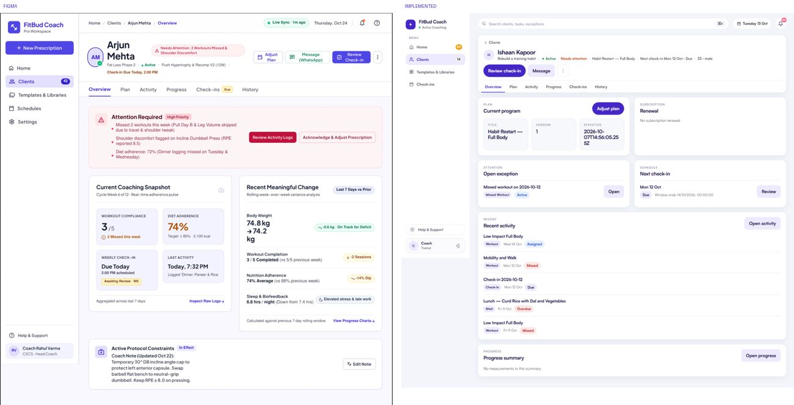{.shot}

4. **What's wrong or missing.** No visual priority. Raw timestamps. No weekly consistency. No reminder responsiveness. No asked-coach items. No trainer note.
5. **Target design.** A two-column grid at ≥1024 (8/4), one column below that.
   - **Left column (8):**
     1. **Needs attention** card, only when it applies: the one open exception (contract: show one, not a counted backlog), using the `ReasonLine`, a severity chip and *Review*, which opens the TW-05 drawer.
     2. **This week** card: `WeeklyConsistency` dots, "3 of 4 workouts · 17 of 21 meals · Check-in due Fri". Counts, never %. Under the dots is a compact **Today's nutrition** line in the client's day: "1,240 / 1,850 kcal · P 62/90 g · C 140/210 g · F 38/55 g", with "≥" when there are unknown values. It uses the same totals as the trainee rings (D25, D28).
     3. **Recent activity:** up to 5 rows (logged, changed, skipped, logged late, missed), each with a status chip and relative time, plus "View all activity".
   - **Right column (4):**
     1. **Next check-in** (date, form name, *Open*).
     2. **Plan** (title, "Effective since Mon 5 Oct", version caption "v3", *Open plan*). When the trainee has changed meal times: "Priya changed 2 meal times · Lunch 1:30 → 2:30 pm" (D24).
     3. **Reminders** (TW-31 summary line: "Responds to reminders · 5 of 7 this week" or "Reminders paused by client", with *Details*).
     4. **Progress** (latest weight and change since start, with a sparkline when ≥2 points; otherwise "No weigh-ins yet").
     5. **Renewal** (chip and date, only when not current).
     6. **Coach notes** (latest 3 notes, each with a "Private" or "Visible to client" badge, plus *Add note*, which opens TW-34 with the visibility switch, D20).
6. **States.**
   - Each card loads independently.
   - Empty plan: "No plan yet · Set up plan".
   - Empty activity: "No activity logged yet. Activity appears once Priya starts logging."
   - Not available (coaching not ready): replace the left column with a guided "Next step" card (Review intake or Configure coaching).
7. **Interactions.** Card titles link to their tab. Everything else is read-only here.
8. **Deep links.** `/go/client/:rid`.
9. **References.**
   - Adapt: the Trainerize Client Insights layout [R17] https://help.trainerize.com/hc/en-us/articles/46648417703956-Using-the-Client-Insights-Dashboard, using its grouping only and **not** its % scores.
   - Adopt: Figma's overview card density (`screens/trainer_05_client_overview.png`) once the banned metrics are removed.
10. **UX decisions.** Ordering attention, then this week, then activity answers "is there a problem, how's the week, what happened". Static plan info moves to the side.
11. **Implementation.**
    - Split into `OverviewAttentionCard`, `WeekCard`, `RecentActivityCard`, `SideCards`.
    - Weekly consistency needs API-NEW `GET /workspaces/relationships/:rid/week?start=YYYY-MM-DD` returning `{workouts:{assigned,completed}, meals:{assigned,logged}, days:[{date, state}]}`, or derive it from the activity pages. A server read model is preferred so trainee and trainer always agree.
    - Use `format.ts` for every date.
12. **Acceptance criteria.**
    - [ ] No raw ISO.
    - [ ] The attention card is first when present.
    - [ ] Weekly counts match the trainee TR-06 numbers for the same week.
    - [ ] Today's kcal and macros match the trainee rings for the same day.
    - [ ] No % anywhere.
    - [ ] Single column at 390.
13. **Priority:** P0 (formatting, hierarchy), P1 (week card, reminders card).

---

### TW-10 · Onboarding review

> **Status:** Implemented · **Priority:** P1 · **Route:** `/clients/:rid/onboarding` · **Files:** `pages/OnboardingReviewPage.tsx` · **API:** `GET /onboarding/relationships/:rid`, `POST /onboarding/relationships/:rid/review` (outcome `coaching_ready`)

1. **Purpose.** Read the intake answers and mark the client ready for coaching.
2. **Entry.** Home "Getting started", the roster action *Review intake*, the header CTA, and a push "Priya finished her intake".
3. **Current state.** `shots/d1440_10_client1_onboarding.png`. Answers are listed. The primary action is Configure Coaching.

   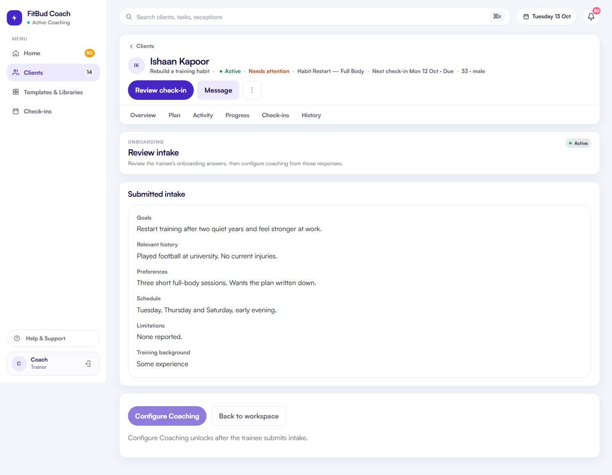{.shot}

4. **What's wrong or missing.**
   - Answers are a flat list.
   - Key safety answers (injuries, medical conditions, if present in the form) are not surfaced.
   - The order "mark ready, then configure" isn't explained.
   - The pinned form version isn't shown.
5. **Target design.**
   - **Header:** "Intake · submitted Mon 12 Oct · FitBud standard intake v3".
   - **Answers grouped by form section**, shown as definition rows (question label, answer). Yes/No answers render as text, not toggles. Multiple-choice answers render as chips.
   - **"Worth noting" summary at the top:** answers to questions the template flags as `highlight` (for example injuries or medications), shown verbatim. API-NEW: a per-question `highlight` flag in the form schema. Without it, show nothing; never infer.
   - **Sticky footer:** primary **Mark ready & configure** (performs the review, then routes to TW-11). Secondary: *WhatsApp client* (prefilled "Thanks for filling your intake…").
6. **States.**
   - Not submitted yet: "Priya hasn't submitted her intake yet. Last saved 2 h ago." (only if the draft time is available), plus *Remind on WhatsApp*.
   - Already reviewed: read-only, "Marked ready 13 Oct".
7. **Edge cases.** Long text answers are clamped to 6 lines with *Show more*. Number answers show the unit if the question defines one.
8. **Deep links.** `/go/intake/:rid`.
9. **References.**
   - Adapt: Trainerize onboarding forms [R20] https://help.trainerize.com/hc/en-us/articles/48660477450388-How-to-Create-and-Manage-Onboarding-Forms
   - Adapt: Everfit forms [R16] https://everfit.io/forms/
10. **UX decisions.** Combining review and configure removes a dead-end. The review is still recorded separately, per the contract.
11. **Implementation.** Reuse the `FormRenderer` in read mode. The CTA calls review and then navigates.
12. **Acceptance criteria.**
    - [ ] Answers are grouped and typed.
    - [ ] One click marks ready and opens Configure.
    - [ ] The pinned version is shown.
13. **Priority:** P1.

---

### TW-11 · Coaching configuration ("Configure")

> **Status:** Implemented (needs rework) · **Priority:** P1 · **Route:** `/clients/:rid/configure` · **Files:** `pages/ConfigureCoachingPage.tsx` · **API:** `GET/PUT /configurations/relationships/:rid[/draft]`, `POST …/configure`, `POST …/activate`, `POST …/versions`; `GET/PUT /relationships/:rid/subscription`; `GET/PUT` reminder rules (notifications routes)

1. **Purpose.** Set the coaching baseline: goal, workout and nutrition expectations, check-in cadence, tracking requirements, subscription dates, and (new here) **automatic reminders on or off per category**.
2. **Entry.** After TW-10, the header overflow, and the Home Renewals CTA.
3. **Current state.** `shots/d1440_10_client1_configure.png`. A long page (about 2,000 px) with every section expanded. It fires 404s for clients with no subscription or configuration. It doesn't load reminder rules.

   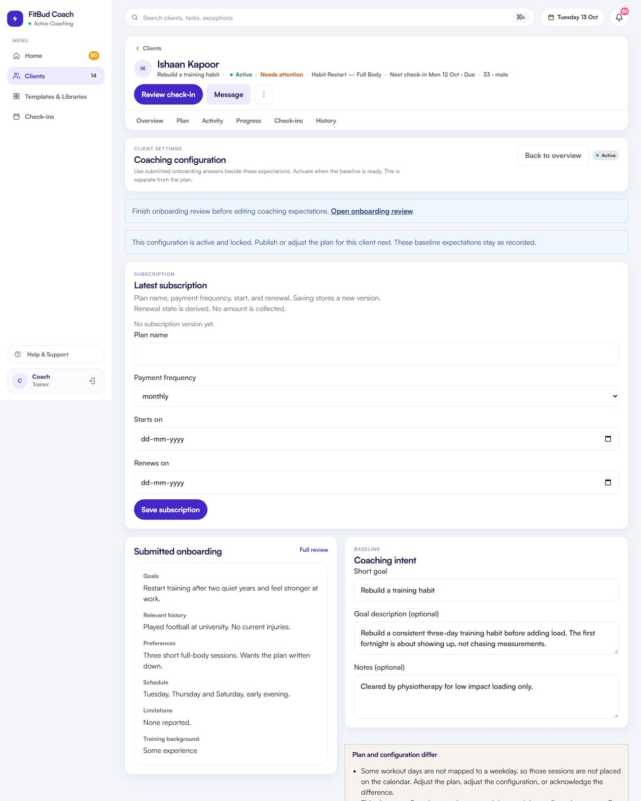{.shot}

4. **What's wrong or missing.**
   - No progressive disclosure.
   - Reminder toggles are missing (the contract says showing them is a wiring task).
   - Empty 404s show as console errors.
   - The draft, configured and active lifecycle is unclear to trainers.
5. **Target design.** An **accordion** with a summary line on each collapsed section.

   | Section | Fields | Collapsed summary example |
   |---|---|---|
   | Goal | goalShort (required, 120, live counter), goalDescription (500) | "Lose 6 kg by March · description added" |
   | Workouts | sessions per week (stepper 1–7), completion window | "4 sessions/week · log within 24 h" |
   | Nutrition | meals per day, confirmation window, photo requirement (none, selected meals, all meals) | "5 meals/day · photo for lunch & dinner" |
   | Check-ins | cadence (weekly, biweekly, monthly), due window hours, form (select from check-in templates, TW-25) | "Weekly · 48 h window · Standard check-in" |
   | Tracking | body weight, progress photos, session RPE (switches) | "Weight weekly · photos · RPE" |
   | **Automatic reminders** | Workout, Meal, Check-in switches (the `reminder_rules` booleans) plus a read-only note | "On for workouts and meals · off for check-ins" |
   | Subscription | plan name, payment frequency, start date, renewal date (no amounts) | "Monthly · renews 1 Nov" |

   - The **Automatic reminders** note reads: "FitBud times reminders around Priya's meal times and workout time, only when something isn't logged, and never in her quiet hours (10 pm–7 am). Priya controls her own notification settings and can adjust her meal times." When she has changed any times, the note adds "Priya's meal times: Lunch 2:30 pm (plan 1:30 pm)" (D24).
   - **WhatsApp reminders** status line (read-only). While `wa_automation` is off, which is today's state: "WhatsApp reminders · **Coming soon**. FitBud reminds Priya in the app for now." When it's on: "WhatsApp reminders: opted in · used when app notifications don't reach Priya" or "Not opted in". The trainer can't opt a client in (D17).
   - The trainer can always message Priya themselves with **Open WhatsApp**, which uses `wa.me` and trainer-signed text (D31).
   - **Sticky footer:** a status pill (Draft / Configured / Active) and the primary action, which depends on state: *Save draft*, *Activate* (when complete), or *Create new version* (when active; active rows aren't edited in place).
6. **States.**
   - Empty (no configuration yet): start a draft with sensible defaults. Treat a 404 as "none", not as an error.
   - `CONFIGURATION_INCOMPLETE`: open the Goal section with an inline error.
   - `CONFIGURATION_NOT_EDITABLE`: prompt "This version is active. Create a new version to change it."
   - Version conflict (409): reload prompt.
   - Ended: read-only.
7. **Edge cases.**
   - Reminder toggles save **independently** of the configuration lifecycle (separate route), with an immediate toast.
   - When a client has turned off push themselves, show "Priya has turned off app notifications. Reminders can't reach her." (from the TW-31 read model).
8. **Deep links.** `/go/client/:rid/configure`.
9. **References.** No strong external reference for this exact screen. Progressive disclosure follows NN/g [R66] https://www.nngroup.com/articles/progressive-disclosure/.
10. **UX decisions.**
    - Accordions with summaries cut cognitive load.
    - Reminders sit here because trainers own the per-client switches (decision C), while the trainee owns timing preferences.
    - There's no coaching-config preset family (contract). Optional "Copy settings from another client" is P2, scoped to the trainer's own clients.
11. **Implementation.**
    - `components/configure/Section.tsx` (accordion).
    - Fetch the reminder rules route on mount.
    - Handle a 404 as empty in `api-client` (a `notFoundAsNull` option).
12. **Acceptance criteria.**
    - [ ] No console errors for new clients.
    - [ ] Every section shows a summary when collapsed.
    - [ ] Reminder toggles load and save.
    - [ ] Lifecycle actions follow the draft, configured, active, superseded rules.
13. **Priority:** P1 (reminder toggles P0, since they're needed for D4–D8).

---

### TW-12 · Plan tab (versions, current plan, consistency)

> **Status:** Implemented · **Priority:** P1 · **Route:** `/clients/:rid/plan` (`?assign=1`) · **Files:** `pages/ClientPlanPage.tsx` (`applyPlanTemplate`, publish, `acknowledgePlanConsistency`), `components/PlanConsistencyNotice.tsx`, `components/plan-composition/PlanCompositionEditor.tsx` · **API:** `GET /plans/relationships/:rid[?versionStatus&effectiveFrom&effectiveTo]`, `GET …/effective`, `POST …/from-template`, `POST /plans/:planId/versions`, `PUT/POST …/publish`, preview

1. **Purpose.** See the current program, start an adjustment, replace it from a template, and browse versions.
2. **Entry.** Header plan link, Overview plan card, TW-05 *Adjust plan*.
3. **Current state.** `shots/d1440_10_client1_plan.png`. Version list with filters, immutable-version messaging, an "Adjust plan" action, and the plan-configuration consistency notice (a strong feature). The composition editor is inline and very long (about 7,100 px). There's no weekday mapping and no assignment-window step.

   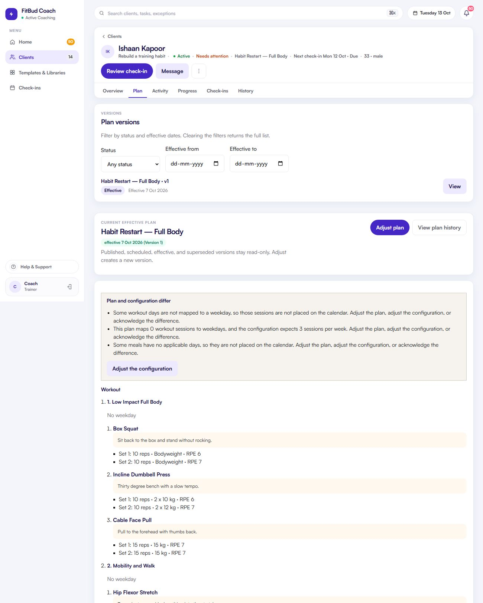{.shot}

4. **What's wrong or missing.**
   - Editing happens inline in one long column.
   - There's no explicit **Assign** step with a date window.
   - The diet change scope (Today onward, Today only) isn't offered.
   - The version list is visually heavier than the current plan.
5. **Target design.**
   - **Current plan card (top):**
     - Title, "Effective since Mon 5 Oct · v3 · ongoing" (or an end date).
     - **Week strip**, Mon to Sun: the session name per day, "Rest", and a meal-count chip per day.
     - **Meal times panel** (under the strip): each meal slot with its plan time, and the client's time where it differs. For example, "Lunch · plan 1:30 pm · **Priya: 2:30 pm** (changed Tue)". The trainer can't edit the client's time, but can change the plan default by adjusting the plan (D24).
     - Actions: **Adjust plan** (primary, creates a new draft version and opens TW-13/14), *Replace from template* (opens the template picker, then TW-16), and ⋯ *Duplicate as template* (`POST /templates/from-plan-version`).
   - **Consistency notice:** keep `PlanConsistencyNotice` with its three resolutions (adjust plan, adjust configuration, acknowledge the intentional difference). Restyle it as an `attention` banner, not red.
   - **Draft banner** when a draft exists: "Draft v4 · edited 2 h ago · Continue editing · Discard".
   - **Versions table (collapsed by default):** version, status (draft, scheduled, effective, superseded), effective interval, published by and date, *View*. Filters stay as they are.
6. **States.**
   - No plan: "No plan yet" with **Start from a template** (primary) and *Start blank*.
   - Seed error: generation 500s (gap analysis). Show "Couldn't create this week's schedule · Retry" on the assign step. Never fail silently.
7. **Edge cases.**
   - Publishing while a newer draft exists: 409, then a reload prompt.
   - Replacement: show the TW-16 preview of superseded unstarted assignments before confirming.
   - Ended: read-only.
8. **Deep links.** `/go/plan/:planId`.
9. **References.**
   - Adapt: TrueCoach programs [R3] https://help.truecoach.co/en/articles/3047401-programs
   - Adapt: Everfit premade program templates [R11] https://help.everfit.io/en/articles/8877415-premade-program-templates
10. **UX decisions.**
    - The week strip answers "what does Priya do on Tuesday" without opening the editor.
    - Editing moves to a dedicated builder route (TW-13/14), which fixes the 7,100 px page.
11. **Implementation.**
    - Move `PlanCompositionEditor` into the builder route.
    - `WeekStrip` reads the weekday-to-session mapping from the version content. API-CHG: the contract (decision B) requires an explicit weekday-to-session mapping, but the current generation derives weekdays from sessions per week. That needs a content schema change (see TW-13).
12. **Acceptance criteria.**
    - [ ] The current plan shows a week strip.
    - [ ] Client meal-time overrides are shown next to plan times.
    - [ ] Adjust creates a draft and opens the builder.
    - [ ] Replace goes through TW-16.
    - [ ] The consistency notice uses attention styling with its three actions.
    - [ ] Versions are collapsed by default.
13. **Priority:** P1.

---

### TW-13 · Workout plan builder (three-pane)

> **Status:** Figma-only layout (content partially implemented) · **Priority:** P1 · **Route:** `/clients/:rid/plan/:planId/versions/:versionId/edit` (`?tab=workout`); template mode `/templates/workout/:tid` · **Files:** `components/plan-composition/PlanCompositionEditor.tsx` → split into `builder/` [new] · **API:** `GET/PUT /plans/:planId/versions/:versionId`, preview, publish; `GET /libraries/exercises?q&muscleGroup&equipment&difficulty`

1. **Purpose.** Compose a weekly workout program quickly: days, sessions, exercises, sets, reps, load, rest and notes.
2. **Entry.** TW-12 *Adjust plan* or *Start blank*, and a template editor.
3. **Current state.**
   - Figma "Plan Builder" frame (metadata audit only; no screenshot, due to the Figma rate limit). It has a three-pane layout plus banned analytics (stimulus, weekly sets volume, HRV).
   - Code: a single-column composition editor with add, reorder and duplicate, and limits. There's no weekday mapping UI.
4. **What's wrong or missing.** The layout doesn't scale. There's no weekday mapping (which causes the consistency notice). There's no preview. The library is a separate page.
5. **Target design.** Three panes at ≥1280.

   | Left (240) · Days | Centre (flex) · Session editor | Right (360) · Library drawer |
   |---|---|---|
   | Mon to Sun list. Each day shows its session name or "Rest", and the row can be dragged to reorder. "+ Add session". A session can be assigned to multiple weekdays through a weekday chip row (M T W T F S S). | Session title and an instruction note. Exercise blocks: name, primary muscle chip, and a **set table** (set #, reps or range, load as kg or a text label like "RPE 7", rest seconds, notes). Actions: add set, duplicate set, superset group (P2), delete. The prescription lives here, never in the library (10 Oct contract). | Search, then filters for muscle, equipment and difficulty. Each result shows the name, primary and secondary muscles and a media thumbnail when one exists (`LinkedMedia`), with **Add to session** (or drag it in). "Create exercise" opens the TW-26 form in the drawer. |

   - **Top bar:** "Draft v4 · Saved 10:42" (autosave status), *Preview as client* (opens a phone-frame preview of TR-10 for any chosen day), and **Publish…** (primary), which opens the TW-16 assign modal.
   - **Validation panel:** shown inside the Publish modal, with no separate inspector. "2 days have no session · Tue, Thu are rest days. Is that intended?" and the consistency check against configuration ("Configuration expects 4 sessions/week; plan has 3").
6. **States.**
   - Autosave: Saving, Saved, Couldn't save (Retry). Use a debounced `PUT` with `expectedVersion`.
   - Conflict: "This draft was changed in another tab."
   - Empty session: "Add exercises from the library →".
   - Library empty or error, shown inline in the drawer.
7. **Interactions and edge cases.**
   - Keyboard: `/` focuses library search, Enter adds the highlighted exercise, Tab moves through set cells, ⌘D duplicates a set.
   - Undo stack for the last 20 edits on the client.
   - Below 1280, the library becomes a toggleable drawer. Below 1024, the builder is read-only with "Open on a larger screen".
   - Published versions can't be opened here. The route rejects them, and the editor shows "Create a new version to edit".
8. **Deep links.** None. It's an editing surface.
9. **References.**
   - Adopt: the TrueCoach workout builder [R4] https://help.truecoach.co/en/articles/3047972-the-workout-builder-basics and its feature page [R5] https://truecoach.co/features/program-workout-builder/
   - Adapt: the Everfit create-a-workout flow [R10] https://help.everfit.io/en/articles/4620472-create-a-workout
   - Avoid: Figma's analytics inspector (banned, Iteration A §10).
10. **UX decisions.**
    - The weekday chips implement decision B (weekday-to-session mapping, rest days).
    - Library on the right plus "Add to session" removes page switching.
    - Publish always goes through the assign step, so trainers never publish without seeing the dates affected.
11. **Implementation.**
    - Components: `builder/BuilderLayout`, `DaysPane`, `SessionEditor`, `SetTable`, `LibraryDrawer` (wrapping the existing `LibrarySearch`), `PublishModal`.
    - API-CHG: version content gains `schedule: { [weekday]: sessionId | 'rest' }`. Generation must use it (gap: it currently derives from frequency).
    - Use the existing preview endpoint for *Preview as client*.
12. **Acceptance criteria.**
    - [ ] Three panes at 1440. The library adds to the selected session.
    - [ ] Weekday mapping is saved, and generation honours it.
    - [ ] Autosave shows its status.
    - [ ] Publish opens TW-16.
    - [ ] No analytics, volume or fatigue UI.
    - [ ] Exercise library items carry no default reps or load.
13. **Priority:** P1.

---

### TW-14 · Nutrition plan builder

> **Status:** Figma-only (content partially implemented) · **Priority:** P1 · **Route:** the same builder route with `?tab=nutrition`; template mode `/templates/nutrition/:tid` · **Files:** `PlanCompositionEditor.tsx` (meal sections) → `builder/MealsPane` [new] · **API:** plan version get and put; `GET /libraries/foods?q`

1. **Purpose.** Compose meal slots per applicable day: type, custom label, time, and items with servings and quantities. Nutrition totals are calculated, and unknown values stay unknown.
2. **Entry.** The same as TW-13.
3. **Current state.** Composition editor meal sections. Food library items are being migrated to a canonical basis (per 100 g or ml) plus serving conversions (10 Oct contract gap).
4. **What's wrong or missing.** No meal time field (the contract needs an explicit time). No applicable-days control. Totals don't show unknown values honestly. No Indian serving labels in the UI.
5. **Target design.**
   - **Left pane:** day applicability. Choose "Every day", or pick days. Several day patterns are allowed, for example "Training days" vs "Rest days".
   - **Centre:** meal slot cards, each with
     - **Meal type** (breakfast, lunch, snack, dinner, pre/post-workout),
     - a **label** ("Meal 1"),
     - a **time** (a required time picker that sets the *default* time; the trainee may adjust their own time later, D24, and reminders follow the trainee's time),
     - and items. Each item has the food name, a serving select (food-specific, for example "1 katori (150 g)", "1 roti (40 g)", "100 g"), a quantity stepper, and calculated kcal, P, C and F. A value is shown as "—" with the tooltip "Not known for this food" when the basis is null.
     - Slot totals show "≥ 420 kcal" plus the footnote "+1 item with unknown calories" when any value is unknown.
     - Each slot has an optional **photo requested** switch (if configuration says "selected meals") and **instructions**.
   - **Right:** a food library drawer with search, a veg / non-veg / egg filter (only if the food classification includes it; otherwise omit), and *Add to meal*.
   - **Day total bar:** kcal and macros for the selected day, with the same unknown rule.
6. **States.** As in TW-13. A missing meal time blocks publish ("Set a time for Snack 2 so reminders work").
7. **Edge cases.**
   - Changing a food in the library later doesn't alter the plan, because copies are snapshots (contract). Show "From library · snapshot" in the item's caption.
   - Allow manual items ("Home-cooked dal, 1 bowl") with nutrition left unknown.
8. **Deep links.** None.
9. **References.**
   - Adapt: the Trainerize flexible meal planner [R23] https://help.trainerize.com/hc/en-us/articles/47042957643156-Flexible-Meal-Planner
   - Adopt: Indian food data from IFCT 2017 [R70] https://www.nin.res.in/ebooks/IFCT2017.pdf (dataset mirror: https://ifct2017.github.io/)
   - Avoid: MyFitnessPal's crowd-sourced inaccuracy [R33].
10. **UX decisions.**
    - The required meal time is the default anchor for D6 reminders. A trainee's override (TR-24) replaces it for that client only, and the plan itself never changes.
    - Showing "—" rather than 0 follows the contract ("Unknown values remain unknown") and keeps nutrition honest.
11. **Implementation.**
    - API-CHG: a meal slot gains `type`, `label` and `time` (HH:MM local) as separate attributes (decision B).
    - Nutrition totals are computed by the backend. The UI shows the backend's calculated values from preview, or computes locally with the same pure function from `packages/core` to give instant feedback.
12. **Acceptance criteria.**
    - [ ] Every slot has a type, label and time.
    - [ ] Unknown nutrients display as "—" and totals say "≥".
    - [ ] Servings come from food-specific conversions.
    - [ ] Publish is blocked without times.
13. **Priority:** P1.

---

### TW-15 · Diet change scope (Today onward vs Today only)

> **Status:** Missing · **Priority:** P1 · **Where:** a step inside the Publish modal (TW-16) when only nutrition changed in an adjustment · **API:** API-NEW publish option `dietChangeScope: 'today_onward' | 'today_only'`

1. **Purpose.** Implements decision B's diet change scope.
2. **Entry.** Publishing a nutrition-only adjustment.
3. **Current state.** Not offered.
4. **What's wrong or missing.** Trainers can't make a one-day change ("Wedding today, swap dinner") without altering the whole plan.
5. **Target design.** Two radio cards.
   - **"From today onward" (default):** "Updates the plan from today. Today's and future meals that aren't logged yet will change."
   - **"Today only":** "Changes only today's meals that aren't logged yet. The plan stays the same from tomorrow."
   - A preview list follows: "3 meals will change today: Lunch, Snack 2, Dinner. Breakfast is already logged and won't change."
6. **States.** If nothing is eligible: "All of today's meals are already logged. Nothing will change today."
7. **Edge cases.** Workouts are unaffected. Logged meals are protected.
8. **Deep links.** The trainee receives the P-PLAN push (§4) only for Today onward, and the I-DAY inbox item for Today only.
9. **References.** No strong external reference. This is FitBud's contract behaviour.
10. **UX decisions.** Default to the safer, more common choice. The preview builds trust.
11. **Implementation.** The modal step is in `PublishModal`. API-NEW: a scope parameter and a dry-run preview endpoint.
12. **Acceptance criteria.**
    - [ ] The default is Today onward.
    - [ ] The preview lists the affected and protected meals.
    - [ ] Today only leaves tomorrow's assignments unchanged.
13. **Priority:** P1.

---

### TW-16 · Assign plan: date window and replacement preview

> **Status:** Missing · **Priority:** P0 · **Route:** a modal over the builder or plan, `?assign=1` · **Files:** `components/plan/AssignModal.tsx` [new], `components/DateWindowPicker.tsx` [new] · **API:** publish, plus `POST /workouts/…/assignments/generate` and `POST /meals/…/assignments/generate` (`fromDate`, `toDate`). API-NEW combined `POST /plans/:planId/versions/:vid/assign {window, effectiveFrom, effectiveTo?, dietChangeScope?}` with a dry-run

1. **Purpose.** Make a plan effective and generate its first assignment window consistently for workouts and meals. Show what gets replaced.
2. **Entry.** Builder Publish, Plan *Replace from template*, and a template *Use for client*.
3. **Current state.** Separate generate endpoints exist. There's no trainer workflow (an explicit gap in the contract). The seed generation 500s.
4. **What's wrong or missing.** Everything listed in the purpose.
5. **Target design.** A modal, 640 wide.
   1. **When does this plan start?**
      - Effective from: a date (default today, trainee-local).
      - Validity: Ongoing (default) or End on a date.
      - The copy explains: "Validity is separate from the first schedule window."
   2. **First schedule window:** three radio cards (`DateWindowPicker`).
      - **Next 7 days**: "Today, Wed 14 Oct → Tue 20 Oct".
      - **Next calendar week**: "Mon 19 Oct → Sun 25 Oct".
      - **Custom dates**: an inclusive range picker.
      - Helper: "After this, FitBud keeps the next 7 days scheduled automatically."
   3. **Preview grid:** dates by workouts and meals, with cells such as "Upper A", "Rest" and "5 meals".
   4. **Replacement**, only if a plan is active: "From Wed 14 Oct, this replaces *Fat loss v3*. 6 upcoming workouts and 28 meals that haven't started will be replaced. Anything already logged stays as it is."
   5. **Diet scope** (TW-15), when relevant.
   6. **Notify client** switch (default on). This sends P-PLAN.
   - Primary button: **Publish & schedule**.
6. **States.**
   - Dry-run loading.
   - Partial failure (meals generated, workouts failed): show which part failed with Retry. Generation is idempotent, so a retry is safe.
   - Ended: blocked.
7. **Edge cases.**
   - Trainee timezone differs from the trainer's: show every date and time in the **trainee's timezone** (D22), with a `TimezoneBadge` in the modal header ("Dates use Priya's time · Dubai · 1 h 30 m behind you").
   - Custom range longer than 28 days: show a warning.
   - Effective date in the past: not allowed.
8. **Deep links.** The trainee gets P-PLAN with a deep link to `/plan` (TR-06 opens the "What changed" card).
9. **References.** Adapt the TrueCoach program assignment to a start date [R3].
10. **UX decisions.** Implements decision B exactly. The preview prevents silent overwrites (contract: "surface actionable trainer warnings, not silent changes").
11. **Implementation.** API-NEW combined assign endpoint (preferred), so workouts and meals succeed or fail as a unit. If the endpoint isn't built yet, call publish, then both generate endpoints in sequence with idempotency keys, and surface partial failures.
12. **Acceptance criteria.**
    - [ ] The three window options produce the documented date ranges in the trainee timezone.
    - [ ] The preview matches the generated assignments.
    - [ ] The replacement counts are shown before confirming.
    - [ ] A retry is safe.
    - [ ] The client notification is optional.
13. **Priority:** P0.


---

### TW-17 · Activity

> **Status:** Implemented · **Priority:** P1 · **Route:** `/clients/:rid/activity` (`?type=workout|meal|checkin&state=&from=&to=&item=`) · **Files:** `pages/ClientActivityPage.tsx` (`nudgeActivity`, generate assignments) · **API:** `GET /workspaces/relationships/:rid/activity` (one activity type per page, derived state, civil date range), nudge

1. **Purpose.** A day-by-day record of what was expected and what happened, plus nudges on specific unresolved items.
2. **Entry.** Workspace tab, Overview "View all activity", exception source links, and `/go/meal/:id` and `/go/workout/:id` for trainers.
3. **Current state.** `shots/d1440_10_client1_activity.png`. Server filters work. Some clients have no assignments because of the seed 500. A "generate assignments" button is exposed to the trainer.

   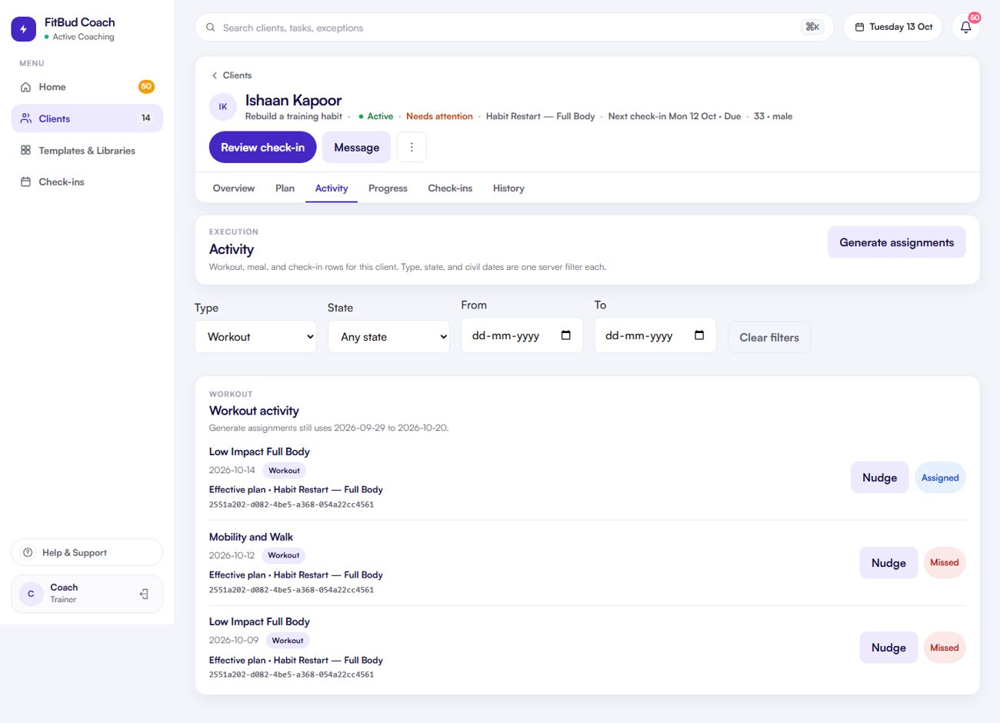{.shot}

4. **What's wrong or missing.**
   - A manual "generate" button is a developer affordance. The rolling horizon should be automatic.
   - Items aren't grouped by day.
   - Meal photos and deviation detail are hidden.
   - There's no asked-coach marker.
   - Nudge has no context about rate limits or quiet hours.
5. **Target design.**
   - **Type segmented control:** Workouts · Meals · Check-ins. One type at a time, matching the API.
   - **State filter pills,** using the type-specific derived states. Workouts: completed, modified, skipped, missed, pending. Meals: logged, changed, skipped, logged late, overdue, pending.
   - **Date range:** This week (default), Last week, or Custom.
   - **Grouped by day** with a sticky day header ("Tue 13 Oct · 2 of 5 meals logged").
   - **Row:** time (in the **client's** timezone, D22, with the trainer's time in the tooltip) · item name · state chip · detail line (deviation text such as "Swapped rice for 2 roti", **logged foods with kcal against plan** such as "Ate: 3 roti, 1 katori rajma · 610 kcal (plan 520)", the photo thumbnail, or "Skipped · 'travelling'") · `AskedCoachMarker` · action. *Nudge* shows only on pending or overdue items not yet logged. *View* opens a side panel with the full workout execution (sets done versus prescribed) or the meal compliance detail.
   - **Meal panel (D28):** planned items against **actual logged items** (food, serving, quantity, kcal, P, C, F), with totals and the difference ("+90 kcal · +6 g protein"). Unknown values are shown as "—" and totals as "≥". Custom foods are marked "Custom · not in library", with **Add to my food library**, which opens the TW-26 food drawer prefilled with the name.
   - **Non-assignment entries** in the Meals view, as single-line events: "Priya changed Lunch time 1:30 pm → 2:30 pm (from Wed)" (D24), and "Logged late on Fri for Wed" (D23).
6. **States.**
   - Empty: "No meals in this range." When there are no assignments at all: "No schedule yet. Publish a plan to create one."
   - The nudge button has three states: available, "Sent 10:12" (disabled), and rate-limited.
7. **Edge cases.**
   - Superseded assignments from a plan replacement show a muted "Replaced by plan v4" badge and are excluded from counts.
   - Logged late shows both the scheduled and logged times. Late logs are possible until the trainer resolves the related exception (D23). After that, the item is locked, and the panel shows "Locked · exception resolved 16 Oct".
8. **Deep links.** `?item=meal:<id>` opens the side panel. `/go/meal/:id` resolves to it for trainers.
9. **References.** Adapt the Trainerize meal-photo sharing view [R22] https://help.trainerize.com/hc/en-us/articles/360058683772-Sharing-Meal-Photos-In-App.
10. **UX decisions.** Remove the manual generate button. Replenishment is a system job (`jobs/replenishment.ts`), and keep a dev-only control behind a flag. Nudges sit at item level, per decision C.
11. **Implementation.** Add `ActivityDayGroup` and `ActivityRow`, plus `ExecutionPanel` for workouts and `MealPanel` for meals. Photos come from the file download target.
12. **Acceptance criteria.**
    - [ ] Rows are grouped by day.
    - [ ] Nudge shows only for unresolved, actionable items, with its states.
    - [ ] Deviation detail and photos are visible.
    - [ ] No generate button in production.
    - [ ] Logged foods, and their kcal against plan, are visible for changed meals.
    - [ ] Meal-time changes appear as activity entries.
13. **Priority:** P1.

---

### TW-18 · Progress

> **Status:** Implemented (text-only, needs charts) · **Priority:** P1 · **Route:** `/clients/:rid/progress` · **Files:** `pages/ClientProgressPage.tsx`, `components/MeasurementTrend.tsx` · **API:** progress summary, `GET /progress/…/measurements`, entries, file download

1. **Purpose.** See body measurement trends and progress photos over time.
2. **Entry.** Workspace tab, Overview progress card, check-in review.
3. **Current state.** `shots/d1440_10_client1_progress.png`. Text such as "No stored body weight measurements". No chart scaffolding and no photo comparison.

   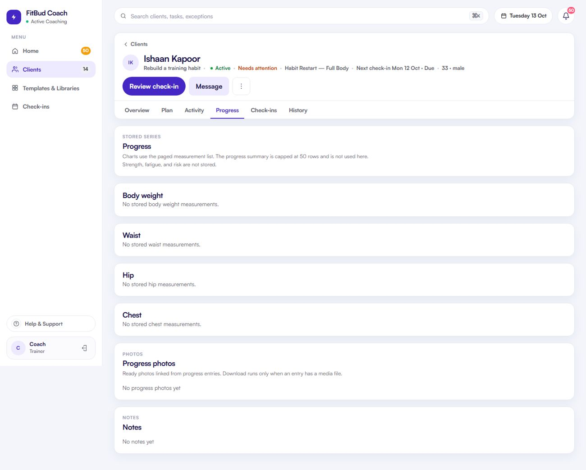{.shot}

4. **What's wrong or missing.** No graphs. No photo comparison. Empty states are plain text.
5. **Target design.**
   - **Metric tabs:** Weight · Waist · Hip · Chest · Other. Only metrics that have data or are required are shown.
   - **TrendChart:** line and points, with a range of 4 weeks, 12 weeks or All. It shows start, latest and change ("−2.4 kg since 5 Oct"). Gaps break the line. Weekly averages are an optional toggle (P2).
   - **Data table** under a disclosure (date, value, source: check-in or manual).
   - **Photos:** a gallery grid by date. **Compare** picks two dates and shows them side by side with dates (`PhotoCompare`).
   - No strength charts (deferred) and no body-fat estimates.
6. **States.**
   - No data: "No weigh-ins yet. Weight is collected in check-ins." plus *Open check-in settings*.
   - One point: show the value with "Add more weigh-ins to see a trend".
   - Photo loading skeletons. A photo error shows "Couldn't load photo · Retry".
7. **Edge cases.**
   - Values display in the trainer's chosen units, stored as kg and cm.
   - Measurements captured from a check-in show a "From check-in · 9 Oct" link.
8. **Deep links.** `/go/progress/:rid`.
9. **References.**
   - Adopt: the Trainerize Client Insights charts [R17] (the charts only, not the % compliance).
   - Adapt: Figma's graph-first progress (Progress frame, metadata audit), minus the strength KPIs.
10. **UX decisions.** Use honest, raw trends. Use language like "change", not "good" or "bad". Never colour weight gain red.
11. **Implementation.** Extend `MeasurementTrend.tsx` into `TrendChart` (SVG or `recharts`). `PhotoCompare` uses signed download targets.
12. **Acceptance criteria.**
    - [ ] A chart renders with 2 or more points.
    - [ ] The empty states are designed.
    - [ ] Photo compare works with any two photos.
    - [ ] No red or green value judgement.
13. **Priority:** P1.

---

### TW-19 · Client check-ins list

> **Status:** Implemented · **Priority:** P2 · **Route:** `/clients/:rid/check-ins` · **Files:** `pages/ClientCheckinsPage.tsx` · **API:** check-in list (cursor), schedule, schedule-next

1. **Purpose.** See this client's check-in history and upcoming check-ins.
2. **Entry.** Workspace tab.
3. **Current state.** `shots/d1440_10_client1_check-ins.png`. A list. The cursor isn't passed (contract note).
4. **What's wrong or missing.** No paging. Weak status chips. No review outcome shown.
5. **Target design.**
   - A table: due window · form name · status chip (Scheduled, Due, Overdue, Submitted, Reviewed) · review outcome chip (Acknowledged, Needs follow-up, Adjust coaching) · *Open*.
   - Header action: **Schedule check-in** (date and form), for one-off check-ins. The date and time picker works in the **client's timezone**, with a `TimezoneBadge` and a live preview such as "Due Fri 16 Oct, 11:59 pm Priya's time (Sat 1:29 am your time)" (D22).
6. **States.** Empty: "No check-ins yet. They'll appear here based on Priya's weekly schedule." Error.
7. **Edge cases.** Paging with "Load more". Overdue items show the attention chip.
8. **Deep links.** `/go/checkin/:id`.
9. **References.** Everfit check-in dashboard [R7].
10. **UX decisions.** The outcome chip shows the coaching follow-through at a glance.
11. **Implementation.** Pass the cursor. Reuse `StatusChip(kind='checkin')`.
12. **Acceptance criteria.**
    - [ ] Paged.
    - [ ] Statuses are derived (never written).
    - [ ] Outcome chips shown.
13. **Priority:** P2.

---

### TW-20 · Check-in review

> **Status:** Implemented (needs rework) · **Priority:** P0 · **Route:** `/clients/:rid/check-ins/:checkinId` · **Files:** `pages/CheckinReviewPage.tsx` · **API:** get check-in, review context, `POST …/review` (acknowledged, needs follow-up, adjust coaching), notes, schedule-next

1. **Purpose.** Review a submitted check-in, record an outcome, and close the loop with the client.
2. **Entry.** Check-ins inbox, Home, header CTA, and trainer push "Priya submitted her check-in".
3. **Current state.** `shots/d1440_11_client1_checkin_review.png`. Submission, measurements, an adherence count grid (10 equal tiles, mostly 0), active exceptions with raw ISO "Detected …Z", plan and notes. The actions (Record Outcome, Schedule Next, Record Note) are at the bottom, below the fold.

   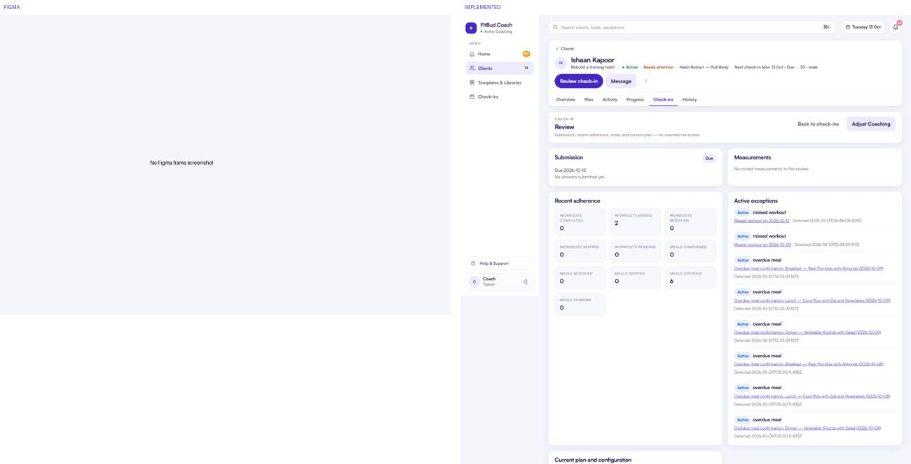{.shot}

4. **What's wrong or missing.** The primary actions are below the fold. Zero tiles add noise. Raw timestamps. The trainee never sees that the trainer reviewed anything.
5. **Target design.** Two columns at ≥1280.
   - **Left (answers):**
     - Header "Weekly check-in · submitted Thu 15 Oct, 8:10 pm".
     - Answers grouped by section.
     - Measurements, each with its change since the last check-in ("74.2 kg · −0.6 since 8 Oct").
     - Photos, with *Compare with last*.
   - **Right (context):**
     - **Since last check-in**, showing only the non-zero counts: "3 of 4 workouts · 2 workouts modified · 6 meals changed · 1 meal skipped".
     - Open exceptions, one line each, with *Review* opening TW-05.
     - Asked-coach items this period.
     - Reminder responsiveness line.
   - **Sticky bottom action bar:**
     - **Outcome** as a segmented control: Acknowledged · Needs follow-up · Adjust coaching.
     - A **note** text area (optional) with the **"Visible to client"** switch (TW-34, D20). It's off by default. When it's on, the note shows on the trainee's check-in (TR-14) and Today "From your coach" card. When it's off, the note stays private.
     - **Primary:** **Save review**.
     - Secondary: *Schedule next*, prefilled from the cadence.
     - Overflow: *WhatsApp client* (prefilled "Reviewed your check-in…" with the deep link), *Adjust plan*.
6. **States.**
   - Not submitted (due or overdue): answers empty, "Due by Fri 16 Oct, 11:59 pm", plus *Nudge*.
   - Already reviewed: the bar shows "Reviewed · Acknowledged · 16 Oct" with *Edit review* (only if the API allows it; otherwise read-only).
   - Draft only: "Priya has started but not submitted."
7. **Edge cases.**
   - Pinned form version: answers render against the pinned version, never against the latest one.
   - The "Adjust coaching" outcome routes to TW-12 or TW-11 after saving.
8. **Notifications and deep links.** Saving a review sends trainee push **P-CHK-REV** ("Rahul reviewed your check-in"), linking to `/checkin/:id`. That's the "visible trainer review" signal (D13).
9. **References.**
   - Adopt: Everfit check-in dashboard and client insights [R6] [R7] https://help.everfit.io/en/articles/16000596-check-in-dashboard-review-client-insights
   - Avoid: Figma's "Feedback draft (WhatsApp & FitBud App Sync)" label, which implies a messaging sync.
10. **UX decisions.** A sticky outcome bar puts the review action within reach. The client-visible note gives FitBud's equivalent of a reply without becoming chat.
11. **Implementation.**
    - `ReviewActionBar` component. Hide zero counts. Format all dates.
    - The review note is a `trainer_notes` row linked to the check-in (`subjectType: 'checkin'`) with `visibility` (API-CHG, see TW-34).
    - **Push rule:** a visible note saved with a review is delivered *inside* **P-CHK-REV** ("Rahul reviewed your check-in and left a note"). No separate P-NOTE is sent.
    - *Schedule next* uses the client's timezone with `TimezoneBadge` (D22).
12. **Acceptance criteria.**
    - [ ] The outcome and Save are visible without scrolling at 1440×900.
    - [ ] Zero counts are hidden.
    - [ ] Saving sends the trainee review push, when the client's preferences allow it.
    - [ ] A note marked "Visible to client" appears for the trainee. An unmarked note never does.
    - [ ] Answers use the pinned version.
13. **Priority:** P0 (action bar, formatting), P1 (visible note).

---

### TW-21 · History

> **Status:** Implemented · **Priority:** P2 · **Route:** `/clients/:rid/history` (`?kind=&from=&to=`) · **Files:** `pages/ClientHistoryPage.tsx` · **API:** `GET /history/relationships/:rid` (paged 30/50, kind, occurredFrom, occurredTo)

1. **Purpose.** A readable ledger of coaching events: plan versions, reviews, interventions, check-ins and lifecycle.
2. **Entry.** Workspace tab, and the Plan "History" link (`kind=plan_version`).
3. **Current state.** `shots/d1440_10_client1_history.png`. A dense list of identical small cards.

   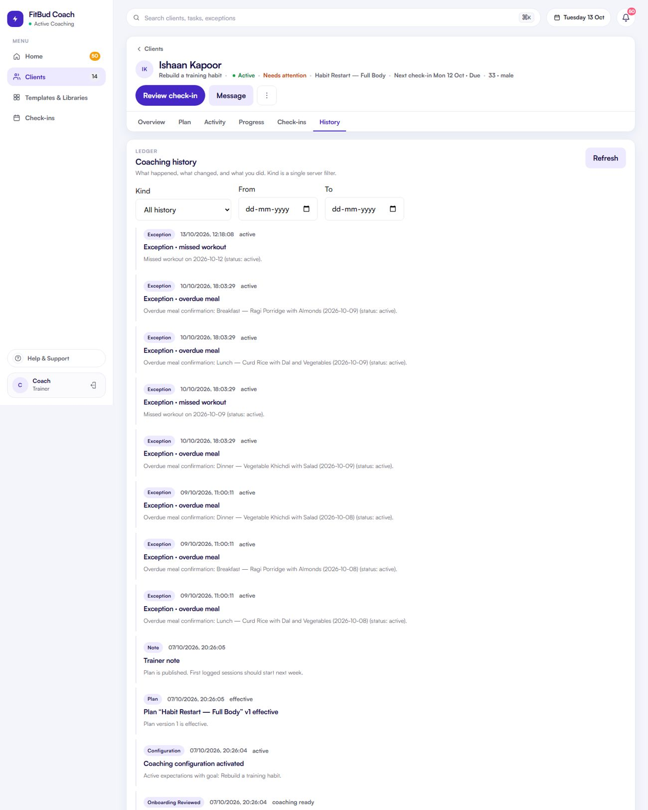{.shot}

4. **What's wrong or missing.** No grouping. Every kind looks the same. Some labels use enum-like wording.
5. **Target design.**
   - Group by week ("Week of 5 Oct").
   - Rows carry a kind icon (plan, check-in, note, review, exception, relationship), a sentence ("You published *Fat loss v4* · effective Wed 14 Oct"), a relative time and a link to the source.
   - A kind filter as pills, plus a date range.
   - Use neutral wording only, and never "clinical intervention".
6. **States.** Empty: "Nothing recorded yet." Load more.
7. **Edge cases.** Ended relationships still show their full history, read-only.
8. **Deep links.** None.
9. **References.** No strong external reference.
10. **UX decisions.** Weekly grouping matches the coaching cadence.
11. **Implementation.** Sentence templates live in the `packages/copy` keyed by history kind.
12. **Acceptance criteria.**
    - [ ] Grouped by week.
    - [ ] Kind icons.
    - [ ] Sentences come from the catalogue.
    - [ ] Filters reset the cursor.
13. **Priority:** P2.

---

### TW-22 · Check-ins inbox (all clients)

> **Status:** Implemented (P0 bug) · **Priority:** P0 · **Route:** `/checkins` (`?view=due|overdue|submitted|reviewed`) · **Files:** `pages/CheckinsPage.tsx` · **API:** check-in trainer inbox

1. **Purpose.** Process check-ins across all clients.
2. **Entry.** Navigation, Home section "View all", bell.
3. **Current state.** `shots/d1440_05_checkins.png`. Due, Overdue and Submitted tabs with counts. **It lists relationship UUIDs instead of client names.**

   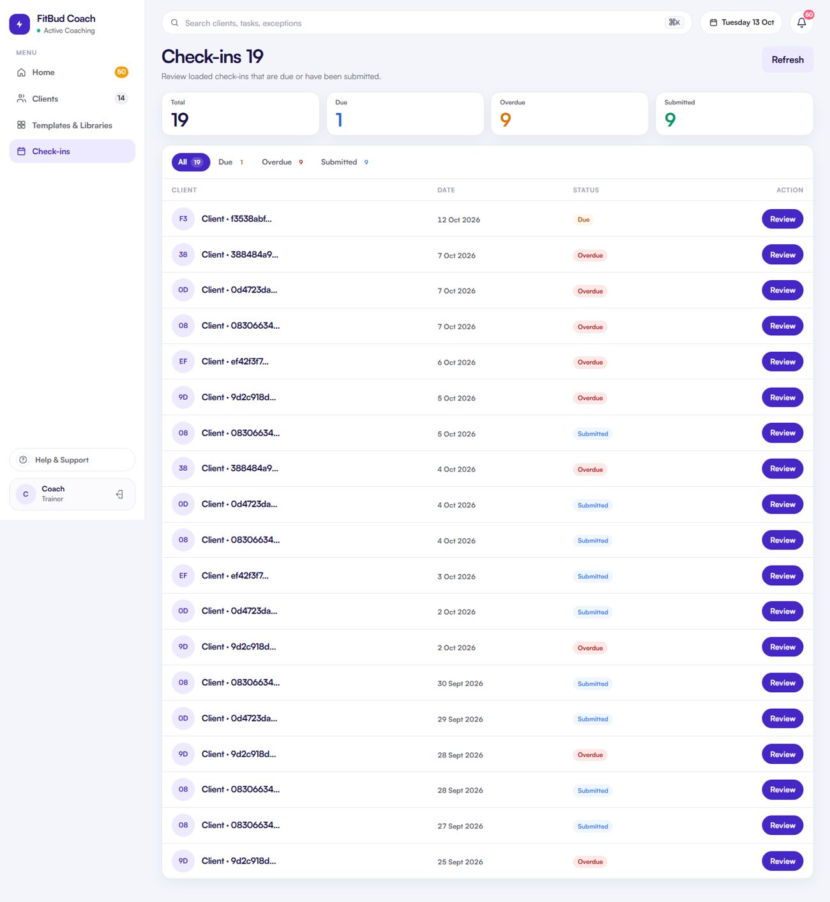{.shot}

4. **What's wrong or missing.** UUIDs are shown. There's no Reviewed tab. No quick nudge for overdue items.
5. **Target design.**
   - Tabs: **To review** (submitted, the default) · Due · Overdue · Reviewed (last 14 days), each with a count.
   - Rows show client (avatar and name) · form · submitted or due time · chips · action. To review: **Review**. Overdue: **Nudge** plus *WhatsApp*. Due: no action.
   - **Review mode:** opening a check-in from To review keeps a "Next ›" control in the review screen (TW-20), so the trainer can go through the queue.
6. **States.** Empty "To review": "No check-ins waiting. Nice." Error.
7. **Edge cases.** Ended clients are excluded.
8. **Deep links.** `/go/checkin/:id`.
9. **References.** Everfit check-in dashboard [R6] (image under TW-04).
10. **UX decisions.** Default to the tab that needs action.
11. **Implementation.** **P0:** include `traineeDisplayName` in the inbox read model (as `GET /exceptions/attention` already does: `traineeDisplayName: nameByUserId.get(...)` in `routes/exceptions.ts`), or resolve it on the client.
12. **Acceptance criteria.**
    - [ ] No UUIDs.
    - [ ] The To review tab is the default.
    - [ ] Next › works in review mode.
13. **Priority:** P0.

---

### TW-23 · Templates hub (type tabs)

> **Status:** Implemented (needs rework) · **Priority:** P1 · **Route:** `/templates/:type` (type ∈ `workouts`, `diets`, `full-plans`, `checkins`, `onboarding`, `libraries`; `/templates` redirects to `/templates/workouts`), with `?scope=all|bases|mine&q=` · **Files:** `pages/TemplatesPage.tsx` ("Templates & Libraries"), `pages/templates/PlanTemplateFamily.tsx` (fork, apply), `OnboardingTemplates.tsx`, `LibrariesPanel.tsx`, `shared.ts`, `useCursorPage.ts` · **API:** `GET/POST /templates` (`templateType` workout, nutrition or combined), get, put (with `expectedVersion`), delete; onboarding form templates; check-in form templates (`/checkins/form-templates`); `/libraries` · **Decision:** D26

1. **Purpose.** Manage reusable starting points: use the global bases as they are, fork them, or create your own. Maintain the exercise and food libraries.
2. **Entry.** Navigation, and the builder's *Duplicate as template*.
3. **Current state.** `shots/d1440_06_templates*.png`. Family tabs with counts (Onboarding · Workout · Nutrition · Combined · Libraries), Global (read-only) and Trainer badges, Fork and New version. Cards are tiny on a large canvas. Open and Read versions expand inline. Libraries is about 6,200 px tall.

   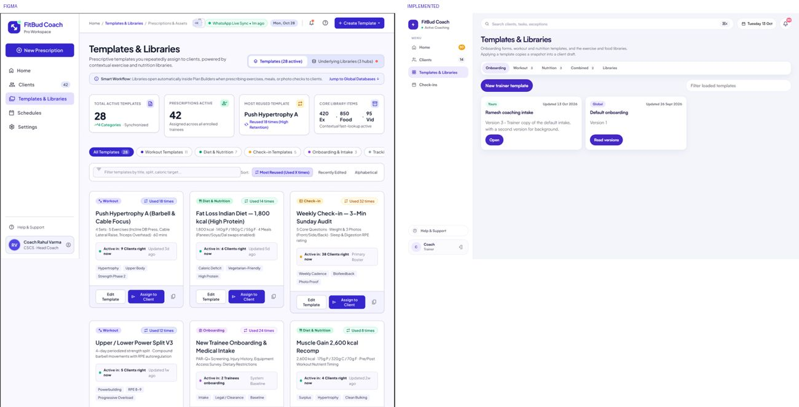{.shot}

4. **What's wrong or missing.**
   - There's no Check-in forms family in the UI (the route exists in the API).
   - No clear separation between global and mine.
   - Inline expansion pushes content down.
   - The labels "Nutrition" and "Combined" are model words, not trainer words.
   - Figma shows usage counts and "Verified", which are banned.
5. **Decision: subtabs or filter pills (D26).** The user suggested type subtabs instead of filter pills. **Adopted, as a secondary tab bar of six tabs.** The global-or-own **scope** stays a filter inside each tab.

   | Option | For | Against |
   |---|---|---|
   | **Secondary tab bar, one tab per type** (chosen) | Each type is a **different object** with its own editor, its own card summary ("4 days · 18 exercises" against "12 questions") and its own actions (plans: Use for client; forms: Set as default; libraries: a table, not cards). Tabs are meant for switching between peer views of different content, while filters narrow one homogeneous set (Material 3 tabs [R86]; NN/g "Tabs, used right" [R87]; NN/g "Filters vs facets" [R88]). Every tab gets its own URL (`/templates/diets`), so the browser back button and deep links work. **The current code already renders families as tabs**, so the effort is renaming, reordering, adding Check-ins, and routing each tab. Libraries stops being a hidden 6,200 px panel. | Six tabs need short labels. Below 768 px the bar scrolls horizontally, and the last tabs can be off-screen. You can't see all types in one list. |
   | Filter pills on one combined list | One search over everything. Multi-select. | It mixes cards whose actions and summaries differ, so each card needs a type badge, which adds noise. Libraries don't fit a card list at all. Pills are also how the scope filter appears, so two pill rows would compete. It's more work, because today's tabs would have to be torn out. |

   **Mitigations for the trade-offs:**
   - Labels are one or two words.
   - Order follows frequency of use: Workouts · Diets · Full plans · Check-ins · Onboarding · Libraries.
   - Each tab carries a count badge (Mine count) so empty types are obvious.
   - The ⌘K palette (TW-03) searches template titles across all types, which covers the "one search over everything" case.
   - Below 768 px the bar scrolls with fade edges.
6. **Target design.**
   - **Secondary tab bar** under the page title. The labels and their model mapping:

     | Tab label | Holds | Model |
     |---|---|---|
     | **Workouts** | Workout templates | `templateType: workout` |
     | **Diets** | Diet templates | `templateType: nutrition` |
     | **Full plans** | Workout plus diet | `templateType: combined` |
     | **Check-ins** | Check-in forms | check-in form templates |
     | **Onboarding** | Intake forms | onboarding form templates |
     | **Libraries** | Exercises and Foods, as a segmented control inside the tab | `/libraries` |

   - **Inside each template tab:**
     - **Scope** segmented control: **All · FitBud bases · Mine**, with counts. The default is All, with bases first.
     - Search box.
     - **New** button ("New workout template", and so on).
   - **Card grid** (3 columns at 1280). Each card shows the title, owner chip (FitBud base or Mine), "Updated 3 Oct", a structure summary and the actions:
     - Base: **Use** (primary: plans open the client picker and then TW-16; forms are set as the default for new invites or check-ins) and *Fork to edit*.
     - Mine: **Edit** (primary) and ⋯ Duplicate, Delete (blocked when a form version is pinned, with the copy "Forms in use can't be deleted").
   - Clicking a card opens the **full-page editor**: TW-13 or TW-14 in template mode, or TW-24 or TW-25. The **Libraries** tab shows TW-26.
   - No usage counts, no "Verified", no ratings.
7. **States.**
   - Empty "Mine" in a tab: "You haven't made any diet templates yet. Fork a FitBud base or start blank."
   - Empty search: "No templates match 'pcod'."
   - Errors are per tab, with Retry.
8. **Edge cases.**
   - Editing a base is impossible. The UI offers Fork instead, because the API rejects in-place mutation of global templates.
   - Plan templates are edited in place with `recordVersion` (409 on a stale save). Form templates create new immutable versions on save ("Saved as v4. Clients already invited keep their version.").
   - Old links to `/templates?family=…`, if any, redirect to the matching tab.
9. **Deep links.** `/templates/:type` is linkable.
10. **References.**
    - Adopt: Material 3 tabs, secondary tabs [R86] https://m3.material.io/components/tabs/guidelines
    - Adopt: NN/g "Tabs, used right" [R87] https://www.nngroup.com/articles/tabs-used-right/ and "Filters vs facets" [R88] https://www.nngroup.com/articles/filters-vs-facets/
    - Adapt: Everfit premade program templates [R11] and TrueCoach programs [R3].
    - Avoid: Figma's usage and retention counts (`screens/trainer_03_templates.png`).
11. **UX decisions and why.**
    - Tabs separate *kinds of thing*. The scope filter narrows *within* a kind. Use/Fork stays on the card, where the decision is made.
    - The Use/Fork vocabulary maps directly onto the 10 Oct ownership contract.
    - Full-page editors replace the inline expansion.
12. **Implementation.**
    - Rename and reorder the existing family tabs into `TemplateTypeTabs`. Each tab is a route under `/templates/:type`.
    - Add the Check-ins tab using the existing `checkinFormTemplateRoutes`.
    - Map UI slugs to API types in `packages/core/src/labels.ts`.
    - `TemplateCard` and `ScopeFilter` components.
13. **Acceptance criteria.**
    - [ ] Six tabs, in the stated order, each with its own URL.
    - [ ] Scope filter and search inside each template tab.
    - [ ] Bases are read-only, with Use and Fork.
    - [ ] Mine is editable.
    - [ ] The deletion guard is in place.
    - [ ] No usage counts.
    - [ ] The bar scrolls at 390 px without wrapping.
14. **Priority:** P1.

---

### TW-24 · Onboarding form builder

> **Status:** Implemented (inline) · **Priority:** P1 · **Route:** `/templates/onboarding/:tid` · **Files:** `pages/templates/OnboardingTemplates.tsx`, `onboardingBuilder.ts` · **API:** onboarding form templates and versions

1. **Purpose.** Create and edit intake forms. MVP field types: short text, long text, single choice, multiple choice, number, yes/no.
2. **Entry.** Templates, Onboarding forms.
3. **Current state.** `shots/d1440_06_templates_1_Onboarding.png`. An inline builder.
4. **What's wrong or missing.** Not a full page. No trainee-facing preview side by side. No highlight flag (TW-10). Field type coverage needs checking against the 10 Oct six-type contract.
5. **Target design.**
   - **Two panes.** Left: a question list with drag handles (add, choose type, reorder, duplicate, delete). Each question has a label, help text, required toggle, type-specific settings (choices with stable ids, number min, max and unit) and **Highlight for coach** (API-NEW).
   - Right: a **live phone preview** of TR-03.
   - Top: "Draft · will save as v4" and **Save version**.
   - No branching, no scoring (MVP).
6. **States.** Validation: a choice question needs at least 2 options. Duplicate labels show a warning.
7. **Edge cases.** Saving creates a new version. Existing invitations keep their pinned version.
8. **Deep links.** None.
9. **References.**
   - Trainerize onboarding forms [R20].
   - Everfit onboarding flow [R13].
10. **UX decisions.** The preview prevents trainee-facing surprises.
11. **Implementation.** Reuse `onboardingBuilder.ts` logic. `FormRenderer` powers the preview.
12. **Acceptance criteria.**
    - [ ] All six types supported.
    - [ ] Reorder, duplicate and delete work.
    - [ ] The preview is live.
    - [ ] Save creates a version.
13. **Priority:** P1.

---

### TW-25 · Check-in form builder

> **Status:** Missing (UI) · **Priority:** P1 · **Route:** `/templates/checkins/:tid` · **Files:** `pages/templates/CheckinTemplates.tsx` [new] · **API:** `/checkins/form-templates` (route mounted in `apps/api/src/index.ts`; confirm its operations)

1. **Purpose.** Reusable, versioned check-in forms (decision E). Today the check-in uses a fixed MVP definition, and the mobile `CheckinScreen` hard-codes Wellbeing, Notes and Body weight.
2. **Entry.** Templates, Check-in forms. TW-11 also picks the form for a client.
3. **Current state.** API route present, no UI.
4. **What's wrong or missing.** Trainers can't customise check-ins.
5. **Target design.** The same two-pane builder as TW-24, plus **check-in blocks**:
   - **Measurement** (weight, waist, hip, chest or a custom metric with unit). A valid value creates a linked measurement record (decision E).
   - **Progress photos** (front, side, back slots).
   - **Scale 1–5** (energy, hunger, stress). Use labelled anchors ("1 · Very low … 5 · Very high"), **not** sleep or HRV device data.
   - The 6 base field types.
   - The FitBud base: "Weekly check-in": weight, waist, 3 photos, energy 1–5, hunger 1–5, "What went well?", "What was hard?", "Anything for your coach?".
6. **States.** As in TW-24.
7. **Edge cases.** A scheduled check-in pins its version. Editing creates a new version for future check-ins only.
8. **Deep links.** None.
9. **References.**
   - Everfit forms and questionnaires [R16].
   - Everfit check-in insights [R7].
10. **UX decisions.** Keep the scales self-reported and labelled. They're answers, not biometrics.
11. **Implementation.** API-CHG: the check-in definition must support the measurement and photo block types if it doesn't already. Verify against `routes/checkin-forms.ts`.
12. **Acceptance criteria.**
    - [ ] A trainer can fork the base, edit it, and assign it in TW-11.
    - [ ] The trainee sees the new form at the next check-in.
    - [ ] Measurement answers create measurement records.
13. **Priority:** P1.

---

### TW-26 · Libraries (exercises, foods)

> **Status:** Implemented (needs paging) · **Priority:** P2 · **Route:** `/templates/libraries/exercises`, `/templates/libraries/foods` · **Files:** `pages/templates/LibrariesPanel.tsx`, `LibrarySearch.tsx` · **API:** `/libraries` exercises (q, muscleGroup, equipment, difficulty), foods (q); create, update, archive

1. **Purpose.** Browse and maintain exercises and foods. Items are identity and metadata only, with no prescription defaults.
2. **Entry.** Templates, Libraries, and the builder drawers.
3. **Current state.** `shots/d1440_06_templates_2_Libraries.png`. A 6,200 px table with filters and paging, but no sticky header.

   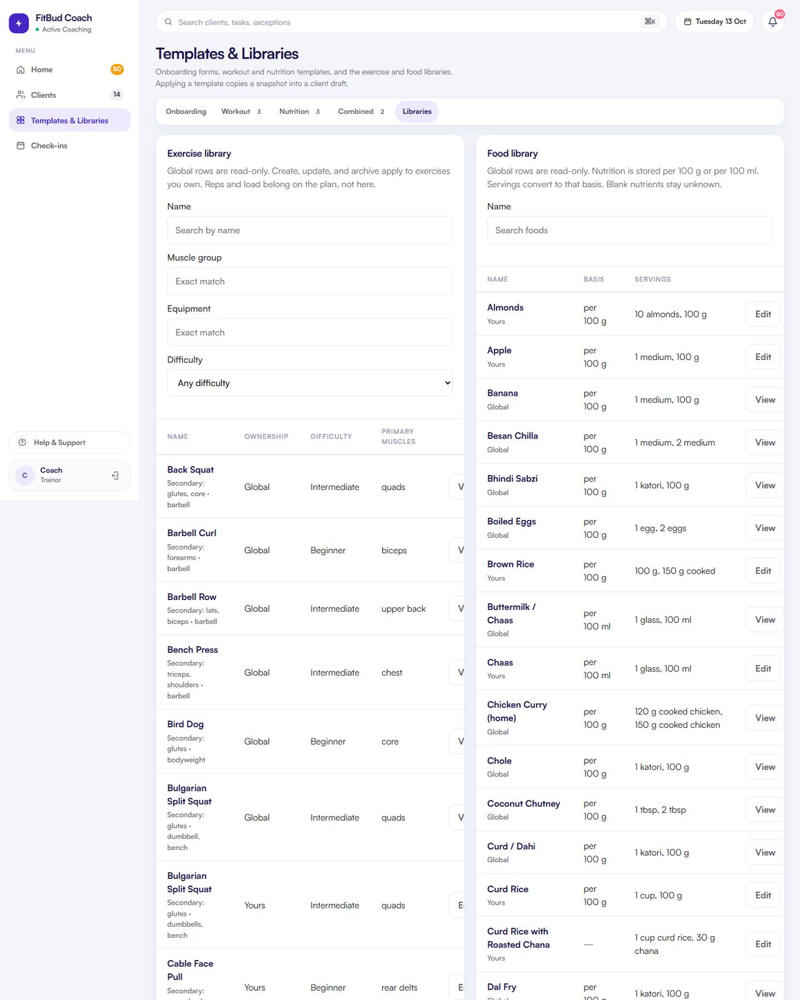{.shot}

4. **What's wrong or missing.** Very long page. No virtualisation. The UI may still show `defaultReps` and `defaultLoadLabel` (remove them per 10 Oct). Foods show per-portion macros, which needs migrating to the canonical basis plus servings.
5. **Target design.**
   - **Exercises table:** name · primary muscles · secondary muscles · equipment · difficulty · media · owner (FitBud or Mine) · ⋯. Sticky header, 25 rows per page, filters in a FilterBar.
   - **Create or edit exercise drawer:** name, primary and secondary muscle multiselects, equipment, difficulty, instructions, media link. No reps or load.
   - **Foods table:** name · classification (raw, generic, prepared, branded) · basis ("per 100 g") · kcal, P, C, F (unknown values shown as "—") · servings count · owner.
   - **Food drawer:** identity and classification; a basis selector (100 g or 100 ml); nullable nutrients; a **servings editor** (label "1 katori", unit, grams or ml equivalent) with stable ids; and an **aliases** field (Hindi and regional names and transliterations, for example "dal, daal, dhal, paruppu"). Aliases power the trainee food search (TR-26, D28).
   - **"Logged by clients, not in library" list** (D28): custom foods your trainees typed in, with the count and last date. Actions are **Add to library** (opens the drawer prefilled, after which past logs can be re-linked to it) and *Dismiss*.
   - Referenced items are **Archived**, not deleted.
6. **States.** Empty search: "No exercises match 'bulgarian'. Create it?"
7. **Edge cases.** Global items are read-only. "Duplicate to mine" creates an independent trainer record (provenance only).
8. **Deep links.** None.
9. **References.**
   - Everfit create or edit an exercise [R12] https://help.everfit.io/en/articles/2945296-create-or-edit-an-exercise
   - IFCT 2017 [R70] for Indian foods.
10. **UX decisions.** Servings are food-specific, because household measures don't convert universally (contract).
11. **Implementation.**
    - Table virtualisation is optional. Paging at 25 is enough.
    - API-CHG: foods gain `aliases: string[]` (search-indexed).
    - API-NEW: `GET /libraries/foods/custom-logged?rid=` (custom trainee entries) and `POST /libraries/foods/:id/relink-custom` (optional, P2).
12. **Acceptance criteria.**
    - [ ] Sticky header and paging.
    - [ ] No prescription defaults.
    - [ ] Foods use basis plus servings.
    - [ ] Archive instead of delete when referenced.
13. **Priority:** P2 (the schema migration is P1 on the backend).

---

### TW-27 · Template use and fork flows (modal set)

> **Status:** Implemented (inline) · **Priority:** P2 · **Where:** modals launched from TW-23 · **Files:** `PlanTemplateFamily.tsx` (fork, apply)

1. **Purpose.** Make Use and Fork explicit and safe.
2. **Entry.** Template card actions.
3. **Current state.** Fork and apply are inline actions.
4. **What's wrong or missing.** No confirmation of what happens. No client picker for Use.
5. **Target design.**
   - **Use for client:** a modal with a client search (only clients who are ready or active), then "Creates a draft plan for Priya from *Fat loss base*. Nothing changes for Priya until you publish." The trainer lands in the builder (TW-13) with the draft.
   - **Fork:** a name field ("Copy of Fat loss base"), then "Your copy is yours to edit. The FitBud base won't change." The trainer lands in the template editor.
6. **States.** Errors appear inline.
7. **Edge cases.** Use deep-copies with fresh ids (contract).
8. **Deep links.** None.
9. **References.** No strong external reference.
10. **UX decisions.** The copy states the copy semantics explicitly, which avoids "did I change the original?" anxiety.
11. **Implementation.** `UseTemplateModal` and `ForkTemplateModal`.
12. **Acceptance criteria.**
    - [ ] Use creates a draft, never a published version.
    - [ ] Fork creates a trainer-owned copy.
13. **Priority:** P2.


---

### TW-28 · Settings (More)

> **Status:** Missing · **Priority:** P1 · **Route:** `/settings`, `/settings/profile` · **Files:** `pages/settings/SettingsLayout.tsx`, `ProfilePage.tsx` [new] · **API:** `GET /me`; trainer profile [API-NEW, see TW-02]; `DELETE /auth/session`

1. **Purpose.** Account, profile, preferences, help and sign-out. Navigation needs a "More" item (UX §5).
2. **Entry.** The More navigation item, and the sidebar profile.
3. **Current state.** None. "Help & Support" is static text (gap analysis).
4. **What's wrong or missing.** The whole screen.
5. **Target design.**
   - **Left sub-navigation:** Profile · Notifications (TW-29) · Ended clients (TW-30) · Units & language · Help · Privacy & data · Sign out.
   - **Profile:** display name, mobile / WhatsApp number (sign-in, OTP and client "Ask coach" links), email (sign-in and OTP), timezone, and **Change password** (current password, then the new one; or "Forgot it?", which uses the OTP flow, D18).
   - **Units and language:** kg or lb, cm or in, interface language (English, with Hinglish later; the trainer UI stays English in MVP).
   - **Help:** a single row, **Email FitBud support**, which opens `mailto:tech@thefitbud.com` with a prefilled subject and context (§1.6.10, D19). There's no help site or support page in MVP. Under the row, the reply promise (D33): "We'll get back to you within a day." The copy options are in §1.6.10.
   - **Privacy and data:** what is stored, and a data export request (P2, pending the retention, export and deletion policy, which is a contract open item).
6. **States.** Save toasts. Inline errors.
7. **Edge cases.** Changing the timezone changes renewal-state calculations. Show "Renewal dates are calculated in your timezone."
8. **Deep links.** None.
9. **References.** No strong external reference. This is a standard settings pattern.
10. **UX decisions.** Keep it small. MVP settings need no organisation or team settings (contract: no organisation).
11. **Implementation.** Nested routes in `App.tsx`.
12. **Acceptance criteria.**
    - [ ] More reaches Settings.
    - [ ] Profile saves.
    - [ ] Sign out revokes the session.
    - [ ] No static fake Help text.
    - [ ] Help opens the mail app with the subject and the app version, role and screen in the body.
13. **Priority:** P1.

---

### TW-29 · Trainer notification settings

> **Status:** Missing · **Priority:** P1 · **Route:** `/settings/notifications` · **API:** notification preferences (`pushEnabled`, category booleans, `quietHoursStart` and `quietHoursEnd`) for the trainer user [API-CHG: trainer categories]

1. **Purpose.** Control which trainer-side alerts reach the trainer (web bell, trainer mobile push, email digest P2).
2. **Entry.** Settings.
3. **Current state.** None. Preferences exist in contracts for any user, but the categories are trainee-oriented.
4. **What's wrong or missing.** The trainer categories aren't defined.
5. **Target design.**
   - **Switches with one-line descriptions:**
     - *Client asked you on WhatsApp* (on).
     - *Check-in submitted* (on).
     - *Critical items* (on, with "Send at most one summary per hour").
     - *Intake submitted* (on).
     - *Renewals due* (on).
     - *Client changed meal times* (on; bell plus push, merged into the 15-minute batch, D24).
     - *WhatsApp budget alerts* (admins only, D17; email plus bell).
     - *Morning summary at 8:00 am* (off; P2).
   - **Quiet hours:** default 22:00–07:00.
   - **Channels:** mobile push (when the trainer app is installed) and the web bell (always on).
6. **States.** Push permission off on the device: "Turn on notifications in the FitBud app on your phone."
7. **Edge cases.** Trainer alerts batch so there's no burst: at most 1 push per 15 min, with merged content ("3 clients need attention").
8. **Deep links.** None.
9. **References.** Android notification channels [R53] https://developer.android.com/develop/ui/compose/notifications/channels (map each category to a channel).
10. **UX decisions.** Trainers get few pushes too. Home is the main surface.
11. **Implementation.** API-CHG: add the trainer notification types `trainer_ask_coach`, `trainer_checkin_submitted`, `trainer_intake_submitted`, `trainer_critical_digest`, `trainer_renewal`, `trainer_meal_times_changed`, `admin_whatsapp_budget` to `packages/contracts/src/notification.ts`, along with category booleans.
12. **Acceptance criteria.**
    - [ ] Each category toggles.
    - [ ] Quiet hours apply to trainer push.
    - [ ] Merging is limited to 1 per 15 min.
13. **Priority:** P1.

---

### TW-30 · Ended relationships: end, view, reactivate

> **Status:** Missing · **Priority:** P1 · **Route:** `/clients?status=ended`; end action from the header overflow; **Reactivate** from the ended header and the ended roster row · **API:** API-NEW `POST /relationships/:rid/end`, `POST /relationships/:rid/reactivate`, `POST /relationships/:rid/reactivate/confirm` (trainee); workspace read (ended) · **Decision:** D21

1. **Purpose.** End coaching cleanly, keep read-only access to the history (decision G), and bring the same client back without starting from zero.
2. **Entry.** Header ⋯ *End coaching*, Roster *Ended*, the ended workspace header CTA **Reactivate coaching**, and TW-07 when the invitee was coached before.
3. **Current state.** The workspace header can display ended. There's no end action, no ended view and no reactivation.
4. **What's wrong or missing.** No workflow. The contract notes that the ended-state guards on mutations and workers need verifying.
5. **Target design.**
   - **End coaching modal:** "End coaching with Priya?" followed by this explanation: "Priya keeps her account and history. You'll both have read-only access. Plans, reminders and nudges stop today. You can reactivate later." An optional reason select (private), then a confirm that requires typing the name (destructive). The button is critical-filled `#B91C1C` with white text.
   - **Ended view:** the roster list with an "Ended 3 Oct" chip and a row action **Reactivate**. The workspace is read-only, with a banner, all mutating CTAs hidden, and History and Progress visible.
   - **Reactivate modal (same trainer and same client):**
     - "Reactivate coaching with Priya?"
     - What comes back: "Her history, your notes, her intake answers, coaching configuration and check-in schedule. Her last plan (*Fat loss v4*) is ready to re-assign."
     - What doesn't: "Reminders and check-ins start again only after you assign a plan and pick a start date. Exceptions that were open when coaching ended stay closed."
     - Optional: **Ask Priya to update her intake** (re-send the onboarding form as a new submission, pinned to the current form version).
     - Primary: **Send reactivation request**. Priya confirms with one tap in the app (TR-22). The trainer sees "Waiting for Priya to confirm · sent 2 h ago", with *Remind on WhatsApp* (wa.me) and *Cancel request*.
   - **After the trainee confirms:** the status becomes `coaching_ready` (or `onboarding_in_progress` if an intake update was requested). The header CTA becomes **Assign plan**, which opens TW-16 with the last plan preselected.
6. **States.**
   - Error ending: "Couldn't end coaching. Nothing has changed." Retry.
   - The reactivation request has expired (14 days, the same expiry as invites): "Request expired · Send again".
   - The trainee has an active relationship with another coach: "Priya is coached by someone else right now. She'll need to end that first." The request can still be sent, and the trainee sees the choice.
7. **Edge cases.**
   - Pending nudges and reminders are cancelled server-side when coaching ends.
   - Exceptions open at the end are system-closed ("Closed · coaching ended"). They're never reopened.
   - The trainee sees TR-22.
   - **A different trainer** coaching the same client creates a *new relationship via a new invite*. It starts blank: no history, no notes, no plans from the earlier coach. The trainee keeps their full history across coaches (TR-13, TR-20 "Past coaching").
   - Reactivation restores the **same relationship id**, so there's no new row and the trainer-trainee uniqueness constraint holds. Its history gets the entries `relationship_ended` and `relationship_reactivated`.
   - Ended for 12 months or more: reactivation still works. Data retention is subject to the open retention policy.
8. **Deep links.** `/go/*` for an ended relationship opens the read-only view.
9. **References.** Trainerize deactivate and reactivate clients [R24] https://help.trainerize.com/hc/en-us/articles/208689116-How-to-Deactivate-and-Reactivate-Clients (adopt: reactivation keeps the client's history).
10. **UX decisions.**
    - Use explicit consequences copy and type-to-confirm to end coaching.
    - Reactivation is cheap and explicit: same thread, history intact, and nothing restarts by surprise.
    - The trainee's tap keeps consent with the client (OQ-25, default accepted 17 Oct).
11. **Implementation.**
    - API-NEW `POST /relationships/:rid/end` and `POST /relationships/:rid/reactivate` (trainer: creates a `reactivation_request` with a 14-day expiry and sends trainee push P-REACT).
    - API-NEW `POST /relationships/:rid/reactivate/confirm` (trainee).
    - Lifecycle states: §3.8.
    - The UI reads `onboardingStatus === 'ended'` and hides mutations everywhere through a `useReadOnly()` hook.
12. **Acceptance criteria.**
    - [ ] After ending, no mutating control is visible anywhere in the workspace.
    - [ ] Reminders stop.
    - [ ] The ended list shows the client.
    - [ ] Reactivating the same client keeps the relationship id, history, notes and configuration.
    - [ ] Nothing is scheduled until a plan is assigned.
    - [ ] A new trainer inviting the same client sees no earlier-coach data.
13. **Priority:** P1.

---

### TW-31 · Reminder responsiveness panel

> **Status:** New-proposed · **Priority:** P1 · **Where:** a side card on Overview (summary), a side panel opened by *Details*, and a line in TW-05 and TW-20 · **API:** API-NEW `GET /notifications/relationships/:rid/responsiveness?days=14`

1. **Purpose.** Let the trainer see whether reminders reach and help this client (D12). That tells them whether the client "didn't see it" or "didn't do it".
2. **Entry.** The Overview Reminders card, the exception drawer, and check-in review context.
3. **Current state.** None. The data exists in `notifications` and `notification_deliveries` (states pending, queued, delivered, read, failed, suppressed, deferred), plus the logging times.
4. **What's wrong or missing.** Not exposed.
5. **Target design.**
   - **Summary label** (one of these, derived deterministically, **no %**):

     | Label | Rule (last 14 days, per category) |
     |---|---|
     | **Logs on own** | ≥ 70% of items logged *before* any reminder fired. Shown as a count ("Logged 18 of 21 meals before a reminder"). The threshold is internal, and only the counts are shown. |
     | **Responds to reminders** | Most reminded items were logged within 2 h of the reminder. |
     | **Often misses reminders** | ≥ 3 consecutive reminders with no log within 2 h. |
     | **Reminders paused** | Back-off pause active (§3.6), with the date it ends. |
     | **Notifications off** | `pushEnabled = false` or no valid device token. Add "· WhatsApp reminders on" when opted in (only when `wa_automation` is on). |
     | **Not enough data** | < 5 reminder-eligible items. |

   - **Details panel:** per category (Workouts, Meals, Check-ins), with these counts: sent · opened · logged after reminder · logged on own · not logged · suppressed (quiet hours or already logged). Also the trainee's **preferred workout time** (set or learned, "~7:15 pm, learned") and their **quiet hours**.
   - **WhatsApp reminders block (D17).** While `wa_automation` is off, the block shows only "WhatsApp reminders · **Coming soon**", with no counts. When the flag is on, it shows:
     - Opt-in status ("Opted in on 2 Oct" or "Not opted in").
     - The WhatsApp reminders sent in 14 days, and how many were delivered or read.
     - Why WhatsApp is used for this client ("App notifications off" or "Logging has been inconsistent").
     - When the platform cap is reached: "WhatsApp reminders are paused for everyone until 1 Nov (monthly limit). App notifications continue." Trainers never see rupee amounts; budget figures are admin-only (§4.5).
   - Copy: "Reminders are timed by FitBud and respect Priya's settings and meal times. You can switch categories on or off in Configure."
6. **States.** Not enough data. Push off (with the suggestion "Ask Priya to turn on notifications · WhatsApp").
7. **Edge cases.** Counts exclude superseded assignments. "Opened" needs the notification-open event from the mobile app (`read` state). If that's missing, show "—".
8. **Deep links.** None.
9. **References.**
   - TrueCoach compliance rates [R2] https://help.truecoach.co/en/articles/2403738-compliance-rates. Adapt the idea with counts instead of %.
   - HeartSteps micro-randomised trial evidence on prompt timing [R64].
10. **UX decisions.** Labels plus counts give the insight without an opaque score (the contract bans numeric adherence scores).
11. **Implementation.**
    - Server read model in `apps/api/src/domain/reminders.ts`: a new function `responsivenessFor(relationshipId, days)`.
    - API-NEW route under `/notifications`.
    - The mobile app must call mark-read when a push is opened (TR-23).
12. **Acceptance criteria.**
    - [ ] The label follows the rule table.
    - [ ] Counts only.
    - [ ] Preferred and learned time shown.
    - [ ] Push off detected.
13. **Priority:** P1.

---

### TW-32 · Asked-coach items (trainer)

> **Status:** New-proposed · **Priority:** P1 · **Where:** Home section and drawer (`/?ask=:id`), an Activity row marker, and the bell · **API:** API-NEW `coach_asks` (see TR-18): `GET /coach-asks?status=open`, `POST /coach-asks/:id/answer {note?}`, `POST /coach-asks/:id/notes`

1. **Purpose.** Close the WhatsApp loop inside FitBud without chat (D2). The trainer sees which items clients asked about, answers in WhatsApp, and marks them answered here.
2. **Entry.** Home "Asked you on WhatsApp", a bell or push notification ("Priya asked about Lunch"), and markers on Activity and exceptions.
3. **Current state.** None.
4. **What's wrong or missing.** The trainer can't link a WhatsApp conversation to the item it's about.
5. **Target design.**
   - **Drawer:**
     - Header: "Priya asked about **Lunch · Tue 13 Oct**".
     - The topic chip the trainee picked ("Swap a food", "Portion size", "Form check", "Pain or discomfort", "Other").
     - "Asked 2 h ago on WhatsApp."
     - A source card: the item, exactly as in TW-05.
   - **Actions:**
     - Primary: **Mark answered** (an optional note to keep in FitBud).
     - Secondary: *Open WhatsApp chat* (wa.me to the client, with no prefill, or "Re: Lunch Tue").
     - Overflow: *Add note*, *Adjust plan*, *Open item*.
   - Notes are trainer notes: private by default, with the optional "Visible to client" switch (D20). The *Mark answered* note includes the same switch, and a visible answer note shows on the trainee's item.
   - Copy hint: "Reply on WhatsApp as usual. Marking it answered lets Priya see it here too."
   - **Trainee effect:** the TR-18 marker changes to "Coach answered" and the trainee gets I-ANS in their inbox (no push, unless they've opted in).
6. **States.**
   - Already answered: read-only.
   - Pain topic: an **attention** chip, plus a caution note: "Pain was reported. Check in with Priya directly." No triage advice.
7. **Edge cases.**
   - Repeated asks on the same item within 24 h merge (count "asked 2×").
   - Asks auto-expire as "Not marked" after 7 days and leave the open list. They stay in history.
   - An ask never changes adherence (contract: separate domains).
8. **Deep links.** `/go/ask/:id`, which goes to `/?ask=:id` for trainers and to the item for trainees.
9. **References.** No strong external reference. The pattern is unique to FitBud. WhatsApp linking mechanics: [R41], [R42].
10. **UX decisions.** Storing a marker, not message content, keeps privacy (decision F) and avoids a chat product.
11. **Implementation.** New domain table `coach_asks` (§3.5 has the data model), a new route file `routes/coach-asks.ts`, `realtime/emit.ts` hints and history kind `coach_ask`.
12. **Acceptance criteria.**
    - [ ] An ask appears within 5 s of the trainee tapping (after sync).
    - [ ] Mark answered updates the trainee.
    - [ ] No message content is stored.
    - [ ] Asks don't affect adherence.
13. **Priority:** P1.

---

### TW-33 · System states: errors, not found, offline, empty

> **Status:** Implemented (partial) · **Priority:** P0 · **Where:** global · **Files:** `AuthProvider`, `App.tsx` `*` route, `components/states/*` [new]

1. **Purpose.** Consistent, honest handling of failure.
2. **Entry.** Anywhere.
3. **Current state.** `shots/d1440_97_clients_api_error.png` (inline error), `d1440_98_client_not_found.png` (fake header), `d1440_99_unknown_redirect.png` (silent redirect). An unreachable API means sign-out.

   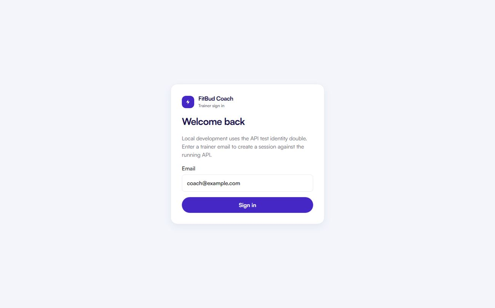{.shot}

4. **What's wrong or missing.** Inconsistent. Sign-out on network errors. Silent 404 redirect.
5. **Target design.**
   - `ErrorState` (title, one sentence, Retry, Details showing the request id from the `requestId` envelope, and **Email support**, which opens the support `mailto` with the request id and screen prefilled, §1.6.10).
   - A `NotFound` page ("We couldn't find that page" with Home).
   - An `OfflineBanner`.
   - `EmptyState` (per screen).
   - A `Forbidden` page ("You don't have access to this client").
6. **States.** These are the states.
7. **Edge cases.** Expected-empty 404s, such as a client with no subscription, aren't errors.
8. **Deep links.** An invalid `/go/` link goes to TR-23 or the web equivalent: "This item isn't available anymore."
9. **References.**
   - NN/g empty states [R67] https://www.nngroup.com/articles/empty-state-interface-design/
   - Skeleton screens [R68] https://www.nngroup.com/articles/skeleton-screens/
10. **UX decisions.** Never lose the trainer's session on transient errors.
11. **Implementation.** `api-client` maps errors to `{kind: 'network'|'unauthorized'|'forbidden'|'notFound'|'conflict'|'server', requestId}`.
12. **Acceptance criteria.**
    - [ ] Five error kinds, each rendered distinctly.
    - [ ] Unknown routes show the 404 page.
    - [ ] The request id is visible in Details.
13. **Priority:** P0.

---

### TW-34 · Trainer note composer (private or visible to client)

> **Status:** New-proposed · **Priority:** P1 · **Where:** Overview "Coach notes", header ⋯ *Add note*, exception drawer (TW-05), check-in review (TW-20), asked-coach drawer (TW-32), Activity side panel (TW-17); trainer mobile TM-03, TM-04, TM-06 · **API:** notes (exists); API-CHG `visibility`, `subjectType`, `subjectId` · **Decision:** D20

1. **Purpose.** Let the trainer write private notes and, when they choose, a short note the client sees. The coach gets a presence in the app without chat.
2. **Entry.** The places listed above.
3. **Current state.** Notes exist and are private (contract). There's no visibility flag.
4. **What's wrong or missing.** The client never hears from the coach inside the app.
5. **Target design.**
   - **Composer:**
     - A text area (max 1,000 characters) with a counter after 800.
     - A **Visible to client** switch, off by default.
     - When the switch is on, the helper reads "Priya will see this on her Today screen and get a notification", and a preview chip shows how it appears ("From Rahul · just now").
     - **Save note** (primary).
   - **Note list:** each note shows its text, the time and a badge: "Private" (neutral) or "Visible to client" (info, eye icon). Visible notes also show "Seen by Priya · 9:12 am" once the trainee has opened them (P1; needs the read state).
   - **Actions on a visible note:**
     - *Edit*. The trainee sees "edited", and no new push is sent.
     - *Make private*. This removes it from the trainee's view immediately and sends no notification.
     - *Delete*, after a confirm.
   - A visible note can't be made private then visible again to re-push. Re-sharing within 24 h sends no second push.
6. **States.** Saving · Saved toast ("Shared with Priya" or "Saved privately") · error with the text kept · ended relationship (read-only, composer hidden).
7. **Edge cases.**
   - A visible note saved with a check-in review is delivered inside P-CHK-REV, with no separate P-NOTE.
   - Several visible notes in 15 min merge into one push ("Rahul left 2 notes for you").
   - Quiet hours defer the push. The note is visible in the app immediately.
   - Notes never contain medical advice. The helper text for the pain topic repeats the caution from TW-32.
8. **Notifications and deep links.** Push **P-NOTE** "Rahul has a note for you!" (no note text on the lock screen; the body is "Tap to read"). It links to `/today?note=:id` (§4.1).
9. **References.** No strong external reference for the visible or private split. The pattern follows FitBud's no-chat rule (UX §15).
10. **UX decisions.**
    - The default is private, so nothing leaks by accident.
    - The note text stays off the lock screen for privacy.
    - Visible notes are one-way: replies happen on WhatsApp.
11. **Implementation.**
    - API-CHG `trainer_notes`: add `visibility: 'private' | 'client'` (default `private`), `subjectType: 'relationship' | 'checkin' | 'exception' | 'meal' | 'workout' | 'coach_ask'`, `subjectId`, `sharedAt` and `seenAt`.
    - API-NEW (trainee) `GET /me/coach-notes?since=` and `POST /me/coach-notes/:id/seen`.
    - Notification type `trainer_note_shared`.
    - History kinds `note_shared` and `note_unshared`.
12. **Acceptance criteria.**
    - [ ] The default is private.
    - [ ] A visible note appears on the trainee's Today within one sync, and the push arrives once.
    - [ ] Make private removes it from the trainee's view.
    - [ ] Private notes never appear in any trainee API response.
13. **Priority:** P1.

---

## 2.2 Trainer mobile (TM)

Trainer mobile is for **quick work away from the laptop**: checking the attention feed, a client's status, reviewing a check-in, acknowledging or resolving, nudging, and marking asked-coach items. Plan building stays on web (UX §7). All TM screens live in `apps/mobile/src/trainer/`. Current navigation is `TrainerShell.tsx`, with tabs Attention, Clients, Check-ins and More (a coral tab indicator). **Change the indicator to indigo**, because coral isn't a status or selection colour.

### TM-01 · Attention (trainer mobile home)

> **Status:** Implemented · **Priority:** P1 · **Screen:** `TrainerAttention` · **Files:** `src/trainer/AttentionTab.tsx` · **API:** `GET /exceptions/attention`, coach asks [API-NEW], check-in inbox

1. **Purpose.** Answers "who needs me" on the phone.
2. **Entry.** App open (trainer role), and trainer pushes.
3. **Current state.** A list of attention items from code. No running screenshot.
4. **What's wrong or missing.** No grouping. No asked-coach items. No check-in section. No pull-to-refresh state. Dev copy may leak ("deterministic exceptions only").
5. **Target design.**
   - Large title "Today".
   - Segmented chips: **Needs you (N)** · **Asked (N)** · **Check-ins (N)**.
   - **Cards, one per client (D32: cards stay on trainer mobile):** a full-width card (16 dp padding, 12 dp radius) shows the avatar and name, one severity chip, the issue in plain words ("Missed 2 workouts · Mon, Wed"), the age ("since 3 d") and one full-width primary button, **Review** (48 dp). The order is the same as web: severity, then age.
   - Swipe right to **Mark reviewed**, swipe left for **Nudge**, with a visible ⋯ fallback for accessibility.
   - Tap opens TM-04 or the ask sheet.
6. **States.**
   - Skeleton.
   - Empty: "All caught up."
   - Offline: "You're offline. Showing the last update from 9:40 am." Actions are disabled. Trainer mobile is online-first for writes; trainer actions aren't in the trainee outbox.
7. **Edge cases.** Swipe actions show undo snackbars.
8. **Deep links.** `/coach/attention`.
9. **References.**
   - Material 3 navigation bar [R47].
   - TrueCoach dashboard [R1].
10. **UX decisions.**
    - On a phone, cards give large tap targets and room for swipe gestures, and a single column removes the density advantage that rows have on web (see the TW-04 comparison, D32).
    - Swipe actions make triage fast, while visible buttons keep it accessible.
11. **Implementation.** React Navigation tab. Shared `AttentionRow` logic in `packages/core` (grouping and labels).
12. **Acceptance criteria.**
    - [ ] Three segments.
    - [ ] One card per client, with one chip and one primary action, in severity-then-age order.
    - [ ] Swipe and button actions work.
    - [ ] No dev copy.
13. **Priority:** P1.

### TM-02 · Clients (search and list)

> **Status:** Implemented · **Priority:** P2 · **Files:** `src/trainer/ClientsTab.tsx` · **API:** `GET /clients`

1. **Purpose.** Find a client quickly.
2. **Entry.** Tab.
3. **Current state.** A list.
4. **What's wrong or missing.** Search and filters need checking. Chips have no icons.
5. **Target design.**
   - A top segmented control: **Clients · Activity** (Activity is TM-09).
   - A search field, filter chips (Needs attention, Check-in due, Onboarding, Ended), and rows showing name, goalShort and two chips. Tapping opens TM-03.
6. **States.** Empty, error, offline.
7. **Edge cases.** Paging via `cursor`.
8. **Deep links.** None.
9. **References.** Everfit client list [R8].
10. **UX decisions.** Mirror web semantics.
11. **Implementation.** Use the unified `StatusChip`.
12. **Acceptance criteria.**
    - [ ] Search with debounce, 300 ms.
    - [ ] Chips have icons.
13. **Priority:** P2.

### TM-03 · Client status

> **Status:** Implemented · **Priority:** P1 · **Files:** `src/trainer/ClientStatusScreen.tsx` · **API:** workspace read, week read model [API-NEW], responsiveness [API-NEW]

1. **Purpose.** A phone-sized overview of one client.
2. **Entry.** Clients, attention rows, `/coach/client/:rid`.
3. **Current state.** The status screen exists.
4. **What's wrong or missing.** No weekly consistency. No reminders line. No WhatsApp context link. "Plan builder stays on web." dev copy.
5. **Target design.**
   - Header: name and chips, plus the `TimezoneBadge` ("Priya's time 6:10 am · 5 h 30 m behind you") when the timezones differ (D22).
   - **This week** dots and counts, and **today's kcal** against plan (D25).
   - **Needs attention** (one item).
   - **Next check-in**.
   - **Reminders** label.
   - **Recent activity** (5 rows), linking to TM-09 filtered to this client.
   - **Coach notes**, with *Add note* opening the TW-34 composer in a sheet.
   - Actions: **WhatsApp** (prefilled with a deep link to the client's Today), *Nudge…* (pick an unresolved item), and "Edit plan on web", which copies or shares the web URL.
6. **States.** Standard. Ended: read-only.
7. **Edge cases.** No WhatsApp number: the button is disabled with an explanation. Ended: *Reactivate* opens the TW-30 confirmation in a sheet.
8. **Deep links.** `/coach/client/:rid`.
9. **References.** Trainerize client app overview [R21] (structure only).
10. **UX decisions.** Mobile shows the decision-making data, and edits happen on web.
11. **Implementation.** Reuse `primaryActionFor(header)`.
12. **Acceptance criteria.**
    - [ ] Week counts match web.
    - [ ] No dev copy.
13. **Priority:** P1.

### TM-04 · Exception review (mobile)

> **Status:** Implemented · **Priority:** P1 · **Files:** `src/trainer/ExceptionReviewScreen.tsx` (Acknowledge and Resolve) · **API:** as in TW-05

1. **Purpose.** Acknowledge or resolve on the go.
2. **Entry.** TM-01, push.
3. **Current state.** Acknowledge and Resolve buttons are present.
4. **What's wrong or missing.** No source context. No reminder context. The verbs are unexplained.
5. **Target design.** The same content as TW-05 in a full-screen stack, with a sticky bottom pair of buttons: **Mark reviewed** or **Resolve** (state-dependent), plus *Nudge*. ⋯ offers Add note (TW-34 composer, with the visibility switch) and WhatsApp. The resolve helper adds: "Resolving locks this item, so Priya can't log it late anymore" (D23).
6. **States.** As in TW-05.
7. **Edge cases.** As in TW-05.
8. **Deep links.** `/coach/exception/:id`.
9. **References.** As in TW-05.
10. **UX decisions.** Parity with web semantics.
11. **Implementation.** Share the copy and label maps with web through `packages/copy` and `packages/core`.
12. **Acceptance criteria.**
    - [ ] The same verbs and helper copy as web.
13. **Priority:** P1.

### TM-05 · Check-ins (mobile inbox)

> **Status:** Implemented · **Priority:** P2 · **Files:** `src/trainer/CheckinsTab.tsx`

1. **Purpose.** See the check-ins that are waiting.
2. **Entry.** Tab, push.
3. **Current state.** A list.
4. **What's wrong or missing.** Verify that names (not UUIDs) are shown, given the web P0 bug.
5. **Target design.** Segments: To review · Overdue. Rows show name, form and time.
6. **States.** Standard.
7. **Edge cases.** None.
8. **Deep links.** `/coach/checkin/:id`.
9. **References.** Everfit [R6].
10. **UX decisions.** Mirror web.
11. **Implementation.** The same inbox read model as web.
12. **Acceptance criteria.**
    - [ ] Names shown.
13. **Priority:** P2.

### TM-06 · Check-in review (mobile, lite)

> **Status:** Implemented · **Priority:** P1 · **Files:** `src/trainer/CheckinReviewScreen.tsx` (Record Outcome, Schedule Next, Record Note)

1. **Purpose.** Review a check-in on the phone.
2. **Entry.** TM-05, push.
3. **Current state.** Three actions.
4. **What's wrong or missing.** Long scroll before the actions. No client-visible note (D20).
5. **Target design.**
   - Answers, then measurements with change, then photos (tap for fullscreen and compare), then "Since last check-in" counts.
   - **Sticky bottom sheet:** an outcome segmented control, a note field with the **Visible to client** switch (TW-34) and **Save review**.
6. **States.** As in TW-20.
7. **Edge cases.** Photos load lazily.
8. **Deep links.** `/coach/checkin/:id`.
9. **References.** Everfit [R7].
10. **UX decisions.** The sticky sheet keeps the outcome in reach.
11. **Implementation.** Bottom sheet component.
12. **Acceptance criteria.**
    - [ ] Save review is reachable without scrolling.
13. **Priority:** P1.

### TM-07 · More (settings, notifications, profile)

> **Status:** Missing (placeholder) · **Priority:** P1 · **Files:** `TrainerShell.tsx` More tab → `src/trainer/MoreScreen.tsx` [new]

1. **Purpose.** Trainer notification settings (TW-29 parity), profile, switch role, help and sign out.
2. **Entry.** Tab.
3. **Current state.** A placeholder.
4. **What's wrong or missing.** No settings.
5. **Target design.**
   - Rows: Notifications (opens the TW-29 categories and quiet hours), Profile (name, mobile / WhatsApp, email, timezone, change password), Open FitBud on web (copy link), Switch to client view (dual-role only), **Help**, which opens the support `mailto` (D19, §1.6.10), Sign out.
   - Permission row: "Notifications: On / Off · Open settings".
6. **States.** Permission denied: deep-link to OS settings.
7. **Edge cases.** Android 13+ needs the POST_NOTIFICATIONS runtime permission ([R52]).
8. **Deep links.** `/coach/settings`.
9. **References.** Android notification permission [R52] https://developer.android.com/develop/ui/compose/notifications/notification-permission
10. **UX decisions.** Parity with web settings.
11. **Implementation.** `expo-notifications` permissions API ([R61]).
12. **Acceptance criteria.**
    - [ ] The permission state is accurate.
    - [ ] Toggles persist through the preferences API.
    - [ ] Help opens the mail composer with the subject and context, and if no mail app is installed it copies the address.
13. **Priority:** P1.

### TM-08 · Role select (dual-role users)

> **Status:** Implemented · **Priority:** P2 · **Files:** `src/screens/RoleSelectScreen.tsx`, `UnsupportedRoleScreen.tsx`; routes `role_select`, `unsupported_role` in `src/navigation/resolveRoute.ts`

1. **Purpose.** Pick the coach or client view when the user has both roles.
2. **Entry.** After auth.
3. **Current state.** Implemented.
4. **What's wrong or missing.** Shows "Selected role · userId" dev copy elsewhere (the trainee More tab).
5. **Target design.** Two large cards, "Coach" ("Manage your clients") and "Client" ("Follow your plan"), plus "Remember my choice". Switching later lives in More.
6. **States.** Unsupported role: "This account can't use the app yet. Contact support."
7. **Edge cases.** A deep link to the other role's item prompts "Switch to coach view to open this?"
8. **Deep links.** The resolver handles the role (§3.5).
9. **References.** None needed.
10. **UX decisions.** Remembering the choice avoids repeated friction.
11. **Implementation.** Persist with `expo-secure-store` or AsyncStorage (choose one, OQ-6).
12. **Acceptance criteria.**
    - [ ] The choice is remembered.
    - [ ] No user ids shown.
13. **Priority:** P2.

### TM-09 · Activity feed (inside the Clients tab)

> **Status:** New-proposed · **Priority:** P1 · **Screen:** `TrainerActivity` (Clients tab, segment "Activity") · **Files:** `src/trainer/ActivityFeedScreen.tsx` [new], `src/trainer/ClientsTab.tsx` (segment) · **API:** API-NEW `GET /activity/feed?cursor=&limit=30&types=&rid=&since=` · **Decision:** D16, user 17 Oct (nav 2)

1. **Purpose.** Answers "what have my clients been doing" across all clients, on the phone, in one scroll. It's a complement to Attention (which shows only what needs action).
2. **Entry.**
   - The Clients tab segment **Activity**.
   - TM-03 "Recent activity → See all" (prefiltered to that client).
   - Trainer push for meal-time changes (T-MEALTIME).
3. **Current state.** None.
4. **What's wrong or missing.** Trainers have no cross-client timeline on mobile. Web has per-client Activity only (TW-17).
5. **Target design.**
   - **Header:** the segmented control **Clients · Activity**. Below it, filter chips that scroll horizontally:
     - **All**
     - **Workouts**
     - **Meals**
     - **Check-ins**
     - **Changes**: meal-time changes, swaps, "something different", logged late
     - **Notes seen**: visible notes the client opened
     - **Client** picker (a single-select sheet with search).
   - **Grouped by day** with sticky headers ("Today", "Yesterday", "Tue 13 Oct"). Within a day, newest first.
   - **Row** (64 dp minimum):
     - avatar initials;
     - **"Priya** completed *Upper body A*", "**Arjun** logged *Lunch* · something different · 610 kcal (plan 520)", "**Neha** changed Lunch time 1:30 → 2:30 pm", "**Priya** logged *Dinner* late (Tue)", "**Arjun** submitted check-in", "**Neha** saw your note";
     - the type icon and status chip;
     - relative time (in the trainer's timezone, with the client's local time in brackets when it differs: "2 h ago · 7:40 pm her time").
   - **Grouping:** consecutive events of the same type from the same client within 60 min collapse into one row ("Priya logged 3 meals"), which expands on tap.
   - **Row tap:**
     - workouts and meals open a sheet with the TW-17 detail (sets, or planned and actual foods with kcal);
     - check-ins open TM-06;
     - meal-time changes open TM-03, scrolled to the plan times.
   - **Row actions** (long-press or a ⋯ button for accessibility): *Open client*, *Add note* (TW-34), *WhatsApp*. Exception actions are **not** here; they stay in Attention.
   - Unread dot: events newer than the last time the trainer viewed the feed (stored on the device).
6. **States.**
   - Skeleton rows.
   - Empty: "No client activity yet. It'll appear as your clients log."
   - Filtered empty: "No meal activity in the last 7 days."
   - Offline: the cached last 100 events, with "Showing activity from 9:40 am".
   - Error with Retry.
7. **Edge cases.**
   - Ended clients are excluded unless they're explicitly picked.
   - Superseded assignments are hidden.
   - Infinite scroll uses the cursor, with a 30-day lookback and a "Load older" button after that.
   - Rate: realtime hints refresh the head of the list without jumping the scroll position ("3 new · tap to see").
8. **Deep links.** `/coach/activity?rid=:rid&type=meal`.
9. **References.**
   - Adapt: the TrueCoach dashboard activity stream [R1] (structure only).
   - Adapt: Material 3 lists [R47].
   - No strong external reference for the change-event types; they're FitBud-specific.
10. **UX decisions.**
    - Living inside Clients keeps the 4-tab bar unchanged.
    - Attention is for *acting*; Activity is for *awareness*, with no resolve actions, so the two never duplicate.
    - Grouping keeps a busy roster scannable.
11. **Implementation.**
    - API-NEW `GET /activity/feed`, a trainer-scoped union read model over assignment state changes, `meal_time_overrides` changes, check-in submissions, coach-note seen events and late logs. It returns `{events:[{id, rid, traineeDisplayName, type, subtype, occurredAt, traineeLocalTime, summary, kcal?, link}], nextCursor}`.
    - Event sentences come from `packages/copy`.
    - FlashList for the list.
12. **Acceptance criteria.**
    - [ ] The Activity segment shows events from all active clients, grouped by day.
    - [ ] The filters and client picker work and reset the cursor.
    - [ ] Meal-time changes and late logs appear.
    - [ ] Rows open the right detail.
    - [ ] There are no resolve or acknowledge actions in the feed.
13. **Priority:** P1.


## 2.3 Trainee mobile (TR)

**Current-state baseline for the whole trainee app**, read from the code on `feat/iteration-a-backend`:

- Custom state routing (`src/navigation/AppRouter.tsx`, `resolveRoute.ts`), with routes auth, loading, unsupported_role, role_select, accept_invite, intake, waiting_review and trainee_shell. Tabs switch through `useState` in `src/trainee/TraineeShell.tsx`.
- Notification routing (`src/notifications/routing.ts`) maps a payload to a **tab only** (workout, diet or today). `register.ts` uses a local test FCM token. **There's no `expo-notifications` dependency.**
- Screens call `api.*` directly: `TodayTab` and `DietTab` call `generate…Assignments` on load, and `confirm` or `deviate` go straight to the API. `src/sync/SyncProvider.tsx` is a memory store, not SQLite. The architecture's offline outbox (Tech Arch §9) isn't wired into the screens yet.
- Satoshi isn't loaded. Theme: background `#F6F5FB`, radii 20 and 16, `touchTargetMin` 44. **Raise it to 48.**
- Figma trainee frames (`screens/trainee_0x_*.png`) exist for Today, Check-in, Active workout, Lock screen, Today's diet, Yesterday's diet, Assigned diet plan and one extra frame.

**Platform prerequisites (P0, before the screens):**
1. Navigation library with `linking` (OQ-6).
2. `expo-notifications` with categories and actions ([R61]).
3. `expo-sqlite` outbox wired into `src/sync/engine.ts`.
4. `expo-font` for Satoshi.
5. Production auth (D18): password plus an email OTP (WhatsApp leg behind `wa_otp`) through the FitBud auth endpoints and Firebase custom tokens (§3.1a).
7. `expo-application` (version and build for the support `mailto`, D19), and `expo-mail-composer` (optional; the plain `Linking.openURL('mailto:…')` is enough).
8. P2 only: `react-native-health-connect` (Android) and `react-native-health` (iOS) for steps (TR-25).
6. Remove the client-side `generate…Assignments` calls. Replenishment is the server job's responsibility (`jobs/replenishment.ts`).

### TR-01 · Sign in / account activation

> **Status:** Implemented (test identity only) · **Priority:** P0 · **Screen:** `SignIn`, `CodeSignIn`, `ForgotPassword`, `SetPassword` · **Files:** `src/screens/AuthScreen.tsx` ("Production Firebase sign-in is not wired yet", test token or Firebase UID inputs) → `src/screens/auth/*` [new] · **API:** API-NEW `POST /auth/login`, `/auth/otp/start`, `/auth/otp/verify`, `/auth/password/reset`, `/auth/password/set` (§3.1a) · **Decision:** D18

1. **Purpose.** Get the trainee into the app with the least friction, usually straight from an invite link, at no per-login cost.
2. **Entry.** App first open, the invite link (TR-02), sign-out, session expiry.
3. **Current state.** Test token and Firebase UID fields. Developer-facing.
4. **What's wrong or missing.** No production auth. Developer copy. No recovery path.
5. **Target design.**
   - Brand gradient hero, logo and "Progress, guided." When the user arrived from an invite: "Join Rahul's coaching" (TR-02 handles new accounts).
   - **Default: password sign-in.**
     - **Mobile number or email**: one field, a numeric keypad toggle, and a "+91" prefix when the input starts with a digit.
     - **Password**, with show/hide.
     - **Sign in** (56 dp primary).
     - **Sign in with a code instead** (a text button).
     - **Forgot password?**
   - **Code sign-in:**
     - **Send code to:** **Email** (selected, the only live option) and **WhatsApp**, disabled, with a **"Coming soon"** chip and the note: "Codes on WhatsApp are coming soon. For now we'll email your code; check spam if you don't see it." This applies while `wa_otp` is off (§1.6.11). When the flag is on, the copy becomes "We'll send a 6-digit code to your WhatsApp and email. Use whichever comes first."
     - **Send code**.
     - A code input with `textContentType="oneTimeCode"` / `autoComplete="sms-otp"`. iOS suggests WhatsApp copy-code from the clipboard; on Android, the WhatsApp authentication template's **copy-code button** puts the code on the clipboard [R79]. Paste fills all six boxes.
     - "Sent to WhatsApp ••••1234 and p•••@gmail.com" · **Resend in 60 s** · *Use password instead*.
     - **No SMS option, and no SMS fallback.**
   - **Forgot password:** the code (same as above), then **New password** (minimum 8 characters, show/hide, no composition rules [R82]), then signed in.
   - Footer: **Need help?**, which opens the support `mailto` (D19).
6. **States.**
   - Signing in: a spinner, with inputs disabled.
   - Wrong credentials: "That mobile number or email and password don't match." (generic).
   - Code sent: "If an account exists, we've sent a code." (generic, no enumeration).
   - Wrong or expired code: "That code didn't work. Check the latest message or tap Resend." After 5 wrong tries: "Too many tries. Request a new code."
   - Rate-limited: "Too many codes requested. Try again in 1 hour or use your password."
   - WhatsApp leg unavailable (budget cap, no mobile on file, or WhatsApp not on that number): "Sent to your email" only.
   - Network error with Retry, and the typed values kept.
7. **Edge cases.**
   - Neither code arrives: "Didn't get it? Check spam, or ask Rahul to confirm your email and number." Resend is available after 60 s. There's still no SMS.
   - Already signed in on the device as another role: go to role select.
   - Password managers: `textContentType="username"` / `password` / `newPassword`.
8. **Deep links.** The invite token persists through auth. `/auth/code?identifier=` prefills.
9. **References.**
   - Adopt: Firebase custom tokens [R80] and password auth [R81]. Firebase phone auth is SMS-based, so it isn't used.
   - Adopt: WhatsApp authentication templates with a copy-code button [R79].
   - Adopt: NIST SP 800-63B [R82] and the OWASP authentication and forgot-password cheat sheets [R84].
   - Avoid: Cult.fit's OTP-only dead ends [R39] https://appinsider.io/apps/cult-fit-gym-workout-fitness-1217794588
10. **UX decisions.**
    - Password by default: it costs nothing per login, works offline from the cached session, and doesn't depend on delivery.
    - The code goes to **two channels at once**, so one failing channel never strands the user. This answers the OTP-failure pattern seen in Indian apps [R39] [R72] without SMS cost.
11. **Implementation.**
    - Firebase JS SDK `signInWithCustomToken` with the token from the FitBud API. Mobile then sends the Firebase ID token as a bearer (Tech Arch).
    - Store the refresh state in `expo-secure-store`.
    - Remove the test fields from production builds.
12. **Acceptance criteria.**
    - [ ] Mobile number or email plus password signs in.
    - [ ] Today, with `wa_otp` off: the code arrives by email from `SYSTEM_EMAIL_FROM`, and WhatsApp shows as disabled "Coming soon".
    - [ ] With `wa_otp` on (staging): one code goes to WhatsApp and email at once, and works from either.
    - [ ] There's no SMS anywhere.
    - [ ] Forgot password resets and signs in.
    - [ ] The invite context is shown.
    - [ ] No test fields in production.
13. **Priority:** P0.

### TR-02 · Invite acceptance

> **Status:** Implemented (paste-token) · **Priority:** P0 · **Screen:** `Invite` · **Files:** `src/screens/AcceptInviteScreen.tsx` (paste-token field, optional display name) · **API:** `POST /invitations/accept`

1. **Purpose.** Join a coach in one tap from WhatsApp.
2. **Entry.** The invite link `https://{appHost}/i/{token}`, or manual code entry.
3. **Current state.** A paste-token field.
4. **What's wrong or missing.** Asking people to paste tokens is a big drop-off point. There's no trainer context and no link handling.
5. **Target design.**
   - **Landing card:** trainer initials and name, "Rahul invited you to coaching on FitBud", and three bullets:
     - "Your plan, day by day"
     - "Log meals and workouts in a tap"
     - "Rahul sees your progress"
   - **Your name** (prefilled from the invite display name, editable).
   - **Mobile number** (prefilled from the invite if the trainer entered it, editable) and **email** (prefilled from the invite, read-only).
   - **Create a password** (minimum 8 characters, show/hide). Helper: "You'll sign in with your mobile number or email and this password."
   - **Verify:** the first acceptance sends a 6-digit code **by email** to prove ownership before the password is set. WhatsApp is added when `wa_otp` turns on (D18). A user who's already signed in skips this step.
   - Primary: **Join Rahul**.
   - A small link: "Have a code instead?" opens manual entry.
   - **Web landing** (app not installed): the same card plus Play Store and App Store buttons. The token carries through install via a deferred deep link, or the page offers "Copy code" and the app prompts "Paste your invite code" on first open with the clipboard prefilled (only with user consent).
6. **States.**
   - Invalid or used token: "This invite link has expired or was already used. Ask Rahul for a new one." plus *Message Rahul on WhatsApp* (when the trainer's number is known from the invite preview API-NEW).
   - Network error.
7. **Edge cases.**
   - The user already has an active relationship (MVP allows one): "You're already coaching with Asha. To join Rahul, end coaching with Asha first." It offers *End coaching with Asha* (confirm), then continues. (Decision G: one active relationship.)
   - **A returning trainee with a new coach:** their account exists, so they sign in and skip the password step. The new relationship starts blank for the trainer. The trainee keeps their history (D21).
   - **A reactivation request** from the same coach is not an invite. It appears as TR-22's confirmation card.
   - Wrong account signed in.
8. **Deep links.** `/i/:token` (web) and `/invite/:token` (app).
9. **References.**
   - Everfit public client invite link [R14].
   - Expo linking into your app [R61] https://docs.expo.dev/linking/into-your-app
10. **UX decisions.** Showing the trainer's identity builds trust. The link-first flow removes the paste step.
11. **Implementation.**
    - API-NEW: an invite preview `GET /invitations/preview?token=` (public, rate-limited) returning the trainer display name only. No PII beyond that.
    - API-CHG: `POST /invitations/accept` accepts `{token, displayName, mobileE164?, password, otpProof}` for new accounts.
    - Universal links and App Links on the host (OQ-2).
12. **Acceptance criteria.**
    - [ ] Tapping the WhatsApp invite opens the app on the join card.
    - [ ] The manual code path works.
    - [ ] The expired-token copy is shown.
    - [ ] A new account sets a password during acceptance.
13. **Priority:** P0.

### TR-03 · Intake form

> **Status:** Implemented · **Priority:** P1 · **Screen:** `Intake` · **Files:** `src/screens/IntakeScreen.tsx` (draft, submit) · **API:** `GET /onboarding/forms/current`, `PUT …/draft`, `POST …/submit`; `PUT /me/trainee-profile` (DOB, gender)

1. **Purpose.** Answer the trainer's onboarding questions.
2. **Entry.** After join, or resuming a draft.
3. **Current state.** Draft and submit work.
4. **What's wrong or missing.** Probably one long scroll. Progress isn't shown. Field types must cover all six.
5. **Target design.**
   - **One section per screen**, with a progress bar ("2 of 5").
   - Fields rendered by `FormRenderer`: short or long text, single choice (radio cards), multiple choice (chips), number (numeric keypad with unit), yes/no (two big buttons).
   - Autosave the draft on every change (debounced), with "Saved" shown in the header.
   - Last screen: a **Review** summary with Edit links, then **Send to Rahul**.
   - Profile basics (date of birth, gender) are asked first only if they're missing.
6. **States.**
   - Offline: answers are saved locally and sent when back online. Submit queues: "Will send when you're online."
   - Validation is inline, per field.
7. **Edge cases.** The form version is pinned (contract): render the pinned version even if the trainer edits the template later.
8. **Deep links.** `/intake`.
9. **References.**
   - Fitbod's one-question-per-screen onboarding [R40] https://www.botsi.com/resources/flows/apps/fitbod (adapt by sectioning rather than one question per screen).
   - Everfit onboarding flow [R13].
10. **UX decisions.** Sectioning lowers the perceived length. Autosave prevents data loss.
11. **Implementation.** Shared `FormRenderer` (also used by TR-14 and the TW-24 preview).
12. **Acceptance criteria.**
    - [ ] All six types.
    - [ ] Autosave.
    - [ ] Offline queue.
    - [ ] Review step.
13. **Priority:** P1.

### TR-04 · Waiting for coach

> **Status:** Implemented · **Priority:** P1 · **Screen:** `Waiting` · **Files:** `src/screens/WaitingReviewScreen.tsx` (green `#D1FAE5` banner, "Refresh status")

1. **Purpose.** Holds the trainee after intake until the plan is ready, without them feeling stuck.
2. **Entry.** After submit, and on app open while the status is `onboarding_submitted` or `coaching_ready` without an effective plan.
3. **Current state.** A green banner and a Refresh button.
4. **What's wrong or missing.** Manual refresh. No expectations set. No useful action.
5. **Target design.**
   - Illustration-free calm card: "Rahul is preparing your plan".
   - A checklist (derived status):
     - ✓ Joined
     - ✓ Intake sent (Mon 12 Oct)
     - ○ Coach reviews your answers
     - ○ Your plan is ready
   - **Meanwhile:**
     - **Set up reminders** (TR-05, when not done).
     - **Add your starting weight** (optional, creating a measurement).
     - **Message Rahul on WhatsApp** (prefilled "Hi Rahul, I've filled my FitBud intake…").
   - Auto-refresh on app focus, and on realtime or push P-PLAN.
6. **States.** Status coaching_ready with no plan: step 3 is ticked, with "Rahul is building your plan."
7. **Edge cases.** Use the neutral or info banner, not green, because nothing is "successful" yet.
8. **Deep links.** `/waiting`.
9. **References.** No strong external reference.
10. **UX decisions.** Give the trainee useful tasks during the wait, and use it to set up reminders.
11. **Implementation.** Poll on focus. The push P-PLAN routes to Today.
12. **Acceptance criteria.**
    - [ ] Auto-advances when the plan becomes effective.
    - [ ] The checklist reflects the derived status.
13. **Priority:** P1.

### TR-05 · Reminder setup (onboarding step)

> **Status:** New-proposed · **Priority:** P0 · **Screen:** `ReminderSetup` · **Files:** `src/trainee/setup/ReminderSetupScreen.tsx` [new] · **API:** notification preferences (PUT), device token registration; API-NEW fields `channelPreference: 'app'|'app_and_whatsapp'`, `whatsappOptIn: {granted, at, source, textVersion}`, `preferredWorkoutTime: HH:MM|null`, `traineeTimezone` (IANA), `locale`; meal-time overrides live in TR-24

1. **Purpose.** Gets the trainee's permission and preferences so reminders reach them at sensible times (D11).
2. **Entry.** After intake submit, before Waiting. It can be skipped, and it's repeatable from TR-16.
3. **Current state.** None.
4. **What's wrong or missing.** Without this, Android OEM battery savers silently kill pushes, and there's no WhatsApp consent.
5. **Target design.** Four short steps, each skippable, with a progress dot strip.
   1. **"When do you usually work out?"**
      - Chips: Morning (6–9), Midday (12–2), Evening (5–8), Night (8–10), Varies.
      - An exact time picker under "Set exact time".
      - Helper: "We'll only remind you if your workout isn't logged about an hour after this. You can change it anytime."
   2. **"How should we remind you?"**
      - **App notifications (recommended)**, selected by default.
      - **App + WhatsApp backup**: **disabled, with a "Coming soon" chip** while `wa_automation` is off. The note reads: "WhatsApp reminders are coming soon. For now we'll remind you in the app. Your coach can still message you on WhatsApp anytime." No consent is collected while the flag is off.
      - **When the flag is on**, the helper explains: "If app notifications don't reach you, or a few logs slip, we'll send a WhatsApp reminder instead. At most one a day." Choosing it opens an **explicit consent** card with the full text: "I agree to receive coaching updates from FitBud on WhatsApp at +91 98xxxx1234. I can stop anytime from Settings or by replying STOP." It has a checkbox (unchecked by default) and the number, which can be edited.
      - Trainees who finished setup before the flag turned on see a one-time inbox item and a TR-16 prompt: "WhatsApp reminders are here. Want them as a backup?" (D17).
   3. **"Allow notifications"** (pre-permission screen).
      - A visual of a sample reminder: "Lunch isn't logged yet · Eaten as planned".
      - Primary: **Allow notifications**, which triggers the OS prompt (Android 13+ POST_NOTIFICATIONS, iOS authorisation).
      - Secondary: *Not now*.
      - If denied: "No problem. You can turn them on later in Settings."
   4. **"Keep reminders working"** (Android only, shown only when the device maker is on a known list: Xiaomi, Redmi, POCO, OnePlus, Oppo, Realme, Vivo, Samsung, Huawei).
      - Maker-specific steps, for example "Settings › Apps › FitBud › Battery › No restrictions" and "Enable Autostart", with an **Open settings** button (an intent to the app details or battery optimisation screen).
      - "Done" and "Skip" buttons.
      - A link: "Why?" opens the dontkillmyapp page for that maker.
   - **Quiet hours** default to 22:00–07:00. They're shown on the last step as a line with *Change*.
   - **Your time zone** (D22): a line on the last step, "Times shown in India Standard Time (from your phone) · *Change*". It's stored as `traineeTimezone` (IANA).
   - **Meal times** line: "Meal reminders follow your plan's times. You can adjust them anytime in Settings › Meal times" (TR-24).
6. **States.**
   - Permission already granted: skip step 3.
   - iOS: skip step 4.
   - Offline: preferences are saved locally and synced later.
7. **Edge cases.**
   - Consent **must** be stored with a timestamp, source ("onboarding") and text version for audit (Meta opt-in rules [R44] and DPDP consent [R60]).
   - WhatsApp reminders are sent through the **Meta WhatsApp Cloud API** with approved utility templates (D17, §4.2, §4.6), **only once `wa_automation` is on**. They take effect as soon as the consent is stored. The number is the account mobile by default.
   - If the platform budget cap is reached (§4.5), the consent stays valid, and reminders fall back to push without telling the trainee.
   - A "Varies" workout time means the learned time is used, with 18:00 as the fallback.
8. **Notifications.** Sets up all of §4. Send no test notification without consent.
9. **References.**
   - Android notification permission best practice [R52].
   - Meta "Getting opt-in" [R44] https://developers.facebook.com/docs/whatsapp/overview/getting-opt-in (mirror verified: https://whatsapp-docs.kap.so/documentation/whatsapp/getting-opt-in).
   - WhatsApp Business Messaging Policy [R45] https://business.whatsapp.com/policy
   - Don't kill my app [R54] https://dontkillmyapp.com/ , https://dontkillmyapp.com/xiaomi , https://dontkillmyapp.com/oneplus
   - DPDP Act 2023 [R60].
   - Apple HIG notifications [R58] https://developer.apple.com/design/human-interface-guidelines/notifications
10. **UX decisions.**
    - A pre-permission screen before the OS prompt raises grant rates, and leaves a second chance if the user isn't ready.
    - WhatsApp is opt-in, defaults off, and is limited to important updates, to protect trust and comply with the opt-in rules.
    - The OEM guide addresses the top Indian Android failure mode.
11. **Implementation.**
    - `expo-notifications` `requestPermissionsAsync`.
    - `expo-device` or `Platform.constants` for the manufacturer.
    - `expo-intent-launcher` for the battery settings intents. Every intent falls back to the app details screen.
    - Persist preferences through the existing preferences `PUT`, plus the new fields (API-NEW).
12. **Acceptance criteria.**
    - [ ] Defaults: App only, quiet hours 22:00–07:00.
    - [ ] While `wa_automation` is off, the WhatsApp option is disabled with "Coming soon" and no consent is stored.
    - [ ] When it's on, the WhatsApp consent checkbox is unchecked by default, and storage includes time and text version.
    - [ ] The OEM step appears only on the listed makers.
    - [ ] Every step can be skipped.
    - [ ] The preferred workout time saves (or stays null).
13. **Priority:** P0 (permission, preferred time, timezone), P1 (OEM guide, WhatsApp consent).

### TR-06 · Today

> **Status:** Implemented (needs redesign) · **Priority:** P0 · **Screen:** `Today` · **Files:** `src/trainee/TodayTab.tsx` (generate calls on load, "Version N · effective", "Open today's diet", Refresh) · **API:** workout and meal assignments for today, the effective plan, check-ins, week read model [API-NEW], notifications unread count

1. **Purpose.** Answers "what do I do now". It's the daily home (UX §8).
2. **Entry.** App open, tab, most pushes (summary P-EOD), and widget taps.
3. **Current state.** Code: a list of today's items, a plan card with "Version N · effective", and Refresh. Figma `screens/trainee_01_today.png` has a strong hero, but also banned elements (streak, 76% ring, hydration, "Active Plan V2").

   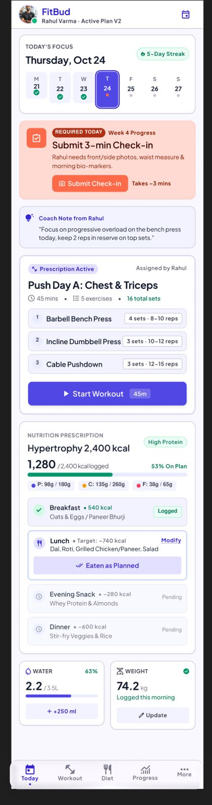{.phone}

4. **What's wrong or missing.**
   - The code version: no hierarchy, plan version jargon, no "next up", no weekly consistency, no check-in surfacing, manual Refresh, client-side generation, no date navigation, no nutrition totals.
   - The Figma version: streak, % ring, hydration and Ask Coach chat.
5. **Target design** (top to bottom; user 17 Oct nav 3, D25, D27).
   1. **Top bar:** "Today · Wed 14 Oct", the sync indicator and a bell with an unread dot (TR-15).
   2. **Date navigator** (D27). A horizontal **week strip** (Mon–Sun, swipe for other weeks) with ‹ › and a *Today* pill when you're on another day. Each day has a small state dot (all done, some open, rest day) and **no %**.
      - **Today:** fully interactive.
      - **Past days:** read-only, *except* items that can still be logged late (D23): assigned items not yet logged whose exception the trainer hasn't resolved. Those rows keep their action and a "Log late" chip, and a banner says "You can still log 2 items from Mon." Logged items on past days are view-only.
      - **Future days:** a read-only preview ("Preview · Thu 15 Oct"), with planned workouts and meals and no actions. The preview reaches only as far as the assigned horizon; after that: "Your coach hasn't planned beyond Sun yet."
   3. **Next up hero card** (today only), the single most relevant item, chosen in this order:
      1. An overdue required item.
      2. The current or next meal window (within ±60 min).
      3. Today's workout, when it isn't done.
      4. A check-in that's due.

      Each hero has one primary action: *Eaten as planned* for a meal, *Start workout* for a workout, *Start check-in* for a check-in. A secondary action is "Something different" or "Not today".
   4. **Today's workout card:** the session name ("Upper body A"), "6 exercises · ~45 min", the first 3 exercise names, and the state chip. The primary **Start** goes **straight into the active workout** (TR-11), skipping the workout overview. *See workout* opens TR-10. In progress: **Resume** ("3 of 6 done"). Done: collapses to "Upper body A · done 7:40 pm" with *View*. Rest day: "Rest day. Recovery is part of the plan."
   5. **Nutrition card** (D25):
      - **Four progress rings in a row: kcal, Protein, Carbs, Fat.** Each ring shows *logged vs assigned* for the day: the centre reads "1,240" over "of 1,850 kcal", or "62 / 90 g". A ring fills to 100% and then shows a thin outer overflow arc; it never turns red.
      - Totals count **only logged meals**: as planned, at the plan's values, plus "something different" at the values of the foods actually logged (TR-26).
      - Unknown values: the ring shows "≥ 1,240" and a footnote "Some foods have no nutrition data."
      - Ring colours are neutral data tokens (`ring.kcal`, `ring.protein`, `ring.carbs`, `ring.fat`; §1.2), never success, warning or critical. There's no "% of goal" text.
      - **Next meal to log** card (inside the nutrition card): the first unlogged meal by time, showing "Lunch · 1:30 pm · 2 roti · 1 katori dal · 520 kcal" with **Eaten as planned** and *Something different*. When every meal is logged: "All meals logged today."
      - Tapping the rings opens TR-07 for that day.
   6. **Steps card** (optional, P2, TR-25). It shows only when the trainee has connected Health Connect or HealthKit **and** granted the steps permission: "6,240 steps today" with a 7-day mini bar chart and no goal judgement. If permission isn't granted, **the card is hidden** (there's no nag on Today). Setup lives in Settings.
   7. **This week** (`WeeklyConsistency`): Mon–Sun dots and "3 of 4 workouts · 17 of 21 meals". Copy rules are in §1.6.9: when the trainee missed yesterday, "Yesterday got away from you. Today's a fresh start." **Never** a streak count.
   8. **From your coach** (D20):
      - **Notes Rahul marked visible to you**, newest first, max 2 with "See all". Each card shows "From Rahul · 2 h ago", the note text, an unread dot until opened, and its context link (for example "About: Weekly check-in").
      - The review signals: "Rahul reviewed your check-in · Tue", "Rahul answered your question about Lunch", and "New plan from Mon · See what changed".
   9. **Check-in card**, when it's due in ≤2 days: "Weekly check-in due Fri" with *Start*.
   10. **Today's list** (collapsed, "All items"): compact rows for each workout and meal with time (the trainee's timezone), name, state chip and the kcal per meal.
   - No plan version numbers, no % text, no hydration, no streak.
   - **Copy examples:**
     - Morning: "Good morning, Priya. Here's your day."
     - All done: "That's everything for today. Nicely done."
6. **States.**
   - Loading skeleton.
   - Rest day with no workout: the workout card reads "Rest day", and meals are still listed.
   - No plan (shouldn't happen after TR-04): show the Waiting card.
   - Offline: data is cached from the last sync, actions are queued, and the sync indicator shows "Saved on phone". The rings update immediately from local logs.
   - Error: a cached view with an inline "Couldn't refresh · Retry".
   - Ended relationship: TR-22.
   - Past day with nothing loggable: "Viewing Mon 12 Oct · read-only".
7. **Interactions and edge cases.**
   - Pull to refresh.
   - Day rollover at midnight in the **trainee's timezone** refreshes automatically (D22).
   - The trainee's stored timezone runs every date and time. If the device timezone changes (travel), a one-time banner asks: "You're in Dubai time now. Use Dubai time for your plan? · Switch / Keep India time" (§3.9).
   - Meal times follow the trainee's own meal times when set (TR-24), labelled "your time".
   - Tapping the hero meal opens TR-08.
   - A shared note opened from P-NOTE scrolls to the note and marks it seen.
8. **Notifications and deep links.**
   - `/today` and `/today/:date` (YYYY-MM-DD; future dates open the preview, past dates the read-only view).
   - `/today?note=:id` from P-NOTE.
   - P-EOD opens Today scrolled to the remaining items.
   - Widget taps open Today.
9. **References.**
   - Adapt: the Trainerize client app "today" structure [R21] https://help.trainerize.com/hc/en-us/articles/208689006-What-Does-the-Client-App-Experience-Look-Like
   - Adapt: MyFitnessPal and HealthifyMe macro summaries on the diary [R31] [R34], with rings showing *logged vs assigned* and no good-or-bad colouring.
   - Adopt: the "never miss twice" framing from habit research [R62] and the BPS summary [R65].
   - Avoid: Duolingo-style streak pressure [R63] https://blog.duolingo.com/how-duolingo-streak-builds-habit/. Streaks work for daily-practice apps, but punish planned rest days in training.
10. **UX decisions.**
    - A single hero item reduces choice. The workout card's Start removes a tap for the most common action.
    - The rings show *progress through the plan*, not a score. That's why they're neutral colours with no % text, which keeps the contract's spirit (Confluence conflict C-9).
    - Weekly counts tolerate rest days and single misses (P9).
    - Coach notes make the accountability visible (P10).
    - The date strip makes yesterday's late logging discoverable without a separate screen.
11. **Implementation.**
    - Remove the `generateWorkoutAssignments` and `generateMealAssignments` calls from `TodayTab.tsx`.
    - Read from the local SQLite cache populated by `sync/pull`.
    - Pure selectors in `packages/core`: `nextUp()`, `dayNutrition(assignments, logs) → {kcal, protein, carbs, fat: {logged, assigned, unknown}}`, `nextMealToLog()` and `isLateLoggable(item, exceptionState)`. All are unit-tested.
    - The `NutritionRings` component uses react-native-svg.
    - The week read model is API-NEW (shared with TW-09). The day read model is `GET /me/day/:date` (API-NEW: assignments, logs, totals, the loggable flag).
12. **Acceptance criteria.**
    - [ ] The hero follows the priority order (unit tests cover each case).
    - [ ] The workout card's Start opens the active workout directly.
    - [ ] The rings show logged vs assigned for kcal, P, C and F, and "something different" meals count their logged foods.
    - [ ] The next meal card shows the first unlogged meal.
    - [ ] Past days are read-only except late-loggable items. Future days are a preview with no actions.
    - [ ] The steps card is hidden without permission.
    - [ ] There's no streak, % text, hydration or version label.
    - [ ] The weekly counts equal the trainer's counts.
    - [ ] It works offline from the cache.
    - [ ] No client-side generation calls.
13. **Priority:** P0 (date navigator, workout card, rings, next meal), P1 (coach notes), P2 (steps).

### TR-07 · Diet: today's meals and logging

> **Status:** Implemented (needs redesign) · **Priority:** P0 · **Screen:** `Diet` · **Files:** `src/trainee/DietTab.tsx` ("Confirm eaten as planned", "Quick modify", "Skip", "Photo required", photo upload; calls `generateMealAssignments` on load) · **API:** meal assignments list, confirm, deviate, skip; files upload target, put, confirm

1. **Purpose.** Log each meal in one tap when it went as planned, and quickly when it didn't.
2. **Entry.** Tab, meal push (the action button logs without opening the app), Today's hero, a deep link `/diet/:date` or `/meal/:id`.
3. **Current state.**
   - Code: a list with three equal buttons per meal, a "Photo required" note and the subtitle "confirm what you ate, then move on."
   - Figma `trainee_05_today_diet.png` and `trainee_06_yesterday_diet.png`: rich meal cards, but with % on-plan, a streak, "Photo Proof" and "Set Reminder".

   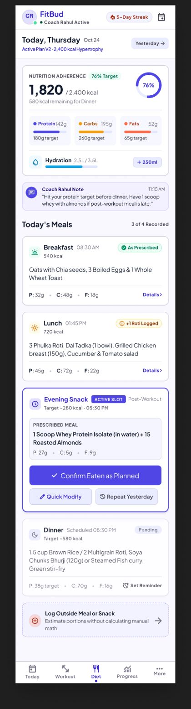{.phone} 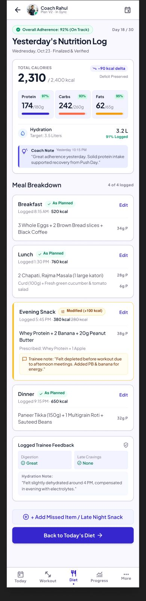{.phone}

4. **What's wrong or missing.**
   - The three equal buttons make no action primary.
   - "Photo required" reads as a barrier.
   - There's no date navigation (yesterday, for logging late).
   - Day totals are missing.
   - Logs go online-only, without the outbox.
5. **Target design.**
   - **Date header**, using the same week strip as TR-06 (shared `DateNavigator`). Today is interactive. Past days are read-only except items that can be logged late (D23). Future days are a read-only preview.
   - **Day summary** (D25): "3 of 5 meals logged", plus the compact **NutritionRings** (kcal, P, C, F: logged vs assigned, as on TR-06) and the line "1,240 of 1,850 kcal". Values use "≥" when unknown. There's no % text and no colour judgement.
   - **MealCard** for each slot:
     - Header: time · meal label (for example "Lunch · 1:30 pm") · state chip (Due, Logged ✓, Changed, Skipped, Logged late, Overdue).
     - Header right: **kcal for this meal** ("520 kcal"). After "Something different" it shows the logged value against the plan: "610 kcal · plan 520" (D25).
     - Body: the planned items ("2 roti · 1 katori dal · salad") with "P 18 · C 72 · F 14 g", and *See details* (opens items and instructions from TR-09). After a food log, the body lists the **foods actually logged** instead, with the plan behind a "Planned" toggle.
     - **Primary: "Eaten as planned"** (56 dp, indigo).
     - Secondary text button: **"Something different"**, which opens TR-08.
     - Overflow ⋯: *Skip this meal* (reason optional), *Ask coach* (TR-18).
     - When photos are requested: the chip "📷 Photo requested" and, after confirm, the inline prompt "Add a photo for Rahul?" with Camera and Gallery buttons. **Photo is never a hard gate on logging.** If configuration requires it, the log saves with `photoIntent` and the photo can follow.
   - **Logged card:** collapses to "Lunch · Eaten as planned · 1:52 pm · 520 kcal" with a *Change* link. Edits are allowed until the end of that day, in the trainee's time.
   - **Late logging (D23):** a past meal that wasn't logged stays loggable **until the trainer has resolved its exception**. The card shows "Log late" with the same actions, and the state becomes **Logged late**. Once the trainer resolves the exception, the card locks: "Closed by Rahul · can't be logged now". **Optional meals aren't late-loggable** (D34, OQ-26): after their day they show "Not logged" (read-only).
   - "Coach answered" marker if relevant.
6. **States.**
   - Offline: "Eaten as planned" is written to the outbox, the card shows a "Saved on phone" glyph, and it syncs later.
   - Upload pending: the photo thumbnail shows a progress ring and retries automatically.
   - Error on sync: the card shows "Not sent yet · Retry" (TR-19).
   - No meals today: "No meals planned today."
   - Ended: read-only.
7. **Interactions and edge cases.**
   - **Undo snackbar** for 5 s after confirm or skip ([R50]).
   - A late log shows the "Logged late" chip with no guilt copy. If the trainer resolves the exception while a late log sits in the outbox, the server accepts the log when it's stamped before the resolve; otherwise it returns `409 locked`, and the card shows "Rahul closed this meal before your log was sent." (TR-19).
   - Double taps are de-duplicated by the idempotency key per assignment.
   - Logging from the notification action (§4) updates the card on the next open.
8. **Notifications and deep links.**
   - Meal reminder **P-MEAL** has the actions *Eaten as planned* (background log through the outbox) and *Snooze 30 min*.
   - Deep link `/meal/:assignmentId` opens Diet on that date with the card highlighted, or TR-08 when `?action=change`.
9. **References.**
   - Adopt: MyFitnessPal "Copy meal" and "Quick Add" speed patterns [R31] https://support.myfitnesspal.com/hc/en-us/articles/360032622131-How-do-I-copy-a-meal-from-one-day-to-another and [R32] https://support.myfitnesspal.com/hc/en-us/articles/360032621971-What-is-Quick-Add
   - Adapt: Trainerize meal photos [R22].
   - Adapt: HealthifyMe Indian meal logging [R34] https://www.healthifyme.com/smart/features.html
   - Avoid: Figma's "Photo Proof", % on-plan and per-meal "Set Reminder".
10. **UX decisions.**
    - One dominant action for the normal path (P5).
    - Photos are optional context, never proof (UX §9; the code already says "Photos are evidence context, not proof").
    - Late logging until resolution captures real behaviour honestly, and the trainer's resolve is the clear end point (D23).
    - Per-meal kcal answers "how big was this meal" at a glance (D25).
11. **Implementation.**
    - The `MealCard` component.
    - Route mutations through `sync/engine.ts` (an outbox with SQLite).
    - Remove `generateMealAssignments` from the tab.
    - Photo upload is a background task with retry.
12. **Acceptance criteria.**
    - [ ] Eaten as planned is one tap and works offline.
    - [ ] Undo works.
    - [ ] Photo never blocks logging.
    - [ ] A past unlogged meal can be logged until its exception is resolved, and shows Logged late. After the resolve it's locked.
    - [ ] Every meal card shows kcal, and the day shows total kcal and the rings.
    - [ ] No % or colour judgement.
    - [ ] The notification action logs without opening the app.
13. **Priority:** P0.

### TR-08 · "Something different" (meal change sheet, with food logging)

> **Status:** Implemented (full screen) · **Priority:** P0 · **Screen:** `MealSheet` (bottom sheet over Diet or Today) → `FoodSearch` (TR-26) · **Files:** `src/trainee/MealDeviationScreen.tsx` (kinds: portion_adjustment, substitute, restaurant, repeat_recent, manual, other; "Save deviation") · **API:** meal deviate (API-CHG: kind `logged_foods` with `items[]`); trainee food search (API-NEW) · **Decision:** D28

1. **Purpose.** Record what was actually eaten, quickly and without judgement, **with real foods and quantities** so the rings and the trainer's view reflect reality.
2. **Entry.** MealCard "Something different", the Today next-meal card, a notification deep link `?action=change`.
3. **Current state.** A full-screen form titled "Meal Deviation", with the subtitle "lightweight change" and the dev copy "Photos are evidence context, not proof or lie detection." There's no food search.
4. **What's wrong or missing.** The title is jargon. It's a full-screen context switch. There are no smart defaults, and no way to say *what* was eaten in structured form, so the macros are unknown.
5. **Target design.** A modal **bottom sheet** ([R49]) titled "What did you have instead?".
   - **Primary path: "Log what I ate"** (a full-width button at the top), which opens **TR-26 Food search**, prefilled with the planned items as editable rows:
     - Each planned item shows as a row with its quantity and serving ("2 × roti"), which the trainee can keep, change or remove.
     - **+ Add food** searches the library.
     - A running total sits at the bottom: "610 kcal · P 24 · C 80 · F 20 g", and the plan comparison "plan 520 kcal".
   - **Quick options as chips (one tap):**
     - **Smaller portion** / **Bigger portion**: a portion slider at ½×, ¾×, 1¼×, 1½×. This maps to `portion_adjustment`, and the macros are the plan × multiplier.
     - **Same as earlier meal**: lists the last 5 logged meals, with kcal. This maps to `repeat_recent`, which copies those items and their macros.
     - **Ate out**: an optional restaurant or dish text, plus an optional "Add foods" link. Without foods, the macros are unknown (the rings show "≥"). This maps to `restaurant`.
     - **Type it in**: free text, for example "2 idli, sambar", with unknown macros. Helper: "Tip: *Log what I ate* lets Rahul see the nutrition too." This maps to `manual`.
     - **Other**.
   - Optional photo (Camera or Gallery).
   - Optional note.
   - Primary: **Save**.
   - Footer link: *Ask Rahul about this meal* (TR-18).
   - Copy: no "deviation" wording anywhere in the UI. The status chip reads "Changed".
6. **States.**
   - Offline: saved to the outbox. Food search works from the on-device index (TR-26).
   - Validation: Save is disabled until an option is picked or at least one food is added.
7. **Edge cases.**
   - The sheet expands to full height when the keyboard opens.
   - Back or swipe dismisses with "Discard changes?" when something was entered.
   - Editing a changed meal later (until end of day) reopens the logged items.
   - A late log uses the same sheet (D23).
8. **Deep links.** `/meal/:id?action=change` and `/meal/:id/foods` (straight to TR-26).
9. **References.**
   - Material 3 bottom sheets [R49] https://m3.material.io/components/bottom-sheets/guidelines
   - MyFitnessPal Quick Add [R32] and Copy meal [R31].
   - HealthifyMe Indian food logging [R34].
10. **UX decisions.**
    - Structured food logging is the *recommended* path, because it feeds the rings and the trainer's view. The chips stay for speed.
    - Prefilling the plan's items means the trainee only edits what differed. Usually that's one or two taps.
    - The neutral language avoids shame.
11. **Implementation.**
    - Use `@gorhom/bottom-sheet` or an equivalent.
    - API-CHG: add the deviation kind `logged_foods` with `items: [{foodId|null, customName?, servingId|null, unit, quantity, grams|null, kcal|null, protein|null, carbs|null, fat|null}]` and the computed `totals` (server recomputes from `foodId` and serving; client values are only for offline display).
    - Other kinds may also carry `items` (portion, repeat) so totals are always derivable.
    - The portion multiplier goes into the deviation details.
    - The trainer sees the items in TW-17.
12. **Acceptance criteria.**
    - [ ] The common change can be saved in 3 taps or fewer.
    - [ ] "Log what I ate" prefills the planned items, and the totals update live.
    - [ ] The saved foods drive the TR-06 rings and the TW-17 meal panel.
    - [ ] Works offline.
    - [ ] No "deviation" word in the UI.
13. **Priority:** P0 (sheet, chips), P1 (food logging, TR-26).

### TR-09 · Assigned meal plan (read-only)

> **Status:** Figma-only · **Priority:** P2 · **Screen:** `MealPlan` · **Files:** `src/trainee/MealPlanScreen.tsx` [new] · **API:** the effective plan (nutrition content)

1. **Purpose.** See the whole diet plan: slots, items, servings and swaps the trainer allows (if the plan defines alternatives).
2. **Entry.** Diet › "See full plan", meal card "See details", P-PLAN "See what changed".
3. **Current state.** Figma `trainee_07_assigned_diet_plan.png` (with "Ask Coach" chat and a grocery list, both banned).

   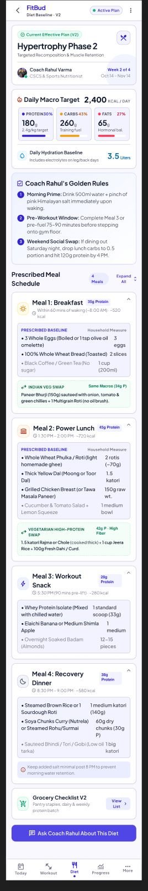{.phone}

4. **What's wrong or missing.** Not built. Figma includes banned elements.
5. **Target design.**
   - A day-pattern switcher (Training day / Rest day, or Every day).
   - A **day total** header: "1,850 kcal · P 90 · C 210 · F 55 g" (D25).
   - Slot sections showing the time (the trainee's own time when changed, with "plan 1:30 pm" muted, D24), label, items with servings, instructions, and **kcal per meal** plus P, C and F (with the unknown rule).
   - A **"What changed"** banner after a new version: "From Mon 19 Oct: Dinner now includes paneer instead of chicken."
   - *Ask Rahul* opens TR-18 (WhatsApp).
   - No grocery list, no chat.
6. **States.** Offline: cached. No plan: hidden.
7. **Edge cases.** The diff is computed against the previous effective version (API-NEW `GET /plans/:planId/versions/:vid/diff`, or a client-side diff of the content).
8. **Deep links.** `/plan/diet`.
9. **References.** Trainerize flexible meal planner [R23].
10. **UX decisions.** "What changed" turns a new version into something the trainee can understand. Version numbers are never shown to the trainee.
11. **Implementation.** Content renderer, plus a diff helper in `packages/core`.
12. **Acceptance criteria.**
    - [ ] A read-only plan view.
    - [ ] The diff banner appears after replacement.
    - [ ] kcal per meal and per day are shown.
13. **Priority:** P2.


### TR-10 · Workout overview

> **Status:** Implemented · **Priority:** P1 · **Screen:** `Workout` · **Files:** `src/trainee/WorkoutTab.tsx` ("Start Workout", "Continue Workout", "Skip workout"; calls `generateWorkoutAssignments`) · **API:** workout assignments, get assignment, start, skip

1. **Purpose.** See today's session and start it. Also see the week ahead.
2. **Entry.** Tab, Today hero, workout push, `/workout/:id`.
3. **Current state.** Today's assignment with Start, Continue and Skip buttons.
4. **What's wrong or missing.** No exercise preview. No week view. "Skip workout" is as prominent as "Start workout". Client-side generation.
5. **Target design.**
   - **Week strip** (Mon–Sun: session name, Rest, or ✓).
   - **Session card:** title ("Upper body A"), estimated duration *only if* the plan stores rest and set data to compute it (otherwise omit), the trainer's instruction note, and an exercise list (name, sets × reps, load label, thumbnail).
   - Primary: **Start workout** (or **Continue**, which shows "Paused at 3 of 6 exercises").
   - Overflow: *Not today* (skip, with an optional reason chip: Sick, Travelling, No time, Injury, Other) and *Ask coach*.
   - Completed state: a summary row with *View summary*.
6. **States.**
   - Rest day: "Rest day" with a tip from the trainer if the plan has one.
   - No plan.
   - Offline: start works offline and sets are logged to the outbox.
   - Missed earlier: "Mon's workout wasn't logged. If you did it, log it now." with *Log it* (opens the late log flow). **Logging late is allowed until your coach resolves the missed-workout exception** (D23). The banner lists every late-loggable workout, max 3.
7. **Edge cases.** Once the trainer resolves the exception, the workout becomes read-only "Missed · closed by Rahul", with no guilt copy. Optional workouts aren't late-loggable (D34). Until resolution, the item shows "Missed · you can still log it".
8. **Deep links.** `/workout/:assignmentId`. P-WO opens here.
9. **References.**
   - Everfit client app: Track a workout [R9] https://help.everfit.io/en/articles/5829094-client-app-track-a-workout
   - Hevy track workouts [R26] https://www.hevyapp.com/features/track-workouts/
10. **UX decisions.** Skipping is demoted to the overflow, but stays honest and available (an explicit skip is different from a silent miss).
11. **Implementation.** Remove the generate call. Cache the assignment and the plan content locally.
12. **Acceptance criteria.**
    - [ ] The week strip.
    - [ ] Start works offline.
    - [ ] Skip is in the overflow with reasons.
    - [ ] The late-log path works until the exception is resolved, and is locked after.
13. **Priority:** P1.

### TR-11 · Active workout

> **Status:** Implemented (needs redesign) · **Priority:** P0 · **Screen:** `ActiveWorkout` · **Files:** `src/trainee/ActiveWorkoutScreen.tsx` (Done, Skip set, Pause, Resume, Complete workout, Exit; session RPE text input, required or optional) · **API:** complete set, skip set, pause, resume, complete session, get execution

1. **Purpose.** Log sets fast, with the phone in one hand between sets.
2. **Entry.** Start or Continue, the Live Activity or notification tap.
3. **Current state.**
   - Code: per-set Done and Skip buttons, Pause and Resume, an RPE text input, and refetching the execution after every action (online round trips).
   - Figma `trainee_03_active_workout.png` is a strong reference (big numbers, rest timer).

   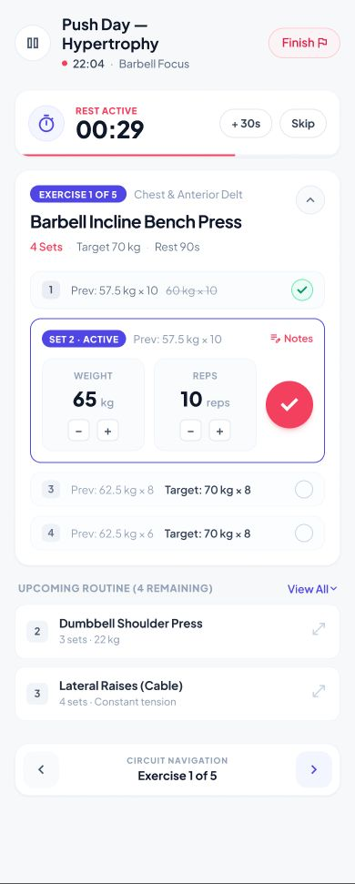{.phone}

4. **What's wrong or missing.**
   - A network round trip on every set is slow, and fails in the gym basement.
   - No rest timer.
   - No previous values.
   - The RPE text field is awkward.
   - There's no way to change load or reps before marking a set Done.
5. **Target design.**
   - **Header:** session name, elapsed time, a **Pause** icon and ⋯ (Finish early, Ask coach about this exercise).
   - **Current exercise card**, in focus:
     - Name, media thumbnail (tap for the video or GIF if a `LinkedMedia` URL exists), and the trainer note.
     - **Set rows** (`SetRow`): set #, prescribed "10 reps · 20 kg", and **Stepper** inputs prefilled with the prescription (reps and load). The caption shows "Last time: 10 × 17.5 kg".
     - The current set is highlighted, with a big **✓ Done** button (72 dp, indigo).
     - Changing a value before Done marks the set "Modified" (recorded as executed values versus prescribed).
     - Row overflow: *Skip set*.
   - **Rest timer:** starts automatically after Done, using the prescribed rest seconds, or 90 s when unspecified (OQ-18). A ring progress bar with −15 s, +15 s and Skip. A haptic and sound fire at the end, respecting silent mode.
   - **Exercise navigation:** swipe or "Next exercise ›", plus an overview list sheet showing ✓ for completed exercises.
   - **Finish:** "Finish workout" shows **Session RPE** as 1–10 big tappable chips with anchors ("1 · Very easy … 10 · Max effort"). It's required or optional according to configuration. A "How did it feel?" note is optional. Then TR-12.
6. **States.**
   - **Offline-first:** every set action is written locally (outbox) and the UI updates immediately. Sync runs in the background, and the `SyncIndicator` shows its state.
   - App killed mid-session: on reopen, "Continue your workout? Started 6:42 pm" with *Continue* or *Finish now*.
   - Paused: a banner with Resume. Paused time is excluded from the duration.
7. **Edge cases.**
   - Screen stays awake during the session (`expo-keep-awake`).
   - Accidental Done: tapping a completed set offers Undo or Edit.
   - Finishing with skipped or pending sets: "4 sets not logged. Finish anyway?" (they're recorded as skipped or pending, never invented).
8. **Notifications and deep links.**
   - An **ongoing notification or Live Activity** (TR-21) shows the current exercise and the rest timer.
   - `/workout/:id/active`.
9. **References.**
   - Adopt: the Hevy rest timer [R27] https://www.hevyapp.com/features/workout-rest-timer/ and workout log [R29] https://www.hevyapp.com/features/workout-log/
   - Adapt: the Hevy teardown [R30] https://www.tarunrai.com/post/hevy-app-teardown
   - Adapt: Everfit tracking [R9].
10. **UX decisions.**
    - Prefilled steppers plus one big Done button make the normal path a single tap per set.
    - The "Modified" state preserves honesty (decision D: record modifications).
    - Offline-first is mandatory in gyms.
11. **Implementation.**
    - Replace the `api.*` calls with outbox mutations (`set_complete`, `set_skip`, `pause`, `resume`, `session_complete`), each with a client mutation id (`sync_mutations` de-duplicates).
    - Local state comes from SQLite.
    - Previous values: from the local execution history (last execution of the same exercise), API-NEW if it isn't synced.
    - `expo-keep-awake` and `expo-haptics`.
12. **Acceptance criteria.**
    - [ ] Marking a set Done is a single tap, with no network wait (<100 ms UI response).
    - [ ] The rest timer auto-starts.
    - [ ] Modified values are recorded.
    - [ ] The RPE chip picker is shown.
    - [ ] Kill-and-resume works.
    - [ ] Fully usable in airplane mode.
13. **Priority:** P0.

### TR-12 · Workout summary

> **Status:** Implemented · **Priority:** P1 · **Screen:** `WorkoutSummary` · **Files:** `src/trainee/WorkoutSummaryScreen.tsx` (dev copy "Session captured for your trainer. No gamification.")

1. **Purpose.** Close the session with a sense of completion and the coach's presence.
2. **Entry.** Finishing a workout, and the completed workout row.
3. **Current state.** Session RPE and Done, with dev copy.
4. **What's wrong or missing.** Dev copy. No recap. No weekly context.
5. **Target design.**
   - Title "Workout done", with a subtle coral accent line (the one place coral is allowed near completion).
   - Recap: duration, exercises done (6 of 6), sets done (22 of 24 · 2 skipped), modified sets ("Bench press: 20 kg → 22.5 kg").
   - **This week:** "3 of 4 workouts".
   - "Rahul will see this." Later, a "Coach reviewed" marker appears here if the trainer acknowledges or adds a note (P2).
   - Optional note to coach (stored as a session note, visible to the trainer).
   - Primary: **Done**.
   - No PR badges, no confetti, no share-to-social in MVP.
6. **States.** Offline: "Saved on phone. Will sync when you're online."
7. **Edge cases.** A finish-early summary shows skipped counts plainly.
8. **Deep links.** `/workout/:executionId/summary`.
9. **References.** Hevy workout log [R29] (recap structure). Avoid: gamified badges.
10. **UX decisions.** Use weekly consistency rather than streaks (D13).
11. **Implementation.** Compute from local execution data.
12. **Acceptance criteria.**
    - [ ] No dev copy.
    - [ ] The recap is accurate.
    - [ ] Weekly count shown.
13. **Priority:** P1.

### TR-13 · Progress

> **Status:** Implemented (no charts) · **Priority:** P1 · **Screen:** `Progress` · **Files:** `src/trainee/ProgressTab.tsx` (weight input, photo upload, "Photos on file", Refresh) · **API:** progress summary, measurements, entries, files

1. **Purpose.** Log body metrics and photos, and see the trend.
2. **Entry.** Tab, check-in completion.
3. **Current state.** A weight input, photo upload and the text "Charts appear only from stored…".
4. **What's wrong or missing.** No charts. No measurement types beyond weight. No compare view.
5. **Target design.**
   - **Weight card:** latest value, change since start ("−2.4 kg since 5 Oct"), and a 12-week sparkline. Primary: **Log weight** (a stepper sheet with a default of the last value, plus a date).
   - **Measurements:** waist, hip and chest (only the ones the configuration requires, plus "Add other").
   - **Photos:** a grid by date, *Add photos* (front, side and back guidance with an overlay outline), and *Compare*.
   - Copy is neutral. Weight up is never red. Tip: "Weigh in at the same time each week for a clearer trend."
   - **History across coaches (D21):** charts include every measurement the trainee has ever logged, across past and current coaches. A subtle vertical marker shows where coaching changed ("Started with Rahul · 5 Oct"). **Past coaching** (TR-20) lists earlier relationships, read-only.
6. **States.**
   - Empty: "Your progress will show here. Start with your weight today."
   - Offline logging goes to the outbox. Photo uploads are queued.
7. **Edge cases.** Unit preference. Values that look implausible ("740 kg?") get a confirm prompt. A new coach sees only measurements logged during their relationship. The trainee sees everything (D21).
8. **Deep links.** `/progress`.
9. **References.** Trainerize progress tracking within Client Insights [R17]. Avoid strength-KPI dashboards (deferred).
10. **UX decisions.** Neutral, honest trends support long-term motivation without judgement.
11. **Implementation.** `TrendChart` with `react-native-svg`. Photo privacy: stored in R2 behind signed targets, never shown in notifications.
12. **Acceptance criteria.**
    - [ ] Charts with 2 or more points.
    - [ ] Offline logging.
    - [ ] Compare.
    - [ ] Neutral colours.
13. **Priority:** P1.

### TR-14 · Check-in

> **Status:** Implemented (hard-coded fields) · **Priority:** P0 · **Screen:** `Checkin` · **Files:** `src/trainee/CheckinScreen.tsx` (Wellbeing, Notes, Body weight; "Check-in submitted / Your trainer can review this when ready.") · **API:** ensure-due, draft, submit, get check-in (pinned form version)

1. **Purpose.** A weekly reflection and measurements for the coach.
2. **Entry.** The Today check-in card, push P-CHK, `/checkin/:id`.
3. **Current state.**
   - Code: three hard-coded fields.
   - Figma `trainee_02_checkin.png` includes sleep and HRV and a "Priority Trainer Queue" (both banned).

   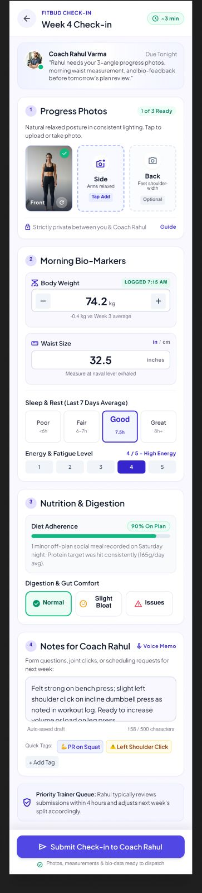{.phone}

4. **What's wrong or missing.** Ignores the check-in templates (decision E). No progress through sections. No prefill.
5. **Target design.**
   - **Intro:** "Weekly check-in · takes about 3 min · due Fri 11:59 pm".
   - Then **sections** rendered by `FormRenderer` from the pinned form version:
     1. **Measurements:** weight prefilled with the last value and adjusted with a stepper; waist, if required.
     2. **Photos:** front, side and back slots with guidance, each optional unless required.
     3. **How was your week:** 1–5 scales with labelled anchors (energy, hunger, stress), as defined by the template.
     4. **Reflection:** "What went well?", "What was hard?", "Anything for Rahul?".
   - A **Review** step, then **Send to Rahul**.
   - **After submit:** "Sent. Rahul will review this." There's no review-time promise. A trainer-set review expectation is **out of MVP scope** (D29).
   - **After review:** the screen shows "Rahul reviewed this · Thu", the outcome in trainee-friendly words (Acknowledged → "Reviewed", Needs follow-up → "Rahul will follow up", Adjust coaching → "Rahul is updating your plan"), and **the coach's note when Rahul marked it visible to you** (D20). Private notes never show.
6. **States.**
   - Draft autosave.
   - Offline: the draft is local and submit is queued.
   - Overdue: "This was due yesterday. You can still send it." (no guilt).
   - Not yet due: shows the date and lets the trainee start early (only if the API's ensure-due allows it).
7. **Edge cases.**
   - A measurement creates a linked measurement record (decision E).
   - Photo upload failures don't block submit. They retry on their own.
8. **Notifications and deep links.**
   - P-CHK (due), P-CHK-LATE (once, when overdue), P-CHK-REV (reviewed).
   - `/checkin/:id`.
9. **References.**
   - Everfit forms [R16].
   - Everfit check-in insights [R7].
   - Avoid: Figma's sleep and HRV and the "Priority Trainer Queue".
10. **UX decisions.**
    - Prefill and a time estimate lower the effort.
    - Visible review closes the loop (P10).
11. **Implementation.** Replace the hard-coded fields with `FormRenderer` using the pinned definition from the API. Outbox for the draft and submit.
12. **Acceptance criteria.**
    - [ ] Renders any check-in template version.
    - [ ] Weight is prefilled.
    - [ ] Offline submit works.
    - [ ] The reviewed state shows the outcome, plus the visible note when there is one.
    - [ ] No review-time promise appears anywhere.
13. **Priority:** P0.

### TR-15 · Notifications inbox

> **Status:** Missing (list API exists) · **Priority:** P1 · **Screen:** `Notifications` · **Files:** `src/trainee/NotificationsScreen.tsx` [new] · **API:** notifications list, mark read

1. **Purpose.** One place for reminders, coach updates and plan changes, including the ones that weren't pushed (informational items go to the inbox only).
2. **Entry.** The Today bell, push long-press, the P-EOD "See all".
3. **Current state.** None.
4. **What's wrong or missing.** Not built.
5. **Target design.**
   - Sections **Today** and **Earlier**.
   - `NotificationRow`: type icon · title ("Lunch isn't logged yet") · relative time · unread dot. Tapping deep-links (§3.5), and expired items open the current state of the item ("Already logged ✓").
   - **Coach notes** (P-NOTE, D20) appear as "Rahul has a note for you" rows. Tapping opens Today at the note (`/today?note=:id`) and marks it seen. If Rahul made the note private again, the row says "This note is no longer shared."
   - **Reactivation requests** (P-REACT) open TR-22's confirmation card.
   - Header: "Mark all read".
   - Footer link: "Notification settings" (TR-16).
6. **States.** Empty: "No notifications yet." Offline: cached.
7. **Edge cases.**
   - Items for superseded assignments show "This meal was replaced by a plan update."
   - Retention: show 30 days.
8. **Deep links.** `/notifications`.
9. **References.** Apple HIG notifications [R58].
10. **UX decisions.** The inbox lets push caps hold without losing information.
11. **Implementation.** Read the list endpoint, then mark read on view. The badge count goes on the bell.
12. **Acceptance criteria.**
    - [ ] Lists the last 30 days.
    - [ ] Tapping routes exactly.
    - [ ] Mark read syncs.
13. **Priority:** P1.

### TR-16 · Reminder settings

> **Status:** Missing · **Priority:** P0 · **Screen:** `ReminderSettings` · **Files:** `src/trainee/settings/ReminderSettingsScreen.tsx` [new] · **API:** notification preferences (`pushEnabled`, 4 category booleans, quiet hours) + API-NEW fields from TR-05

1. **Purpose.** The trainee owns their reminders (decision C: "clients own notification preferences and quiet hours").
2. **Entry.** More › Reminders, the TR-15 footer, notification long-press "Settings".
3. **Current state.** None in the UI. The preferences contract exists.
4. **What's wrong or missing.** Not built.
5. **Target design.**
   - **Status card:** "Notifications: On" (or "Off in phone settings · Turn on").
   - **Category switches**, each with a one-line description of *when* it fires:
     - **Workout reminder:** "If your workout isn't logged about an hour after **7:00 pm**." Tap to change the time, or choose "Learn from my workouts".
     - **Meal reminders:** "About 40 min after each meal time, if it isn't logged." A row shows "Using your plan's meal times" or "Using your meal times (2 changed)", with **Change**, which opens **TR-24 Meal times** (D24). Reminders follow the trainee's times.
     - **Check-in reminders:** "The day your check-in is due."
     - **Daily summary:** "One evening note if anything's left, by 9:30 pm."
     - **Coach nudges:** this can't be turned off separately; nudges follow the category of the item. Show the copy "Your coach can send a reminder about a specific item. It follows your quiet hours."
   - **Quiet hours** row: "10:00 pm – 7:00 am" (opens TR-17).
   - **WhatsApp reminders:** while `wa_automation` is off, the row is disabled with a **"Coming soon"** chip and the note "WhatsApp reminders are coming soon. For now we'll remind you in the app." When the flag is on: On or Off, with the number. Turning it on shows the consent text (TR-05). The description reads: "Used only when app notifications don't reach you, or when a few logs slip. At most one a day. Reply STOP to stop." (D17). Turning it off, or replying STOP, takes effect immediately.
   - **Paused reminders** notice (back-off, §3.6): "Meal reminders are paused until Mon because they weren't helping. Turn back on?"
   - A link: "Reminders not arriving?" opens the OEM battery guide (TR-05 step 4).
6. **States.**
   - Saving toast.
   - Offline: saved locally and synced later.
   - OS permission denied: the switches are disabled, with a *Turn on in Settings* deep link (`Linking.openSettings()`).
7. **Edge cases.**
   - A trainer-disabled category (reminder rules off) shows "Your coach has turned off workout reminders", greyed out.
   - **Android channels:** each category maps to a channel, so OS-level toggles stay in sync ([R53]).
8. **Notifications.** These settings drive the engine (§3.6).
9. **References.**
   - Android notification channels [R53].
   - Apple HIG notifications [R58].
   - The HealthifyMe "pushy notifications" complaint [R36] https://www.reddit.com/r/Fitness_India/comments/1c9uudx/ (avoid).
10. **UX decisions.** Describing *when* a reminder fires builds trust and reduces opt-outs.
11. **Implementation.**
    - The existing preferences `PUT`, plus the new fields.
    - Android channels are created at app start: `workout`, `meal`, `checkin`, `summary`, `coach`, `plan`.
12. **Acceptance criteria.**
    - [ ] Each switch persists.
    - [ ] The described timing matches engine behaviour.
    - [ ] Trainer-off categories show as greyed out.
    - [ ] The permission-off state is handled.
    - [ ] The meal times row reflects overrides and opens TR-24.
    - [ ] WhatsApp opt-out takes effect immediately.
    - [ ] With `wa_automation` off, the WhatsApp row is visibly disabled with "Coming soon".
13. **Priority:** P0.

### TR-17 · Quiet hours

> **Status:** Missing · **Priority:** P1 · **Screen:** `QuietHours` · **API:** `quietHoursStart` and `quietHoursEnd` (HH:MM)

1. **Purpose.** Set the times when FitBud never sends a notification.
2. **Entry.** TR-16, TR-05.
3. **Current state.** None in the UI.
4. **What's wrong or missing.** Not built.
5. **Target design.**
   - Two time pickers (From, To), with the default 22:00–07:00 and a 24 h preview bar showing the shaded quiet period.
   - Explanation: "No notifications during these hours. Reminders that would fall here are skipped, not saved for later. Your coach can't override this."
   - Presets: "Night 10 pm–7 am", "Late night 11 pm–6 am", "Custom".
6. **States.** Validation: the range must be at least 6 h and at most 12 h. Ranges that cross midnight are handled.
7. **Edge cases.**
   - The **D7 rule:** nothing after 22:00 even if quiet hours start later. Show "FitBud never sends reminders after 10 pm."
   - Ranges are stored in local time, using the user's timezone.
8. **Notifications.** The engine **expires** (doesn't defer) time-bound reminders whose relevance passes during quiet hours (§3.6). The current code defers, so that's a change.
9. **References.** Apple HIG notifications (respect focus) [R58].
10. **UX decisions.** Expiring rather than deferring prevents a burst of stale reminders at 7 am.
11. **Implementation.** API-CHG in `apps/api/src/domain/reminders.ts`: the quiet-hours behaviour per type. Expire meal, workout and summary reminders. Defer check-in and plan reminders to quiet-hours end.
12. **Acceptance criteria.**
    - [ ] Persisted.
    - [ ] The engine respects it.
    - [ ] Nothing is sent after 22:00.
13. **Priority:** P1.

### TR-18 · Ask coach on WhatsApp

> **Status:** New-proposed · **Priority:** P1 · **Where:** a bottom sheet from the meal card, workout or exercise overflow, a check-in, a plan view, a notification · **Files:** `src/trainee/ask/AskCoachSheet.tsx` [new], `packages/core/src/whatsapp.ts` (extend) · **API:** API-NEW `POST /coach-asks {relationshipId, itemType, itemId, topic}` (outbox-capable), the trainer WhatsApp number on the relationship read (API-NEW)

1. **Purpose.** Ask the coach about *this specific item* in WhatsApp, with the context and a link back already filled in (D1, D2, D3).
2. **Entry.** "Ask Rahul" in item overflows and in TR-08, TR-09, TR-11 and TR-14.
3. **Current state.** None on the trainee side. The trainer side has `trainer/whatsapp.ts` ("WhatsApp (outside FitBud)") and the web `lib/whatsapp.ts`.
4. **What's wrong or missing.** The trainee has no way to ask about a specific item.
5. **Target design.**
   - A sheet titled "Ask Rahul about **Lunch · Tue 13 Oct**".
   - **Topic chips:** Swap a food · Portion size · Form check · Pain or discomfort · Can't do this today · Other.
   - A preview of the message that will be prefilled (editable in WhatsApp), for example: "Hi Rahul, question about my Lunch (Tue 13 Oct): portion size. https://fitbud.app/go/meal/7f3a…"
   - Primary: **Open WhatsApp**.
   - Caption: "Your message is sent from your WhatsApp. FitBud only notes that you asked."
   - After returning to the app, the item shows the `AskedCoachMarker` "Asked Rahul · just now". When the trainer marks it answered: "Rahul answered ✓".
6. **States.**
   - No trainer number: "Rahul hasn't added a WhatsApp number yet." (the button is disabled), plus the fallback "Leave a note in your next check-in."
   - WhatsApp not installed: open the wa.me URL in the browser (the WhatsApp web or install page).
   - Offline: the ask is recorded in the outbox. WhatsApp itself needs the network, so show "You're offline. WhatsApp will send when you're back online."
7. **Edge cases.**
   - **Message length:** keep the prefilled text short. Bird notes Meta's guidance of about 140 characters for prefilled text [R43]. Template: `Hi {coach}, question about my {item} ({date}): {topic}. {link}`. Truncate the item name to fit.
   - URL-encode the text with `encodeURIComponent`.
   - The link must be the **https** `/go/` link. WhatsApp only makes http(s) links clickable, so a `fitbud://` link would show as plain text.
   - Pain topic: show "If it's sharp pain or you feel unwell, stop and get medical help." before opening WhatsApp. This is a safety note, not a diagnosis.
   - Recording the ask happens *before* opening WhatsApp. FitBud can't know whether the user actually sent the message, so the marker says "Asked", not "Sent". OQ-21: should the marker be confirmed by the user on return ("Did you send it?")? The default here is no; keep it simple.
8. **Notifications and deep links.**
   - The trainer gets **T-ASK** (push and bell, merged at most once per 15 min).
   - The `/go/meal/:id` link opens the item for the trainee (their own) or the trainer (the client item).
9. **References.**
   - WhatsApp Click to Chat [R41] https://faq.whatsapp.com/5913398998672934/?locale=en_US
   - Linking from another app [R42] https://faq.whatsapp.com/425247423114725/?cms_platform=iphone
   - Bird's click-to-chat explainer [R43] https://bird.com/explained/whatsapp/what-is-a-whatsapp-click-to-chat-link
   - Avoid: Figma's "Ask Coach" in-app chat (`trainee_07`).
10. **UX decisions.**
    - It uses the channel trainers and trainees already live in, and keeps FitBud out of the chat business.
    - Context plus a link saves the coach the "which meal?" back-and-forth.
    - The marker gives accountability without storing content (decision F: sensitive data minimisation).
11. **Implementation.**
    - Extend `packages/core/src/whatsapp.ts` with `buildAskCoachMessage({coachName, itemLabel, date, topic, link})`, which enforces the length.
    - `Linking.openURL(waHref)`.
    - Outbox mutation `coach_ask_create`.
    - **Data model (`coach_asks`):** id, relationship_id, trainee_user_id, item_type (`meal_assignment`, `workout_assignment`, `exercise_execution`, `checkin`, `plan_version`), item_id, topic, asked_at, status (`open`, `answered`, `expired`), answered_at, answered_by, trainer_note_id nullable. No message text.
12. **Acceptance criteria.**
    - [ ] Opening the sheet from a meal prefills the item and date.
    - [ ] The WhatsApp chat opens with the text and the https link.
    - [ ] The marker appears.
    - [ ] The trainer sees the ask.
    - [ ] Prefilled text is ≤ 140 chars excluding the URL. If the full message must be ≤ 140, the URL uses the short `/go/` form (OQ-2).
13. **Priority:** P1.

### TR-19 · Offline and sync status

> **Status:** Implemented (partial: no UI, memory store) · **Priority:** P0 · **Screen:** `Sync` + global `SyncIndicator` · **Files:** `src/sync/engine.ts`, `src/sync/SyncProvider.tsx` · **API:** `POST /sync/push`, `GET /sync/pull`

1. **Purpose.** Trainees never lose a log, and always know whether it reached the coach.
2. **Entry.** The top-bar sync glyph, More › Sync status, error snackbars.
3. **Current state.** An engine plus a memory-store provider. Screens bypass it.
4. **What's wrong or missing.** No persistence (SQLite). No UI. No conflict display.
5. **Target design.**
   - **SyncIndicator** in the top bar (hidden when everything is synced for more than 2 s).
   - **Sync status screen:**
     - "Last synced 2 min ago".
     - **Waiting to send (3):** a list, for example "Lunch · Eaten as planned · 1:52 pm".
     - **Couldn't send (1):** with the reason and **Retry**. Examples: "This meal was changed by your coach", "Photo too large", "Rahul closed this meal before your log was sent" (late log after resolution, D23).
     - *Sync now*.
     - A diagnostics disclosure (app version, device id hash) for support, with **Email support**, which opens the support `mailto` with the diagnostics included (D19).
   - Copy: "Your logs are saved on this phone and sent to Rahul when you're online."
6. **States.** Conflict: a server rejection (for example, the assignment was superseded) shows the item with "Your coach updated this. Your log was kept in history." (if the server keeps it). If not, the copy is "Couldn't save. The meal was replaced." and *Log against the new meal* is offered.
7. **Edge cases.**
   - Sign-out with unsent items: "3 logs haven't been sent. Sign out anyway?" Recommend syncing first.
   - Storage-full errors.
8. **Deep links.** `/settings/sync`.
9. **References.**
   - web.dev offline UX guidelines [R69] https://web.dev/articles/offline-ux-design-guidelines
   - Trainerize known sync issues [R25] (avoid).
10. **UX decisions.** A quiet indicator by default, with detail on demand, so being offline never looks like an error (P11).
11. **Implementation.**
    - `expo-sqlite` store for the cache and outbox.
    - The outbox drains with exponential backoff on app foreground and on connectivity change (`@react-native-community/netinfo`).
    - Background sync on Android with `expo-background-fetch` or `expo-task-manager` (best effort).
12. **Acceptance criteria.**
    - [ ] Logs survive an app kill and a reboot.
    - [ ] The indicator shows four states.
    - [ ] Conflicts are explained.
    - [ ] Sign-out warns about unsent items.
13. **Priority:** P0.

### TR-20 · More: profile and settings

> **Status:** Implemented (placeholder) · **Priority:** P1 · **Screen:** `Profile` / More tab · **Files:** `src/trainee/TraineeShell.tsx` More tab (shows userId, "Switch to trainer mode", Sign out) → `src/trainee/MoreScreen.tsx` [new]

1. **Purpose.** Account and preferences.
2. **Entry.** Tab.
3. **Current state.** A placeholder with the userId (dev copy).
4. **What's wrong or missing.** Not a real settings screen.
5. **Target design.**
   - Rows:
     - **Profile** (name, date of birth, gender, units).
     - **My coach** (Rahul, coaching since 5 Oct, WhatsApp).
     - **Reminders** (TR-16).
     - **Meal times** (TR-24).
     - **Quiet hours** (TR-17).
     - **Time zone** ("India Standard Time · from your phone", with *Change*; D22).
     - **Steps** (TR-25, P2; shown only on devices where Health Connect or HealthKit is available).
     - **Password and sign-in** (change password; the sign-in mobile and email are read-only, with "Ask your coach to update these", D18).
     - **Past coaching** (shown only when there's at least one ended relationship): each past coach with the dates, opening a read-only history of that period (D21).
     - **Language** (English, Hinglish later).
     - **Sync status** (TR-19).
     - **Lock-screen widget** (TR-21 setup tips).
     - **Help**: opens `mailto:tech@thefitbud.com` with the subject "FitBud help · Trainee · v1.4.0 (212)" and a body prefilled with the app version, role, screen ("More"), the device model and the OS version, plus a blank line for the message (D19, §1.6.10). There's no support page. If no mail app is set up, copy the address and show "Email address copied: tech@thefitbud.com". Under the row, the reply promise (D33, §1.6.10): "We'll get back to you within a day." (Hinglish: "Hum ek din ke andar aapko reply karenge.")
     - **Privacy** (what your coach can see; data requests later).
     - **Switch to coach view** (dual-role only).
     - **Sign out**.
   - No user ids.
6. **States.** Standard.
7. **Edge cases.** Ended coaching: "My coach" shows "Coaching ended 3 Oct".
8. **Deep links.** `/settings/profile`.
9. **References.** No strong external reference.
10. **UX decisions.** "What your coach can see" supports trust and DPDP transparency [R60].
11. **Implementation.** `PUT /me/trainee-profile` for date of birth and gender.
12. **Acceptance criteria.**
    - [ ] No dev copy.
    - [ ] All rows navigate.
    - [ ] Help opens a prefilled email.
    - [ ] Past coaching appears only when it applies.
13. **Priority:** P1.

### TR-21 · Lock-screen widget and Live Activity

> **Status:** Figma-only · **Priority:** P2 · **Files:** native modules (Android widget, iOS WidgetKit and ActivityKit) via an Expo config plugin [new]

1. **Purpose.** Glanceable "next up" and one-tap meal confirm without opening the app. A live rest timer during workouts.
2. **Entry.** Home or lock screen.
3. **Current state.** Figma `trainee_04_lockscreen_live_activity.png` (it includes "WhatsApp Live Sync" style claims, which are banned).

   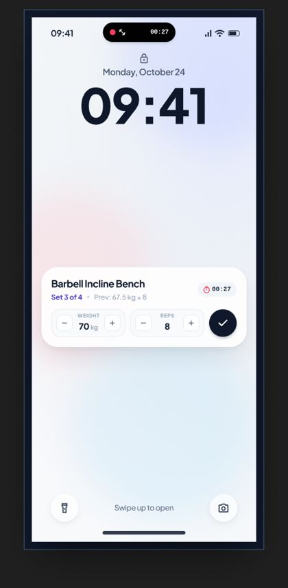{.phone}

4. **What's wrong or missing.** Not built. Needs native work.
5. **Target design.**
   - **Home widget (small and medium):** "Next: Lunch · 1:30 pm" with an **Eaten as planned** button (Android widgets support buttons; iOS 17+ interactive widgets). The medium size adds "3 of 5 meals today".
   - **During a workout:** an Android ongoing notification (live update style [R55]) and an iOS Live Activity, showing the exercise, set 2 of 4 and the rest timer countdown, with a *Done* button where the platform allows it.
   - **Privacy:** no food names on the lock screen if "Hide details on lock screen" is on (default off; OQ-22).
6. **States.** Not signed in: "Open FitBud to get started." Stale: "Updated 1 h ago".
7. **Edge cases.** Widget actions write to the shared outbox (an App Group on iOS).
8. **Deep links.** Tap opens `/today` or `/workout/:id/active`.
9. **References.**
   - Apple HIG Live Activities [R58] https://developer.apple.com/design/human-interface-guidelines/live-activities and widgets https://developer.apple.com/design/human-interface-guidelines/widgets
   - Android live updates [R55] https://developer.android.com/develop/ui/views/notifications/live-update and app widgets https://developer.android.com/develop/ui/views/appwidgets/overview
   - The Hevy Live Activity [R28] https://www.hevyapp.com/features/live-activity/
10. **UX decisions.** A one-tap confirm from the widget is the shortest possible logging path. It's P2 because of the native cost.
11. **Implementation.** Expo config plugins plus native targets (requires a dev client, which is already a dependency: `expo-dev-client`).
12. **Acceptance criteria.**
    - [ ] The widget shows the next item.
    - [ ] Confirm logs through the outbox.
    - [ ] The workout Live Activity shows the rest timer.
13. **Priority:** P2.

### TR-22 · Ended coaching, reactivation and a new coach

> **Status:** Missing · **Priority:** P1 · **Where:** the trainee shell in the ended state; the reactivation confirmation card · **API:** relationship read; API-NEW `POST /relationships/:rid/reactivate/confirm` · **Decision:** D21

1. **Purpose.** Tell the trainee clearly that coaching ended, keep their history accessible (decision G), and let them say yes when the same coach wants to restart.
2. **Entry.** App open after the trainer ends coaching, push P-END, and push P-REACT ("Rahul wants to restart coaching with you").
3. **Current state.** Not handled in the UI.
4. **What's wrong or missing.** Not built.
5. **Target design.**
   - **Ended:**
     - A banner on every tab: "Coaching with Rahul ended on 3 Oct. Your history is still here."
     - Today shows the history summary in place of tasks.
     - Logging is disabled, and reminders stop.
     - More › My coach shows the ended state, and More › Past coaching lists it.
     - "Got an invite from a new coach? Open the link, or *enter a code*" (P1).
   - **Reactivation card** (same coach): "Rahul wants to restart coaching with you."
     - What comes back: "Your history and settings stay as they are. Rahul will send your plan."
     - Primary: **Restart coaching**. Secondary: *Not now*, which keeps the request until it expires in 14 days.
     - If an intake update was requested, the next screen is TR-03 with the previous answers prefilled.
   - **New coach:** accepting a new coach's invite (TR-02) starts a new relationship. The trainee's history (logs, measurements, photos, past check-ins) stays visible to the trainee under Progress and Past coaching. **The new coach sees none of it** and starts blank (D21).
6. **States.** Read-only everywhere while ended. Request expired: "This request has expired. Ask Rahul to send a new one."
7. **Edge cases.**
   - Queued outbox items for the ended relationship are rejected by the server. Show "Couldn't send. Coaching has ended."
   - The trainee has an active coach and gets a reactivation request from a past coach: "You're coaching with Asha right now. Restarting with Rahul will end coaching with Asha." There's a confirm step.
8. **Deep links.** Any `/go/` link opens the read-only item. `/go/reactivate/:requestId` opens the card.
9. **References.** Trainerize deactivate and reactivate [R24].
10. **UX decisions.**
    - Use respectful, clear copy, with no upsell.
    - The trainee's one tap keeps consent with them (OQ-25, default accepted).
    - History belongs to the trainee and follows them. Coaching data belongs to the relationship.
11. **Implementation.** `relationship.status === 'ended'` gates the routing. The reactivation request is a row with a 14-day expiry. Confirming flips the same relationship to `coaching_ready` (§3.8).
12. **Acceptance criteria.**
    - [ ] No logging controls while ended.
    - [ ] Banner shown.
    - [ ] History visible.
    - [ ] Restart coaching restores the same relationship.
    - [ ] A new coach's workspace shows no earlier data, while the trainee still sees all their history.
13. **Priority:** P1.

### TR-23 · Deep-link router and "item unavailable"

> **Status:** New-proposed · **Priority:** P0 · **Files:** `src/navigation/linking.ts` [new] (replacing tab-only `src/notifications/routing.ts`), web `pages/GoResolver.tsx` [new] · **API:** API-NEW `GET /links/resolve?kind=&id=` returning `{role, route, available, reason?}`

1. **Purpose.** Every push, WhatsApp link and widget tap opens the **exact** screen (D3).
2. **Entry.** Notification taps and actions, `https://{appHost}/go/{kind}/{id}`, `fitbud://…`, widget taps.
3. **Current state.** `routing.ts` maps a payload to a tab only, and `TraineeShell` special-cases check-ins.
4. **What's wrong or missing.** No exact routing. No unavailable state. No https links.
5. **Target design.**
   - **Resolution:**
     - The app receives a URL or payload, then parses `{kind, id}`.
     - With no session, it goes to TR-01 and then resumes.
     - Otherwise it resolves locally from the cache, falling back to the API.
     - It routes by role: trainee to their screen, trainer to the TM screen or the web workspace.
   - **Unavailable screen:** "This item isn't available anymore", with the reason (replaced by a plan update, coaching ended, or not your account) and *Go to Today*.
   - **Expired reminder taps:** opening a meal reminder after the meal is logged shows the meal with "Already logged ✓". No error.
   - **Dated routes:** `/today/:date` opens TR-06 on that date. Past dates are read-only plus late logging (D23), and future dates are a preview. `/meal/:id` opens the meal's own date.
6. **States.** Resolving: a 300 ms spinner before navigating.
7. **Edge cases.**
   - A trainer tapping a trainee link (shared by mistake) for a client they don't own: Forbidden.
   - Dual-role users: prompt to switch role.
8. **Deep links.** The full mapping is in §3.5.
9. **References.**
   - React Navigation deep linking [R46] https://reactnavigation.org/docs/deep-linking/
   - Expo linking overview [R61] https://docs.expo.dev/linking/overview
   - Expo notifications [R61] https://docs.expo.dev/versions/latest/sdk/notifications
10. **UX decisions.** https links work everywhere (WhatsApp, SMS, email). The app scheme stays as the internal fallback (`app.json` `scheme: "fitbud"`).
11. **Implementation.**
    - Configure Android App Links (`assetlinks.json`) and iOS Universal Links (`apple-app-site-association`) on `{appHost}` (OQ-2).
    - Serve the `/go/*` web route from trainer-web (it resolves for trainers and shows an "Open in app" page for trainees on desktop).
    - Push payloads carry `{notificationId, notificationType, domainEntityType, domainEntityId, createdAt}` (the existing safe payload), and the client maps them to a route with the same table.
12. **Acceptance criteria.**
    - [ ] Every notification type in §4 opens its documented screen (an automated test per type).
    - [ ] WhatsApp links open the app when installed.
    - [ ] The unavailable state is covered.
13. **Priority:** P0.

### TR-24 · My meal times

> **Status:** New-proposed · **Priority:** P1 · **Screen:** `MealTimes` · **Files:** `src/trainee/settings/MealTimesScreen.tsx` [new] · **API:** API-NEW `GET/PUT /me/meal-times` (per relationship and slot key) · **Decision:** D24

1. **Purpose.** Let the trainee set meal times that match their real day, so reminders and windows fit them. The trainer's plan stays unchanged.
2. **Entry.**
   - More › Meal times.
   - TR-16 "Change".
   - The meal card overflow: *Change this meal's time*.
   - TR-05 last step.
3. **Current state.** None. Meal times come only from the plan.
4. **What's wrong or missing.** Reminders fire at plan times that may not match the trainee's routine, which causes noise and opt-outs.
5. **Target design.**
   - Title "Your meal times". Subtitle: "Reminders follow these times. Rahul will see that you changed them."
   - A list of the plan's meal slots, for example "Breakfast · 8:00 am", "Lunch · 1:30 pm", "Snack · 5:00 pm" and "Dinner · 8:30 pm". Each row has:
     - the plan time, muted, when changed ("plan 1:30 pm");
     - a time picker (15-minute steps);
     - *Reset to plan*.
   - Applies to: **Every day** (default) or a day-pattern switch when the plan has training and rest day patterns ("Training days / Rest days").
   - **Save** shows the toast "Meal times updated. Rahul has been told." It applies from **today's unlogged meals onward**. Logged meals keep their time.
6. **States.** Saving, offline (saved locally, synced later; reminders rescheduled on sync), error.
7. **Edge cases.**
   - Validation: times must be between 05:00 and 22:00, in slot order (Breakfast before Lunch), and at least 60 minutes apart; otherwise "Lunch needs to be at least an hour after Breakfast."
   - A new plan version with different slots: overrides for slots that still exist (by slot key) carry over. Removed slots drop their override. The trainee gets "Your plan changed. Check your meal times."
   - Quiet hours still win over reminders (TR-17), and the D7 rule (nothing after 22:00) still holds.
   - Windows shift with the time: the due, overdue and logged-late states use the overridden time.
8. **Notifications.**
   - P-MEAL is scheduled from the override time (§3.6, §4.1).
   - The trainer gets an **activity entry** (TW-17, TM-09), the "Custom meal times" indicator (TW-09a, TW-12) and the bell item **T-MEALTIME** ("Priya changed her meal times").
9. **References.** No strong external reference for trainee-owned times within a trainer plan. This is FitBud-specific (decision C: clients own reminder preferences).
10. **UX decisions.**
    - The trainee owns *when*. The trainer owns *what*.
    - Telling the trainer keeps the change visible without asking for permission.
11. **Implementation.**
    - API-NEW table `meal_time_overrides` (relationship_id, slot_key, day_pattern|null, time HH:MM, updated_at) and a history kind `meal_times_changed`.
    - The reminder engine anchor reads the override first (§3.6).
    - The assignment due window is recomputed for today's unlogged meals and future ones.
12. **Acceptance criteria.**
    - [ ] Changing Lunch to 2:30 pm moves today's unlogged Lunch reminder to about 3:10 pm.
    - [ ] The trainer sees the activity entry and the indicator.
    - [ ] Reset to plan works.
    - [ ] The validation rules hold.
13. **Priority:** P1.

### TR-25 · Steps (optional, Health Connect / HealthKit)

> **Status:** New-proposed · **Priority:** **MVP (P1) only if the go/no-go spike passes, otherwise after MVP (P2)** · **Screen:** `StepsSettings` + the TR-06 steps card · **Files:** `src/trainee/steps/*` [new] · **API:** none (on-device only, never sent to FitBud, never shared with the trainer) · **Decision:** D27, D35

1. **Purpose.** Show the trainee their daily steps next to the plan, as gentle context.
2. **Entry.** More › Steps (setup), and the TR-06 card once it's connected.
3. **Current state.** None.
4. **What's wrong or missing.** Not built.
5. **Target design.**
   - **Setup screen:** "See your steps on Today". It explains: "FitBud reads your step count from Health Connect (Android) or Apple Health (iPhone). Steps stay on your phone and aren't shared with Rahul." Primary: **Connect**, which opens the OS permission sheet for **steps, read-only**.
   - **Today card:** "6,240 steps today" with a 7-day mini bar chart. There's no target, no % and no colour judgement.
   - **Disconnect** is in the same settings screen.
6. **States.**
   - Not granted or denied: the Today card is **hidden**, and settings shows "Not connected · Connect".
   - Health Connect not installed (Android 13 and below): "Install Health Connect from Play Store" with a link.
   - No data today: "No steps recorded yet today."
7. **Edge cases.**
   - Permission revoked in OS settings: hide the card on the next foreground.
   - Several sources: use the platform's aggregated total.
8. **Deep links.** `/settings/steps`.
9. **References.**
   - Android Health Connect [R89].
   - Apple HealthKit [R90].
   - The React Native wrappers `react-native-health-connect` and `react-native-health` [R91].
   - The `react-native-health-connect` npm package [R98] https://www.npmjs.com/package/react-native-health-connect
   - `@kingstinct/react-native-healthkit` [R99] https://github.com/kingstinct/react-native-healthkit
   - There's no strong UX reference for a steps card without a target. The design follows P12 (no judgement colours).
10. **UX decisions.**
    - It's optional, on-device only and hidden unless granted, so it adds value without consent or privacy debt.
    - **Never shared with the trainer** (OQ-30, decided 17 Oct), because steps aren't part of the plan contract (Confluence conflict C-10).
11. **Implementation and the go/no-go evaluation (D35).**
    - **Candidate libraries** (checked 17 Oct 2026):

      | Platform | Library | Expo fit | Notes |
      |---|---|---|---|
      | Android | `react-native-health-connect` v4+ [R98] (the matinzd repo [R91]) | **Config plugin built in** since v4 (Aug 2026). The separate `expo-health-connect` package is deprecated and mustn't be installed alongside it. | Needs `expo-build-properties` with **compileSdk and targetSdk 36 and minSdk 26** per its README. That's above Expo 52's defaults, so the spike must prove the bump builds cleanly. It reads the aggregated `Steps` record. |
      | iOS | `@kingstinct/react-native-healthkit` [R99] | **Config plugin** (entitlement plus `NSHealthShareUsageDescription`) | Needs `react-native-nitro-modules`. It uses statistics queries (`cumulativeSum` for step count). It's actively maintained. |
      | iOS (alternative) | `react-native-health` [R91] | Config plugin available | An older API surface. Fall back to it only if the Nitro dependency blocks Expo 52. |

    - **Unavoidable work on either path:**
      - No Expo Go: EAS dev builds only. `expo-dev-client` is already a dependency.
      - Android: the `android.permission.health.READ_STEPS` declaration, a privacy-policy rationale activity (provided by the plugin) and the **Play Console Health Connect permissions declaration** at release.
      - iOS: the HealthKit capability and App Store review of the health-data usage text.
    - **Go/no-go criterion.** Run a **time-boxed spike of at most 2 developer-days in total**. It's **Go for MVP** only if **all** of these hold:
      1. Both libraries install into the current Expo 52 app through config plugins only, with no ejecting and no hand-edited native files. EAS dev builds succeed for both platforms.
      2. The Android SDK bump (compile and target 36) doesn't break any existing dependency build or test.
      3. Today's aggregated step count reads correctly against the platform's own app (within 1%) on at least one Android 14+ device (Pixel or Samsung), one Android device on the OEM list (TR-05), and one iPhone on iOS 17+.
      4. Permission grant, deny and revoke all behave as specified in States, with no crash.
      5. No new background, server or sharing requirement appears.

      If any check fails, it's **No-go**: hide TR-25 for MVP, keep the TR-06 card code path behind `steps_enabled=false`, and revisit after the beta. Record the spike result in the PR description.
    - **Implementation if Go:** `src/trainee/steps/stepsSource.ts` exposes one interface, `getTodaySteps()` and `getLast7Days()`, with an Android implementation and an iOS implementation. Read on foreground only, with no background delivery.
12. **Acceptance criteria.**
    - [ ] The card is hidden without permission.
    - [ ] Steps show after the grant.
    - [ ] No steps data leaves the device, and none appears in any trainer view or API.
    - [ ] The spike result (Go or No-go, against the five checks) is recorded before MVP scope is frozen.
13. **Priority:** P1 if the spike is Go; otherwise P2, after MVP.

### TR-26 · Food search and quantity (logging actual foods)

> **Status:** New-proposed · **Priority:** P1 · **Screen:** `FoodSearch` (full-height modal from TR-08) · **Files:** `src/trainee/food/FoodSearchScreen.tsx`, `QuantitySheet.tsx`, `src/sync/foodIndex.ts` [new] · **API:** API-NEW `GET /me/foods/search?q=&limit=20`, `GET /me/foods/recent`, `GET /me/foods/index?since=` (delta for offline), deviate `kind: logged_foods` · **Decision:** D28

1. **Purpose.** Log what was actually eaten, with real foods, quantities and units, in a few taps. That feeds the trainee's rings and the trainer's view.
2. **Entry.** TR-08 "Log what I ate" and "+ Add food", and `/meal/:id/foods`.
3. **Current state.** None on mobile. Foods exist in the trainer library (`/libraries` foods, with servings and nullable nutrients).
4. **What's wrong or missing.** Trainees can't reach the food library.
5. **Target design.**
   - **Top:** the meal title ("Lunch · Wed") and the list of **items in this log**. It's prefilled with the plan items, each row showing "2 × roti · 240 kcal" with a stepper and ✕. A live total bar is pinned to the bottom: "610 kcal · P 24 · C 80 · F 20 g · plan 520 kcal" and **Save**.
   - **Search field** ("Search foods, e.g. dal, roti, poha"), autofocused when adding.
   - **Before typing:**
     - **Recent**: the last 10 foods this trainee logged, with their last quantity ("1 katori rajma").
     - **Frequent**: the top 10 by count in 30 days.
     - **From your plan**: the foods in the trainee's current plan.
     - One tap adds the food with its last-used or default serving.
   - **Results while typing** (debounced 150 ms, local index first, server merge when online):
     - Ranked by: a prefix match on the name or an alias, then the trainee's own history, then trainer foods, then the global library.
     - **Indian names, spellings and transliterations** match through the aliases ("daal" finds Dal, "chapati" finds Roti, "dahi" finds Curd).
     - Each row shows the name, the default serving and its kcal ("Roti (phulka) · 1 roti · 120 kcal") and a source tag (Your coach, FitBud).
     - Unknown nutrients show "kcal —".
   - **Quantity sheet** (on tapping a result):
     - **Unit chips** from the food's servings: **katori**, **roti/piece**, **cup**, **glass**, **tbsp**, **tsp**, **slice**, **bowl**, plus **g** or **ml** (always available when the basis is mass or volume).
     - A **quantity stepper** in 0.25 steps (¼, ½, ¾, 1, 1½ …) with quick chips ½ · 1 · 2 · 3.
     - **Live macros** for this item: kcal, P, C and F, with "≈ 150 g" shown under household units.
     - **Add** (or **Update**).
   - **Not found:**
     - "Can't find 'thepla'?"
     - **Add 'thepla' as a custom food**: a name and a quantity text ("2 pieces"), with **nutrition unknown**. Optionally the trainee can enter the kcal if they know it (marked "entered by you").
     - Custom foods are saved for this trainee and appear in Recent.
     - Rahul sees "Custom · not in library" and can add it to his library (TW-17, TW-26).
     - Helper: "It's fine to log it anyway. Rahul can add the details."
6. **States.**
   - Offline: search the on-device index (global foods, the trainer's foods and the trainee's recent and custom foods). The copy "Showing foods saved on your phone" appears when the server merge isn't available.
   - Loading: skeleton rows (only when the index isn't downloaded yet).
   - Empty search: the not-found block.
   - Error: local results, plus "Couldn't search online".
7. **Edge cases.**
   - Mixed known and unknown items: totals show "≥". The rings use "≥".
   - Quantity 0 removes the item.
   - Very large values ("20 katori") get a confirm prompt.
   - A food archived by the trainer still works in logs that already use it, but is hidden from search.
   - Units: a katori is about 150 ml or g unless the food's serving defines otherwise; a cup is 240 ml; a tbsp is 15 ml; a tsp is 5 ml. The serving's own gram or ml equivalent always wins.
8. **Deep links.** `/meal/:id/foods`.
9. **References.**
   - Adapt: MyFitnessPal recent, frequent and quick add [R31] [R32].
   - Adapt: HealthifyMe Indian food database and household units [R34].
   - Base data: the Indian Food Composition Tables (IFCT 2017, ICMR-NIN) [R70] for global foods, with nutrients left unknown where a source has no value.
10. **UX decisions.**
    - Recent, frequent and from-plan lists cover most logs with no typing.
    - Household units (katori, roti) match how Indians describe portions, and grams are always available.
    - Not-found never blocks logging, and the coach can enrich it later.
11. **Implementation.**
    - The on-device SQLite table `food_index` (id, name, aliases, servings JSON, basis, nutrients, source, updatedAt) gets a full download on first open (~2–3k foods, about 1 MB) and deltas via `GET /me/foods/index?since=`. It uses an FTS5 or prefix index on name and aliases.
    - API-NEW trainee-scoped food endpoints return global foods plus the active trainer's foods (read-only) plus the trainee's custom foods.
    - API-NEW `trainee_custom_foods` (id, trainee_user_id, name, quantity_text, kcal|null, created_at).
    - Macro calculation is a pure function `macrosFor(food, servingId|unit, quantity)` in `packages/core`, with unknowns kept as null.
12. **Acceptance criteria.**
    - [ ] Recent, frequent and from-plan lists show before typing.
    - [ ] "daal" finds Dal.
    - [ ] Katori, roti, cup and g units work, with 0.25 steps.
    - [ ] Live macros and the total are correct against unit tests.
    - [ ] Search works offline.
    - [ ] A custom food can be logged with unknown nutrients and shows to the trainer.
13. **Priority:** P1.


# 3. Cross-cutting flows

## 3.1 Onboarding (trainer invite → trainee active)

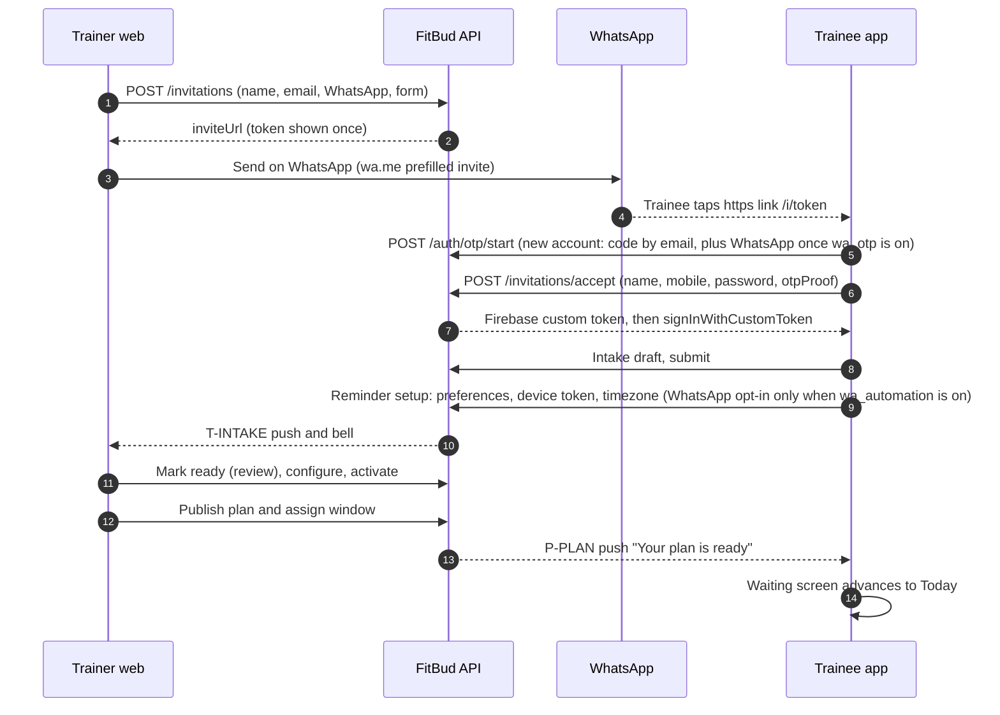

**Derived status** at each step (the header and roster chips): Invited → Onboarding (accepted, intake pending) → Intake submitted → Ready to coach (reviewed) → Active (effective plan) → Ended.

| Step | Trainer sees | Trainee sees | Failure handling |
|---|---|---|---|
| Invite created | Share card (TW-07) | n/a | Token lost: re-issue (TW-08) |
| Link tapped | n/a | Join card (TR-02), with set password and code verification | Expired: ask for a new link. Code not received: resend (email; WhatsApp too once `wa_otp` is on). |
| Intake | Getting started row: "Intake in progress" | Sectioned form (TR-03) | Autosave and offline queue |
| Reminder setup | n/a | TR-05 | Every step can be skipped. Permission denied is OK. |
| Review | TW-10 | Waiting checklist (TR-04) | n/a |
| Configure and plan | TW-11, TW-13/14, TW-16 | Waiting: "Rahul is building your plan" | A generation failure shows Retry (TW-16) |
| Active | Overview | Today | n/a |

## 3.1a Authentication: password by default, email code live, WhatsApp code behind a flag (D18)

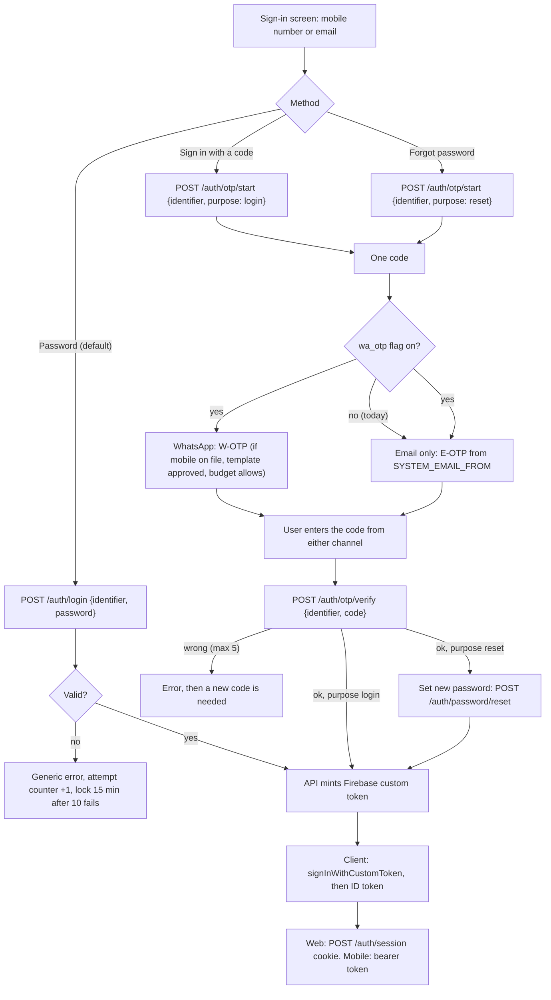

**Rules:**

| Item | Value |
|---|---|
| Identifier | A mobile number (normalised to E.164, +91 default) or an email. Both are unique per user. |
| Password | Minimum 8 characters, maximum 64, no composition rules, checked against a breached-password list where available (NIST 800-63B [R82]). Hashed by Firebase Auth (the account email is the Firebase key; the phone-to-account lookup happens server-side). |
| Code | 6 digits, valid **10 min**, single use. **One code per request.** Today it's sent by email only; with `wa_otp` on, the same code goes to both channels. Requesting a new code invalidates the old one. |
| Limits | 5 verify attempts per code. Resend after 60 s. 5 codes per hour and 10 per day per identifier. A per-IP rate limit too. |
| Responses | Always generic ("If an account exists, we've sent a code"). No account enumeration (OWASP [R84]). |
| Channels | **Live: email** (E-OTP, sender `SYSTEM_EMAIL_FROM`, default `tech@thefitbud.com`, D30). **Built, flag off: WhatsApp** (authentication template, copy-code button [R79], counted in the budget §4.5, `wa_otp`). **No SMS, ever.** When the WhatsApp leg is skipped (flag off, no mobile, template not approved, cap reached, or a send error), email still goes, and the UI names only the channels used. The sign-in UI shows WhatsApp as disabled "Coming soon" while the flag is off (§1.6.11). |
| New accounts | Created at invite acceptance (TR-02) with code verification and then a password. Trainers are provisioned, and set a password on first code sign-in. |
| Sessions | Unchanged: web uses the HTTP-only cookie via `POST /auth/session`; mobile uses the Firebase bearer token with refresh. |

API-NEW: `POST /auth/login`, `POST /auth/otp/start`, `POST /auth/otp/verify`, `POST /auth/password/reset`, `POST /auth/password/set` (signed-in). Table `auth_otps` (id, identifier_hash, code_hash, purpose, expires_at, attempts, channels_sent, consumed_at).

## 3.2 Daily logging loop (trainee)

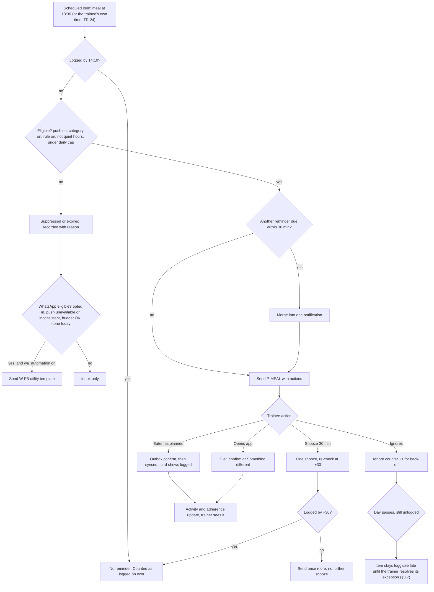

## 3.3 Exception loop (trainer)

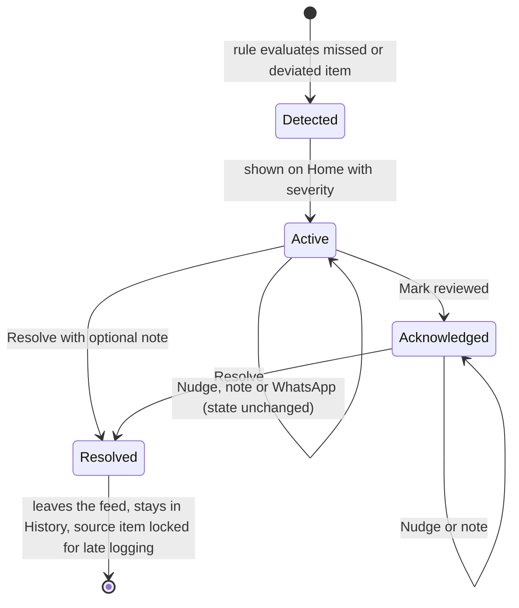

**Rules:**
- Acknowledge and Resolve never change the source workout, meal or check-in.
- A late log by the trainee does **not** auto-resolve the exception unless the rule says so. This is OQ-23. The current behaviour is to keep the exception visible, marked "Client logged later", so the trainer resolves it in one tap.
- Nudges are tracked separately and never change adherence.
- **Resolving locks late logging** for the source item (D23, §3.7). The resolve drawer says so. Mark reviewed (acknowledge) does **not** lock it.

## 3.4 Check-in loop

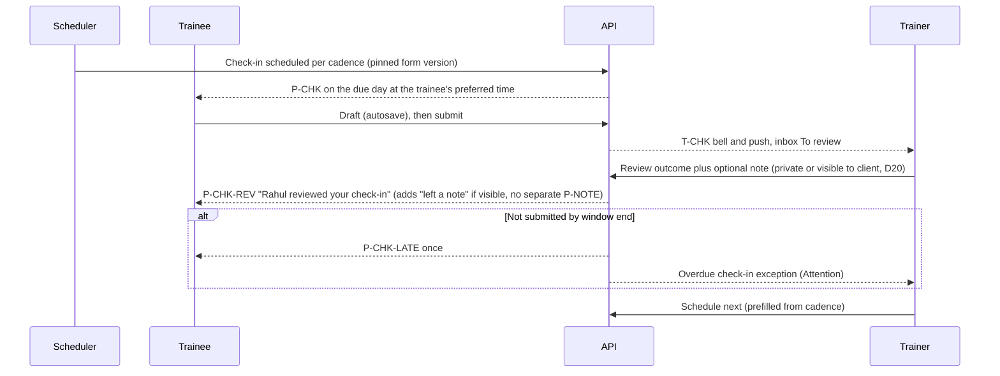

## 3.5 WhatsApp round trip and deep links

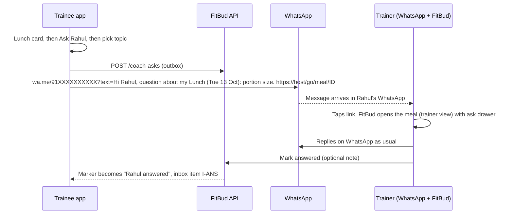

**Link format and resolver.** Use one https format for every channel: `https://{appHost}/go/{kind}/{id}`. The host is undecided (OQ-2). The web route lives in `apps/trainer-web` (`/go/:kind/:id`), and the same paths are registered as Android App Links and iOS Universal Links for `apps/mobile`.

| kind | id | Trainee opens | Trainer opens |
|---|---|---|---|
| `meal` | meal assignment id | Diet on that date, card focused (`/meal/:id`) | Activity › Meals with the item panel (`/clients/:rid/activity?type=meal&item=meal:<id>`) |
| `workout` | workout assignment id | Workout (`/workout/:id`), or Active when in progress | Activity › Workouts, item panel |
| `checkin` | check-in id | Check-in (`/checkin/:id`) | Check-in review (`/clients/:rid/check-ins/:id`) |
| `exception` | exception id | n/a (Forbidden; trainees never see exceptions) | `/?exception=:id` |
| `ask` | coach ask id | The asked item | `/?ask=:id` |
| `plan` | plan id | Plan view "What changed" (`/plan/diet` or `/workout`) | `/clients/:rid/plan` |
| `client` | relationship id | Today | `/clients/:rid` |
| `today` | none | `/today` (or `/today/:date`) | Home |
| `note` | trainer note id | Today scrolled to the note (`/today?note=:id`) | `/clients/:rid` (Overview notes) |
| `reactivate` | reactivation request id | TR-22 confirmation card | `/clients/:rid` |

**Link rules:**
- The id in the URL is not an authorisation token. The server checks ownership on every resolve.
- Links never contain names, food or health detail. Decision F: no sensitive data in payloads.
- Prefilled WhatsApp text stays short (≤ 140 chars of text, per [R43]).

**WhatsApp channels (D17).** There are two, and they're always kept apart:

| Channel | Who sends | Cost to FitBud | Used for |
|---|---|---|---|
| **`wa.me` click-to-chat** (**live, no flag**) | A person, from their own WhatsApp, who presses Send themselves (D31) | **Free** | Trainee asks (TR-18), trainer invites, **day-3 re-engagement (trainer-signed text)**, check-in follow-ups, *Message client* |
| **Meta WhatsApp Cloud API** (FitBud's business number) (**fully built, switched off**: `wa_otp` and `wa_automation`, §1.6.11) | FitBud, automatically, with **Meta-approved** templates from the registry (§4.6), signed as FitBud | ≈ **₹0.136 per message** (₹0.115 + 18% GST, utility and authentication categories, India [R77] [R78]) | **W-OTP** login and reset codes (authentication, `wa_otp`). Under `wa_automation`: **W-FB** reminder fallback, **W-CHK** check-in due, **W-PLAN** plan published, **W-RENEW** renewal date (utility only). **There's no automated re-engagement message.** |

Rules for the Cloud API channel:
- **Flags first.** If the matching flag is off, the send function returns `{skipped: 'flag_off'}` before any opt-in check or budget reservation, and the caller uses push, the inbox or email. Today both flags are off, so only push and user-tapped `wa.me` links reach WhatsApp.
- **Approved templates only.** The server refuses to send any template whose registry status isn't `approved` (§4.6), even with the flag on.
- Only **utility** and **authentication** templates. Marketing templates (≈ ₹0.86) are never used. Template copy is transactional and tied to a specific item, so Meta keeps the utility category [R92].
- From 1 Oct 2026 utility templates are billed even inside an open 24-hour window [R78]. Free-form service replies stay free (1,000 a month per number), and FitBud only uses them for the STOP and help auto-reply.
- **Explicit opt-in** is required for reminder templates (TR-05, stored with the time, source and text version). Requesting an OTP is itself the user's request for that message.
- At most **1 FitBud-started reminder template per trainee per day**, never during quiet hours or after 22:00. OTPs are exempt from the daily cap, but not from the rate limits.
- Every send goes through the **budget guard** (§4.5).

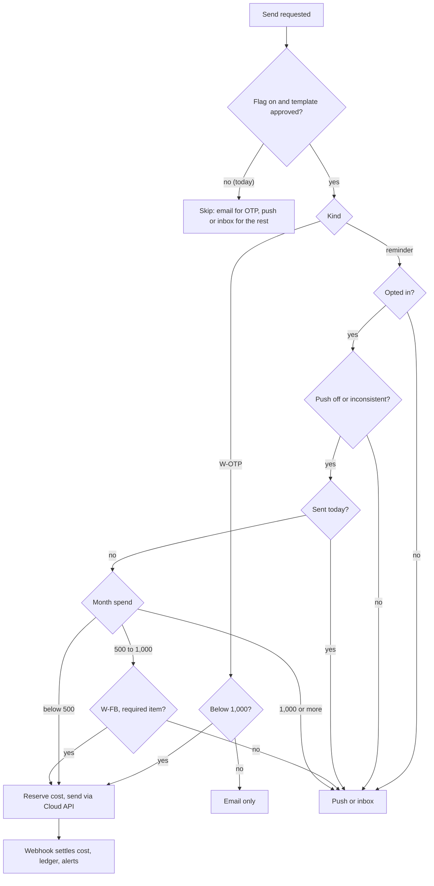

## 3.6 Reminder engine: policy and decision table

This changes `packages/core/src/reminder.ts` and `apps/api/src/domain/reminders.ts`, together with `jobs/reminders.ts`.

**Constants (new defaults):**

| Constant | Current | New | Note |
|---|---|---|---|
| `WORKOUT_REMINDER_LOCAL_TIMES` | `["06:00","18:00"]` | **remove** | Replaced by the `workoutReminderTime()` function |
| `WORKOUT_REMINDER_OFFSET_MINUTES` | n/a | `75` (allowed 60–90) | Added to the anchor time |
| `WORKOUT_FALLBACK_ANCHOR` | n/a | `"18:00"` | Used when there's no preferred or learned time. The reminder then fires at about 19:15. |
| `WORKOUT_LEARNED_MIN_SAMPLES` / `_WINDOW_DAYS` / `_SESSIONS` | n/a | 3 / 28 / last 6 | Median local start time of recent sessions |
| `MEAL_REMINDER_ADVANCE_MINUTES` | `45` | **remove** | No advance meal reminders (D6) |
| `MEAL_REMINDER_AFTER_MINUTES` | n/a | `40` (allowed 30–45) | After the meal time |
| `MEAL_REMINDER_FOLLOW_UP_MINUTES` | `[30, 60]` | **remove** | Replaced by one user-initiated snooze |
| `MEAL_SNOOZE_MINUTES` / `MEAL_MAX_SNOOZES` | n/a | `30` / `1` | n/a |
| `DAILY_SUMMARY_LOCAL_TIME` | `"21:00"` | **replace** with `min(lastMealTime + 60, "21:30")` | Never after 22:00 |
| `HARD_STOP_LOCAL_TIME` | n/a | `"22:00"` | Nothing is delivered after this, whatever the quiet hours |
| `DEFAULT_QUIET_HOURS` | n/a | `22:00–07:00` | Preference default |
| `DAILY_PUSH_CAP` | n/a | `5` (target ≤ 4) | Per trainee per local day, across all types including nudges |
| `MERGE_WINDOW_MINUTES` | n/a | `30` | n/a |
| `ACTIVITY_NUDGE_HOURLY_LIMIT` | `3` | keep `3` per trainer, plus **1 per item per 4 h** | n/a |

**Pre-send checks** (all must pass, evaluated at send time, not at schedule time):

| # | Check | If it fails |
|---|---|---|
| 1 | The relationship is active (not ended) and the trainer reminder rule for the category is on | Drop (`suppressed: rule_off`) |
| 2 | The item still needs action (not logged, skipped or resolved, not superseded) | Drop (`suppressed: already_logged`) |
| 3 | The trainee has `pushEnabled` and the category on, and a valid device token exists | Drop (`suppressed: prefs`). If the trainee opted in to WhatsApp and the type is fallback-eligible (required meal, workout or check-in), queue **W-FB** through the budget guard (§4.5, cap 1 a day). |
| 4 | Not within quiet hours and before 22:00 | Time-bound types (meal, workout, summary) **expire** (`suppressed: quiet_hours`). Check-in and plan types **defer** to quiet-hours end. |
| 5 | Under the daily cap | Apply the priority order below. Lower-priority items are dropped to the inbox only. |
| 6 | No other send to this trainee within 30 min | Merge: one notification, with the summary title "2 things to log" and actions for the first item. |
| 7 | Back-off doesn't apply (see below) | Drop (`suppressed: backoff`) |

**Priority order when the cap binds:**
1. Trainer nudge.
2. Meal reminder for a required meal.
3. Workout reminder.
4. Check-in due or late.
5. End-of-day summary.
6. Informational (plan updated, coach reviewed, coach answered).

Informational items are pushed only when the cap allows; otherwise they go to the inbox.

**Back-off rules:**

| Pattern | Detection (per category) | Action | Visible to |
|---|---|---|---|
| **Self-logger** | The item was logged *before* its reminder time on ≥ 5 of the last 7 occurrences | Skip that category's reminders. The end-of-day summary still covers misses. Re-enable automatically after 2 misses in 7 days. | Trainer (TW-31 "Logs on own"), and the trainee settings note |
| **Ignorer (soft)** | 3 consecutive reminders in the category ignored (no open and no log within 2 h) | Halve the frequency: skip every other occurrence, for example only the main meals | TW-31 |
| **Ignorer (pause)** | 5 consecutive ignored | Pause the category for 7 days. The trainee sees a Today card: "Meal reminders paused for a week since they weren't helping. Turn back on?" The trainer sees "Reminders paused". The re-engagement candidate list includes them (TW-04). | Both |
| **Push failure** | Delivery failed (invalid token) twice | Mark the token invalid and stop pushing. W-FB WhatsApp fallback if `wa_automation` is on, the trainee opted in and it's within budget; otherwise the inbox only. Trainer sees "Notifications off". | Trainer |
| **Inconsistent logger** (WhatsApp eligibility) | Ignorer (soft or pause) state, **or** fewer than half of the required items logged in the last 7 days | Push continues as above. **W-FB becomes eligible** for one required item a day, at the push time + 60 min if it's still unlogged. | Trainer (TW-31 WhatsApp block) |

**Workout reminder time:**
- `anchor = trainee.preferredWorkoutTime ?? learnedStart(last 6 sessions in 28 d, ≥3 samples) ?? 18:00`
- `fire = anchor + 75 min`
- If `fire` is after 21:30, fold the workout reminder into the end-of-day summary.
- On rest days and days without a required workout, nothing fires.

**End-of-day summary:**
- Fires once at `min(lastMealTime + 60, 21:30)`, only if any required item is still unlogged.
- Content: "2 things left today: Dinner, Workout". The action is "Log now", which opens Today.
- When everything is logged, nothing is sent. Don't send congratulations pushes.

**Re-engagement (2–3 days):**
- Trigger: no trainee log for 48 h and at least 3 consecutive unanswered reminders.
- On day 3 the client appears in Home "Re-engage" for the trainer (TW-04 §7). **The trainer starts the message**: **Open WhatsApp** opens `wa.me` with trainer-signed text prefilled (W-RE-M, §4.2), which the trainer can edit and sends themselves. It's free.
- **FitBud sends nothing automatically for re-engagement**, on any channel, even with `wa_automation` on (D31). Push stays on the normal schedule (and backs off per the ignorer rule).
- Opening WhatsApp hides the row for 3 days. The trainee isn't shown again for 7 days unless they log and lapse again.

**Decision table (by type):**

| Type | Anchor | Fires at | Only if | Quiet hours | Actions | Max per day |
|---|---|---|---|---|---|---|
| P-MEAL | **the trainee's meal time if set (TR-24), else the plan slot time** | +40 min | unlogged | expire | Eaten as planned · Snooze 30 m | 1 per meal (+1 after snooze) |
| P-WO | preferred, learned or 18:00 | +75 min | required workout unlogged and not started | expire (fold into summary) | Start · Not today | 1 |
| P-EOD | last meal +60, 21:30 cap | once | any required item unlogged | expire | Log now | 1 |
| P-CHK | the due date, at preferred time or 18:00 | once | not submitted | defer | Start check-in | 1 |
| P-CHK-LATE | window end +12 h, inside allowed hours | once | not submitted | defer | Start check-in | 1 |
| P-NUDGE | trainer action | immediately | item unresolved | defer to 07:00 (or drop if no longer relevant) | Open | 1 per item per 4 h |
| P-PLAN | publish with Notify client | immediately | relationship active | defer | See plan | 1 |
| P-CHK-REV | review saved | immediately | n/a | defer | See review | 1 (merged) |
| P-ANS | ask marked answered | inbox only by default | n/a | n/a | Open | n/a |
| P-NOTE | trainer marks a note visible | immediately (merged within 15 min) | the note is still visible | defer | Read | 2 |
| P-REACT | trainer sends a reactivation request | immediately | the request is still pending | defer | Review | 1 |
| W-FB | push unavailable or inconsistent logging (§4.5) | push time + 60 min | **`wa_automation` on**, still unlogged, opted in, template approved, within budget | never in quiet hours or after 22:00 | WhatsApp template with deep link | 1 per day (all W-*) |

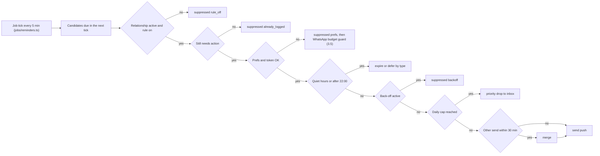

**Timezone (D22):** every local time in this section (anchors, quiet hours, the 22:00 hard stop, the daily cap day) is evaluated in the **trainee's stored timezone**.

**Testing:** a table-driven unit test per row above lives in `packages/core/src/reminder.test.ts`. Add "a day in the life" fixtures for: 5 meals plus a workout at 19:00 (expect ≤ 5 pushes), a self-logger (expect 0–1), an ignorer (expect a pause on day 5), quiet hours 21:00–06:00 (expect nothing at or after 21:00), a Lunch override to 14:30 (expect P-MEAL at about 15:10), push-off plus opt-in (expect exactly 1 W-FB a day), and budget soft and hard modes.

**Confluence write-back required** (OQ-3): decision C allows advance meal reminders and "one or two follow-ups", and says "no invented start-time reminder" for workouts. The 14 Oct user decisions refine these to after-meal only plus one snooze, and to a reminder anchored on the trainee-stated or learned time, which isn't invented. Record this in FitBud Workflows and States §C.

## 3.7 Late logging (D23)

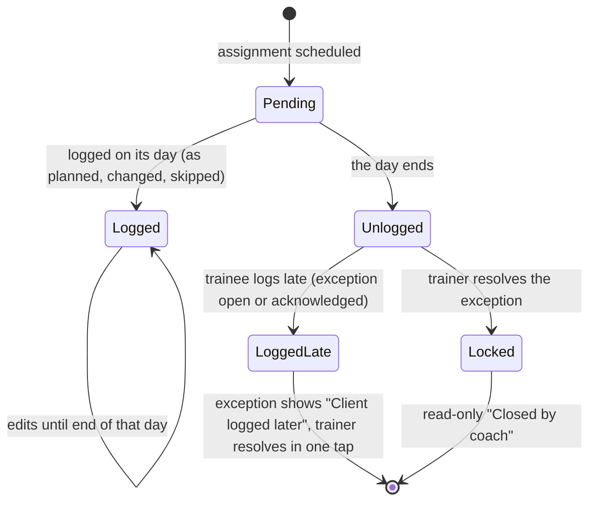

| Case | Can log late? | Until |
|---|---|---|
| Required item with an exception (missed meal or workout) | Yes | The trainer **resolves** that exception. Acknowledge doesn't lock it. |
| Required item where the exception hasn't fired yet | Yes | Same, once the exception exists. |
| Optional item (no exception raised) | **No** (D34, OQ-26) | Loggable only on its own day, until the end of that day in the trainee's timezone. Afterwards it shows "Not logged" (read-only), with no guilt copy. |
| Superseded by a plan replacement | No | n/a ("Replaced by plan update") |
| Relationship ended | No | n/a |
| Edits to an item already logged | Yes | The end of that item's day, in the trainee's timezone. |

**Server rule:** a late log is accepted when `exception.state ≠ resolved` at the time of the server write. An outbox item with a client timestamp *before* `resolvedAt` is still accepted, flagged `logged_after_resolve` for the trainer. Otherwise the server returns `409 locked`. For an **optional** item, a log is accepted only if its client timestamp falls on the item's own date (in the trainee's timezone), so an offline log made that day still syncs; anything later gets `409 locked`. Late logs set the derived state **Logged late** and never auto-resolve (OQ-23 default stands). **Rings and weekly counts** include late logs on their original date.

## 3.8 Relationship lifecycle: end, reactivate, new coach (D21)

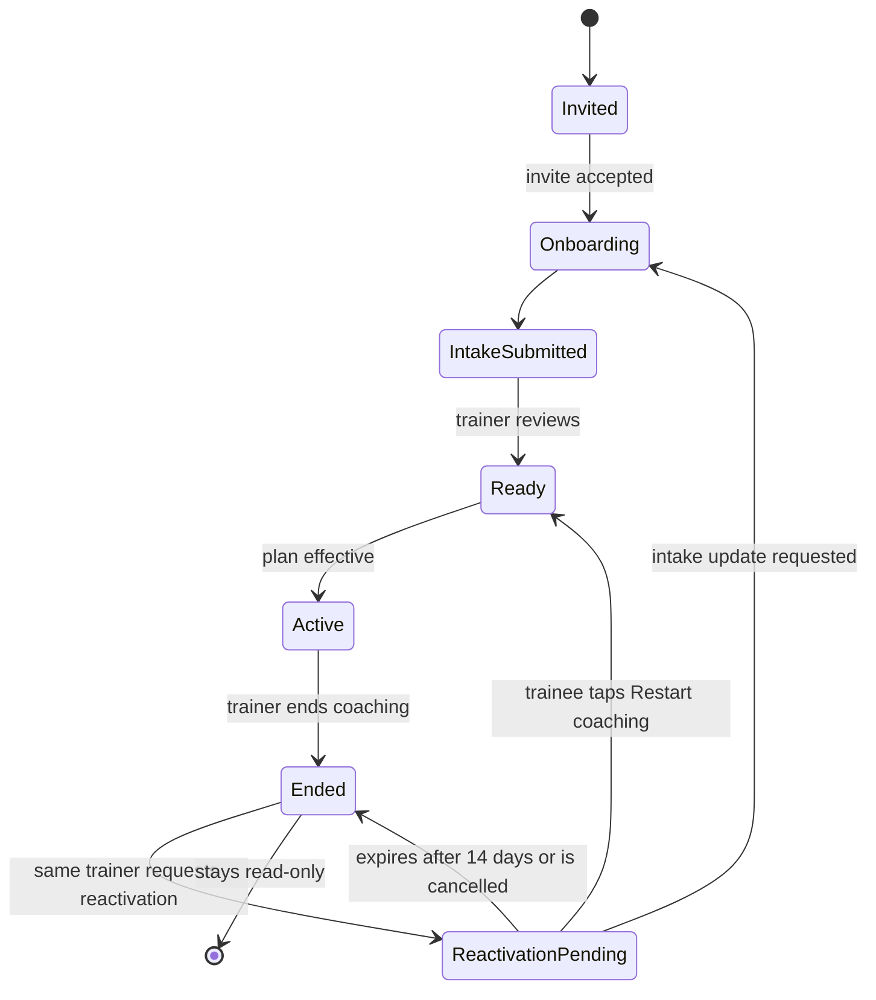

| | Same trainer (reactivate) | Different trainer (new invite) |
|---|---|---|
| Relationship row | **The same id**, restored | A new id |
| Trainer sees | All earlier history, notes, intake, configuration and plans | Nothing from earlier coaches. A blank workspace. |
| Trainee sees | Everything | Everything (Progress, Past coaching) |
| Exceptions open at the end | Stay closed ("Closed · coaching ended") | n/a |
| Reminders and check-ins | Resume after a plan is assigned | Start after onboarding and a plan, as for a new client |
| Consent | The trainee confirms with one tap (OQ-25) | The trainee accepts the invite |

## 3.9 Timezone (D22)

- **Source of truth:** `traineeTimezone` (IANA, for example `Asia/Kolkata`), set from the device at onboarding (TR-05) and editable in More.
- **Everything about the trainee's day** uses it: assignment civil dates, meal and workout times, windows, reminders, quiet hours, the 22:00 stop, rings, "today", late-log cut-offs and check-in due times.
- **Trainers** see the trainee's times with a `TimezoneBadge` whenever the offsets differ:
  - in the workspace header (TW-09a, TM-03);
  - in check-in scheduling (TW-19, TW-20 *Schedule next*);
  - in the assign-plan date window (TW-16).
  - Trainer-owned dates (renewals) stay in the trainer's timezone (TW-28).
- **Device timezone changes** (travel): the app compares the device zone with the stored one on foreground. If they differ for more than an hour of offset, it shows a one-time banner: "You're in Dubai time now. Use Dubai time for your plan?" **Switch** updates the stored zone (reminders reschedule, and the trainer sees the new badge and an activity entry). **Keep** remembers the choice until the device zone changes again (OQ-31).
- Formatting helper: `formatTimeDiff(trainerTz, traineeTz, now)` gives "5 h 30 m behind you" or "same time" (§1.6).

## 3.10 Meal-time change (D24)

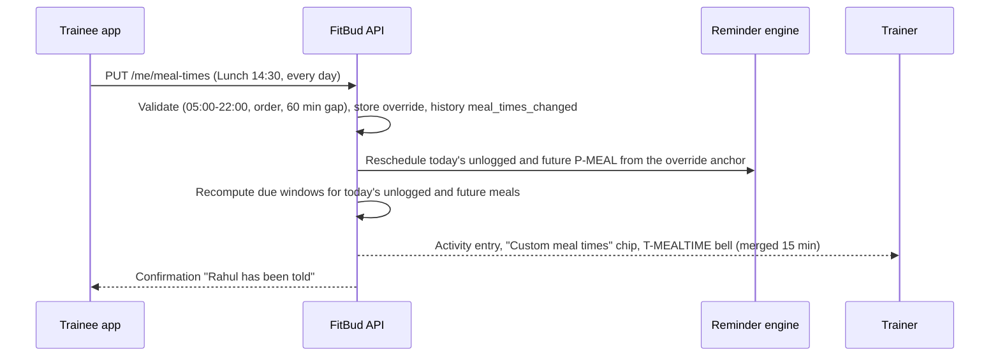

A plan change keeps the overrides for slots that still exist, and drops the rest with a trainee prompt (TR-24).


# 4. Notification specification

**Conventions:**
- Copy uses `{coach}`, `{meal}`, `{workout}` and similar placeholders, resolved server-side in the recipient's locale.
- The payload is always the existing safe payload: `notificationId`, `notificationType`, `domainEntityType`, `domainEntityId`, `createdAt`. Health detail never goes in the payload. The title and body may name the meal label ("Lunch") but never foods, weights or photos.
- Lock-screen privacy: when "Hide details on lock screen" is on (OQ-22), the body becomes "You have something to log in FitBud."
- **Contract mapping:**

  | Guide id | Existing type |
  |---|---|
  | P-MEAL | `meal_reminder` |
  | P-WO | `workout_reminder` |
  | P-CHK, P-CHK-LATE | `checkin_reminder` |
  | P-EOD | `daily_summary` |
  | P-NUDGE | `activity_nudge` |
  | P-RENEW | `subscription_renewal_reminder` (trainer-side today; trainee-side is optional) |

  New types (API-CHG in `packages/contracts/src/notification.ts`): `plan_published`, `checkin_reviewed`, `coach_answered`, `reminders_paused`, `relationship_ended`, **`trainer_note_shared`** (P-NOTE, D20), **`reactivation_requested`** (P-REACT, D21), and the trainer types `trainer_ask_coach`, `trainer_checkin_submitted`, `trainer_intake_submitted`, `trainer_critical_digest`, `trainer_renewal`, **`trainer_meal_times_changed`** (T-MEALTIME, D24) and **`admin_whatsapp_budget`** (A-WABUDGET, D17).
  WhatsApp sends aren't notification-table pushes. They're logged in `whatsapp_messages` and the budget ledger (§4.5), linked to the notification that triggered them.
- **Android channels:** `meal`, `workout`, `checkin`, `summary`, `coach` (nudges, reviews, answers), `plan`, and `coach_alerts` (trainer).
- **Feature flags (§1.6.11):** every FitBud-started WhatsApp message is behind `wa_otp` (W-OTP) or `wa_automation` (all other W-* templates). **Both are off today.** While they're off, only push, the inbox, email and user-tapped `wa.me` links are used.
- **System emails** (E-OTP, E-INV, E-PWD, E-ALERT) are sent from `SYSTEM_EMAIL_FROM` (default `FitBud <tech@thefitbud.com>`, configurable, D30).
- **Action category ids** must not contain `:` or `-` (Expo constraint, [R61]). Use `meal_actions`, `workout_actions`, `checkin_actions`.

## 4.1 Trainee push notifications

#### P-MEAL

| Field | Spec |
|---|---|
| Trigger | Meal time passes: **the trainee's own meal time when set (TR-24, D24)**, otherwise the plan slot time |
| Condition (all pass) | Meal unlogged, meal rule on, category on, not quiet, under cap |
| Channel | Push (`meal`). WhatsApp **W-FB** fallback when push is unavailable or logging is inconsistent (§4.5). |
| Timing | meal time +40 min (30–45), in the trainee's timezone |
| Copy EN (title · body) | "Lunch isn't logged yet" · "Tap if you ate as planned. Changed something? Open to log it." |
| Hinglish sample | "Lunch log nahi hua" · "Plan ke hisaab se khaya? Ek tap mein log karo." |
| Actions | **Eaten as planned** (background, outbox) · **Snooze 30 min** (once) |
| Deep link | `/meal/:id` |
| Caps and opt-out | 1 per meal plus 1 after snooze. Merged within 30 min ("Lunch and Snack aren't logged yet"). Back-off applies. Category toggle in TR-16. |

#### P-WO

| Field | Spec |
|---|---|
| Trigger | Anchor +75 min |
| Condition (all pass) | Required workout today, not started or logged |
| Channel | Push (`workout`) |
| Timing | preferred, learned or 18:00 anchor, +75 min |
| Copy EN (title · body) | "Time for {workout}?" · "If you've already trained, log it in a tap. If today's not the day, that's okay too." |
| Hinglish sample | "{workout} ka time?" · "Workout ho gaya toh log kar lo. Aaj nahi ho paaya toh bhi theek hai." |
| Actions | **Start** · **Not today** (skip sheet) |
| Deep link | `/workout/:id` |
| Caps and opt-out | 1 a day. Folded into P-EOD if past 21:30. |

#### P-EOD

| Field | Spec |
|---|---|
| Trigger | `min(lastMeal+60, 21:30)` |
| Condition (all pass) | ≥1 required item unlogged |
| Channel | Push (`summary`) |
| Timing | once |
| Copy EN (title · body) | "2 things left today" · "Dinner and your workout. Log what you did, then rest easy." |
| Hinglish sample | "Aaj ke 2 kaam baaki" · "Dinner aur workout. Jo kiya woh log karo, phir aaram." |
| Actions | **Log now** |
| Deep link | `/today` |
| Caps and opt-out | 1 a day. None after 22:00. Nothing when complete. |

#### P-CHK

| Field | Spec |
|---|---|
| Trigger | Due date |
| Condition (all pass) | Not submitted |
| Channel | Push (`checkin`) |
| Timing | the due day at preferred time, or 18:00 |
| Copy EN (title · body) | "Weekly check-in is ready" · "About 3 minutes. {coach} will review it." |
| Hinglish sample | "Weekly check-in ready hai" · "Sirf 3 minute. {coach} review karenge." |
| Actions | **Start check-in** |
| Deep link | `/checkin/:id` |
| Caps and opt-out | 1. Defers through quiet hours. |

#### P-CHK-LATE

| Field | Spec |
|---|---|
| Trigger | Window end +12 h |
| Condition (all pass) | Still not submitted |
| Channel | Push (`checkin`) |
| Timing | inside 07:00–21:30 |
| Copy EN (title · body) | "Your check-in can still go in" · "Late is fine. {coach} would love the update." |
| Hinglish sample | "Check-in abhi bhi bhej sakte ho" · "Late chalega, {coach} ko update mil jayega." |
| Actions | **Start check-in** |
| Deep link | `/checkin/:id` |
| Caps and opt-out | 1, never repeated |

#### P-NUDGE

| Field | Spec |
|---|---|
| Trigger | Trainer taps Nudge |
| Condition (all pass) | Item unresolved, relationship active |
| Channel | Push (`coach`) |
| Timing | immediately, or 07:00 if quiet |
| Copy EN (title · body) | "{coach}: quick reminder about {item}" · "Log it when you can." |
| Hinglish sample | "{coach} ka reminder: {item}" · "Jab time mile, log kar dena." |
| Actions | **Open** (plus **Eaten as planned** for meals) |
| Deep link | the item |
| Caps and opt-out | 1 per item per 4 h. 3 per trainer per hour. Counts toward the daily cap at top priority. |

#### P-PLAN

| Field | Spec |
|---|---|
| Trigger | Plan published with Notify on |
| Condition (all pass) | Active |
| Channel | Push (`plan`) |
| Timing | immediately (defer through quiet hours) |
| Copy EN (title · body) | "Your plan is updated" · "{coach} made changes from {date}. See what's new." |
| Hinglish sample | "Aapka plan update hua" · "{date} se naye changes. Dekh lo kya badla." |
| Actions | **See changes** |
| Deep link | `/plan/diet` or `/workout` |
| Caps and opt-out | 1 a day (merge multiple) |

#### P-CHK-REV

| Field | Spec |
|---|---|
| Trigger | Trainer saves the review |
| Condition (all pass) | n/a |
| Channel | Push (`coach`) |
| Timing | immediately (defer) |
| Copy EN (title · body) | "{coach} reviewed your check-in" · "Tap to see." When a **visible** note is attached: "{coach} reviewed your check-in and left a note" (this replaces P-NOTE for that note, D20). |
| Hinglish sample | "{coach} ne check-in dekh liya" · "Unka note dekho." |
| Actions | **See review** |
| Deep link | `/checkin/:id` |
| Caps and opt-out | Merged with other coach events within 30 min |

#### I-ANS

| Field | Spec |
|---|---|
| Trigger | Ask marked answered |
| Condition (all pass) | n/a |
| Channel | **Inbox only** by default |
| Timing | n/a |
| Copy EN (title · body) | "{coach} answered your question about {item}" |
| Hinglish sample | "{coach} ne {item} wale sawaal ka jawab diya" |
| Actions | n/a |
| Deep link | the item |
| Caps and opt-out | No push unless the coach-category push is on and the cap allows |

#### P-PAUSE

| Field | Spec |
|---|---|
| Trigger | Back-off pause starts |
| Condition (all pass) | n/a |
| Channel | Inbox, plus a Today card (no push) |
| Timing | n/a |
| Copy EN (title · body) | "Meal reminders paused for a week" · "They didn't seem to help. Turn them back on anytime." |
| Hinglish sample | "Meal reminders ek hafte ke liye band" · "Chahiye toh wapas on kar lo." |
| Actions | **Turn back on** |
| Deep link | `/settings/reminders` |
| Caps and opt-out | n/a |

#### P-NOTE

| Field | Spec |
|---|---|
| Trigger | The trainer saves a note with **Visible to client** on (TW-34), outside a check-in review |
| Condition (all pass) | Relationship active, the note is still visible at send time, coach category on |
| Channel | Push (`coach`) plus inbox, and the note appears on Today ("From your coach") |
| Timing | immediately (defer through quiet hours). Several notes within 15 min merge. |
| Copy EN (title · body) | "{coach} has a note for you!" · "Tap to read." (The note text is never shown on the lock screen.) Merged: "{coach} left 2 notes for you" |
| Hinglish sample | "{coach} ka aapke liye ek note hai!" · "Padhne ke liye tap karo." |
| Actions | **Read** |
| Deep link | `/today?note=:id` (`/go/note/:id`) |
| Caps and opt-out | Max 2 a day. Counts as informational in the cap priority. Editing or re-sharing within 24 h doesn't push again. |

#### P-REACT

| Field | Spec |
|---|---|
| Trigger | The trainer sends a reactivation request (TW-30) |
| Condition (all pass) | The request is pending, and the relationship is ended |
| Channel | Push (`coach`) plus inbox |
| Timing | immediately (defer) |
| Copy EN (title · body) | "{coach} wants to restart coaching with you" · "Tap to review." |
| Hinglish sample | "{coach} aapke saath coaching phir shuru karna chahte hain" · "Dekhne ke liye tap karo." |
| Actions | **Review** |
| Deep link | `/go/reactivate/:requestId` |
| Caps and opt-out | 1 per request. A reminder after 3 days, inbox only. |

#### P-END

| Field | Spec |
|---|---|
| Trigger | Relationship ended |
| Condition (all pass) | n/a |
| Channel | Push (`coach`) |
| Timing | immediately (defer) |
| Copy EN (title · body) | "Coaching with {coach} has ended" · "Your history stays in FitBud." |
| Hinglish sample | "{coach} ke saath coaching khatam" · "Aapki history FitBud mein safe hai." |
| Actions | **Open** |
| Deep link | `/today` |
| Caps and opt-out | 1 |


**Notification actions (Expo):**
- `meal_actions`: `eaten_as_planned` (opensAppToForeground false) and `snooze_30` (false).
- `workout_actions`: `start` (true) and `not_today` (true).
- `checkin_actions`: `start` (true).
- Background actions write to the SQLite outbox and request a background sync. If the outbox can't be reached (the iOS app was killed), the action opens the app and completes the action on launch.

## 4.2 WhatsApp messages (D17)

FitBud uses the **Meta WhatsApp Cloud API** directly ([R93]), with no BSP, for messages FitBud starts. **This is fully built and switched off** (`wa_otp` and `wa_automation`, §1.6.11), because there's no business SIM or WhatsApp Business account yet. Everything a person sends from their own WhatsApp stays a free `wa.me` link, which works today regardless of the flags.

**FitBud never sends a message on anyone's behalf (D31).** Part A messages are prefilled; the person reviews them and presses Send in their own WhatsApp. They're text only, with no voice notes. Trainer prefills are **trainer-signed text**: written as the trainer and editable before sending. Part B messages are always signed as FitBud.

**A. Person-sent, via `wa.me` (free, no template, no FitBud cost):**

| ID | Trigger | Sender | Template EN | Hinglish sample | Link |
|---|---|---|---|---|---|
| **W-INV** | Invite created | Trainer taps, then presses Send | "Hi {name}, I've set up your coaching on FitBud. Join here: {inviteUrl}" | "Hi {name}, maine FitBud pe aapki coaching set ki hai. Yahan join karo: {inviteUrl}" | invite |
| **W-INV-R** | Remind on a pending invite | Trainer taps | "Hi {name}, just a reminder to join FitBud so we can start: {inviteUrl}" | "Hi {name}, FitBud join kar lo taaki shuru karein: {inviteUrl}" | invite |
| **W-RE-M** | Home Re-engage, day 3 (**the only re-engagement message**, D10 and D31) | Trainer taps, edits if they like, then presses Send | "Hi {name}, haven't seen your logs for a couple of days. All okay? Pick up with today's plan whenever you're ready: {todayLink}" | "Hi {name}, 2 din se logs nahi dikhe. Sab theek? Jab ready ho, aaj ke plan se shuru karo: {todayLink}" | `/go/today` |
| **W-ASK** | Trainee asks about an item (TR-18) | Trainee taps | "Hi {coach}, question about my {item} ({date}): {topic}. {link}" | (same, short) | the item |

**B. FitBud-started, via the Cloud API (paid, Meta-approved templates from the registry §4.6, budget-guarded §4.5, built and flag-gated):**

| ID | Flag | Meta category | Trigger and eligibility | Timing | Template EN (variables in braces) | Button | Caps |
|---|---|---|---|---|---|---|---|
| **W-OTP** | `wa_otp` | **Authentication** (≈ ₹0.136) | Code sign-in, forgot password, or invite verification (§3.1a) | Immediately | Meta's fixed authentication text: "{code} is your verification code. For your security, do not share this code. This code expires in 10 minutes." [R79] | **Copy code** (the only button allowed, because Meta requires it) | Rate limits in §3.1a. Exempt from the daily cap. Blocked at the hard cap (email still goes). |
| **W-FB** | `wa_automation` | **Utility** (≈ ₹0.136) | A required item is unlogged **and** (push unavailable: permission off, no valid token, or 2 failed deliveries) **or** (inconsistent logging: the ignorer state, or < 50% of required items logged in 7 days), **and** opted in | Push time + 60 min (or the push time when push is unavailable), never in quiet hours or after 22:00 | "Your {item} for {date} is not logged yet in FitBud. Open: {link}" | None | **1 a day** across all W-* utility messages. The most important item only. |
| **W-CHK** | `wa_automation` | **Utility** | Check-in due, push unopened by 18:00, opted in, **normal mode** | 18:00–20:00 | "Your weekly check-in for {coach} is due on {date}. Open: {link}" | None | Within the daily cap |
| **W-PLAN** | `wa_automation` | **Utility** | A new plan version was published for an opted-in trainee and P-PLAN went unopened for 2 h, **normal mode** | Next allowed hour | "{coach} published your updated plan, starting {date}. Open: {link}" | None | Within the daily cap. At most 1 per plan version. |
| **W-RENEW** | `wa_automation` | **Utility** | The coaching end or renewal date is 3 days away, or today, for an opted-in trainee, **normal mode** | 10:00 | "Your coaching with {coach} is scheduled to end on {date}. Details: {link}" (informational only: no price, offer or call to renew) | None | Within the daily cap. At most 2 per period. |

**There's no automated re-engagement template.** The earlier W-RE is removed. Day-3 re-engagement is only the trainer-signed W-RE-M prefill (D31). That also closes OQ-27.

**Template rules (Q27: strictly utility):**
- **No buttons and no calls to action** on utility templates: no URL buttons and no quick replies. The deep link appears as plain text in the body. The only button anywhere is the authentication **Copy code** that Meta requires.
- Every utility body states a fact about **something the user already has**: a specific item, date, check-in, plan version or coaching period. There's no persuasive framing.
- Templates are submitted in English (`en`). Hinglish copy is used only in `wa.me` links, because a Hinglish template would need a separate approval.
- Every reminder template's footer reads "Reply STOP to stop WhatsApp reminders." ([R44] [R45]).
- The link is always the https `/go/` link (D3).
- Every template is **pre-approved by Meta** and tracked in the registry (§4.6). The server refuses to send a template that isn't `approved`.
- The copy lint and the review checklist are in §4.6. Utility templates that read as promotional may be recategorised as marketing [R92] [R100].

**Inbound handling (the webhook):**
- **STOP**, "stop", "unsubscribe" or "band karo" set `whatsappOptIn.granted=false` immediately. FitBud replies once with a free-form service message: "You won't get WhatsApp reminders from FitBud anymore. Turn them back on in the app anytime."
- **Any other inbound message** gets a single auto-reply per 24 h (a free service message): "This number only sends FitBud reminders and codes. To talk to {coach}, message them here: {coachWaMe}." No inbound content is stored beyond the 24 h dedupe key (decision F).
- Delivery statuses (sent, delivered, read, failed) and the `pricing` object (billable, category) update `whatsapp_messages` and the ledger (§4.5).
- An "Invalid WhatsApp user" style error marks the number `whatsappUnreachable`, so W-* stops and OTPs go by email only.

## 4.3 Trainer notifications (web bell and trainer mobile push)

| ID | Trigger | Copy EN | Deep link | Caps |
|---|---|---|---|---|
| **T-ASK** | Trainee creates an ask | "{client} asked about {item}" | `/?ask=:id` (TM: `/coach/ask/:id`) | Merged per 15 min ("3 clients asked you on WhatsApp") |
| **T-CHK** | Check-in submitted | "{client} sent their check-in" | `/clients/:rid/check-ins/:id` | Merged per 15 min |
| **T-INTAKE** | Intake submitted | "{client} finished their intake" | `/clients/:rid/onboarding` | n/a |
| **T-CRIT** | New Critical exception(s) | "2 clients need attention" | `/` | At most 1 an hour, in trainer quiet hours |
| **T-RENEW** | Renewal enters due or expired | "{client}'s coaching renews today" | `/clients/:rid/configure` | Once per state change |
| **T-DIGEST** (P2) | 08:00 local | "Today: 4 need attention, 2 check-ins to review" | `/` | 1 a day, opt-in |
| **T-MEALTIME** | Trainee changes meal times (TR-24, D24) | "{client} changed her meal times · Lunch 1:30 → 2:30 pm" | `/clients/:rid/plan` (TM: `/coach/activity?rid=`) | Merged per 15 min. Also an activity entry (TW-17, TM-09). |
| **T-NOTE-SEEN** (bell only, P2) | The client opens a visible note | "{client} read your note" | `/clients/:rid` | Bell only, no push |
| **A-WABUDGET** (admins) | The WhatsApp spend crosses a threshold (§4.5) | "WhatsApp spend: ₹402 of ₹500 this month (80%)" / "WhatsApp paused: hard cap ₹1,000 reached" | admin email plus bell | Once per threshold per month |

## 4.4 Opt-out matrix

| Control | Owner | Effect |
|---|---|---|
| OS notification permission | Trainee | All pushes stop. The engine marks "Notifications off" for the trainer. |
| Category switches (TR-16) | Trainee | The category stops. Nudges for that category also stop (nudges respect client preferences). |
| Quiet hours (TR-17) | Trainee | Expire or defer, per type |
| Reminder rules per client (TW-11) | Trainer | Automatic reminders for that category stop. Nudges remain possible. |
| **`wa_otp` flag off (today)** | System (§1.6.11) | No W-OTP. Codes go by email only. The UI shows WhatsApp as disabled "Coming soon". |
| **`wa_automation` flag off (today)** | System (§1.6.11) | No W-FB, W-CHK, W-PLAN or W-RENEW. No opt-in is collected (TR-05 and TR-16 show "Coming soon"). Reminders are push and inbox only. `wa.me` links still work. |
| WhatsApp opt-in (TR-05, TR-16) | Trainee | W-FB, W-CHK, W-PLAN and W-RENEW stop. `wa.me` chats are ordinary WhatsApp, outside FitBud. W-OTP is sent only when the user requests a code. |
| Reply **STOP** on WhatsApp | Trainee | The same as turning the opt-in off, immediately. A confirmation is sent once (a free service message). |
| WhatsApp budget soft mode (spend ≥ ₹500) | System (§4.5) | W-CHK, W-PLAN and W-RENEW pause. W-FB is limited to required items. W-OTP continues. |
| WhatsApp hard cap (spend ≥ ₹1,000) | System (§4.5) | **No FitBud-started WhatsApp** until the 1st of next month. Reminders are push-only. OTPs go by email only. Admins are alerted, and trainers see "paused" in TW-31. |
| Meal times (TR-24) | Trainee | P-MEAL and W-FB follow the trainee's times. |
| Note visibility (TW-34) | Trainer | Only visible notes reach the trainee (P-NOTE). Making a note private removes it, with no notification. |
| Back-off | System | Visible to both. The trainee can override it. |
| Relationship ended | Trainer | Everything stops except P-END. |

## 4.5 WhatsApp budget, cap enforcement and alerts (D17)

**Flag note:** all of this section is built and tested now but inert while `wa_otp` and `wa_automation` are off. A flag-off send returns `{skipped: 'flag_off'}` **before** any reservation, so no ledger rows are written. Budget alerts (A-WABUDGET) go to `ADMIN_ALERT_EMAILS` (default `tech@thefitbud.com`, configurable, OQ-28 decided) from `SYSTEM_EMAIL_FROM`.

**Budget:** ₹500 a month for the first 50 trainers, with a **hard cap of ₹1,000**. Both are config values (`WA_MONTHLY_BUDGET_INR`, `WA_HARD_CAP_INR`), changed without a deploy. The month is a calendar month in IST and resets at 00:00 IST on the 1st.

**Rate card (config, India, from 1 Oct 2026):**

| Category | Meta rate | With 18% GST | Used by |
|---|---|---|---|
| Authentication | ₹0.115 | **₹0.1357** | W-OTP |
| Utility | ₹0.115 | **₹0.1357** | W-FB, W-CHK, W-PLAN, W-RENEW |
| Marketing | ₹0.8631 | ₹1.0185 | not used (only if Meta reclassifies a template) |
| Service (free-form replies) | free (1,000 a month per number) | n/a | STOP confirmation, auto-reply |

Sources: Meta pricing [R77] and the 1 Oct 2026 India coverage [R78]. **Utility templates are now billed even inside an open 24-hour window**, so every W-* reminder is assumed billable. Store the rates in paise in config and update them from Meta's rate card each quarter.

**What the budget buys** (planning numbers):

| Budget level | Messages at ₹0.1357 | Example for 50 trainers × 15 clients = 750 trainees |
|---|---|---|
| ₹500 | ≈ 3,680 a month | ≈ 120 WhatsApp reminders a day, i.e. about 16% of trainees getting one a day, plus about 100 OTPs a month |
| ₹1,000 | ≈ 7,370 a month | ≈ 245 a day |

With password as the default login, OTPs are expected to be a few percent of spend. Reminders to trainees with push off or inconsistent logging are the bulk of it.

**Budget modes:**

| Mode | Month-to-date spend (actual + reserved) | Allowed FitBud-started WhatsApp | Everything else |
|---|---|---|---|
| **Normal** | < ₹500 | W-OTP, W-FB, W-CHK, W-PLAN, W-RENEW | Unchanged |
| **Soft** | ₹500 – < ₹1,000 | W-OTP, plus W-FB for **required** items only | W-CHK, W-PLAN and W-RENEW fall back to push and inbox. The trainer's Home Re-engage (`wa.me`) is unaffected. |
| **Hard cap** | ≥ ₹1,000 | **None** | Reminders are push-only (inbox if push is unavailable). OTPs go **by email only**, and the sign-in UI says "Sent to your email". The TW-31 WhatsApp block shows "paused until 1 {month}". |

**Enforcement (the server, `apps/api/src/domain/whatsapp-budget.ts`):**
1. **Reserve before sending:** in one D1 transaction, read the month-to-date `SUM(cost_paise)` (actual plus reserved), check the mode for this kind, and insert a ledger row `reserved` with the estimated cost. If the check fails, nothing is sent and the caller falls back.
2. Send via Cloud API `POST /{phone-number-id}/messages` (a template message [R93]) and store the returned message id (`wamid`).
3. **Settle from the webhook:** the status webhook's `pricing` object (billable, category) sets the row to `billed` at the category's rate, or `not_billed` (cost 0). A failed send releases the reservation.
4. Reservations with no webhook after 24 h are kept as billed (conservative).
5. **Monthly reconciliation:** compare the ledger with WhatsApp Manager analytics or the invoice. Webhooks report the category, not the rupee amount. Differences above 5% raise an admin alert.

**Ledger table `whatsapp_ledger`:** id, month_key (YYYY-MM in IST), kind (`otp`, `fb`, `chk`, `plan`, `renew`), template_name, category, wamid, trainee_user_id nullable, relationship_id nullable, est_cost_paise, cost_paise, state (`reserved`, `billed`, `not_billed`, `failed`), created_at, settled_at.

**Alerts (A-WABUDGET):** sent to the admin recipients (`ADMIN_ALERT_EMAILS`, default `tech@thefitbud.com`, configurable list; OQ-28 decided 17 Oct) by email plus the admin bell, **once per threshold per month**:
- 50% of budget (₹250);
- 80% of budget (₹400);
- 100% of budget (₹500): "Soft mode on";
- 90% of the hard cap (₹900);
- 100% of the hard cap (₹1,000): "WhatsApp paused until the 1st".

There's also a daily spike alert when one day's spend is more than 3 times the 7-day average (possible abuse or a bug), and the OTP send rate is watched for abuse.

**Eligibility recap for reminder templates:** `wa_automation` on **and** the template `approved` in the registry **and** opted in (and not STOP, not `whatsappUnreachable`) **and** (push unavailable **or** inconsistent logging) **and** no W-* reminder today **and** the mode allows the kind **and** not in quiet hours or after 22:00 in the trainee's timezone.

**Admin view (P2):** a simple internal page or a weekly email with the month-to-date spend, the mode, messages by kind, and the delivered and read rates. Trainers never see rupee amounts.

**Acceptance criteria:**
- [ ] No W-* reminder is sent when the reservation would cross the mode limit, and the fallback is push.
- [ ] At ₹1,000, OTP emails still go and WhatsApp OTPs don't.
- [ ] Each threshold alert fires exactly once a month.
- [ ] The ledger settles from webhooks, and failed sends cost 0.
- [ ] Changing `WA_HARD_CAP_INR` in config takes effect without a deploy.
- [ ] STOP opts out within one webhook round trip.
- [ ] With either flag off, the matching send returns `skipped: flag_off`, writes no ledger row and uses the fallback.
- [ ] A template whose registry status isn't `approved` is refused even with the flag on.

## 4.6 WhatsApp template registry, approval and copy lint (D17)

Every Cloud API template must be **approved by Meta in advance**, and Meta can later pause or disable one for quality. FitBud keeps a registry so code only sends what's approved, and so copy changes go through review. It's built now (behind the flags) so the templates can be submitted the day the WhatsApp Business account exists.

**Table `whatsapp_templates`:**

| Column | Notes |
|---|---|
| `id`, `key` | `key` is the guide id: `W-OTP`, `W-FB`, `W-CHK`, `W-PLAN`, `W-RENEW` |
| `name` | The Meta template name, lowercase with underscores, versioned (for example `fitbud_item_not_logged_v1`) |
| `category` | `utility` or `authentication`. **Never `marketing`.** |
| `language` | `en` |
| `body`, `footer`, `variables` | `variables` is a JSON list of name and sample pairs, transactional facts only (`item`, `date`, `coach`, `link`) |
| `buttons` | Empty for utility. `copy_code` for authentication. |
| `version` | An integer. Editing an approved body creates a new version that must be approved again. |
| `status` | `draft` → `submitted` → `approved`, or `rejected`, `paused` or `disabled` |
| `meta_template_id`, `quality_rating`, `rejection_reason` | From Meta |
| `submitted_at`, `approved_at`, `last_synced_at`, `owner` | Audit |

**Status sync:** subscribe to the WhatsApp Business Account webhook's template status updates [R100] and update `status`, `quality_rating` and `rejection_reason`. Also run a daily reconcile job. A change to `paused`, `disabled` or `rejected` raises an E-ALERT email to `ADMIN_ALERT_EMAILS`, and sends of that key fall back immediately.

**Send-time rule:** `sendTemplate(key, …)` resolves the **latest `approved` version** for the key. If there's none, it returns `{skipped: 'template_not_approved'}`. The code never builds template text inline.

**Copy lint** (a unit test over the registry seed file, failing CI):
1. The category must be `utility` or `authentication`.
2. Banned words and phrases (case-insensitive): offer, discount, free, sale, deal, hurry, limited, exclusive, upgrade, buy, "don't miss", "we miss you", "come back", "last chance", "special".
3. No `!`, no emoji, no `%`, no prices or ₹ amounts, and no superlatives.
4. The body must contain at least one transactional variable (`{item}`, `{date}`, `{checkin}` or `{plan}`) and the `{link}` variable as plain text.
5. No buttons on utility templates.
6. Signed as FitBud: nothing written as the trainer ("I", "my plan for you"). The trainer is named only as `{coach}`.
7. The footer is exactly "Reply STOP to stop WhatsApp reminders."
8. The body is 160 characters or less, excluding variables.
9. The language is `en`.

**Review checklist** (before submitting to Meta, ticked in the PR):
- [ ] It's about one specific thing the user already has or agreed to (an item, check-in, plan or coaching period).
- [ ] It reads as a notice, not a nudge to buy, return or upgrade.
- [ ] Variables carry facts only. No free text from trainers goes into templates.
- [ ] The sample values contain no personal health detail (decision F).
- [ ] The lint passes, and the registry row is `draft` with an owner.
- [ ] After approval, the registry shows `approved` before the flag is turned on.

# 5. Implementation roadmap and backlog

## 5.1 Phases

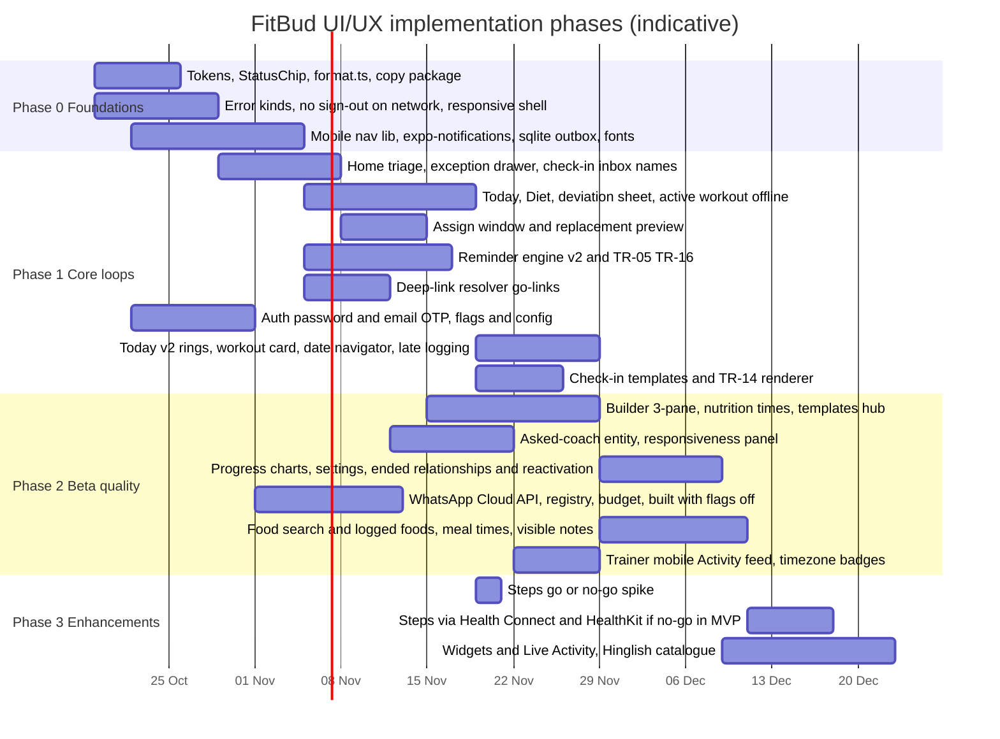

The dates are indicative, assuming one full-stack agent stream per section. Updated 17 Oct 2026 for the resolved decisions. **v1.2 (17 Oct, evening):** the email OTP ships in Phase 1 and doesn't depend on WhatsApp. The WhatsApp Cloud API is still built in Phase 2, but ships with both flags off; turning them on is an operations step (§1.6.11) once the business number, the Meta verification and the template approvals exist. The steps spike runs in Phase 1. If it's Go, steps join Phase 2 work; if not, they stay in Phase 3.

**Phase exit criteria:**
- **Phase 0:** no raw ISO or UUID anywhere. No sign-out on network errors. 390 px works. The mobile app has a navigation library, a SQLite outbox and push permission.
- **Phase 1:** a trainee can complete a full day (meals, a workout and a check-in) fully offline, with ≤5 pushes. A trainer can triage Home in drawer mode and assign a plan with a window.
- **Phase 1:** also, password sign-in and the **email OTP** work from `SYSTEM_EMAIL_FROM`, `GET /config` serves the flags, WhatsApp shows "Coming soon", Today shows the rings, the workout card and the date navigator, and the steps spike has a recorded Go or No-go.
- **Phase 2:** builder, templates (six tabs), asked-coach, responsiveness, the WhatsApp Cloud API with the registry and budget guard (built and tested in staging, **flags off in production**), food logging, meal times, visible notes, reactivation and the trainer Activity feed are in place. Beta-ready.
- **Phase 3:** steps, widgets and Hinglish.

## 5.2 Full backlog (P0, P1, P2)

| # | Pri | Screen or area | Item | Type | Depends on |
|---|---|---|---|---|---|
| 1 | P0 | Global | `packages/core/src/format.ts`, with no raw ISO or `Z` anywhere | Code | n/a |
| 2 | P0 | TW-33 | Error kinds in `api-client`, and only a 401 signs out | Code | n/a |
| 3 | P0 | TW-03 | Responsive shell (rail, bottom navigation, sticky sidebar), nav order and More | Code | n/a |
| 4 | P0 | TW-22 | Inbox shows client names | API and code | n/a |
| 5 | P0 | Design system | Semantic tokens, unified `StatusChip` with icons, no coral warnings | Code | n/a |
| 6 | P0 | §1.5 | Remove banned elements from Figma and any code (dev copy, live dot, version label for trainees) | Design and code | n/a |
| 7 | P0 | TW-04 | Bounded, grouped Home with sections. **Needs attention as rows** (one per client, one chip, severity then age, about 8 plus View all, keyboard grid) (D32) | Code | 1, 5 |
| 8 | P0 | TW-05 | Exception drawer, separate verbs, no UUIDs, nudge states | Code | 7 |
| 9 | P0 | TW-09a, TW-09 | Header split, single CTA, 404 handling, overview hierarchy | Code | 1 |
| 10 | P0 | TW-16 | Assign window, replacement preview, combined assign API | API and code | seed fix |
| 11 | P0 | API | Fix the seed's 500 on `assignments/generate` | API | n/a |
| 12 | P0 | TW-20 | Sticky review bar, hide zero counts | Code | 1 |
| 13 | P0 | TR platform | React Navigation 7 and linking, expo-notifications, expo-sqlite outbox, expo-font, expo-application | Code | n/a |
| 14 | P0 | TR-02, TW-07 | Invite link URL plus share card plus app landing | API and code | OQ-2 |
| 15 | P0 | TR-05 | Reminder setup: permission, preferred time, quiet hours default, WhatsApp shown as "Coming soon" while the flag is off | Code and API | 13, 64 |
| 16 | P0 | TR-06 | Today redesign: date navigator, next up, **workout card with Start into the active workout**, **nutrition rings and next meal**, weekly consistency; no client-side generation | Code and API | 13, week and day read models |
| 17 | P0 | TR-07, TR-08 | Meal card with **kcal per meal and day**, one-tap confirm, sheet, offline, undo | Code | 13 |
| 18 | P0 | TR-11 | Offline-first active workout, steppers, rest timer, RPE chips | Code | 13 |
| 19 | P0 | TR-14 | Check-in rendered from the pinned template, prefill, offline | Code | 13, TW-25 API |
| 20 | P0 | TR-16 | Reminder settings | Code and API | 15 |
| 21 | P0 | §3.6 | Reminder engine v2 (constants, caps, merge, expire, back-off) | API | n/a |
| 22 | P0 | TR-19 | Sync indicator plus status screen | Code | 13 |
| 23 | P0 | TR-23 | Deep-link resolver (`/go/`), exact routing, unavailable state | API and code | OQ-2 |
| 24 | P0 | TW-11 | Reminder rule toggles in Configure | Code | n/a |
| 25 | P0 | TW-01, TR-01, TR-02, §3.1a | Auth: mobile number or email plus password; **email OTP live**, WhatsApp leg built behind `wa_otp` with a disabled "Coming soon" option; no SMS; forgot and set password; Firebase custom tokens | API and code | 64, 65 (53 only for the WhatsApp leg) |
| 26 | P1 | TW-02 | Trainer first-run plus trainer WhatsApp number | API and code | n/a |
| 27 | P1 | TW-06 | Roster FilterBar, Ended view, stacked cards | Code | n/a |
| 28 | P1 | TW-10 | Grouped answers, highlight flag, combined CTA | Code and API | n/a |
| 29 | P1 | TW-11 | Accordion configure, empty 404s handled quietly | Code | n/a |
| 30 | P1 | TW-12 | Week strip, draft banner, versions collapsed | Code | n/a |
| 31 | P1 | TW-13 | Three-pane workout builder, weekday mapping, autosave, preview | API and code | n/a |
| 32 | P1 | TW-14, TW-15 | Nutrition builder with meal times, servings, unknown nutrients; diet scope | API and code | food migration |
| 33 | P1 | TW-17 | Activity grouped by day, panels, no manual generate | Code | n/a |
| 34 | P1 | TW-18, TR-13 | Charts and photo compare | Code | n/a |
| 35 | P1 | TW-23, TW-24, TW-25 | Templates hub with **six type tabs** (D26), scope filter, form builders, check-in templates | API and code | n/a |
| 36 | P1 | TW-28, TW-29 | Settings, trainer notifications | API and code | n/a |
| 37 | P1 | TW-30, TR-22, §3.8 | End coaching, read-only views, **reactivation** (same relationship) and new-coach blank start | API and code | n/a |
| 38 | P1 | TW-31 | Responsiveness read model and panel | API and code | 21 |
| 39 | P1 | TW-32, TR-18 | Asked-coach entity, sheet, drawer, markers | API and code | 23 |
| 40 | P1 | TM-01 to TM-07 | Trainer mobile parity (segments, **attention cards**, swipe, More, timezone badge) | Code | 13 |
| 41 | P1 | TR-03, TR-04 | Sectioned intake, waiting checklist | Code | n/a |
| 42 | P1 | TR-10, TR-12 | Week strip, late log (until resolved; optional items not late-loggable), summary recap | Code | 61 |
| 43 | P1 | TR-15, TR-17 | Inbox, quiet hours | Code | n/a |
| 44 | P1 | TR-20 | More screen (meal times, time zone, password, past coaching, Help by email with the reply promise) | Code | n/a |
| 45 | P1 | TW-34, TW-20, TR-06, TR-14 | Trainer notes with **Visible to client**, P-NOTE push, Today "From your coach" | API and code | n/a |
| 46 | P1 | §1.6.9 | Copy catalogue package plus the en-IN source | Code | n/a |
| 47 | P1 | TR-05 | OEM battery guide | Code | n/a |
| 48 | P2 | TW-08 | Invitation detail, re-issue, revoke | API and code | n/a |
| 49 | P2 | TW-19, TW-21 | Check-in list paging, history weekly grouping | Code | n/a |
| 50 | P2 | TW-26, TW-27 | Library paging and drawers, Use/Fork modals | Code | n/a |
| 51 | P2 | TR-09 | Assigned meal plan plus "What changed" | Code | n/a |
| 52 | P2 | TR-21 | Widgets and Live Activity | Native | 13 |
| 53 | **P1** | §4.2, §4.5 | **Meta WhatsApp Cloud API, built with the flags off**: the client, templates (W-OTP, W-FB, W-CHK, W-PLAN, W-RENEW), webhook, STOP and auto-reply, budget ledger, modes and alerts (to `ADMIN_ALERT_EMAILS`). Tested in staging against a test number. Turning it on needs a business number, Meta verification and approved templates. | API and integration | 64, 66 |
| 54 | P2 | i18n | Hinglish catalogue (hi-Latn) for trainee app and push | Copy | 46 |
| 55 | P2 | TM-08 | Remember the role choice | Code | n/a |
| 56 | P2 | TW-04 | Morning digest, saved views | Code | n/a |
| 57 | P0 | §1.6.10, TW-03, TW-28, TW-33, TM-07, TR-20 | Support `mailto:tech@thefitbud.com` with prefilled context (D19), plus the reply promise "We'll get back to you within a day" (D33) | Code | 13 |
| 58 | P1 | TM-09 | Trainer mobile Activity feed in the Clients tab, plus `GET /activity/feed` | API and code | 40 |
| 59 | P1 | TR-24, TW-09a, TW-12, §3.10 | Trainee meal times, reminder anchor override, trainer indicator, T-MEALTIME | API and code | 21 |
| 60 | P1 | TR-26, TR-08, TW-17, TW-26 | Food search (recent, frequent, Indian aliases, household units), `logged_foods` deviation, offline food index, custom foods, "Add to library" | API and code | 13, food aliases |
| 61 | P0 | §3.7, TR-06, TR-07, TR-10 | Late-logging rule (until the exception is resolved; optional items only on their own day, D34), `409 locked`, locked UI | API and code | 21 |
| 62 | P1 | §3.9, TW-09a, TW-16, TW-19, TM-03, TR-05 | Trainee timezone as the source of truth, `TimezoneBadge`, device-change prompt | API and code | 1 |
| 63 | P1 if Go, else P2 | TR-25 | Steps via Health Connect and HealthKit (on-device, never shared, hidden without permission) | Native | 13, 68 |
| 64 | P0 | §1.6.11 | Feature flags `wa_otp` and `wa_automation` (server config, both off), API-NEW `GET /config`, client cache, "Coming soon" UI states | API and code | n/a |
| 65 | P0 | §1.6.11, §3.1a | System email: `SYSTEM_EMAIL_FROM`, reply-to, provider adapter, E-OTP, E-INV, E-PWD, E-ALERT; SPF, DKIM and DMARC on thefitbud.com (OQ-32) | API and ops | n/a |
| 66 | P1 | §4.6 | WhatsApp template registry (`whatsapp_templates`), status webhook and reconcile, copy lint in CI, review checklist | API and code | 64 |
| 67 | P1 | TW-07 | **Email invite** button (E-INV) on the share card | API and code | 65 |
| 68 | P1 | TR-25 | Steps go or no-go spike (≤ 2 dev-days, five checks, D35) | Spike | 13 |

## 5.3 Testing and QA checklist (applies to every PR)

- [ ] Unit tests for pure selectors (`nextUp`, `primaryActionFor`, the reminder decisions, the formatters, the link builders).
- [ ] Playwright web flows: triage Home → drawer → resolve; assign a plan; review a check-in.
- [ ] Mobile (Detox or Maestro) flows: log 5 meals offline, then sync; a workout in airplane mode; a notification action logging a meal.
- [ ] Accessibility: axe on web, plus the React Native accessibility inspector. 200% font on Today, Diet and Active workout.
- [ ] Visual regression at 390, 768, 1280 and 1440.
- [ ] 17 Oct additions: unit tests for `dayNutrition`, `macrosFor`, `isLateLoggable`, `formatTimeDiff`, `buildSupportMailto` and the WhatsApp budget modes. An API test for `409 locked` after a resolve. An OTP test proving one code works from either channel and that there's no SMS path.
- [ ] v1.2 flag tests: with `wa_otp` and `wa_automation` off, no Cloud API call is made, no ledger row is written, the OTP goes by email from `SYSTEM_EMAIL_FROM`, and the "Coming soon" states render. Flipping a flag in config changes behaviour within the cache time and without a deploy. A send of an unapproved template is refused. The registry lint fails on a banned word, `!`, an emoji, `%` or a button.
- [ ] Optional items: a log made after the item's day returns `409 locked`. An offline log made on the day syncs.
- [ ] Home: Needs attention renders rows (not cards), at most 8, and passes keyboard tests.
- [ ] A copy lint that blocks strings like "%", "risk", "streak", "deterministic", "exception" in trainee UI, and "outside FitBud".

## 5.4 Open questions and resolved decisions

On 17 Oct 2026 the user reviewed every open question. **All proposed defaults stand**, except the ten questions answered below, which are now firm decisions. The accepted defaults are listed for traceability. **On the evening of 17 Oct (v1.2), OQ-25 to OQ-31 were answered too**, together with decisions on sign-in, WhatsApp automation, sending on someone's behalf and the Home layout. Only OQ-32 to OQ-34, raised by those decisions, are open.

### Resolved decisions (17 Oct 2026)

| ID | Question | Decision | Decision log | Where applied |
|---|---|---|---|---|
| OQ-1 | WhatsApp Business Platform: build it, which provider, what budget? | **Meta WhatsApp Cloud API**, used directly. FitBud pays only for messages it starts (login OTPs and utility reminders, ≈ ₹0.136 including GST). `wa.me` links are free. Budget ₹500 a month for 50 trainers, hard cap ₹1,000. Budget tracking, cap enforcement (fall back to push only and alert admins), utility templates and opt-in are specified. | D10, D17 | §3.5, §3.6, §4.2, §4.4, §4.5, TR-05, TR-16, TW-04, TW-11, TW-31, backlog 53 |
| OQ-7 | Should trainees see kcal? | **Yes: kcal for the day and for each meal**, plus P, C and F rings (logged vs assigned) on Today. | D25 | TR-06, TR-07, TR-08, TR-09, TR-26, TW-09 |
| OQ-11 | Production sign-in methods | **Mobile number or email plus password** by default. Alternative: a **one-time code sent to both WhatsApp and email** at once, usable from either. **No SMS fallback.** *(Refined in v1.2: email-only until `wa_otp` is on.)* | D18 | TW-01, TR-01, TR-02, TW-07, TW-28, §3.1, §3.1a, backlog 25 |
| OQ-12 | Help or support URL and channel | **No support page.** `mailto:tech@thefitbud.com` with a prefilled subject and context (app version, role, screen). | D19 | §1.6.10, TW-03, TW-28, TW-33, TM-07, TR-01, TR-19, TR-20, backlog 57 |
| OQ-14 | Client-visible trainer note | **A note can be marked "Visible to client".** It shows on the trainee's Today and sends a push ("Rahul has a note for you!"). Other notes stay private. | D20 | TW-34, TW-09, TW-20, TW-32, TM-04, TM-06, TR-06, TR-14, TR-15, P-NOTE, backlog 45 |
| OQ-15 | Re-inviting after coaching ended | **Reactivating the same relationship restores it.** A new relationship means a new invite. The trainee keeps their full history; a new trainer starts blank. | D21 | TW-07, TW-09a, TW-30, TR-02, TR-13, TR-20, TR-22, §3.8, P-REACT, backlog 37 |
| OQ-16 | Whose timezone runs the app? | **The trainee's timezone.** Trainers see the time difference in the client header and when scheduling check-ins or calls. | D22 | §3.9, TW-09a, TW-16, TW-17, TW-19, TW-20, TM-03, TM-09, TR-05, TR-06, TR-20, backlog 62 |
| OQ-17 | How long can a trainee log or edit? | **Assigned items can be logged late until the trainer has acknowledged and resolved the exception.** Edits to logged items: until the end of that day. | D23 | §3.3, §3.7, TR-06, TR-07, TR-10, TR-19, TW-17, TM-04, backlog 61 |
| OQ-19 | Trainer-set review expectation | **Optional and out of MVP scope.** There's no review-time promise anywhere. | D29 | TR-14 |
| OQ-20 | Personal meal-time overrides | **Trainees can change meal timings.** The trainer gets an activity entry plus an indicator on the client view. Reminders follow the new times. | D24 | TR-24, TR-16, TW-09a, TW-09, TW-11, TW-12, TW-14, TW-17, TM-09, §3.6, §3.10, T-MEALTIME, backlog 59 |

**Navigation changes, also decided 17 Oct 2026:**
- Templates use six type subtabs, with the scope filter inside each tab (D26, TW-23).
- The trainer mobile Activity feed lives in the Clients tab (TM-09).
- Today gains the workout card, nutrition rings, the next-meal card, optional steps and the date navigator (D27, TR-06, TR-25).
- "Something different" logs real foods from the library (D28, TR-08, TR-26).

### Defaults accepted (17 Oct 2026)

| ID | Question | Accepted default |
|---|---|---|
| OQ-2 | Production app host for `/go/` links, invite links, App Links and Universal Links | One host serving trainer-web and the link resolver (the hostname itself is still to be chosen at deployment) |
| OQ-3 | Write the 14 Oct reminder refinements back to Workflows and States §C | Yes, as worded in §3.6 (see C-1 in §5.5) |
| OQ-4 | Automatic reminders for optional meals? | Required meals only |
| OQ-5 | Learned workout time when the start time is missing | Use the start time, else completion minus duration |
| OQ-6 | Mobile navigation library and storage | React Navigation 7 and SecureStore |
| OQ-8 | Veg, non-veg and egg classification on foods | Add `dietTag` to the food classification |
| OQ-9 | Hydration tracking | No in MVP |
| OQ-10 | Devanagari fallback font | Noto Sans Devanagari |
| OQ-13 | Invite expiry | 14 days (reactivation requests also expire in 14 days) |
| OQ-18 | Default rest when unspecified | 90 s |
| OQ-21 | "Did you send it?" after WhatsApp | No |
| OQ-22 | Lock-screen privacy option | Default off, with the option in TR-16 |
| OQ-23 | Does a late log auto-resolve the exception? | No. Mark it "Client logged later" for a one-tap resolve (consistent with D23). |
| OQ-24 | WhatsApp number editing after invite | A contact field on the relationship, editable by the trainer. The sign-in mobile is a separate account field (D18). |

### Resolved decisions (17 Oct 2026, evening, v1.2)

| ID or topic | Question | Decision | Decision log | Where applied |
|---|---|---|---|---|
| Sign-in | What ships for sign-in now? | Password (mobile or email) and **email OTP** are live. The WhatsApp OTP is fully built behind `wa_otp` (off), shown as disabled "WhatsApp · Coming soon" with a note. There's no business SIM or WhatsApp Business account yet. No SMS ever. System emails go from `tech@thefitbud.com` (configurable). | D18, D30 | §1.6.11, TW-01, TW-07, TR-01, TR-02, §3.1, §3.1a, backlog 25, 64, 65, 67 |
| WhatsApp automation | Which FitBud WhatsApp ships? | Everything is built (Cloud API client, template registry, budget ledger and cap, alerts) behind `wa_automation` (off). Only push and user-tapped `wa.me` links work for now. Templates are pre-approved by Meta, tracked in the registry, and strictly utility. Settings show "Coming soon". | D17 | §1.6.11, TW-11, TW-31, TR-05, TR-16, §3.2, §3.5, §3.6, §4.2, §4.4, §4.5, §4.6, backlog 53, 66 |
| Sending | Can FitBud send on someone's behalf? | **Never.** Re-engage and every trainer message opens `wa.me` with **trainer-signed text** that the trainer sends. Text only. Day-3 re-engagement is a trainer-initiated prefill; there's no automated re-engagement message. | D10, D31 | TW-04, TW-07, TW-08, TW-11, §3.5, §3.6, §4.2 |
| Home layout | Cards or rows for Needs attention? | **Rows on trainer web** (one per client, one chip, severity then age, about 8 plus "View all", keyboard navigation). **Cards stay on trainer mobile.** | D32 | TW-04, TM-01, backlog 7, 40 |
| OQ-25 | Reactivation consent | **Default accepted:** the trainee confirms with one tap. The request expires in 14 days. | D21 | TR-22, TW-30, §3.8 |
| OQ-26 | Late-log window for optional items | **None.** Late logging applies only until the trainer resolves an exception, and optional items (which never raise one) aren't late-loggable. | D34 | §3.7, TR-07, TR-10, backlog 42, 61, C-7 |
| OQ-27 | Utility vs marketing risk | **Strictly utility:** no CTA, no marketing framing, lint rules and a checklist. The automated re-engagement (W-RE) is removed, so the reclassification risk is gone. | D17, D31 | §4.2, §4.6 |
| OQ-28 | Budget alert recipients | **Implemented:** `ADMIN_ALERT_EMAILS`, default `tech@thefitbud.com`, configurable. | D17, D30 | §4.5, §1.6.11 |
| OQ-29 | Reply promise under Help | **Commit:** "We'll get back to you within a day", in FitBud's voice, with English and Hinglish options. | D33 | §1.6.10, TW-28, TM-07, TR-20, backlog 57 |
| OQ-30 | Steps shared with the trainer? | **Never.** Steps are in MVP only if reading device data through Expo-compatible libraries passes a ≤ 2-day spike; otherwise after MVP. | D27, D35 | TR-25, §5.1, backlog 63, 68 |
| OQ-31 | Device timezone change | **Default accepted:** prompt once ("Switch / Keep"), and remember the choice. | D22 | §3.9, TR-20 |

### Open questions (raised by the v1.2 decisions)

| ID | Question | Why it matters | Proposed default |
|---|---|---|---|
| OQ-32 | Which email provider sends system mail from `tech@thefitbud.com`, and who sets SPF, DKIM and DMARC on thefitbud.com? | Email is now the **only** OTP channel, so deliverability is critical to sign-in | A transactional email API with a Workers-compatible HTTP API, with SPF, DKIM and DMARC aligned before beta. Monitor bounce and spam rates. Move to a `no-reply@` or `auth@` subdomain sender later through config. |
| OQ-33 | When WhatsApp turns on, which templates go to Meta first? | Approval lead time and quality rating | Submit W-OTP and W-FB first; then W-CHK; then W-PLAN and W-RENEW. |
| OQ-34 | Who decides to flip `wa_otp` and `wa_automation`, and with what checks? | Cost and compliance | The product owner flips them after the turn-on checklist in §1.6.11. Flip `wa_otp` first, then `wa_automation` for 10% of opted-in trainees for a week. |

## 5.5 Confluence conflicts to resolve (flagged, not edited)

Per the brief, Confluence wasn't edited. These pages or sections now disagree with the guide and need a write-back by the product owner. The section names are as read during the guide's research; the Confluence space is FM on thefitbud.atlassian.net.

| # | Confluence page or section | What it says | What the guide now decides | Decision |
|---|---|---|---|---|
| C-1 | FitBud Workflows and States, decision C (reminders) | Advance meal reminders and "one or two follow-ups". No invented workout start-time reminder. | After-meal reminders only, plus one snooze. Workout reminders anchor on the stated or learned time. **Meal anchors can be the trainee's own times.** | D6, D24, OQ-3 |
| C-2 | Project Details, non-goals ("Replacing WhatsApp") and Technical Architecture (no messaging integration) | FitBud doesn't send WhatsApp messages itself, and WhatsApp stays outside FitBud | FitBud **builds** a small set of **utility and authentication templates via the Meta Cloud API**, behind flags that are off at launch (OTP, reminder fallback, check-in due, plan published, renewal date; no automated re-engagement; see also C-14) under a budget cap. WhatsApp is still not replaced, and there's no chat. | D10, D17 |
| C-3 | Technical Architecture, identity (Firebase) | Firebase sign-in (provider methods unspecified or Firebase-native) | Password plus an OTP (**email live**, WhatsApp behind `wa_otp`) through FitBud endpoints that mint **Firebase custom tokens**. No SMS or Firebase phone auth. See also C-13. | D18 |
| C-4 | Data model or contracts, `trainer_notes` | Trainer notes are private | Notes gain `visibility` (`private` or `client`). Visible notes reach the trainee, with a push. | D20 |
| C-5 | FitBud Workflows and States, decision G (relationship lifecycle) | Ended is final; a re-invite isn't defined (one active relationship) | **Reactivation restores the same relationship.** A new coach means a new relationship with a blank trainer view, and the trainee keeps their history. | D21 |
| C-6 | Workflows and States or Tech Arch (dates and timezones), minor | Civil dates per assignment. Timezone ownership isn't explicit. | The **trainee's timezone** is the source of truth, and trainers see the difference. | D22 |
| C-7 | Workflows and States, completion window and the "Logged later" state | A completion window ends loggability, then the item is Missed | Loggable late **until the trainer resolves the exception**. **Optional items aren't late-loggable** (v1.2), so for them the guide matches a same-day window. | D23, D34 |
| C-8 | Workflows and States, decision C: "Custom reminder clocks are not stored" | No per-trainee reminder times | Trainee **meal-time overrides are stored** and drive reminders | D24 |
| C-9 | UX Guidelines and the removal list (no % or progress-score visuals) | No % rings or scores | **Nutrition rings** (logged vs assigned) are allowed as plan progress, in neutral colours with no % text. Adherence scores stay banned. | D25 |
| C-10 | Project Details, non-goals ("Wearable integrations") | No wearables | **Optional, on-device steps** via Health Connect or HealthKit: in MVP only if the spike passes (D35), otherwise later. **Never** shared with the trainer, and not an integration with a wearable vendor. | D27, D35 |
| C-11 | Library and ownership contract (10 Oct): foods are trainer and global library objects | Trainees don't access the library | Trainees **search** global and coach foods (read-only) and create **custom foods** for their own logs | D28 |
| C-12 | UX Guidelines §7 (trainer mobile scope) | The trainer mobile scope lists attention, status, check-ins and actions | Adds a **read-only Activity feed** in the Clients tab | D16 |
| **C-13** (v1.2) | Technical Architecture, integrations and identity (Firebase only; no outbound email service listed) | No system email sender or provider is defined. Identity is Firebase. | FitBud sends **system emails** (E-OTP, E-INV, E-PWD, E-ALERT) from `tech@thefitbud.com` through a configurable provider (`SYSTEM_EMAIL_FROM`, OQ-32). **Email is the only live OTP channel.** This needs SPF, DKIM and DMARC on thefitbud.com. | D18, D30 |
| **C-14** (v1.2) | Technical Architecture (configuration, integrations) and the data model or contracts | There are no feature flags or `GET /config`, and no WhatsApp tables | Server-side flags `wa_otp` and `wa_automation` (off), API-NEW `GET /config`, and new tables `whatsapp_templates` (registry, §4.6), `whatsapp_messages` and `whatsapp_ledger`. The integration is dormant until the flags flip. It extends C-2. | D17 |
| **C-15** (v1.2) | UX Guidelines, card guidance (the "each card…" rule, written for card-based triage) | The attention triage is described as cards | **Trainer web Home uses rows** (one per client, one chip, one primary action). **Cards stay on trainer mobile** (TM-01). The card rule should be scoped to mobile, or reworded as "each item" so it covers rows. | D32 |


# 6. References library

These are the only external sources cited in this guide. The "Use" column says what to adopt, adapt or avoid. URLs were checked on 14 Oct 2026, either by fetch or search result. A few sites block automated fetches (the Wiley DOI page returned 403 to the checker), but those URLs are canonical. No URL was invented. Where a screen has no strong external reference, its section says so.

### Competitor products and help centres

| ID | Source | URL | Use |
|---|---|---|---|
| R1 | TrueCoach: Dashboard (Needs Attention, Due Soon) | https://truecoach.co/features/dashboard/ | **Adopt** the triage sections and the one-client-per-line list for TW-04 (rows, D32) and TM-01 (cards) |
| R2 | TrueCoach Help: Compliance rates | https://help.truecoach.co/en/articles/2403738-compliance-rates | **Adapt** using counts, not % (TW-31) |
| R3 | TrueCoach Help: Programs | https://help.truecoach.co/en/articles/3047401-programs | **Adapt** for TW-12, TW-16 and TW-23 |
| R4 | TrueCoach Help: Workout builder basics | https://help.truecoach.co/en/articles/3047972-the-workout-builder-basics | **Adopt** for TW-13 |
| R5 | TrueCoach: Program and workout builder | https://truecoach.co/features/program-workout-builder/ | **Adopt** for TW-13 |
| R6 | Everfit Help: Check-in dashboard, manage your client list | https://help.everfit.io/en/articles/16000579-check-in-dashboard-manage-your-client-list | **Adopt** for TW-04 and TW-22 |
| R7 | Everfit Help: Check-in dashboard, review client insights | https://help.everfit.io/en/articles/16000596-check-in-dashboard-review-client-insights | **Adopt** for TW-20 |
| R8 | Everfit Help: Client list filter and segment | https://help.everfit.io/en/articles/3365958-client-list-filter-and-segment-clients | **Adopt** for TW-06 |
| R9 | Everfit Help: Client app, track a workout | https://help.everfit.io/en/articles/5829094-client-app-track-a-workout | **Adapt** for TR-10 and TR-11 |
| R10 | Everfit Help: Create a workout | https://help.everfit.io/en/articles/4620472-create-a-workout | **Adapt** for TW-13 |
| R11 | Everfit Help: Premade program templates | https://help.everfit.io/en/articles/8877415-premade-program-templates | **Adapt** for TW-23 |
| R12 | Everfit Help: Create or edit an exercise | https://help.everfit.io/en/articles/2945296-create-or-edit-an-exercise | **Adapt** for TW-26 |
| R13 | Everfit Help: Introducing onboarding flow | https://help.everfit.io/en/articles/8440572-introducing-onboarding-flow | **Adapt** for TW-02, TW-24 and TR-03 |
| R14 | Everfit Help: Public client invite link | https://help.everfit.io/en/articles/5369004-public-client-invite-link | **Adopt** for TW-07 and TR-02 |
| R15 | Everfit Help: Habit coaching (streak insights) | https://help.everfit.io/en/articles/6866473-introducing-habit-coaching | **Avoid** daily streaks. Weekly counts instead. |
| R16 | Everfit: Forms and questionnaires | https://everfit.io/forms/ | **Adapt** for TW-24, TW-25 and TR-14 |
| R17 | Trainerize Help: Client Insights dashboard | https://help.trainerize.com/hc/en-us/articles/46648417703956-Using-the-Client-Insights-Dashboard | **Adapt** the layout and charts. **Avoid** % scores. |
| R18 | Trainerize Help: Measuring engagement and compliance | https://help.trainerize.com/hc/en-us/articles/360022256632-Measuring-Client-Engagement-and-Compliance | **Avoid** the % compliance |
| R19 | Trainerize Help: How to add clients | https://help.trainerize.com/hc/en-us/articles/208689066-How-To-Add-Clients-To-ABC-Trainerize | **Adapt** for TW-07 |
| R20 | Trainerize Help: Onboarding forms | https://help.trainerize.com/hc/en-us/articles/48660477450388-How-to-Create-and-Manage-Onboarding-Forms | **Adapt** for TW-10 and TW-24 |
| R21 | Trainerize Help: Client app experience | https://help.trainerize.com/hc/en-us/articles/208689006-What-Does-the-Client-App-Experience-Look-Like | **Adapt** for TR-06 and TM-03 |
| R22 | Trainerize Help: Sharing meal photos in app | https://help.trainerize.com/hc/en-us/articles/360058683772-Sharing-Meal-Photos-In-App | **Adapt** for TR-07 and TW-17 |
| R23 | Trainerize Help: Flexible meal planner | https://help.trainerize.com/hc/en-us/articles/47042957643156-Flexible-Meal-Planner | **Adapt** for TW-14 and TR-09 |
| R24 | Trainerize Help: Deactivate and reactivate clients | https://help.trainerize.com/hc/en-us/articles/208689116-How-to-Deactivate-and-Reactivate-Clients | **Adapt** for TW-30 and TR-22 |
| R25 | Trainerize Help: Known issues | https://help.trainerize.com/hc/en-us/articles/360034499751-Known-Issues-We-Are-Currently-Working-On | **Avoid** the sync fragility (TR-19) |
| R26 | Hevy: Track workouts | https://www.hevyapp.com/features/track-workouts/ | **Adopt** for TR-10 and TR-11 |
| R27 | Hevy: Workout rest timer | https://www.hevyapp.com/features/workout-rest-timer/ | **Adopt** for TR-11 |
| R28 | Hevy: Live Activity | https://www.hevyapp.com/features/live-activity/ | **Adopt** for TR-21 |
| R29 | Hevy: Workout log | https://www.hevyapp.com/features/workout-log/ | **Adopt** for TR-11 and TR-12 |
| R30 | Tarun Rai: Hevy app teardown | https://www.tarunrai.com/post/hevy-app-teardown | **Adapt** for TR-11 |
| R31 | MyFitnessPal Help: Copy a meal | https://support.myfitnesspal.com/hc/en-us/articles/360032622131-How-do-I-copy-a-meal-from-one-day-to-another | **Adopt** "same as earlier" in TR-08 |
| R32 | MyFitnessPal Help: Quick Add | https://support.myfitnesspal.com/hc/en-us/articles/360032621971-What-is-Quick-Add | **Adopt** for TR-07 and TR-08 |
| R33 | Unstar: MyFitnessPal Premium reviews (2026) | https://unstar.app/blog/is-myfitnesspal-premium-worth-it-paywall-app-reviews-2026 | **Avoid** the logging friction and data quality issues |
| R34 | HealthifyMe: Smart features | https://www.healthifyme.com/smart/features.html | **Adapt** the Indian meal logging |
| R35 | TechCrunch: HealthifyMe Snap for Indian food (2023) | https://techcrunch.com/2023/09/21/khosla-backed-healthifyme-introduces-ai-powered-image-recognition-for-indian-food/ | Context only. Photo AI is out of scope. |
| R36 | Reddit r/Fitness_India: "Is HealthifyMe the worst app now?" | https://www.reddit.com/r/Fitness_India/comments/1c9uudx/ | **Avoid** pushy notifications (§3.6) |
| R37 | Google Play: FITTR | https://play.google.com/store/apps/details?id=com.squats.fittr&hl=en_IN | **Avoid** the coach-absence complaints |
| R38 | FITTR: Coaching (fitness and nutrition) | https://coaching.fittr.com/coaching/fitness-and-nutrition/ | Context for the Indian coaching model |
| R39 | AppInsider: cult.fit | https://appinsider.io/apps/cult-fit-gym-workout-fitness-1217794588 | **Avoid** OTP-only login (TR-01) |
| R40 | Botsi: Fitbod onboarding flow | https://www.botsi.com/resources/flows/apps/fitbod | **Adapt** the sectioned intake |
| R72 | Reddit r/Fitness_India: Cult.fit OTP login issue | https://www.reddit.com/r/Fitness_India/comments/1vrn1lw/ | **Avoid** (TR-01) |
| R75 | Scraler: Trainerize vs Kahunas (2026) | https://www.scraler.com/blog/trainerize-vs-kahunas | Context: trainer pain points |
| R76 | Mobbin (pattern library, general) | https://mobbin.com/ | General browsing only. No specific page is cited. |

### WhatsApp, messaging and consent

| ID | Source | URL | Use |
|---|---|---|---|
| R41 | WhatsApp Help: How to use click to chat | https://faq.whatsapp.com/5913398998672934/?locale=en_US | **Adopt** the `wa.me` format (TR-18, TW-07) |
| R42 | WhatsApp Help: Linking to WhatsApp from a different app | https://faq.whatsapp.com/425247423114725/?cms_platform=iphone | **Adopt** for TR-18 |
| R43 | Bird: What is a WhatsApp click-to-chat link (≈140-char prefill note) | https://bird.com/explained/whatsapp/what-is-a-whatsapp-click-to-chat-link | **Adopt** the length limit |
| R44 | Meta for Developers: WhatsApp, getting opt-in (mirror: https://whatsapp-docs.kap.so/documentation/whatsapp/getting-opt-in) | https://developers.facebook.com/docs/whatsapp/overview/getting-opt-in | **Adopt** the consent design (TR-05) |
| R45 | WhatsApp Business Messaging Policy | https://business.whatsapp.com/policy | **Adopt** the Cloud API template constraints (§4.2) |
| R77 | Meta for Developers: WhatsApp pricing (rate cards by category and market) | https://developers.facebook.com/docs/whatsapp/pricing | **Adopt** the per-message model and categories (§4.5). The fetch tool got a 403; the page returned HTTP 200 to a direct check, and the rates were cross-checked in R78. |
| R78 | Business Standard (1 Oct 2026): WhatsApp Business pricing changes, what Indian firms should know · Virtuo: WhatsApp in-window pricing, India, October 2026 | https://www.business-standard.com/world-news/whatsapp-business-pricing-changes-from-today-what-indian-firms-should-know-126100100165_1.html · https://virtuo.in/blog/whatsapp-in-window-pricing-india-october-2026 | India utility and authentication at ₹0.115 + GST, marketing at ₹0.8631, utility billed inside the 24 h window from 1 Oct 2026 (§4.5) |
| R79 | Meta for Developers: Authentication templates (copy-code and one-tap buttons) | https://developers.facebook.com/docs/whatsapp/business-management-api/authentication-templates | **Adopt** for W-OTP (§3.1a, TR-01) |
| R92 | Meta for Developers: Template categorisation guidelines · Message templates | https://developers.facebook.com/docs/whatsapp/updates-to-pricing/new-template-guidelines · https://developers.facebook.com/docs/whatsapp/business-management-api/message-templates/ | **Adopt**: keep W-FB, W-RE and W-CHK utility (§4.2) |
| R93 | Meta for Developers: WhatsApp Cloud API overview · Sending message templates | https://developers.facebook.com/docs/whatsapp/cloud-api/overview · https://developers.facebook.com/docs/whatsapp/cloud-api/guides/send-message-templates | **Adopt** as the integration (§4.2, §4.5) |
| R94 | WhatsApp Business: Platform pricing (overview) | https://business.whatsapp.com/products/platform-pricing | Context for budget planning |
| R100 | Meta for Developers: Message template guidelines · WhatsApp Business Account webhooks reference (template status updates) | https://developers.facebook.com/docs/whatsapp/message-templates/guidelines/ · https://developers.facebook.com/docs/graph-api/webhooks/reference/whatsapp-business-account/ | **Adopt** for the template registry, approval-status sync and copy lint (§4.6) |

### Platform guidelines

| ID | Source | URL | Use |
|---|---|---|---|
| R46 | React Navigation: Deep linking | https://reactnavigation.org/docs/deep-linking/ | TR-23 |
| R47 | Material 3: Navigation bar | https://m3.material.io/components/navigation-bar/guidelines | TW-03 (<768), TM, TR tabs |
| R48 | Material 3: Navigation rail | https://m3.material.io/components/navigation-rail/overview | TW-03 |
| R49 | Material 3: Bottom sheets | https://m3.material.io/components/bottom-sheets/guidelines | TR-08, TR-18 |
| R50 | Material 3: Snackbar | https://m3.material.io/components/snackbar/overview | Undo toasts |
| R51 | Material 3: Layout breakpoints | https://m3.material.io/foundations/layout/breakpoints | §1.6.7 |
| R52 | Android: Notification runtime permission | https://developer.android.com/develop/ui/compose/notifications/notification-permission | TR-05, TM-07 |
| R53 | Android: Notification channels | https://developer.android.com/develop/ui/compose/notifications/channels | TR-16, TW-29 |
| R54 | Don't kill my app (and Xiaomi, OnePlus pages) | https://dontkillmyapp.com/ · https://dontkillmyapp.com/xiaomi · https://dontkillmyapp.com/oneplus | TR-05 OEM guide |
| R55 | Android: Live updates · App widgets overview | https://developer.android.com/develop/ui/views/notifications/live-update · https://developer.android.com/develop/ui/views/appwidgets/overview | TR-21 |
| R56 | WCAG 2.2: Target size (minimum) | https://www.w3.org/WAI/WCAG22/Understanding/target-size-minimum | §1.6.6 |
| R57 | WCAG 2.2: Contrast (minimum) | https://www.w3.org/WAI/WCAG22/Understanding/contrast-minimum | §1.6.1 |
| R58 | Apple HIG: Notifications · Live Activities · Widgets | https://developer.apple.com/design/human-interface-guidelines/notifications · https://developer.apple.com/design/human-interface-guidelines/live-activities · https://developer.apple.com/design/human-interface-guidelines/widgets | TR-05, TR-15, TR-17, TR-21 |
| R59 | MDN: Intl.NumberFormat | https://developer.mozilla.org/en-US/docs/Web/JavaScript/Reference/Global_Objects/Intl/NumberFormat | §1.6.4 |
| R61 | Expo: Notifications (latest, v52) · Linking overview · Linking into your app · Task manager | https://docs.expo.dev/versions/latest/sdk/notifications · https://docs.expo.dev/versions/v52.0.0/sdk/notifications/ · https://docs.expo.dev/linking/overview · https://docs.expo.dev/linking/into-your-app · https://docs.expo.dev/versions/latest/sdk/task-manager/ | TR platform, TR-23 |
| R66 | NN/g: Progressive disclosure | https://www.nngroup.com/articles/progressive-disclosure/ | TW-11 |
| R67 | NN/g: Designing empty states | https://www.nngroup.com/articles/empty-state-interface-design/ | §1.6.5 |
| R68 | NN/g: Skeleton screens | https://www.nngroup.com/articles/skeleton-screens/ | §1.6.5 |
| R69 | web.dev: Offline UX design guidelines | https://web.dev/articles/offline-ux-design-guidelines | TR-19 |
| R73 | Material 3: Progress indicators | https://m3.material.io/components/progress-indicators/overview | Rest timer and uploads |
| R71 | Firebase: Phone authentication (web) | https://firebase.google.com/docs/auth/web/phone-auth | **Not used**: it's SMS-based, and D18 excludes SMS. Kept for traceability. |
| R80 | Firebase: Create custom tokens | https://firebase.google.com/docs/auth/admin/create-custom-tokens | **Adopt** for password and OTP sign-in (§3.1a) |
| R81 | Firebase: Password authentication (web) | https://firebase.google.com/docs/auth/web/password-auth | **Adopt** for password storage and reset (§3.1a) |
| R83 | IETF RFC 6068: The 'mailto' URI scheme | https://www.rfc-editor.org/rfc/rfc6068 | **Adopt** for the support link encoding (§1.6.10) |
| R85 | Expo: Application (version and build) · Mail composer | https://docs.expo.dev/versions/latest/sdk/application/ · https://docs.expo.dev/versions/latest/sdk/mail-composer/ | §1.6.10, TR-20, TM-07 |
| R86 | Material 3: Tabs (primary and secondary) | https://m3.material.io/components/tabs/guidelines | **Adopt** secondary tabs for Templates (TW-23) |
| R87 | NN/g: Tabs, used right | https://www.nngroup.com/articles/tabs-used-right/ | TW-23 decision |
| R88 | NN/g: Filters vs. facets, definitions | https://www.nngroup.com/articles/filters-vs-facets/ | TW-23 decision (scope stays a filter) |
| R89 | Android: Health Connect guide | https://developer.android.com/health-and-fitness/guides/health-connect | TR-25 (P2) |
| R90 | Apple Developer: HealthKit | https://developer.apple.com/documentation/healthkit | TR-25 (P2) |
| R91 | GitHub: react-native-health-connect · react-native-health | https://github.com/matinzd/react-native-health-connect · https://github.com/agencyenterprise/react-native-health | TR-25 implementation and spike (D35) |
| R95 | NN/g: Cards, UI-component definition | https://www.nngroup.com/articles/cards-component/ | TW-04 rows-vs-cards decision (D32): cards suit heterogeneous content, lists suit scanning comparable items |
| R96 | W3C WAI-ARIA Authoring Practices: Grid pattern | https://www.w3.org/WAI/ARIA/apg/patterns/grid/ | **Adopt** the TW-04 row keyboard model (roving focus, arrow keys, Enter) |
| R97 | Material 3: Lists · Cards | https://m3.material.io/components/lists/overview · https://m3.material.io/components/cards/overview | Lists for TW-04 rows; cards for TM-01 |
| R98 | npm: react-native-health-connect (v4, bundled Expo config plugin) | https://www.npmjs.com/package/react-native-health-connect | TR-25 Android candidate (D35). The npm page blocks automated fetches (403); its content was verified through web search on 17 Oct. |
| R99 | GitHub: @kingstinct/react-native-healthkit | https://github.com/kingstinct/react-native-healthkit | TR-25 iOS candidate, with an Expo config plugin (D35) |

### Behaviour research, data and regulation

| ID | Source | URL | Use |
|---|---|---|---|
| R62 | Lally et al. (2010), *How are habits formed*, European Journal of Social Psychology | https://onlinelibrary.wiley.com/doi/10.1002/ejsp.674 | A missed day doesn't derail habit formation. Basis for "never miss twice" and weekly counts. |
| R65 | BPS Research Digest: How to form a habit (summary of R62) | https://www.bps.org.uk/research-digest/how-form-habit | As above |
| R63 | Duolingo blog: How the streak builds habit | https://blog.duolingo.com/how-duolingo-streak-builds-habit/ | **Avoid** daily streaks for training (rest days) |
| R64 | Klasnja et al., HeartSteps micro-randomised trial (PMC) | https://pmc.ncbi.nlm.nih.gov/articles/PMC6401341/ | Context-timed prompts have short-lived effects. Basis for few, well-timed reminders. |
| R70 | NIN, Indian Food Composition Tables (IFCT 2017) · dataset mirror | https://www.nin.res.in/ebooks/IFCT2017.pdf · https://ifct2017.github.io/ | TW-14, TW-26 and TR-26 food data |
| R82 | NIST SP 800-63B: Digital Identity Guidelines, authentication | https://pages.nist.gov/800-63-3/sp800-63b.html | Password length without composition rules, OTP handling (§3.1a) |
| R84 | OWASP Cheat Sheets: Authentication · Forgot password | https://cheatsheetseries.owasp.org/cheatsheets/Authentication_Cheat_Sheet.html · https://cheatsheetseries.owasp.org/cheatsheets/Forgot_Password_Cheat_Sheet.html | Generic responses, rate limits, reset flow (§3.1a) |
| R60 | MeitY: Digital Personal Data Protection Act 2023 · DPDP Rules 2025 | https://www.meity.gov.in/static/uploads/2024/02/Digital-Personal-Data-Protection-Act-2023.pdf · https://www.meity.gov.in/documents/act-and-policies/digital-personal-data-protection-rules-2025-gDOxUjMtQWa?pageTitle=Digital-Personal-Data-Protection-Rules-2025.pdf | TR-05 consent, TR-20 transparency |

### Internal sources

| Source | Location |
|---|---|
| Confluence FM: FitBud Project Details (393217) · UX and Screen Architecture (65720) · Workflows and States (393229) · Current State and Iteration Guide (5734401) · Iteration A Trainer UI Contract Decisions (8716289) · Technical Architecture and SLOs (196929) · API (360482) · Database (458777) | https://thefitbud.atlassian.net/wiki/spaces/FM/pages/393229/FitBud+Workflows+and+States (the other pages are by id in the same space). Local exports are in `/workspace/fitbud-ux/sources/`. |
| Earlier research | `/workspace/fitbud-ux/FitBud_UIUX_Research.md` |
| Trainer web gap analysis and shots | `/workspace/fitbud-impl/FitBud_Trainer_Web_Gap_Analysis.md`, `/workspace/fitbud-impl/shots/`, `sbs/`, `refs/` |
| Figma | Trainee file `lIUv0KzTaIEb61aYRePzB5`, trainer file `WxSw4jGGeOigNmc6RKFhfh` (exports in `/workspace/fitbud-ux/screens/`) |
| Code | `thefitbud` repo, branch `feat/iteration-a-backend` at `ae1cfa6` (read-only) |

# 7. Appendices

## A. Access notes and limitations

- **Figma:** the 14 Oct call hit the Starter-plan MCP tool-call limit. The guide uses the earlier exports (8 trainee frames, and 4 of 10 trainer frames as images). The trainer Plan Builder, Plan, Check-ins, Activity, Progress and History frames are described from the earlier metadata audit only.
- **Mobile app:** not run. TM and TR "current state" comes from reading the source code. There are no device screenshots.
- **Meta developer docs:** the fetch tool got a 403. The opt-in content was verified through the kap.so mirror and a direct HTTP 200 check. The 17 Oct pricing figures were verified through web search and the R78 news coverage, and the Meta pages returned HTTP 200 to a direct check.
- **17 Oct 2026 update (v1.1):** the user's answers to ten open questions and four navigation changes were applied across the guide. Confluence wasn't edited; the conflicts are listed in §5.5. No Figma calls were made for this update.
- **17 Oct 2026, evening (v1.2):** decisions on sign-in (email OTP live, WhatsApp behind a flag), WhatsApp automation (built behind flags, with a template registry), no auto-sending on anyone's behalf, rows for web Home, and OQ-25 to OQ-31 were applied. No Figma or Confluence calls were made. New references R95 to R100 were checked by direct HTTP status (200), except npm (403 to automated fetches, verified through search). A candidate Meta "manage templates" URL returned 404 and was **not** used. There's no strong reference for the steps card or the "Coming soon" disabled state; they follow the guide's own principles.
- **Security observation:** a Confluence CQL search excerpt displayed plaintext credentials from pages titled "FitBud Credentials" and "Adtune Credentials" in space FM. Those pages were **not opened** and the values were not used. Recommendation: rotate those secrets and restrict or remove the pages.
- **Repository:** read-only PowerShell reads. No git changes were made. The working tree had 5 modified test files and 1 staged doc (`docs/implementation/fitbud-p1-baseline.md`), which were left untouched.

## B. Screen status summary

| ID | Screen | Status | Priority |
|---|---|---|---|
| TW-01 | Sign in | Implemented (test identity) · v1.2: email OTP live, WhatsApp "Coming soon" | P0 |
| TW-02 | Trainer first-run | New-proposed | P1 |
| TW-03 | Shell and navigation | Implemented, rework | P0 |
| TW-04 | Home triage | Implemented, rework · v1.2: Needs attention as rows (D32) | P0 |
| TW-05 | Exception drawer | Implemented (partial) | P0 |
| TW-06 | Roster | Implemented | P1 |
| TW-07 | Add client | Implemented · v1.2: Email invite added | P1 |
| TW-08 | Invitation detail | New-proposed | P2 |
| TW-09a | Workspace header | Implemented, rework | P0 |
| TW-09 | Overview | Implemented, rework | P0 |
| TW-10 | Onboarding review | Implemented | P1 |
| TW-11 | Configuration | Implemented, rework · v1.2: WhatsApp "Coming soon" | P1 (reminders P0) |
| TW-12 | Plan tab | Implemented | P1 |
| TW-13 | Workout builder | Figma-only layout | P1 |
| TW-14 | Nutrition builder | Figma-only layout | P1 |
| TW-15 | Diet change scope | Missing | P1 |
| TW-16 | Assign window | Missing | P0 |
| TW-17 | Activity | Implemented | P1 |
| TW-18 | Progress | Implemented (no charts) | P1 |
| TW-19 | Client check-ins | Implemented | P2 |
| TW-20 | Check-in review | Implemented, rework | P0 |
| TW-21 | History | Implemented | P2 |
| TW-22 | Check-ins inbox | Implemented (UUID bug) | P0 |
| TW-23 | Templates hub (six type tabs) | Implemented, rework | P1 |
| TW-24 | Onboarding form builder | Implemented (inline) | P1 |
| TW-25 | Check-in form builder | Missing (API exists) | P1 |
| TW-26 | Libraries | Implemented | P2 |
| TW-27 | Use and Fork modals | Implemented (inline) | P2 |
| TW-28 | Settings | Missing · v1.2: reply promise | P1 |
| TW-29 | Trainer notification settings | Missing | P1 |
| TW-30 | Ended relationships and reactivation | Missing | P1 |
| TW-31 | Reminder responsiveness | New-proposed · v1.2: WhatsApp block "Coming soon" | P1 |
| TW-32 | Asked-coach items | New-proposed | P1 |
| TW-33 | System states | Implemented (partial) | P0 |
| TW-34 | Trainer note composer (private or visible) | New-proposed | P1 |
| TM-01 | Attention | Implemented · v1.2: cards, one per client | P1 |
| TM-02 | Clients | Implemented | P2 |
| TM-03 | Client status | Implemented | P1 |
| TM-04 | Exception review | Implemented | P1 |
| TM-05 | Check-ins | Implemented | P2 |
| TM-06 | Check-in review | Implemented | P1 |
| TM-07 | More | Missing (placeholder) | P1 |
| TM-08 | Role select | Implemented | P2 |
| TM-09 | Activity feed (Clients tab) | New-proposed | P1 |
| TR-01 | Sign in | Implemented (test) · v1.2: email OTP, WhatsApp "Coming soon" | P0 |
| TR-02 | Invite acceptance | Implemented (paste token) · v1.2: code by email | P0 |
| TR-03 | Intake | Implemented | P1 |
| TR-04 | Waiting for coach | Implemented | P1 |
| TR-05 | Reminder setup | New-proposed · v1.2: WhatsApp "Coming soon", no opt-in yet | P0 |
| TR-06 | Today | Implemented, redesign | P0 |
| TR-07 | Diet logging | Implemented, redesign · v1.2: optional meals not late-loggable | P0 |
| TR-08 | Something different sheet | Implemented (full screen) | P0 |
| TR-09 | Assigned meal plan | Figma-only | P2 |
| TR-10 | Workout overview | Implemented · v1.2: optional workouts not late-loggable | P1 |
| TR-11 | Active workout | Implemented, redesign | P0 |
| TR-12 | Workout summary | Implemented | P1 |
| TR-13 | Progress | Implemented (no charts) | P1 |
| TR-14 | Check-in | Implemented (hard-coded) | P0 |
| TR-15 | Notifications inbox | Missing | P1 |
| TR-16 | Reminder settings | Missing · v1.2: WhatsApp "Coming soon" | P0 |
| TR-17 | Quiet hours | Missing | P1 |
| TR-18 | Ask coach on WhatsApp | New-proposed | P1 |
| TR-19 | Offline and sync | Implemented (partial) | P0 |
| TR-20 | More and profile | Implemented (placeholder) · v1.2: reply promise | P1 |
| TR-21 | Widget and Live Activity | Figma-only | P2 |
| TR-22 | Ended coaching, reactivation and a new coach | Missing | P1 |
| TR-23 | Deep-link router | New-proposed | P0 |
| TR-24 | My meal times | New-proposed | P1 |
| TR-25 | Steps (Health Connect / HealthKit) | New-proposed · v1.2: go/no-go spike (D35), never shared | P1 if Go, else P2 |
| TR-26 | Food search and quantity | New-proposed | P1 |

## C. Code map (where things live)

| Concern | Path |
|---|---|
| Trainer web routes | `apps/trainer-web/src/App.tsx` |
| Trainer web shell | `apps/trainer-web/src/layout/AppShell.tsx` |
| Trainer web pages | `apps/trainer-web/src/pages/*.tsx`, `pages/templates/*` |
| Trainer web components | `apps/trainer-web/src/components/` (`StatusBadge`, `MeasurementTrend`, `PlanConsistencyNotice`, `LinkedMedia`, `plan-composition/`) |
| Trainer web styles | `apps/trainer-web/src/styles.css`, `src/styles/{clients,home,plan,templates,workspace}.css` |
| WhatsApp helpers | `packages/core/src/whatsapp.ts`, `apps/trainer-web/src/lib/whatsapp.ts`, `apps/mobile/src/trainer/whatsapp.ts` (consolidate into core) |
| Mobile routing | `apps/mobile/src/navigation/AppRouter.tsx`, `resolveRoute.ts` (replace with a navigation library plus `linking.ts`) |
| Mobile trainee | `apps/mobile/src/trainee/*` |
| Mobile trainer | `apps/mobile/src/trainer/*` |
| Mobile shared screens | `apps/mobile/src/screens/*` |
| Mobile notifications | `apps/mobile/src/notifications/routing.ts`, `register.ts` |
| Mobile sync | `apps/mobile/src/sync/engine.ts`, `SyncProvider.tsx` |
| Mobile theme | `packages/ui-mobile/src/theme.ts` |
| Contracts | `packages/contracts/src/{notification,exception,adherence}.ts` |
| Reminder constants | `packages/core/src/reminder.ts` |
| API routes | `apps/api/src/routes/*.ts` (mounted in `apps/api/src/index.ts`) |
| API domain | `apps/api/src/domain/{reminders,adherence,exceptions,client-status,assignment-schedule,workspace,sync}.ts` |
| Jobs | `apps/api/src/jobs/{reminders,replenishment}.ts` |
| Push provider | `apps/api/src/lib/push-provider.ts` |
| Realtime | `apps/api/src/realtime/{emit,relationship-room}.ts` |
| OpenAPI | `apps/api/src/openapi/document.ts` |
| **New (17 Oct)**: auth | `apps/api/src/routes/auth.ts` (login, OTP, password), `apps/api/src/domain/otp.ts`, trainer-web `pages/auth/*`, mobile `src/screens/auth/*` |
| **New (v1.2)**: flags and config | `apps/api/src/config/flags.ts` (`wa_otp`, `wa_automation`, `steps_enabled`), `apps/api/src/routes/config.ts` (`GET /config`), `packages/core/src/config.ts` (client cache, 1 h) |
| **New (v1.2)**: system email | `apps/api/src/lib/email.ts` (provider adapter, `SYSTEM_EMAIL_FROM`, `SYSTEM_EMAIL_REPLY_TO`, `ADMIN_ALERT_EMAILS`), `apps/api/src/emails/*` (E-OTP, E-INV, E-PWD, E-ALERT) |
| **New (v1.2)**: template registry | `apps/api/src/domain/whatsapp-templates.ts` (registry, latest approved version), `apps/api/src/domain/whatsapp-templates.seed.ts` and `whatsapp-templates.lint.test.ts` (copy lint), migration for `whatsapp_templates` |
| **New**: WhatsApp Cloud API (built, flags off) | `apps/api/src/lib/whatsapp-cloud.ts` (send), `apps/api/src/routes/webhooks-whatsapp.ts` (statuses, STOP, auto-reply), `apps/api/src/domain/whatsapp-budget.ts` (ledger, modes, alerts) |
| **New**: notes visibility, reactivation, meal times, activity feed | `routes/notes.ts` (visibility), `routes/relationships.ts` (end, reactivate, confirm), `routes/me-meal-times.ts`, `routes/activity-feed.ts` |
| **New**: food logging | `routes/me-foods.ts` (search, recent, index), mobile `src/trainee/food/*`, `src/sync/foodIndex.ts`, `packages/core/src/macros.ts` |
| **New**: support link | `packages/core/src/support.ts` (`buildSupportMailto`) |

## D. Additional reference images

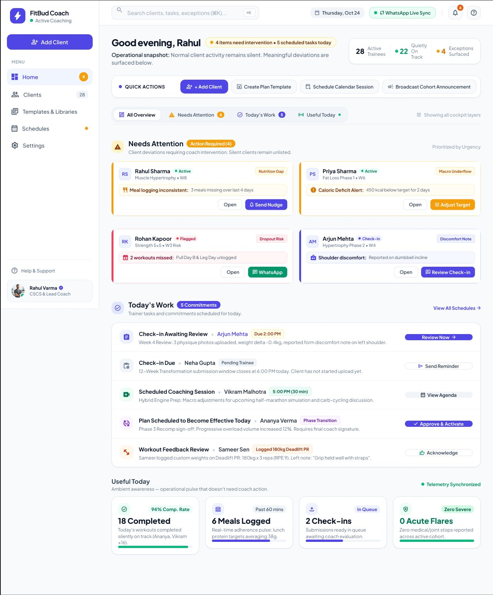{.shot}

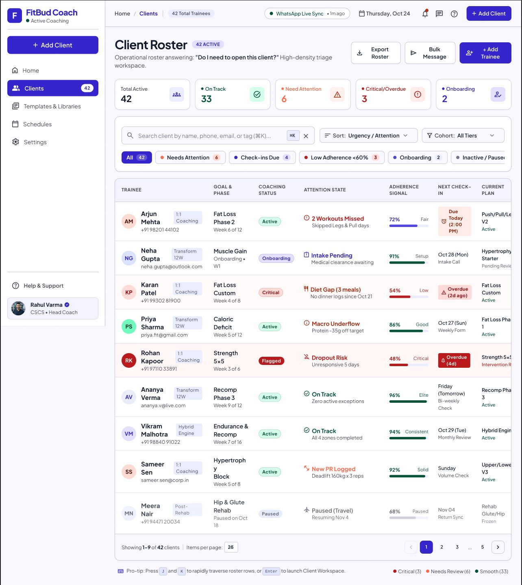{.shot}

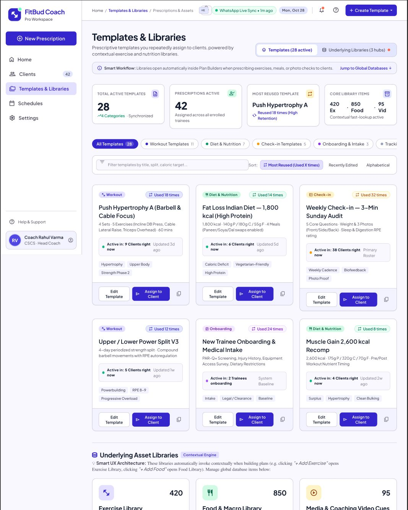{.shot}

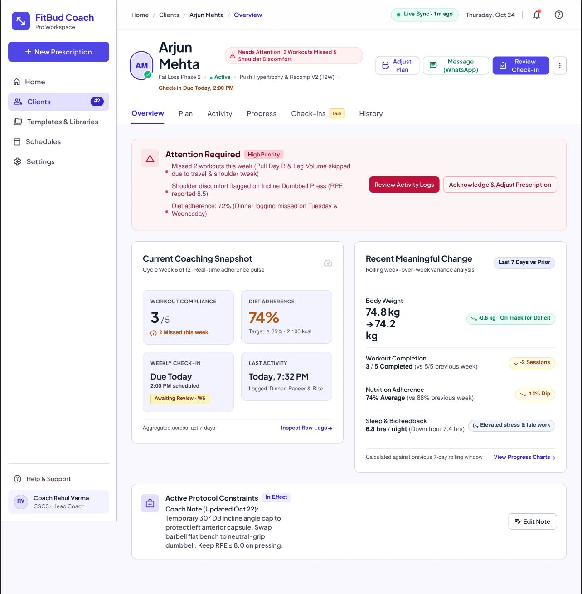{.shot}

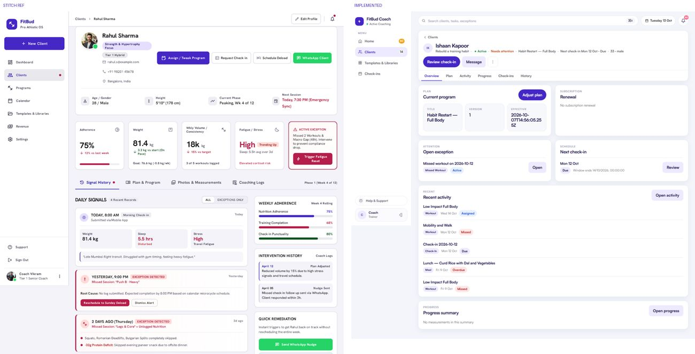{.shot}

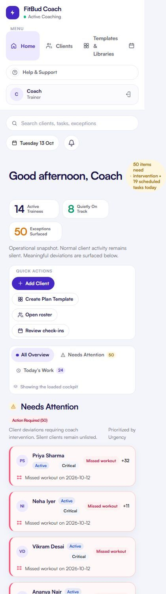{.phone} 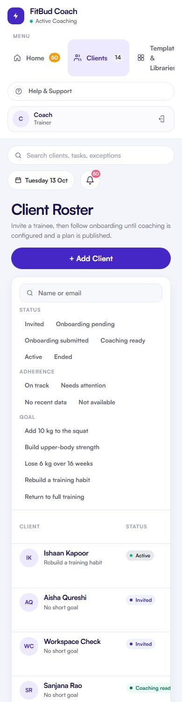{.phone} 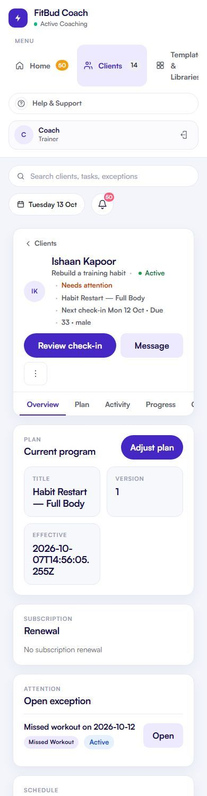{.phone}

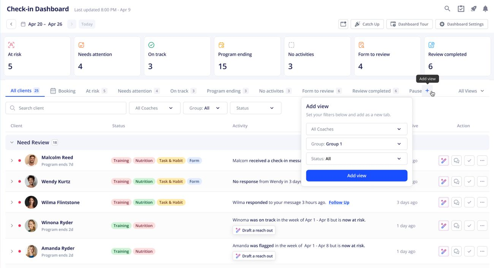{.shot}

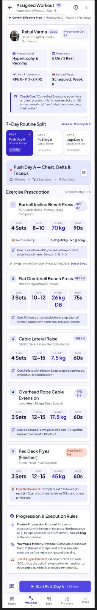{.phone}

*End of guide.*
