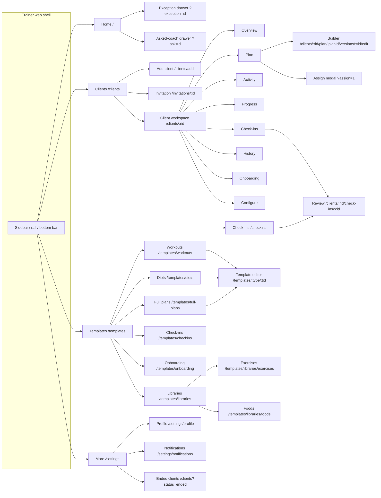
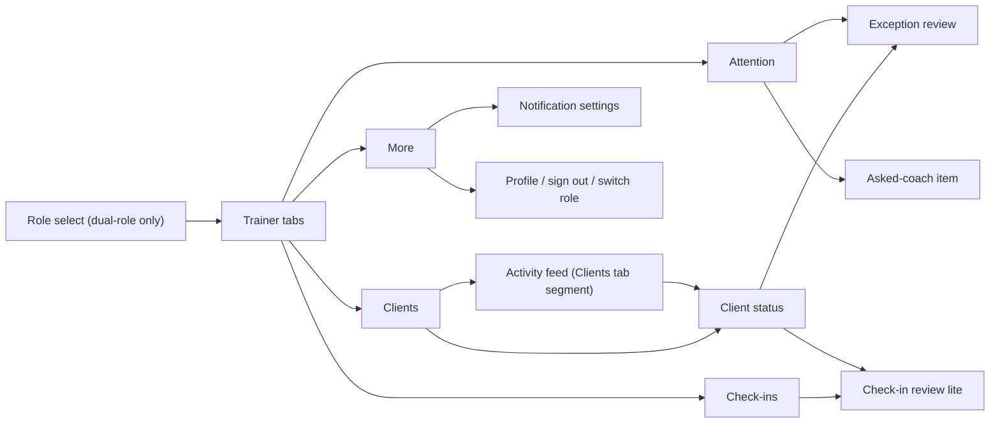
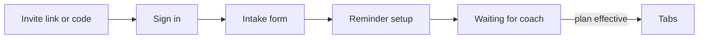
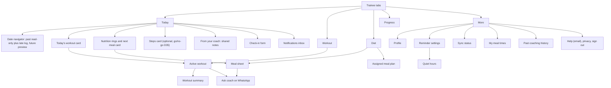

# 02 · Navigation and information architecture

Copied **verbatim** from guide §1.7, lines 446–616. The guide's screen-catalogue notes and the trainer/trainee mobile baselines follow it, also verbatim. Each "current state"/"baseline" paragraph describes **legacy** code to replace.

<!-- BEGIN VERBATIM navigation -->
## 1.7 Navigation and information architecture

### 1.7.1 Trainer web IA (target)

The target primary navigation is Home · Clients · Check-ins · Templates · More (UX §5). The current navigation reads "Templates & Libraries" and has no More item.

**Route table.** ✅ means the route exists in `apps/trainer-web/src/App.tsx`. 🆕 means it's proposed.

| Route | Screen | Status |
|---|---|---|
| `/sign-in` | TW-01 Sign in | ✅ |
| `/welcome` | TW-02 Trainer first-run | 🆕 |
| `/` (`?exception=:id`, `?ask=:id`, `?group=`) | TW-04 Home, plus the TW-05 and TW-32 drawers | ✅ (+ params 🆕) |
| `/exceptions/:exceptionId` | TW-05 fallback full page. Keep it for deep links, and have it render Home with the drawer open. | ✅ |
| `/clients` (`?q=&status=&adherence=&goal=&renewal=`) | TW-06 Roster | ✅ (+ `renewal` 🆕) |
| `/clients/add` | TW-07 Add client | ✅ |
| `/invitations/:invitationId` | TW-08 Pending invitation | 🆕 |
| `/clients/:rid` and `/overview` | TW-09 Overview | ✅ |
| `/clients/:rid/onboarding` | TW-10 Onboarding review | ✅ |
| `/clients/:rid/configure` | TW-11 Configuration (the tab label is "Configure") | ✅ |
| `/clients/:rid/plan` (`?assign=1`) | TW-12 Plan, plus the TW-16 Assign modal | ✅ (+ param 🆕) |
| `/clients/:rid/plan/:planId/versions/:versionId/edit` | TW-13 and TW-14 builders | 🆕 |
| `/clients/:rid/activity` (`?item=:type::id`) | TW-17 Activity | ✅ (+ param 🆕) |
| `/clients/:rid/progress` | TW-18 Progress | ✅ |
| `/clients/:rid/check-ins` | TW-19 Client check-ins | ✅ |
| `/clients/:rid/check-ins/:checkinId` | TW-20 Check-in review | ✅ |
| `/clients/:rid/history` | TW-21 History | ✅ |
| `/checkins` (`?view=due\|overdue\|submitted\|reviewed`) | TW-22 Inbox | ✅ (+ param 🆕) |
| `/templates` → redirects to `/templates/workouts` | TW-23 Templates hub | ✅ (+ redirect 🆕) |
| `/templates/:type` (`?scope=all\|bases\|mine&q=`), where type ∈ `workouts`, `diets`, `full-plans`, `checkins`, `onboarding`, `libraries` | TW-23 type tabs (D26) | 🆕 |
| `/templates/onboarding/:tid` | TW-24 Onboarding form builder | 🆕 route (the UI exists inline) |
| `/templates/checkins/:tid` | TW-25 Check-in form builder | 🆕 |
| `/templates/workouts/:tid`, `/templates/diets/:tid`, `/templates/full-plans/:tid` | TW-13 and TW-14 in template mode. API `templateType` maps to `workout`, `nutrition` and `combined`. | 🆕 |
| `/templates/libraries/exercises`, `/templates/libraries/foods` | TW-26 Libraries | 🆕 route (the UI exists inline) |
| `/settings`, `/settings/profile`, `/settings/notifications` | TW-28, TW-29 | 🆕 |
| `/go/:kind/:id` | The universal deep-link resolver (§3.5) | 🆕 |
| `*` | Not found. Change the current silent redirect to `/` into a TW-33 404 with a link home. | ✅ (change) |

### 1.7.2 Trainer mobile IA (target)

The mobile app currently has no navigation library. `TrainerShell.tsx` and `TraineeShell.tsx` switch tabs with `useState` and overlays, so there is no back stack and no deep linking. **Target: adopt React Navigation 7** (native stack plus bottom tabs) with a `linking` config ([R46]), or Expo Router. This guide assumes React Navigation, because the app isn't Expo Router–structured (`index.js` plus `App.tsx`). See OQ-6.

### 1.7.3 Trainee mobile IA (target)

The tabs are Today · Workout · Diet · Progress · More (UX §8). Check-ins appear in context from Today.

**Mobile route names** (React Navigation screen names, with the deep-link path each one maps to)

| Name | Path (`fitbud://` and `https://{appHost}/app/…`) | Screen |
|---|---|---|
| `Invite` | `/invite/:token` | TR-02 |
| `Intake` | `/intake` | TR-03 |
| `ReminderSetup` | `/setup/reminders` | TR-05 |
| `Waiting` | `/waiting` | TR-04 |
| `Today` (`date?`) | `/today/:date?` (YYYY-MM-DD, trainee-local) | TR-06 |
| `Diet` (`date?`) | `/diet/:date?` | TR-07 |
| `MealSheet` | `/meal/:assignmentId` | TR-08 (opens over Diet) |
| `MealPlan` | `/plan/diet` | TR-09 |
| `Workout` | `/workout/:assignmentId?` | TR-10 |
| `ActiveWorkout` | `/workout/:assignmentId/active` | TR-11 |
| `WorkoutSummary` | `/workout/:executionId/summary` | TR-12 |
| `Progress` | `/progress` | TR-13 |
| `Checkin` | `/checkin/:checkinId` | TR-14 |
| `Notifications` | `/notifications` | TR-15 |
| `ReminderSettings` | `/settings/reminders` | TR-16 |
| `QuietHours` | `/settings/quiet-hours` | TR-17 |
| `Sync` | `/settings/sync` | TR-19 |
| `Profile` | `/settings/profile` | TR-20 |
| `MealTimes` | `/settings/meal-times` | TR-24 |
| `FoodSearch` | `/meal/:assignmentId/foods` (modal) | TR-26 |
| `StepsSettings` | `/settings/steps` | TR-25 |
| `SignIn` · `CodeSignIn` · `ForgotPassword` · `SetPassword` | `/auth`, `/auth/code`, `/auth/forgot`, `/auth/set-password` | TR-01 |
| `PastCoaching` | `/settings/history` | TR-20 |
| `TrainerActivity` | `/coach/activity` | TM-09 |
| `TrainerAttention` · `TrainerClient` · `TrainerException` · `TrainerCheckin` · `TrainerAsk` | `/coach/attention`, `/coach/client/:rid`, `/coach/exception/:id`, `/coach/checkin/:id`, `/coach/ask/:id` | TM-01 to TM-06 |
<!-- END VERBATIM navigation -->

## Screen catalogue reading notes (guide §2 intro, verbatim)

<!-- BEGIN VERBATIM catalogue-intro -->

**Reading each section:**
- "Current state" cites screenshot files. `shots/…` and `sbs/…` are in `/workspace/fitbud-impl/`. `screens/…` are the Figma exports in `/workspace/fitbud-ux/`. The embedded copies are in `/workspace/fitbud-guide/img/`.
- There are **no running screenshots of the Expo app**, because the mobile app was not run for this guide. For TM and TR screens, "current state" comes from reading the source files on `feat/iteration-a-backend`.
- API routes follow the Confluence endpoint catalogue (Current State and Iteration Guide, "Endpoint catalog"). `API-NEW` marks an endpoint or field this guide needs that doesn't exist yet. **Sub-action paths** (for example `…/acknowledge`, `…/resolve`, `…/inbox`) follow the catalogue's action names. The catalogue lists the actions but not every literal path, so confirm the exact path in `apps/api/src/routes/<area>.ts` (or the OpenAPI document at `apps/api/src/openapi/document.ts`) before wiring. Always call the API through `packages/api-client`.
<!-- END VERBATIM catalogue-intro -->

## Trainer mobile intro (guide §2.2, verbatim)

<!-- BEGIN VERBATIM tm-intro -->
## 2.2 Trainer mobile (TM)

Trainer mobile is for **quick work away from the laptop**: checking the attention feed, a client's status, reviewing a check-in, acknowledging or resolving, nudging, and marking asked-coach items. Plan building stays on web (UX §7). All TM screens live in `apps/mobile/src/trainer/`. Current navigation is `TrainerShell.tsx`, with tabs Attention, Clients, Check-ins and More (a coral tab indicator). **Change the indicator to indigo**, because coral isn't a status or selection colour.
<!-- END VERBATIM tm-intro -->

## Trainee mobile baseline and platform prerequisites (guide §2.3, verbatim; the baseline is LEGACY)

<!-- BEGIN VERBATIM tr-intro -->
## 2.3 Trainee mobile (TR)

**Current-state baseline for the whole trainee app**, read from the code on `feat/iteration-a-backend`:

- Custom state routing (`src/navigation/AppRouter.tsx`, `resolveRoute.ts`), with routes auth, loading, unsupported_role, role_select, accept_invite, intake, waiting_review and trainee_shell. Tabs switch through `useState` in `src/trainee/TraineeShell.tsx`.
- Notification routing (`src/notifications/routing.ts`) maps a payload to a **tab only** (workout, diet or today). `register.ts` uses a local test FCM token. **There's no `expo-notifications` dependency.**
- Screens call `api.*` directly: `TodayTab` and `DietTab` call `generate…Assignments` on load, and `confirm` or `deviate` go straight to the API. `src/sync/SyncProvider.tsx` is a memory store, not SQLite. The architecture's offline outbox (Tech Arch §9) isn't wired into the screens yet.
- Satoshi isn't loaded. Theme: background `#F6F5FB`, radii 20 and 16, `touchTargetMin` 44. **Raise it to 48.**
- Figma trainee frames (`screens/trainee_0x_*.png`) exist for Today, Check-in, Active workout, Lock screen, Today's diet, Yesterday's diet, Assigned diet plan and one extra frame.

**Platform prerequisites (P0, before the screens):**
1. Navigation library with `linking` (OQ-6).
2. `expo-notifications` with categories and actions ([R61]).
3. `expo-sqlite` outbox wired into `src/sync/engine.ts`.
4. `expo-font` for Satoshi.
5. Production auth (D18): password plus an email OTP (WhatsApp leg behind `wa_otp`) through the FitBud auth endpoints and Firebase custom tokens (§3.1a).
7. `expo-application` (version and build for the support `mailto`, D19), and `expo-mail-composer` (optional; the plain `Linking.openURL('mailto:…')` is enough).
8. P2 only: `react-native-health-connect` (Android) and `react-native-health` (iOS) for steps (TR-25).
6. Remove the client-side `generate…Assignments` calls. Replenishment is the server job's responsibility (`jobs/replenishment.ts`).
<!-- END VERBATIM tr-intro -->

## Code facts at 7f74108 (not from the guide)

- Trainer web routes: `apps/trainer-web/src/App.tsx` (React Router). The templates hub lives in `pages/TemplatesHub.tsx`.
- Mobile still uses **custom state routing** (`apps/mobile/src/navigation/AppRouter.tsx`, `resolveRoute.ts`, `TraineeOverlay.tsx`), with no `@react-navigation/*` dependency in `apps/mobile/package.json`. `expo-notifications` is a dependency now. The 18 Oct captures drive screens through `apps/mobile/src/dev/captureBridge.ts`.
