# 04 · Cross-cutting flows

Copied **verbatim** from guide §3, lines 3768–4193. Screen files point here for onboarding, auth, logging, exceptions, check-ins, WhatsApp/deep links, the reminder engine, late logging, lifecycle, timezone and meal-time changes.

<!-- BEGIN VERBATIM flows -->
# 3. Cross-cutting flows

## 3.1 Onboarding (trainer invite → trainee active)

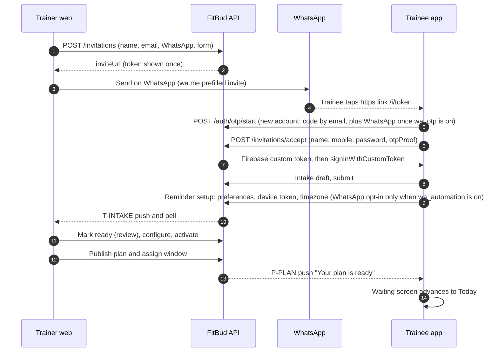

**Derived status** at each step (the header and roster chips): Invited → Onboarding (accepted, intake pending) → Intake submitted → Ready to coach (reviewed) → Active (effective plan) → Ended.

| Step | Trainer sees | Trainee sees | Failure handling |
|---|---|---|---|
| Invite created | Share card (TW-07) | n/a | Token lost: re-issue (TW-08) |
| Link tapped | n/a | Join card (TR-02), with set password and code verification | Expired: ask for a new link. Code not received: resend (email; WhatsApp too once `wa_otp` is on). |
| Intake | Getting started row: "Intake in progress" | Sectioned form (TR-03) | Autosave and offline queue |
| Reminder setup | n/a | TR-05 | Every step can be skipped. Permission denied is OK. |
| Review | TW-10 | Waiting checklist (TR-04) | n/a |
| Configure and plan | TW-11, TW-13/14, TW-16 | Waiting: "Rahul is building your plan" | A generation failure shows Retry (TW-16) |
| Active | Overview | Today | n/a |

## 3.1a Authentication: password by default, email code live, WhatsApp code behind a flag (D18)

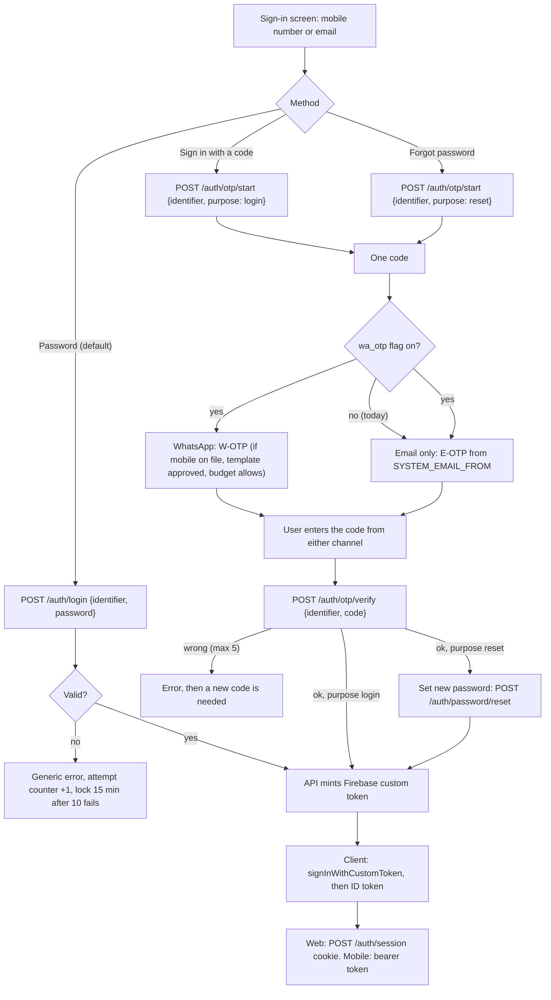

**Rules:**

| Item | Value |
|---|---|
| Identifier | A mobile number (normalised to E.164, +91 default) or an email. Both are unique per user. |
| Password | Minimum 8 characters, maximum 64, no composition rules, checked against a breached-password list where available (NIST 800-63B [R82]). Hashed by Firebase Auth (the account email is the Firebase key; the phone-to-account lookup happens server-side). |
| Code | 6 digits, valid **10 min**, single use. **One code per request.** Today it's sent by email only; with `wa_otp` on, the same code goes to both channels. Requesting a new code invalidates the old one. |
| Limits | 5 verify attempts per code. Resend after 60 s. 5 codes per hour and 10 per day per identifier. A per-IP rate limit too. |
| Responses | Always generic ("If an account exists, we've sent a code"). No account enumeration (OWASP [R84]). |
| Channels | **Live: email** (E-OTP, sender `SYSTEM_EMAIL_FROM`, default `tech@thefitbud.com`, D30). **Built, flag off: WhatsApp** (authentication template, copy-code button [R79], counted in the budget §4.5, `wa_otp`). **No SMS, ever.** When the WhatsApp leg is skipped (flag off, no mobile, template not approved, cap reached, or a send error), email still goes, and the UI names only the channels used. The sign-in UI shows WhatsApp as disabled "Coming soon" while the flag is off (§1.6.11). |
| New accounts | Created at invite acceptance (TR-02) with code verification and then a password. Trainers are provisioned, and set a password on first code sign-in. |
| Sessions | Unchanged: web uses the HTTP-only cookie via `POST /auth/session`; mobile uses the Firebase bearer token with refresh. |

API-NEW: `POST /auth/login`, `POST /auth/otp/start`, `POST /auth/otp/verify`, `POST /auth/password/reset`, `POST /auth/password/set` (signed-in). Table `auth_otps` (id, identifier_hash, code_hash, purpose, expires_at, attempts, channels_sent, consumed_at).

## 3.2 Daily logging loop (trainee)

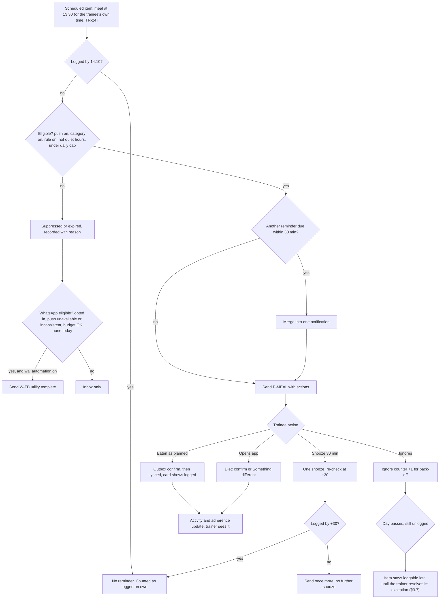

## 3.3 Exception loop (trainer)

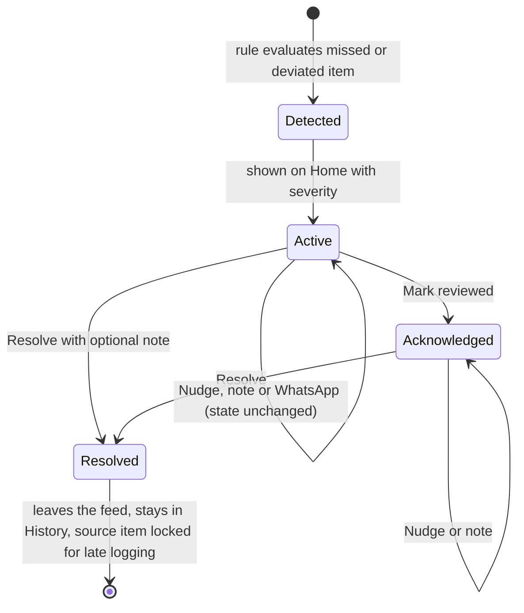

**Rules:**
- Acknowledge and Resolve never change the source workout, meal or check-in.
- A late log by the trainee does **not** auto-resolve the exception unless the rule says so. This is OQ-23. The current behaviour is to keep the exception visible, marked "Client logged later", so the trainer resolves it in one tap.
- Nudges are tracked separately and never change adherence.
- **Resolving locks late logging** for the source item (D23, §3.7). The resolve drawer says so. Mark reviewed (acknowledge) does **not** lock it.

## 3.4 Check-in loop

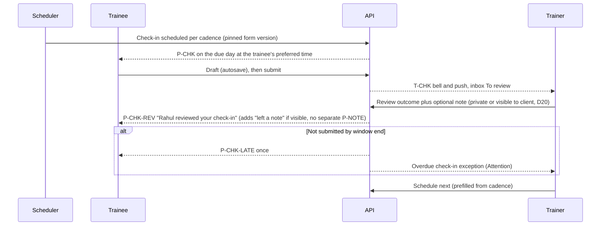

## 3.5 WhatsApp round trip and deep links

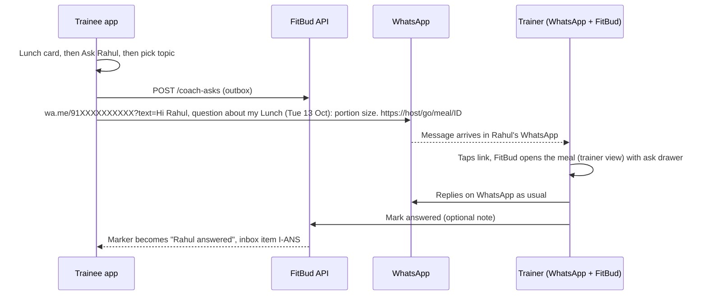

**Link format and resolver.** Use one https format for every channel: `https://{appHost}/go/{kind}/{id}`. The host is undecided (OQ-2). The web route lives in `apps/trainer-web` (`/go/:kind/:id`), and the same paths are registered as Android App Links and iOS Universal Links for `apps/mobile`.

| kind | id | Trainee opens | Trainer opens |
|---|---|---|---|
| `meal` | meal assignment id | Diet on that date, card focused (`/meal/:id`) | Activity › Meals with the item panel (`/clients/:rid/activity?type=meal&item=meal:<id>`) |
| `workout` | workout assignment id | Workout (`/workout/:id`), or Active when in progress | Activity › Workouts, item panel |
| `checkin` | check-in id | Check-in (`/checkin/:id`) | Check-in review (`/clients/:rid/check-ins/:id`) |
| `exception` | exception id | n/a (Forbidden; trainees never see exceptions) | `/?exception=:id` |
| `ask` | coach ask id | The asked item | `/?ask=:id` |
| `plan` | plan id | Plan view "What changed" (`/plan/diet` or `/workout`) | `/clients/:rid/plan` |
| `client` | relationship id | Today | `/clients/:rid` |
| `today` | none | `/today` (or `/today/:date`) | Home |
| `note` | trainer note id | Today scrolled to the note (`/today?note=:id`) | `/clients/:rid` (Overview notes) |
| `reactivate` | reactivation request id | TR-22 confirmation card | `/clients/:rid` |

**Link rules:**
- The id in the URL is not an authorisation token. The server checks ownership on every resolve.
- Links never contain names, food or health detail. Decision F: no sensitive data in payloads.
- Prefilled WhatsApp text stays short (≤ 140 chars of text, per [R43]).

**WhatsApp channels (D17).** There are two, and they're always kept apart:

| Channel | Who sends | Cost to FitBud | Used for |
|---|---|---|---|
| **`wa.me` click-to-chat** (**live, no flag**) | A person, from their own WhatsApp, who presses Send themselves (D31) | **Free** | Trainee asks (TR-18), trainer invites, **day-3 re-engagement (trainer-signed text)**, check-in follow-ups, *Message client* |
| **Meta WhatsApp Cloud API** (FitBud's business number) (**fully built, switched off**: `wa_otp` and `wa_automation`, §1.6.11) | FitBud, automatically, with **Meta-approved** templates from the registry (§4.6), signed as FitBud | ≈ **₹0.136 per message** (₹0.115 + 18% GST, utility and authentication categories, India [R77] [R78]) | **W-OTP** login and reset codes (authentication, `wa_otp`). Under `wa_automation`: **W-FB** reminder fallback, **W-CHK** check-in due, **W-PLAN** plan published, **W-RENEW** renewal date (utility only). **There's no automated re-engagement message.** |

Rules for the Cloud API channel:
- **Flags first.** If the matching flag is off, the send function returns `{skipped: 'flag_off'}` before any opt-in check or budget reservation, and the caller uses push, the inbox or email. Today both flags are off, so only push and user-tapped `wa.me` links reach WhatsApp.
- **Approved templates only.** The server refuses to send any template whose registry status isn't `approved` (§4.6), even with the flag on.
- Only **utility** and **authentication** templates. Marketing templates (≈ ₹0.86) are never used. Template copy is transactional and tied to a specific item, so Meta keeps the utility category [R92].
- From 1 Oct 2026 utility templates are billed even inside an open 24-hour window [R78]. Free-form service replies stay free (1,000 a month per number), and FitBud only uses them for the STOP and help auto-reply.
- **Explicit opt-in** is required for reminder templates (TR-05, stored with the time, source and text version). Requesting an OTP is itself the user's request for that message.
- At most **1 FitBud-started reminder template per trainee per day**, never during quiet hours or after 22:00. OTPs are exempt from the daily cap, but not from the rate limits.
- Every send goes through the **budget guard** (§4.5).

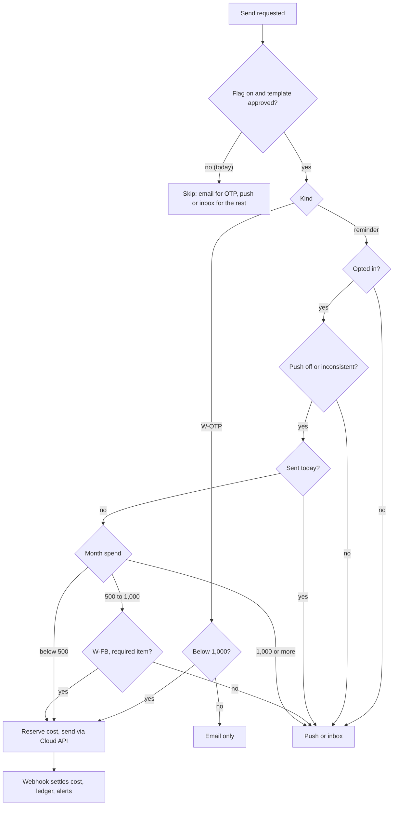

## 3.6 Reminder engine: policy and decision table

This changes `packages/core/src/reminder.ts` and `apps/api/src/domain/reminders.ts`, together with `jobs/reminders.ts`.

**Constants (new defaults):**

| Constant | Current | New | Note |
|---|---|---|---|
| `WORKOUT_REMINDER_LOCAL_TIMES` | `["06:00","18:00"]` | **remove** | Replaced by the `workoutReminderTime()` function |
| `WORKOUT_REMINDER_OFFSET_MINUTES` | n/a | `75` (allowed 60–90) | Added to the anchor time |
| `WORKOUT_FALLBACK_ANCHOR` | n/a | `"18:00"` | Used when there's no preferred or learned time. The reminder then fires at about 19:15. |
| `WORKOUT_LEARNED_MIN_SAMPLES` / `_WINDOW_DAYS` / `_SESSIONS` | n/a | 3 / 28 / last 6 | Median local start time of recent sessions |
| `MEAL_REMINDER_ADVANCE_MINUTES` | `45` | **remove** | No advance meal reminders (D6) |
| `MEAL_REMINDER_AFTER_MINUTES` | n/a | `40` (allowed 30–45) | After the meal time |
| `MEAL_REMINDER_FOLLOW_UP_MINUTES` | `[30, 60]` | **remove** | Replaced by one user-initiated snooze |
| `MEAL_SNOOZE_MINUTES` / `MEAL_MAX_SNOOZES` | n/a | `30` / `1` | n/a |
| `DAILY_SUMMARY_LOCAL_TIME` | `"21:00"` | **replace** with `min(lastMealTime + 60, "21:30")` | Never after 22:00 |
| `HARD_STOP_LOCAL_TIME` | n/a | `"22:00"` | Nothing is delivered after this, whatever the quiet hours |
| `DEFAULT_QUIET_HOURS` | n/a | `22:00–07:00` | Preference default |
| `DAILY_PUSH_CAP` | n/a | `5` (target ≤ 4) | Per trainee per local day, across all types including nudges |
| `MERGE_WINDOW_MINUTES` | n/a | `30` | n/a |
| `ACTIVITY_NUDGE_HOURLY_LIMIT` | `3` | keep `3` per trainer, plus **1 per item per 4 h** | n/a |

**Pre-send checks** (all must pass, evaluated at send time, not at schedule time):

| # | Check | If it fails |
|---|---|---|
| 1 | The relationship is active (not ended) and the trainer reminder rule for the category is on | Drop (`suppressed: rule_off`) |
| 2 | The item still needs action (not logged, skipped or resolved, not superseded) | Drop (`suppressed: already_logged`) |
| 3 | The trainee has `pushEnabled` and the category on, and a valid device token exists | Drop (`suppressed: prefs`). If the trainee opted in to WhatsApp and the type is fallback-eligible (required meal, workout or check-in), queue **W-FB** through the budget guard (§4.5, cap 1 a day). |
| 4 | Not within quiet hours and before 22:00 | Time-bound types (meal, workout, summary) **expire** (`suppressed: quiet_hours`). Check-in and plan types **defer** to quiet-hours end. |
| 5 | Under the daily cap | Apply the priority order below. Lower-priority items are dropped to the inbox only. |
| 6 | No other send to this trainee within 30 min | Merge: one notification, with the summary title "2 things to log" and actions for the first item. |
| 7 | Back-off doesn't apply (see below) | Drop (`suppressed: backoff`) |

**Priority order when the cap binds:**
1. Trainer nudge.
2. Meal reminder for a required meal.
3. Workout reminder.
4. Check-in due or late.
5. End-of-day summary.
6. Informational (plan updated, coach reviewed, coach answered).

Informational items are pushed only when the cap allows; otherwise they go to the inbox.

**Back-off rules:**

| Pattern | Detection (per category) | Action | Visible to |
|---|---|---|---|
| **Self-logger** | The item was logged *before* its reminder time on ≥ 5 of the last 7 occurrences | Skip that category's reminders. The end-of-day summary still covers misses. Re-enable automatically after 2 misses in 7 days. | Trainer (TW-31 "Logs on own"), and the trainee settings note |
| **Ignorer (soft)** | 3 consecutive reminders in the category ignored (no open and no log within 2 h) | Halve the frequency: skip every other occurrence, for example only the main meals | TW-31 |
| **Ignorer (pause)** | 5 consecutive ignored | Pause the category for 7 days. The trainee sees a Today card: "Meal reminders paused for a week since they weren't helping. Turn back on?" The trainer sees "Reminders paused". The re-engagement candidate list includes them (TW-04). | Both |
| **Push failure** | Delivery failed (invalid token) twice | Mark the token invalid and stop pushing. W-FB WhatsApp fallback if `wa_automation` is on, the trainee opted in and it's within budget; otherwise the inbox only. Trainer sees "Notifications off". | Trainer |
| **Inconsistent logger** (WhatsApp eligibility) | Ignorer (soft or pause) state, **or** fewer than half of the required items logged in the last 7 days | Push continues as above. **W-FB becomes eligible** for one required item a day, at the push time + 60 min if it's still unlogged. | Trainer (TW-31 WhatsApp block) |

**Workout reminder time:**
- `anchor = trainee.preferredWorkoutTime ?? learnedStart(last 6 sessions in 28 d, ≥3 samples) ?? 18:00`
- `fire = anchor + 75 min`
- If `fire` is after 21:30, fold the workout reminder into the end-of-day summary.
- On rest days and days without a required workout, nothing fires.

**End-of-day summary:**
- Fires once at `min(lastMealTime + 60, 21:30)`, only if any required item is still unlogged.
- Content: "2 things left today: Dinner, Workout". The action is "Log now", which opens Today.
- When everything is logged, nothing is sent. Don't send congratulations pushes.

**Re-engagement (2–3 days):**
- Trigger: no trainee log for 48 h and at least 3 consecutive unanswered reminders.
- On day 3 the client appears in Home "Re-engage" for the trainer (TW-04 §7). **The trainer starts the message**: **Open WhatsApp** opens `wa.me` with trainer-signed text prefilled (W-RE-M, §4.2), which the trainer can edit and sends themselves. It's free.
- **FitBud sends nothing automatically for re-engagement**, on any channel, even with `wa_automation` on (D31). Push stays on the normal schedule (and backs off per the ignorer rule).
- Opening WhatsApp hides the row for 3 days. The trainee isn't shown again for 7 days unless they log and lapse again.

**Decision table (by type):**

| Type | Anchor | Fires at | Only if | Quiet hours | Actions | Max per day |
|---|---|---|---|---|---|---|
| P-MEAL | **the trainee's meal time if set (TR-24), else the plan slot time** | +40 min | unlogged | expire | Eaten as planned · Snooze 30 m | 1 per meal (+1 after snooze) |
| P-WO | preferred, learned or 18:00 | +75 min | required workout unlogged and not started | expire (fold into summary) | Start · Not today | 1 |
| P-EOD | last meal +60, 21:30 cap | once | any required item unlogged | expire | Log now | 1 |
| P-CHK | the due date, at preferred time or 18:00 | once | not submitted | defer | Start check-in | 1 |
| P-CHK-LATE | window end +12 h, inside allowed hours | once | not submitted | defer | Start check-in | 1 |
| P-NUDGE | trainer action | immediately | item unresolved | defer to 07:00 (or drop if no longer relevant) | Open | 1 per item per 4 h |
| P-PLAN | publish with Notify client | immediately | relationship active | defer | See plan | 1 |
| P-CHK-REV | review saved | immediately | n/a | defer | See review | 1 (merged) |
| P-ANS | ask marked answered | inbox only by default | n/a | n/a | Open | n/a |
| P-NOTE | trainer marks a note visible | immediately (merged within 15 min) | the note is still visible | defer | Read | 2 |
| P-REACT | trainer sends a reactivation request | immediately | the request is still pending | defer | Review | 1 |
| W-FB | push unavailable or inconsistent logging (§4.5) | push time + 60 min | **`wa_automation` on**, still unlogged, opted in, template approved, within budget | never in quiet hours or after 22:00 | WhatsApp template with deep link | 1 per day (all W-*) |

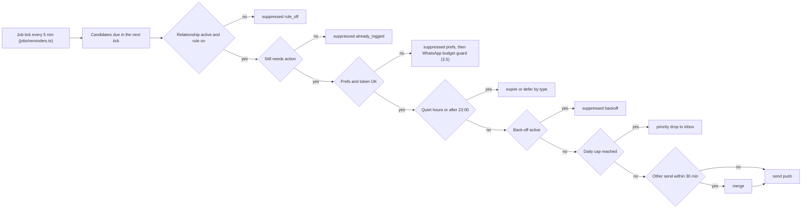

**Timezone (D22):** every local time in this section (anchors, quiet hours, the 22:00 hard stop, the daily cap day) is evaluated in the **trainee's stored timezone**.

**Testing:** a table-driven unit test per row above lives in `packages/core/src/reminder.test.ts`. Add "a day in the life" fixtures for: 5 meals plus a workout at 19:00 (expect ≤ 5 pushes), a self-logger (expect 0–1), an ignorer (expect a pause on day 5), quiet hours 21:00–06:00 (expect nothing at or after 21:00), a Lunch override to 14:30 (expect P-MEAL at about 15:10), push-off plus opt-in (expect exactly 1 W-FB a day), and budget soft and hard modes.

**Confluence write-back required** (OQ-3): decision C allows advance meal reminders and "one or two follow-ups", and says "no invented start-time reminder" for workouts. The 14 Oct user decisions refine these to after-meal only plus one snooze, and to a reminder anchored on the trainee-stated or learned time, which isn't invented. Record this in FitBud Workflows and States §C.

## 3.7 Late logging (D23)

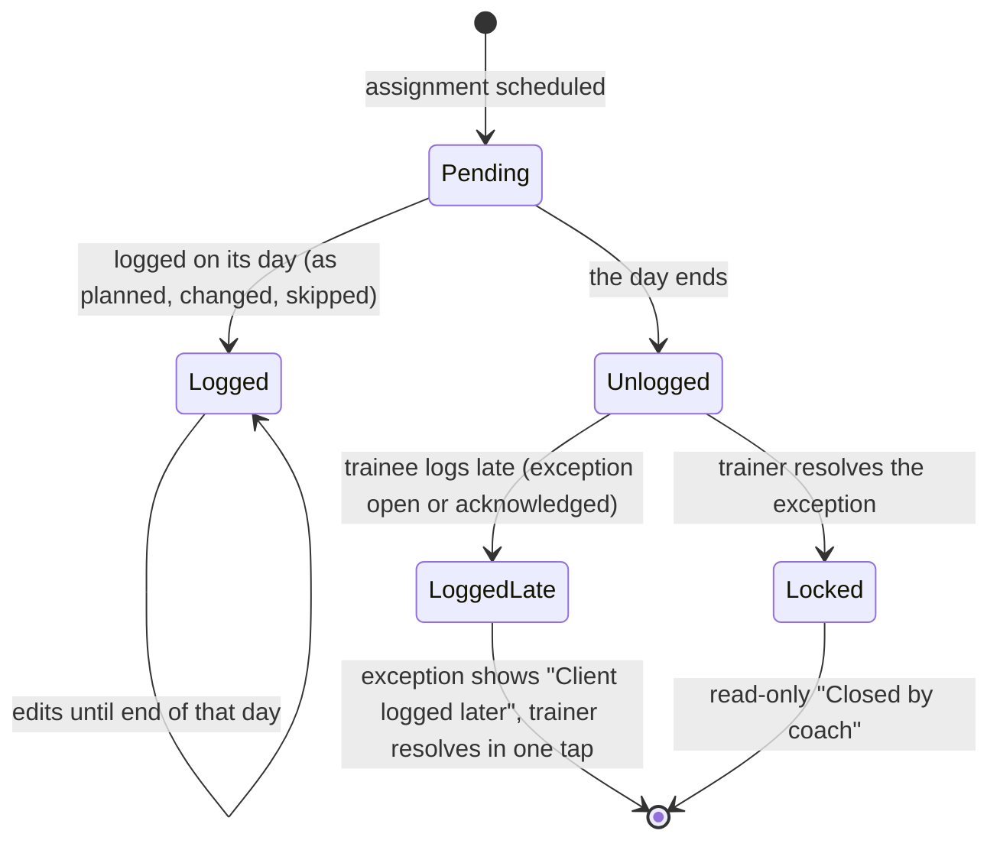

| Case | Can log late? | Until |
|---|---|---|
| Required item with an exception (missed meal or workout) | Yes | The trainer **resolves** that exception. Acknowledge doesn't lock it. |
| Required item where the exception hasn't fired yet | Yes | Same, once the exception exists. |
| Optional item (no exception raised) | **No** (D34, OQ-26) | Loggable only on its own day, until the end of that day in the trainee's timezone. Afterwards it shows "Not logged" (read-only), with no guilt copy. |
| Superseded by a plan replacement | No | n/a ("Replaced by plan update") |
| Relationship ended | No | n/a |
| Edits to an item already logged | Yes | The end of that item's day, in the trainee's timezone. |

**Server rule:** a late log is accepted when `exception.state ≠ resolved` at the time of the server write. An outbox item with a client timestamp *before* `resolvedAt` is still accepted, flagged `logged_after_resolve` for the trainer. Otherwise the server returns `409 locked`. For an **optional** item, a log is accepted only if its client timestamp falls on the item's own date (in the trainee's timezone), so an offline log made that day still syncs; anything later gets `409 locked`. Late logs set the derived state **Logged late** and never auto-resolve (OQ-23 default stands). **Rings and weekly counts** include late logs on their original date.

## 3.8 Relationship lifecycle: end, reactivate, new coach (D21)

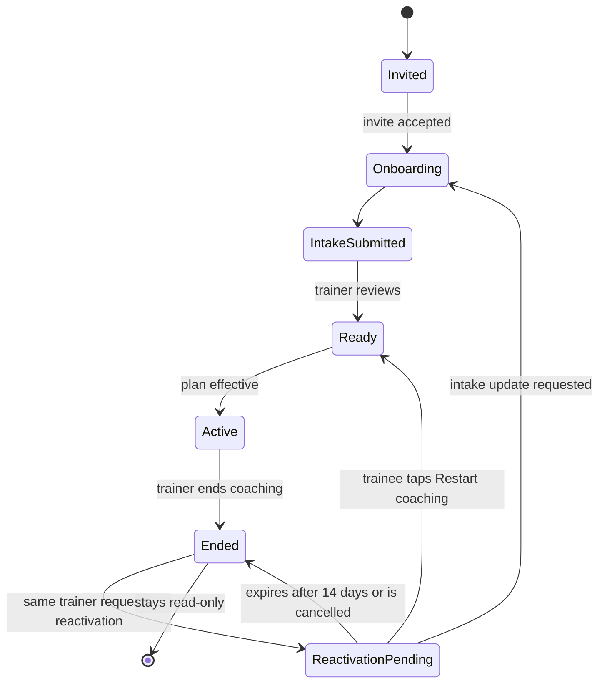

| | Same trainer (reactivate) | Different trainer (new invite) |
|---|---|---|
| Relationship row | **The same id**, restored | A new id |
| Trainer sees | All earlier history, notes, intake, configuration and plans | Nothing from earlier coaches. A blank workspace. |
| Trainee sees | Everything | Everything (Progress, Past coaching) |
| Exceptions open at the end | Stay closed ("Closed · coaching ended") | n/a |
| Reminders and check-ins | Resume after a plan is assigned | Start after onboarding and a plan, as for a new client |
| Consent | The trainee confirms with one tap (OQ-25) | The trainee accepts the invite |

## 3.9 Timezone (D22)

- **Source of truth:** `traineeTimezone` (IANA, for example `Asia/Kolkata`), set from the device at onboarding (TR-05) and editable in More.
- **Everything about the trainee's day** uses it: assignment civil dates, meal and workout times, windows, reminders, quiet hours, the 22:00 stop, rings, "today", late-log cut-offs and check-in due times.
- **Trainers** see the trainee's times with a `TimezoneBadge` whenever the offsets differ:
  - in the workspace header (TW-09a, TM-03);
  - in check-in scheduling (TW-19, TW-20 *Schedule next*);
  - in the assign-plan date window (TW-16).
  - Trainer-owned dates (renewals) stay in the trainer's timezone (TW-28).
- **Device timezone changes** (travel): the app compares the device zone with the stored one on foreground. If they differ for more than an hour of offset, it shows a one-time banner: "You're in Dubai time now. Use Dubai time for your plan?" **Switch** updates the stored zone (reminders reschedule, and the trainer sees the new badge and an activity entry). **Keep** remembers the choice until the device zone changes again (OQ-31).
- Formatting helper: `formatTimeDiff(trainerTz, traineeTz, now)` gives "5 h 30 m behind you" or "same time" (§1.6).

## 3.10 Meal-time change (D24)

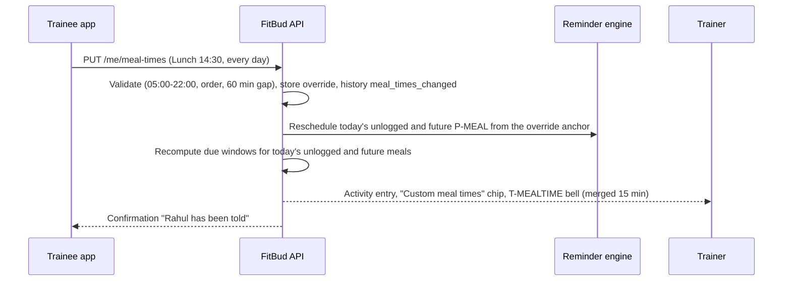

A plan change keeps the overrides for slots that still exist, and drops the rest with a trainee prompt (TR-24).
<!-- END VERBATIM flows -->
