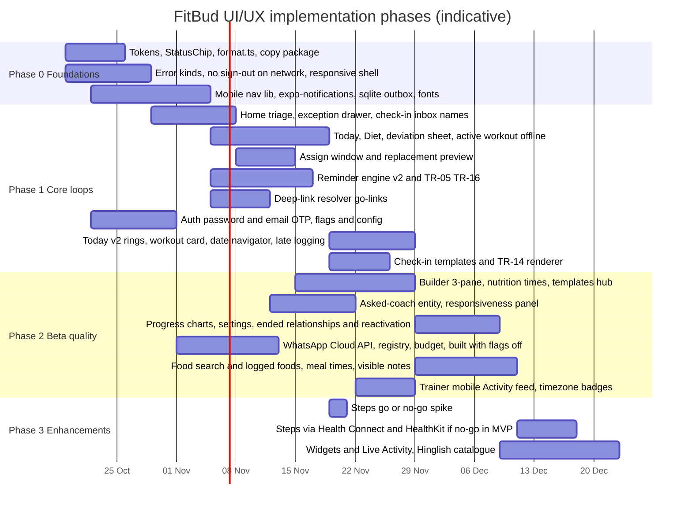

# 06 · Roadmap, backlog, QA checklist, decisions and conflicts

Copied **verbatim** from guide §5, lines 4592–4812. For the order of work, use `BATCHES.md`; this file gives background and the open questions.

<!-- BEGIN VERBATIM roadmap -->
# 5. Implementation roadmap and backlog

## 5.1 Phases

The dates are indicative, assuming one full-stack agent stream per section. Updated 17 Oct 2026 for the resolved decisions. **v1.2 (17 Oct, evening):** the email OTP ships in Phase 1 and doesn't depend on WhatsApp. The WhatsApp Cloud API is still built in Phase 2, but ships with both flags off; turning them on is an operations step (§1.6.11) once the business number, the Meta verification and the template approvals exist. The steps spike runs in Phase 1. If it's Go, steps join Phase 2 work; if not, they stay in Phase 3.

**Phase exit criteria:**
- **Phase 0:** no raw ISO or UUID anywhere. No sign-out on network errors. 390 px works. The mobile app has a navigation library, a SQLite outbox and push permission.
- **Phase 1:** a trainee can complete a full day (meals, a workout and a check-in) fully offline, with ≤5 pushes. A trainer can triage Home in drawer mode and assign a plan with a window.
- **Phase 1:** also, password sign-in and the **email OTP** work from `SYSTEM_EMAIL_FROM`, `GET /config` serves the flags, WhatsApp shows "Coming soon", Today shows the rings, the workout card and the date navigator, and the steps spike has a recorded Go or No-go.
- **Phase 2:** builder, templates (six tabs), asked-coach, responsiveness, the WhatsApp Cloud API with the registry and budget guard (built and tested in staging, **flags off in production**), food logging, meal times, visible notes, reactivation and the trainer Activity feed are in place. Beta-ready.
- **Phase 3:** steps, widgets and Hinglish.

## 5.2 Full backlog (P0, P1, P2)

| # | Pri | Screen or area | Item | Type | Depends on |
|---|---|---|---|---|---|
| 1 | P0 | Global | `packages/core/src/format.ts`, with no raw ISO or `Z` anywhere | Code | n/a |
| 2 | P0 | TW-33 | Error kinds in `api-client`, and only a 401 signs out | Code | n/a |
| 3 | P0 | TW-03 | Responsive shell (rail, bottom navigation, sticky sidebar), nav order and More | Code | n/a |
| 4 | P0 | TW-22 | Inbox shows client names | API and code | n/a |
| 5 | P0 | Design system | Semantic tokens, unified `StatusChip` with icons, no coral warnings | Code | n/a |
| 6 | P0 | §1.5 | Remove banned elements from Figma and any code (dev copy, live dot, version label for trainees) | Design and code | n/a |
| 7 | P0 | TW-04 | Bounded, grouped Home with sections. **Needs attention as rows** (one per client, one chip, severity then age, about 8 plus View all, keyboard grid) (D32) | Code | 1, 5 |
| 8 | P0 | TW-05 | Exception drawer, separate verbs, no UUIDs, nudge states | Code | 7 |
| 9 | P0 | TW-09a, TW-09 | Header split, single CTA, 404 handling, overview hierarchy | Code | 1 |
| 10 | P0 | TW-16 | Assign window, replacement preview, combined assign API | API and code | seed fix |
| 11 | P0 | API | Fix the seed's 500 on `assignments/generate` | API | n/a |
| 12 | P0 | TW-20 | Sticky review bar, hide zero counts | Code | 1 |
| 13 | P0 | TR platform | React Navigation 7 and linking, expo-notifications, expo-sqlite outbox, expo-font, expo-application | Code | n/a |
| 14 | P0 | TR-02, TW-07 | Invite link URL plus share card plus app landing | API and code | OQ-2 |
| 15 | P0 | TR-05 | Reminder setup: permission, preferred time, quiet hours default, WhatsApp shown as "Coming soon" while the flag is off | Code and API | 13, 64 |
| 16 | P0 | TR-06 | Today redesign: date navigator, next up, **workout card with Start into the active workout**, **nutrition rings and next meal**, weekly consistency; no client-side generation | Code and API | 13, week and day read models |
| 17 | P0 | TR-07, TR-08 | Meal card with **kcal per meal and day**, one-tap confirm, sheet, offline, undo | Code | 13 |
| 18 | P0 | TR-11 | Offline-first active workout, steppers, rest timer, RPE chips | Code | 13 |
| 19 | P0 | TR-14 | Check-in rendered from the pinned template, prefill, offline | Code | 13, TW-25 API |
| 20 | P0 | TR-16 | Reminder settings | Code and API | 15 |
| 21 | P0 | §3.6 | Reminder engine v2 (constants, caps, merge, expire, back-off) | API | n/a |
| 22 | P0 | TR-19 | Sync indicator plus status screen | Code | 13 |
| 23 | P0 | TR-23 | Deep-link resolver (`/go/`), exact routing, unavailable state | API and code | OQ-2 |
| 24 | P0 | TW-11 | Reminder rule toggles in Configure | Code | n/a |
| 25 | P0 | TW-01, TR-01, TR-02, §3.1a | Auth: mobile number or email plus password; **email OTP live**, WhatsApp leg built behind `wa_otp` with a disabled "Coming soon" option; no SMS; forgot and set password; Firebase custom tokens | API and code | 64, 65 (53 only for the WhatsApp leg) |
| 26 | P1 | TW-02 | Trainer first-run plus trainer WhatsApp number | API and code | n/a |
| 27 | P1 | TW-06 | Roster FilterBar, Ended view, stacked cards | Code | n/a |
| 28 | P1 | TW-10 | Grouped answers, highlight flag, combined CTA | Code and API | n/a |
| 29 | P1 | TW-11 | Accordion configure, empty 404s handled quietly | Code | n/a |
| 30 | P1 | TW-12 | Week strip, draft banner, versions collapsed | Code | n/a |
| 31 | P1 | TW-13 | Three-pane workout builder, weekday mapping, autosave, preview | API and code | n/a |
| 32 | P1 | TW-14, TW-15 | Nutrition builder with meal times, servings, unknown nutrients; diet scope | API and code | food migration |
| 33 | P1 | TW-17 | Activity grouped by day, panels, no manual generate | Code | n/a |
| 34 | P1 | TW-18, TR-13 | Charts and photo compare | Code | n/a |
| 35 | P1 | TW-23, TW-24, TW-25 | Templates hub with **six type tabs** (D26), scope filter, form builders, check-in templates | API and code | n/a |
| 36 | P1 | TW-28, TW-29 | Settings, trainer notifications | API and code | n/a |
| 37 | P1 | TW-30, TR-22, §3.8 | End coaching, read-only views, **reactivation** (same relationship) and new-coach blank start | API and code | n/a |
| 38 | P1 | TW-31 | Responsiveness read model and panel | API and code | 21 |
| 39 | P1 | TW-32, TR-18 | Asked-coach entity, sheet, drawer, markers | API and code | 23 |
| 40 | P1 | TM-01 to TM-07 | Trainer mobile parity (segments, **attention cards**, swipe, More, timezone badge) | Code | 13 |
| 41 | P1 | TR-03, TR-04 | Sectioned intake, waiting checklist | Code | n/a |
| 42 | P1 | TR-10, TR-12 | Week strip, late log (until resolved; optional items not late-loggable), summary recap | Code | 61 |
| 43 | P1 | TR-15, TR-17 | Inbox, quiet hours | Code | n/a |
| 44 | P1 | TR-20 | More screen (meal times, time zone, password, past coaching, Help by email with the reply promise) | Code | n/a |
| 45 | P1 | TW-34, TW-20, TR-06, TR-14 | Trainer notes with **Visible to client**, P-NOTE push, Today "From your coach" | API and code | n/a |
| 46 | P1 | §1.6.9 | Copy catalogue package plus the en-IN source | Code | n/a |
| 47 | P1 | TR-05 | OEM battery guide | Code | n/a |
| 48 | P2 | TW-08 | Invitation detail, re-issue, revoke | API and code | n/a |
| 49 | P2 | TW-19, TW-21 | Check-in list paging, history weekly grouping | Code | n/a |
| 50 | P2 | TW-26, TW-27 | Library paging and drawers, Use/Fork modals | Code | n/a |
| 51 | P2 | TR-09 | Assigned meal plan plus "What changed" | Code | n/a |
| 52 | P2 | TR-21 | Widgets and Live Activity | Native | 13 |
| 53 | **P1** | §4.2, §4.5 | **Meta WhatsApp Cloud API, built with the flags off**: the client, templates (W-OTP, W-FB, W-CHK, W-PLAN, W-RENEW), webhook, STOP and auto-reply, budget ledger, modes and alerts (to `ADMIN_ALERT_EMAILS`). Tested in staging against a test number. Turning it on needs a business number, Meta verification and approved templates. | API and integration | 64, 66 |
| 54 | P2 | i18n | Hinglish catalogue (hi-Latn) for trainee app and push | Copy | 46 |
| 55 | P2 | TM-08 | Remember the role choice | Code | n/a |
| 56 | P2 | TW-04 | Morning digest, saved views | Code | n/a |
| 57 | P0 | §1.6.10, TW-03, TW-28, TW-33, TM-07, TR-20 | Support `mailto:tech@thefitbud.com` with prefilled context (D19), plus the reply promise "We'll get back to you within a day" (D33) | Code | 13 |
| 58 | P1 | TM-09 | Trainer mobile Activity feed in the Clients tab, plus `GET /activity/feed` | API and code | 40 |
| 59 | P1 | TR-24, TW-09a, TW-12, §3.10 | Trainee meal times, reminder anchor override, trainer indicator, T-MEALTIME | API and code | 21 |
| 60 | P1 | TR-26, TR-08, TW-17, TW-26 | Food search (recent, frequent, Indian aliases, household units), `logged_foods` deviation, offline food index, custom foods, "Add to library" | API and code | 13, food aliases |
| 61 | P0 | §3.7, TR-06, TR-07, TR-10 | Late-logging rule (until the exception is resolved; optional items only on their own day, D34), `409 locked`, locked UI | API and code | 21 |
| 62 | P1 | §3.9, TW-09a, TW-16, TW-19, TM-03, TR-05 | Trainee timezone as the source of truth, `TimezoneBadge`, device-change prompt | API and code | 1 |
| 63 | P1 if Go, else P2 | TR-25 | Steps via Health Connect and HealthKit (on-device, never shared, hidden without permission) | Native | 13, 68 |
| 64 | P0 | §1.6.11 | Feature flags `wa_otp` and `wa_automation` (server config, both off), API-NEW `GET /config`, client cache, "Coming soon" UI states | API and code | n/a |
| 65 | P0 | §1.6.11, §3.1a | System email: `SYSTEM_EMAIL_FROM`, reply-to, provider adapter, E-OTP, E-INV, E-PWD, E-ALERT; SPF, DKIM and DMARC on thefitbud.com (OQ-32) | API and ops | n/a |
| 66 | P1 | §4.6 | WhatsApp template registry (`whatsapp_templates`), status webhook and reconcile, copy lint in CI, review checklist | API and code | 64 |
| 67 | P1 | TW-07 | **Email invite** button (E-INV) on the share card | API and code | 65 |
| 68 | P1 | TR-25 | Steps go or no-go spike (≤ 2 dev-days, five checks, D35) | Spike | 13 |

## 5.3 Testing and QA checklist (applies to every PR)

- [ ] Unit tests for pure selectors (`nextUp`, `primaryActionFor`, the reminder decisions, the formatters, the link builders).
- [ ] Playwright web flows: triage Home → drawer → resolve; assign a plan; review a check-in.
- [ ] Mobile (Detox or Maestro) flows: log 5 meals offline, then sync; a workout in airplane mode; a notification action logging a meal.
- [ ] Accessibility: axe on web, plus the React Native accessibility inspector. 200% font on Today, Diet and Active workout.
- [ ] Visual regression at 390, 768, 1280 and 1440.
- [ ] 17 Oct additions: unit tests for `dayNutrition`, `macrosFor`, `isLateLoggable`, `formatTimeDiff`, `buildSupportMailto` and the WhatsApp budget modes. An API test for `409 locked` after a resolve. An OTP test proving one code works from either channel and that there's no SMS path.
- [ ] v1.2 flag tests: with `wa_otp` and `wa_automation` off, no Cloud API call is made, no ledger row is written, the OTP goes by email from `SYSTEM_EMAIL_FROM`, and the "Coming soon" states render. Flipping a flag in config changes behaviour within the cache time and without a deploy. A send of an unapproved template is refused. The registry lint fails on a banned word, `!`, an emoji, `%` or a button.
- [ ] Optional items: a log made after the item's day returns `409 locked`. An offline log made on the day syncs.
- [ ] Home: Needs attention renders rows (not cards), at most 8, and passes keyboard tests.
- [ ] A copy lint that blocks strings like "%", "risk", "streak", "deterministic", "exception" in trainee UI, and "outside FitBud".

## 5.4 Open questions and resolved decisions

On 17 Oct 2026 the user reviewed every open question. **All proposed defaults stand**, except the ten questions answered below, which are now firm decisions. The accepted defaults are listed for traceability. **On the evening of 17 Oct (v1.2), OQ-25 to OQ-31 were answered too**, together with decisions on sign-in, WhatsApp automation, sending on someone's behalf and the Home layout. Only OQ-32 to OQ-34, raised by those decisions, are open.

### Resolved decisions (17 Oct 2026)

| ID | Question | Decision | Decision log | Where applied |
|---|---|---|---|---|
| OQ-1 | WhatsApp Business Platform: build it, which provider, what budget? | **Meta WhatsApp Cloud API**, used directly. FitBud pays only for messages it starts (login OTPs and utility reminders, ≈ ₹0.136 including GST). `wa.me` links are free. Budget ₹500 a month for 50 trainers, hard cap ₹1,000. Budget tracking, cap enforcement (fall back to push only and alert admins), utility templates and opt-in are specified. | D10, D17 | §3.5, §3.6, §4.2, §4.4, §4.5, TR-05, TR-16, TW-04, TW-11, TW-31, backlog 53 |
| OQ-7 | Should trainees see kcal? | **Yes: kcal for the day and for each meal**, plus P, C and F rings (logged vs assigned) on Today. | D25 | TR-06, TR-07, TR-08, TR-09, TR-26, TW-09 |
| OQ-11 | Production sign-in methods | **Mobile number or email plus password** by default. Alternative: a **one-time code sent to both WhatsApp and email** at once, usable from either. **No SMS fallback.** *(Refined in v1.2: email-only until `wa_otp` is on.)* | D18 | TW-01, TR-01, TR-02, TW-07, TW-28, §3.1, §3.1a, backlog 25 |
| OQ-12 | Help or support URL and channel | **No support page.** `mailto:tech@thefitbud.com` with a prefilled subject and context (app version, role, screen). | D19 | §1.6.10, TW-03, TW-28, TW-33, TM-07, TR-01, TR-19, TR-20, backlog 57 |
| OQ-14 | Client-visible trainer note | **A note can be marked "Visible to client".** It shows on the trainee's Today and sends a push ("Rahul has a note for you!"). Other notes stay private. | D20 | TW-34, TW-09, TW-20, TW-32, TM-04, TM-06, TR-06, TR-14, TR-15, P-NOTE, backlog 45 |
| OQ-15 | Re-inviting after coaching ended | **Reactivating the same relationship restores it.** A new relationship means a new invite. The trainee keeps their full history; a new trainer starts blank. | D21 | TW-07, TW-09a, TW-30, TR-02, TR-13, TR-20, TR-22, §3.8, P-REACT, backlog 37 |
| OQ-16 | Whose timezone runs the app? | **The trainee's timezone.** Trainers see the time difference in the client header and when scheduling check-ins or calls. | D22 | §3.9, TW-09a, TW-16, TW-17, TW-19, TW-20, TM-03, TM-09, TR-05, TR-06, TR-20, backlog 62 |
| OQ-17 | How long can a trainee log or edit? | **Assigned items can be logged late until the trainer has acknowledged and resolved the exception.** Edits to logged items: until the end of that day. | D23 | §3.3, §3.7, TR-06, TR-07, TR-10, TR-19, TW-17, TM-04, backlog 61 |
| OQ-19 | Trainer-set review expectation | **Optional and out of MVP scope.** There's no review-time promise anywhere. | D29 | TR-14 |
| OQ-20 | Personal meal-time overrides | **Trainees can change meal timings.** The trainer gets an activity entry plus an indicator on the client view. Reminders follow the new times. | D24 | TR-24, TR-16, TW-09a, TW-09, TW-11, TW-12, TW-14, TW-17, TM-09, §3.6, §3.10, T-MEALTIME, backlog 59 |

**Navigation changes, also decided 17 Oct 2026:**
- Templates use six type subtabs, with the scope filter inside each tab (D26, TW-23).
- The trainer mobile Activity feed lives in the Clients tab (TM-09).
- Today gains the workout card, nutrition rings, the next-meal card, optional steps and the date navigator (D27, TR-06, TR-25).
- "Something different" logs real foods from the library (D28, TR-08, TR-26).

### Defaults accepted (17 Oct 2026)

| ID | Question | Accepted default |
|---|---|---|
| OQ-2 | Production app host for `/go/` links, invite links, App Links and Universal Links | One host serving trainer-web and the link resolver (the hostname itself is still to be chosen at deployment) |
| OQ-3 | Write the 14 Oct reminder refinements back to Workflows and States §C | Yes, as worded in §3.6 (see C-1 in §5.5) |
| OQ-4 | Automatic reminders for optional meals? | Required meals only |
| OQ-5 | Learned workout time when the start time is missing | Use the start time, else completion minus duration |
| OQ-6 | Mobile navigation library and storage | React Navigation 7 and SecureStore |
| OQ-8 | Veg, non-veg and egg classification on foods | Add `dietTag` to the food classification |
| OQ-9 | Hydration tracking | No in MVP |
| OQ-10 | Devanagari fallback font | Noto Sans Devanagari |
| OQ-13 | Invite expiry | 14 days (reactivation requests also expire in 14 days) |
| OQ-18 | Default rest when unspecified | 90 s |
| OQ-21 | "Did you send it?" after WhatsApp | No |
| OQ-22 | Lock-screen privacy option | Default off, with the option in TR-16 |
| OQ-23 | Does a late log auto-resolve the exception? | No. Mark it "Client logged later" for a one-tap resolve (consistent with D23). |
| OQ-24 | WhatsApp number editing after invite | A contact field on the relationship, editable by the trainer. The sign-in mobile is a separate account field (D18). |

### Resolved decisions (17 Oct 2026, evening, v1.2)

| ID or topic | Question | Decision | Decision log | Where applied |
|---|---|---|---|---|
| Sign-in | What ships for sign-in now? | Password (mobile or email) and **email OTP** are live. The WhatsApp OTP is fully built behind `wa_otp` (off), shown as disabled "WhatsApp · Coming soon" with a note. There's no business SIM or WhatsApp Business account yet. No SMS ever. System emails go from `tech@thefitbud.com` (configurable). | D18, D30 | §1.6.11, TW-01, TW-07, TR-01, TR-02, §3.1, §3.1a, backlog 25, 64, 65, 67 |
| WhatsApp automation | Which FitBud WhatsApp ships? | Everything is built (Cloud API client, template registry, budget ledger and cap, alerts) behind `wa_automation` (off). Only push and user-tapped `wa.me` links work for now. Templates are pre-approved by Meta, tracked in the registry, and strictly utility. Settings show "Coming soon". | D17 | §1.6.11, TW-11, TW-31, TR-05, TR-16, §3.2, §3.5, §3.6, §4.2, §4.4, §4.5, §4.6, backlog 53, 66 |
| Sending | Can FitBud send on someone's behalf? | **Never.** Re-engage and every trainer message opens `wa.me` with **trainer-signed text** that the trainer sends. Text only. Day-3 re-engagement is a trainer-initiated prefill; there's no automated re-engagement message. | D10, D31 | TW-04, TW-07, TW-08, TW-11, §3.5, §3.6, §4.2 |
| Home layout | Cards or rows for Needs attention? | **Rows on trainer web** (one per client, one chip, severity then age, about 8 plus "View all", keyboard navigation). **Cards stay on trainer mobile.** | D32 | TW-04, TM-01, backlog 7, 40 |
| OQ-25 | Reactivation consent | **Default accepted:** the trainee confirms with one tap. The request expires in 14 days. | D21 | TR-22, TW-30, §3.8 |
| OQ-26 | Late-log window for optional items | **None.** Late logging applies only until the trainer resolves an exception, and optional items (which never raise one) aren't late-loggable. | D34 | §3.7, TR-07, TR-10, backlog 42, 61, C-7 |
| OQ-27 | Utility vs marketing risk | **Strictly utility:** no CTA, no marketing framing, lint rules and a checklist. The automated re-engagement (W-RE) is removed, so the reclassification risk is gone. | D17, D31 | §4.2, §4.6 |
| OQ-28 | Budget alert recipients | **Implemented:** `ADMIN_ALERT_EMAILS`, default `tech@thefitbud.com`, configurable. | D17, D30 | §4.5, §1.6.11 |
| OQ-29 | Reply promise under Help | **Commit:** "We'll get back to you within a day", in FitBud's voice, with English and Hinglish options. | D33 | §1.6.10, TW-28, TM-07, TR-20, backlog 57 |
| OQ-30 | Steps shared with the trainer? | **Never.** Steps are in MVP only if reading device data through Expo-compatible libraries passes a ≤ 2-day spike; otherwise after MVP. | D27, D35 | TR-25, §5.1, backlog 63, 68 |
| OQ-31 | Device timezone change | **Default accepted:** prompt once ("Switch / Keep"), and remember the choice. | D22 | §3.9, TR-20 |

### Open questions (raised by the v1.2 decisions)

| ID | Question | Why it matters | Proposed default |
|---|---|---|---|
| OQ-32 | Which email provider sends system mail from `tech@thefitbud.com`, and who sets SPF, DKIM and DMARC on thefitbud.com? | Email is now the **only** OTP channel, so deliverability is critical to sign-in | A transactional email API with a Workers-compatible HTTP API, with SPF, DKIM and DMARC aligned before beta. Monitor bounce and spam rates. Move to a `no-reply@` or `auth@` subdomain sender later through config. |
| OQ-33 | When WhatsApp turns on, which templates go to Meta first? | Approval lead time and quality rating | Submit W-OTP and W-FB first; then W-CHK; then W-PLAN and W-RENEW. |
| OQ-34 | Who decides to flip `wa_otp` and `wa_automation`, and with what checks? | Cost and compliance | The product owner flips them after the turn-on checklist in §1.6.11. Flip `wa_otp` first, then `wa_automation` for 10% of opted-in trainees for a week. |

## 5.5 Confluence conflicts to resolve (flagged, not edited)

Per the brief, Confluence wasn't edited. These pages or sections now disagree with the guide and need a write-back by the product owner. The section names are as read during the guide's research; the Confluence space is FM on thefitbud.atlassian.net.

| # | Confluence page or section | What it says | What the guide now decides | Decision |
|---|---|---|---|---|
| C-1 | FitBud Workflows and States, decision C (reminders) | Advance meal reminders and "one or two follow-ups". No invented workout start-time reminder. | After-meal reminders only, plus one snooze. Workout reminders anchor on the stated or learned time. **Meal anchors can be the trainee's own times.** | D6, D24, OQ-3 |
| C-2 | Project Details, non-goals ("Replacing WhatsApp") and Technical Architecture (no messaging integration) | FitBud doesn't send WhatsApp messages itself, and WhatsApp stays outside FitBud | FitBud **builds** a small set of **utility and authentication templates via the Meta Cloud API**, behind flags that are off at launch (OTP, reminder fallback, check-in due, plan published, renewal date; no automated re-engagement; see also C-14) under a budget cap. WhatsApp is still not replaced, and there's no chat. | D10, D17 |
| C-3 | Technical Architecture, identity (Firebase) | Firebase sign-in (provider methods unspecified or Firebase-native) | Password plus an OTP (**email live**, WhatsApp behind `wa_otp`) through FitBud endpoints that mint **Firebase custom tokens**. No SMS or Firebase phone auth. See also C-13. | D18 |
| C-4 | Data model or contracts, `trainer_notes` | Trainer notes are private | Notes gain `visibility` (`private` or `client`). Visible notes reach the trainee, with a push. | D20 |
| C-5 | FitBud Workflows and States, decision G (relationship lifecycle) | Ended is final; a re-invite isn't defined (one active relationship) | **Reactivation restores the same relationship.** A new coach means a new relationship with a blank trainer view, and the trainee keeps their history. | D21 |
| C-6 | Workflows and States or Tech Arch (dates and timezones), minor | Civil dates per assignment. Timezone ownership isn't explicit. | The **trainee's timezone** is the source of truth, and trainers see the difference. | D22 |
| C-7 | Workflows and States, completion window and the "Logged later" state | A completion window ends loggability, then the item is Missed | Loggable late **until the trainer resolves the exception**. **Optional items aren't late-loggable** (v1.2), so for them the guide matches a same-day window. | D23, D34 |
| C-8 | Workflows and States, decision C: "Custom reminder clocks are not stored" | No per-trainee reminder times | Trainee **meal-time overrides are stored** and drive reminders | D24 |
| C-9 | UX Guidelines and the removal list (no % or progress-score visuals) | No % rings or scores | **Nutrition rings** (logged vs assigned) are allowed as plan progress, in neutral colours with no % text. Adherence scores stay banned. | D25 |
| C-10 | Project Details, non-goals ("Wearable integrations") | No wearables | **Optional, on-device steps** via Health Connect or HealthKit: in MVP only if the spike passes (D35), otherwise later. **Never** shared with the trainer, and not an integration with a wearable vendor. | D27, D35 |
| C-11 | Library and ownership contract (10 Oct): foods are trainer and global library objects | Trainees don't access the library | Trainees **search** global and coach foods (read-only) and create **custom foods** for their own logs | D28 |
| C-12 | UX Guidelines §7 (trainer mobile scope) | The trainer mobile scope lists attention, status, check-ins and actions | Adds a **read-only Activity feed** in the Clients tab | D16 |
| **C-13** (v1.2) | Technical Architecture, integrations and identity (Firebase only; no outbound email service listed) | No system email sender or provider is defined. Identity is Firebase. | FitBud sends **system emails** (E-OTP, E-INV, E-PWD, E-ALERT) from `tech@thefitbud.com` through a configurable provider (`SYSTEM_EMAIL_FROM`, OQ-32). **Email is the only live OTP channel.** This needs SPF, DKIM and DMARC on thefitbud.com. | D18, D30 |
| **C-14** (v1.2) | Technical Architecture (configuration, integrations) and the data model or contracts | There are no feature flags or `GET /config`, and no WhatsApp tables | Server-side flags `wa_otp` and `wa_automation` (off), API-NEW `GET /config`, and new tables `whatsapp_templates` (registry, §4.6), `whatsapp_messages` and `whatsapp_ledger`. The integration is dormant until the flags flip. It extends C-2. | D17 |
| **C-15** (v1.2) | UX Guidelines, card guidance (the "each card…" rule, written for card-based triage) | The attention triage is described as cards | **Trainer web Home uses rows** (one per client, one chip, one primary action). **Cards stay on trainer mobile** (TM-01). The card rule should be scoped to mobile, or reworded as "each item" so it covers rows. | D32 |
<!-- END VERBATIM roadmap -->
