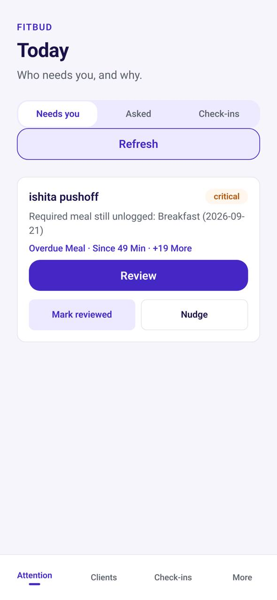

# TM-01 · Attention (trainer mobile home)

**ID:** TM-01 · **Name:** Attention (trainer mobile home) · **Priority:** P1 · **Route/screen:** `TrainerAttention` · **Batch:** M-7 (see `../BATCHES.md`)

**Files to touch:**
- `apps/mobile/src/trainer/AttentionTab.tsx` (exists: old code. Rebuild it to the target; do not patch it)

**API (from the guide):** `GET /exceptions/attention`, coach asks [API-NEW], check-in inbox

**Code status:** old code exists (the guide labelled it "Implemented"). **That code is LEGACY. Rebuild the screen to the target design below; don't patch the old UI.**

**Read first:** `../00-foundations.md` · `../01-product-rules.md` · `../02-navigation.md` (routes, IA) · `../03-api-changes.md` · `../09-demo-data.md`

---

## (b) Guide section (verbatim)

> **Read every line of this section.** Item 3, **"Legacy (do not keep)"**, describes the OLD UI that you must **REPLACE**. Never preserve or restyle it. Item 4, **"Gaps to close"**, lists what's wrong. The target is item 5 onward. Copied from FitBud UI/UX Implementation Guide v1.2, lines 2308–2340. Changes: the misleading "Status" label is dropped, two subsections are renamed, and image paths point to `../img/`. Nothing else is changed.

<!-- BEGIN VERBATIM TM-01 -->
### TM-01 · Attention (trainer mobile home)

> **Priority:** P1 · **Screen:** `TrainerAttention` · **Files:** `src/trainer/AttentionTab.tsx` · **API:** `GET /exceptions/attention`, coach asks [API-NEW], check-in inbox

1. **Purpose.** Answers "who needs me" on the phone.
2. **Entry.** App open (trainer role), and trainer pushes.
3. **Legacy (do not keep).** A list of attention items from code. No running screenshot.
4. **Gaps to close.** No grouping. No asked-coach items. No check-in section. No pull-to-refresh state. Dev copy may leak ("deterministic exceptions only").
5. **Target design.**
   - Large title "Today".
   - Segmented chips: **Needs you (N)** · **Asked (N)** · **Check-ins (N)**.
   - **Cards, one per client (D32: cards stay on trainer mobile):** a full-width card (16 dp padding, 12 dp radius) shows the avatar and name, one severity chip, the issue in plain words ("Missed 2 workouts · Mon, Wed"), the age ("since 3 d") and one full-width primary button, **Review** (48 dp). The order is the same as web: severity, then age.
   - Swipe right to **Mark reviewed**, swipe left for **Nudge**, with a visible ⋯ fallback for accessibility.
   - Tap opens TM-04 or the ask sheet.
6. **States.**
   - Skeleton.
   - Empty: "All caught up."
   - Offline: "You're offline. Showing the last update from 9:40 am." Actions are disabled. Trainer mobile is online-first for writes; trainer actions aren't in the trainee outbox.
7. **Edge cases.** Swipe actions show undo snackbars.
8. **Deep links.** `/coach/attention`.
9. **References.**
   - Material 3 navigation bar [R47].
   - TrueCoach dashboard [R1].
10. **UX decisions.**
    - On a phone, cards give large tap targets and room for swipe gestures, and a single column removes the density advantage that rows have on web (see the TW-04 comparison, D32).
    - Swipe actions make triage fast, while visible buttons keep it accessible.
11. **Implementation.** React Navigation tab. Shared `AttentionRow` logic in `packages/core` (grouping and labels).
12. **Acceptance criteria.**
    - [ ] Three segments.
    - [ ] One card per client, with one chip and one primary action, in severity-then-age order.
    - [ ] Swipe and button actions work.
    - [ ] No dev copy.
13. **Priority:** P1.
<!-- END VERBATIM TM-01 -->

---

## (c) Reference images

Open **every** image below before you write code. LEGACY images show what to remove. REFERENCE images show the target or inspiration.

- **LEGACY: 18 Oct QA capture of the current build at 7f74108 (iPhone 15 profile), do not copy** (Attention, rahul.coach@demo.fitbud.test): `mobile-qa/TM-01-attention.jpg`

  

## (d) Acceptance checks (verifiable)

Every check needs a PASS or FAIL line in your report, citing a screenshot in `docs/spec/evidence/`. Cite checks by ID (e.g. `TM-01.3`). Where a QA check restates a guide criterion, both must pass. A check you can't prove is FAIL, not ✅.

1. **TM-01.1** [guide §12] Three segments.
2. **TM-01.2** [guide §12] One card per client, with one chip and one primary action, in severity-then-age order.
3. **TM-01.3** [guide §12] Swipe and button actions work.
4. **TM-01.4** [guide §12] No dev copy.
5. **TM-01.5** [18 Oct QA] Names are title-cased ("Ishita Pushoff"); no "(2026-09-21)"; metadata is sentence case ("since 49 min · +19 more").
6. **TM-01.6** [18 Oct QA] Pull-to-refresh refreshes the list; there's no "Refresh" button.
7. **TM-01.7** [product rule] Lists refresh by **pull-to-refresh** (the shared Screen wrapper). There's no manual "Refresh" button.
8. **TM-01.8** [product rule] The banned-strings check (01-product-rules.md §B) finds no match on this screen in any captured state.
9. **TM-01.9** [guide §1.1 DoD] Loading, empty, error, offline and partial states exist as specified in "States" (one evidence screenshot per state, or a named test).

## (e) Observed in 18 Oct QA

These failures were seen on branch `cursor/stage1-foundation-a3da` @ `7f74108`. Fix every one, and prove the fix in the checks above.

- Mobile QA index: the header says "Today" while the tab is "Attention"; raw "(2026-09-21)"; Title-Case "Overdue Meal · Since 49 Min · +19 More"; lowercase names ("ishita pushoff"). (Note: the guide target *is* a large title "Today". See the ambiguity list in BATCHES.md.)
- Same API root cause as TW-04: the attention limit applies before grouping, so only one client shows.
- Code at 7f74108: `apps/mobile/src/trainer/AttentionTab.tsx:133` renders a manual "Refresh" button. Pull-to-refresh is required.

## (f) Demo state to verify

Local stack: web http://localhost:5173 (proxies `/api` to http://127.0.0.1:8787). Expo web runs on :8081 with `EXPO_PUBLIC_SCREEN_CAPTURE=1`. Every demo password is `FitBud-demo-2026`. Reset with `pnpm db:reset` (stop the API first). See `../09-demo-data.md` for all IDs.

- Account **rahul.coach@demo.fitbud.test** · route `trainer_shell › tab attention` · 18 Oct capture `fitbud-mobile-shots/ios/TM-01-attention.png`

## (g) Viewport for evidence

**393×852** (iPhone 15 profile, Expo web or a device). Save it as `docs/spec/evidence/TM-01.png`. Save extra states as `docs/spec/evidence/TM-01--<state>.png` (e.g. `--empty`, `--error`, `--offline`).

