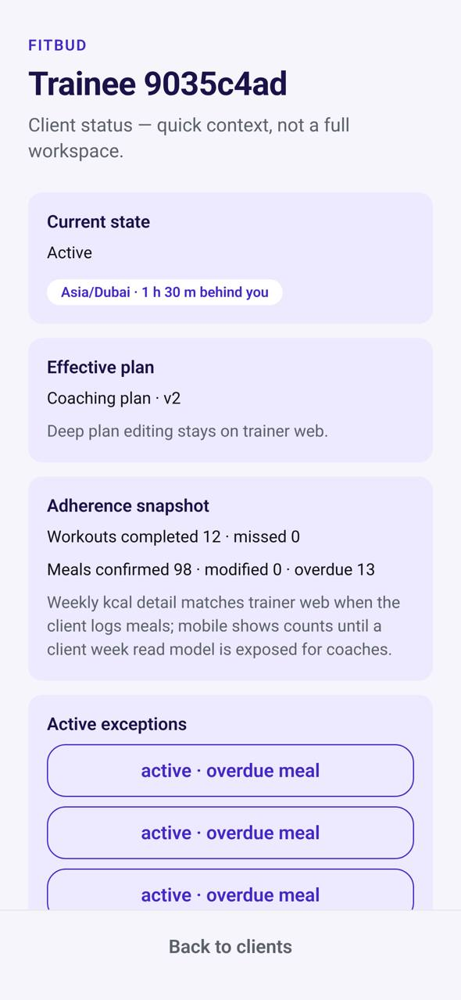

# TM-03 · Client status

**ID:** TM-03 · **Name:** Client status · **Priority:** P1 · **Route/screen:** — · **Batch:** M-7 (see `../BATCHES.md`)

**Files to touch:**
- `apps/mobile/src/trainer/ClientStatusScreen.tsx` (exists: old code. Rebuild it to the target; do not patch it)
- `apps/mobile/src/trainer/TrainerShell.tsx:71` (UUID title)
- `apps/mobile/src/trainer/labels.ts` (replace with `packages/core` labels)

**API (from the guide):** workspace read, week read model [API-NEW], responsiveness [API-NEW]

**Code status:** old code exists (the guide labelled it "Implemented"). **That code is LEGACY. Rebuild the screen to the target design below; don't patch the old UI.**

**Read first:** `../00-foundations.md` · `../01-product-rules.md` · `../02-navigation.md` (routes, IA) · `../03-api-changes.md` · `../09-demo-data.md`

---

## (b) Guide section (verbatim)

> **Read every line of this section.** Item 3, **"Legacy (do not keep)"**, describes the OLD UI that you must **REPLACE**. Never preserve or restyle it. Item 4, **"Gaps to close"**, lists what's wrong. The target is item 5 onward. Copied from FitBud UI/UX Implementation Guide v1.2, lines 2364–2390. Changes: the misleading "Status" label is dropped, two subsections are renamed, and image paths point to `../img/`. Nothing else is changed.

<!-- BEGIN VERBATIM TM-03 -->
### TM-03 · Client status

> **Priority:** P1 · **Files:** `src/trainer/ClientStatusScreen.tsx` · **API:** workspace read, week read model [API-NEW], responsiveness [API-NEW]

1. **Purpose.** A phone-sized overview of one client.
2. **Entry.** Clients, attention rows, `/coach/client/:rid`.
3. **Legacy (do not keep).** The status screen exists.
4. **Gaps to close.** No weekly consistency. No reminders line. No WhatsApp context link. "Plan builder stays on web." dev copy.
5. **Target design.**
   - Header: name and chips, plus the `TimezoneBadge` ("Priya's time 6:10 am · 5 h 30 m behind you") when the timezones differ (D22).
   - **This week** dots and counts, and **today's kcal** against plan (D25).
   - **Needs attention** (one item).
   - **Next check-in**.
   - **Reminders** label.
   - **Recent activity** (5 rows), linking to TM-09 filtered to this client.
   - **Coach notes**, with *Add note* opening the TW-34 composer in a sheet.
   - Actions: **WhatsApp** (prefilled with a deep link to the client's Today), *Nudge…* (pick an unresolved item), and "Edit plan on web", which copies or shares the web URL.
6. **States.** Standard. Ended: read-only.
7. **Edge cases.** No WhatsApp number: the button is disabled with an explanation. Ended: *Reactivate* opens the TW-30 confirmation in a sheet.
8. **Deep links.** `/coach/client/:rid`.
9. **References.** Trainerize client app overview [R21] (structure only).
10. **UX decisions.** Mobile shows the decision-making data, and edits happen on web.
11. **Implementation.** Reuse `primaryActionFor(header)`.
12. **Acceptance criteria.**
    - [ ] Week counts match web.
    - [ ] No dev copy.
13. **Priority:** P1.
<!-- END VERBATIM TM-03 -->

---

## (c) Reference images

Open **every** image below before you write code. LEGACY images show what to remove. REFERENCE images show the target or inspiration.

- **LEGACY: 18 Oct QA capture of the current build at 7f74108 (iPhone 15 profile), do not copy** (Client status, rahul.coach@demo.fitbud.test): `mobile-qa/TM-03-client-status.jpg`

  

## (d) Acceptance checks (verifiable)

Every check needs a PASS or FAIL line in your report, citing a screenshot in `docs/spec/evidence/`. Cite checks by ID (e.g. `TM-03.3`). Where a QA check restates a guide criterion, both must pass. A check you can't prove is FAIL, not ✅.

1. **TM-03.1** [guide §12] Week counts match web.
2. **TM-03.2** [guide §12] No dev copy.
3. **TM-03.3** [18 Oct QA] The title is the client's name, never "Trainee <8-hex>".
4. **TM-03.4** [18 Oct QA] Chips use human labels with icons ("Needs attention", "Missed meal"), never "active · overdue meal".
5. **TM-03.5** [product rule] The banned-strings check (01-product-rules.md §B) finds no match on this screen in any captured state.
6. **TM-03.6** [guide §1.1 DoD] Loading, empty, error, offline and partial states exist as specified in "States" (one evidence screenshot per state, or a named test).

## (e) Observed in 18 Oct QA

These failures were seen on branch `cursor/stage1-foundation-a3da` @ `7f74108`. Fix every one, and prove the fix in the checks above.

- Mobile QA index: title "Trainee 9035c4ad" (UUID fragment instead of name): `apps/mobile/src/trainer/TrainerShell.tsx:71` builds `Trainee ${traineeUserId.slice(0,8)}`.
- Mobile QA index: exception chips read "active · overdue meal" (raw lowercase enums): `apps/mobile/src/trainer/labels.ts` `statusLabel()` only replaces underscores.

## (f) Demo state to verify

Local stack: web http://localhost:5173 (proxies `/api` to http://127.0.0.1:8787). Expo web runs on :8081 with `EXPO_PUBLIC_SCREEN_CAPTURE=1`. Every demo password is `FitBud-demo-2026`. Reset with `pnpm db:reset` (stop the API first). See `../09-demo-data.md` for all IDs.

- Account **rahul.coach@demo.fitbud.test** · route `clients › first client status` · 18 Oct capture `fitbud-mobile-shots/ios/TM-03-client-status.png`

## (g) Viewport for evidence

**393×852** (iPhone 15 profile, Expo web or a device). Save it as `docs/spec/evidence/TM-03.png`. Save extra states as `docs/spec/evidence/TM-03--<state>.png` (e.g. `--empty`, `--error`, `--offline`).

