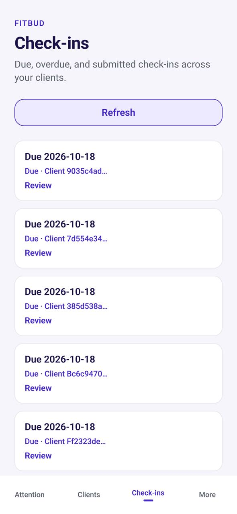

# TM-05 · Check-ins (mobile inbox)

**ID:** TM-05 · **Name:** Check-ins (mobile inbox) · **Priority:** P2 · **Route/screen:** — · **Batch:** M-8 (see `../BATCHES.md`)

**Files to touch:**
- `apps/mobile/src/trainer/CheckinsTab.tsx` (exists: old code. Rebuild it to the target; do not patch it)

**Code status:** old code exists (the guide labelled it "Implemented"). **That code is LEGACY. Rebuild the screen to the target design below; don't patch the old UI.**

**Read first:** `../00-foundations.md` · `../01-product-rules.md` · `../02-navigation.md` (routes, IA) · `../09-demo-data.md`

---

## (b) Guide section (verbatim)

> **Read every line of this section.** Item 3, **"Legacy (do not keep)"**, describes the OLD UI that you must **REPLACE**. Never preserve or restyle it. Item 4, **"Gaps to close"**, lists what's wrong. The target is item 5 onward. Copied from FitBud UI/UX Implementation Guide v1.2, lines 2411–2428. Changes: the misleading "Status" label is dropped, two subsections are renamed, and image paths point to `../img/`. Nothing else is changed.

<!-- BEGIN VERBATIM TM-05 -->
### TM-05 · Check-ins (mobile inbox)

> **Priority:** P2 · **Files:** `src/trainer/CheckinsTab.tsx`

1. **Purpose.** See the check-ins that are waiting.
2. **Entry.** Tab, push.
3. **Legacy (do not keep).** A list.
4. **Gaps to close.** Verify that names (not UUIDs) are shown, given the web P0 bug.
5. **Target design.** Segments: To review · Overdue. Rows show name, form and time.
6. **States.** Standard.
7. **Edge cases.** None.
8. **Deep links.** `/coach/checkin/:id`.
9. **References.** Everfit [R6].
10. **UX decisions.** Mirror web.
11. **Implementation.** The same inbox read model as web.
12. **Acceptance criteria.**
    - [ ] Names shown.
13. **Priority:** P2.
<!-- END VERBATIM TM-05 -->

---

## (c) Reference images

Open **every** image below before you write code. LEGACY images show what to remove. REFERENCE images show the target or inspiration.

- **LEGACY: 18 Oct QA capture of the current build at 7f74108 (iPhone 15 profile), do not copy** (Check-ins, rahul.coach@demo.fitbud.test): `mobile-qa/TM-05-check-ins.jpg`

  

## (d) Acceptance checks (verifiable)

Every check needs a PASS or FAIL line in your report, citing a screenshot in `docs/spec/evidence/`. Cite checks by ID (e.g. `TM-05.3`). Where a QA check restates a guide criterion, both must pass. A check you can't prove is FAIL, not ✅.

1. **TM-05.1** [guide §12] Names shown.
2. **TM-05.2** [18 Oct QA] Rows show the client's name (never "Client 9035c4ad…") and a formatted due date ("Due Sun 18 Oct").
3. **TM-05.3** [18 Oct QA] Pull-to-refresh; no "Refresh" button.
4. **TM-05.4** [product rule] Lists refresh by **pull-to-refresh** (the shared Screen wrapper). There's no manual "Refresh" button.
5. **TM-05.5** [product rule] The banned-strings check (01-product-rules.md §B) finds no match on this screen in any captured state.
6. **TM-05.6** [guide §1.1 DoD] Loading, empty, error, offline and partial states exist as specified in "States" (one evidence screenshot per state, or a named test).

## (e) Observed in 18 Oct QA

These failures were seen on branch `cursor/stage1-foundation-a3da` @ `7f74108`. Fix every one, and prove the fix in the checks above.

- Mobile QA index: rows read "Due 2026-10-18 / Due · Client 9035c4ad…" (UUID fragments instead of client names; ISO dates). `labels.ts` `shortId()` is the helper used.
- Code at 7f74108: `CheckinsTab.tsx:51` has a manual "Refresh" button.

## (f) Demo state to verify

Local stack: web http://localhost:5173 (proxies `/api` to http://127.0.0.1:8787). Expo web runs on :8081 with `EXPO_PUBLIC_SCREEN_CAPTURE=1`. Every demo password is `FitBud-demo-2026`. Reset with `pnpm db:reset` (stop the API first). See `../09-demo-data.md` for all IDs.

- Account **rahul.coach@demo.fitbud.test** · route `tab checkins` · 18 Oct capture `fitbud-mobile-shots/ios/TM-05-check-ins.png`

## (g) Viewport for evidence

**393×852** (iPhone 15 profile, Expo web or a device). Save it as `docs/spec/evidence/TM-05.png`. Save extra states as `docs/spec/evidence/TM-05--<state>.png` (e.g. `--empty`, `--error`, `--offline`).

