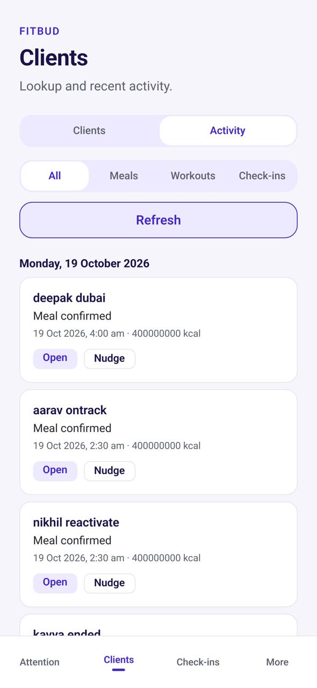

# TM-09 · Activity feed (inside the Clients tab)

**ID:** TM-09 · **Name:** Activity feed (inside the Clients tab) · **Priority:** P1 · **Route/screen:** `TrainerActivity` (Clients tab, segment "Activity") · **Batch:** M-7 (see `../BATCHES.md`)

**Files to touch:**
- `apps/mobile/src/trainer/ActivityFeedScreen.tsx` (exists: old code. Rebuild it to the target; do not patch it)
- `apps/mobile/src/trainer/ClientsTab.tsx` (exists: old code. Rebuild it to the target; do not patch it)
- `apps/api/src/routes/activity-feed.ts:86` (kcal scale, Batch 0)

**API (from the guide):** API-NEW `GET /activity/feed?cursor=&limit=30&types=&rid=&since=`

**Code status:** the guide says "New-proposed" (no code, or only partial code). Build it to the target. If you find code already in the repo, treat it as unverified legacy.

**Read first:** `../00-foundations.md` · `../01-product-rules.md` · `../02-navigation.md` (routes, IA) · `../03-api-changes.md` · `../05-notifications.md` · `../09-demo-data.md`

---

## (b) Guide section (verbatim)

> **Read every line of this section.** Item 3, **"Legacy (do not keep)"**, describes the OLD UI that you must **REPLACE**. Never preserve or restyle it. Item 4, **"Gaps to close"**, lists what's wrong. The target is item 5 onward. Copied from FitBud UI/UX Implementation Guide v1.2, lines 2494–2557. Changes: the misleading "Status" label is dropped, two subsections are renamed, and image paths point to `../img/`. Nothing else is changed.

<!-- BEGIN VERBATIM TM-09 -->
### TM-09 · Activity feed (inside the Clients tab)

> **Priority:** P1 · **Screen:** `TrainerActivity` (Clients tab, segment "Activity") · **Files:** `src/trainer/ActivityFeedScreen.tsx` [new], `src/trainer/ClientsTab.tsx` (segment) · **API:** API-NEW `GET /activity/feed?cursor=&limit=30&types=&rid=&since=` · **Decision:** D16, user 17 Oct (nav 2)

1. **Purpose.** Answers "what have my clients been doing" across all clients, on the phone, in one scroll. It's a complement to Attention (which shows only what needs action).
2. **Entry.**
   - The Clients tab segment **Activity**.
   - TM-03 "Recent activity → See all" (prefiltered to that client).
   - Trainer push for meal-time changes (T-MEALTIME).
3. **Legacy (do not keep).** None.
4. **Gaps to close.** Trainers have no cross-client timeline on mobile. Web has per-client Activity only (TW-17).
5. **Target design.**
   - **Header:** the segmented control **Clients · Activity**. Below it, filter chips that scroll horizontally:
     - **All**
     - **Workouts**
     - **Meals**
     - **Check-ins**
     - **Changes**: meal-time changes, swaps, "something different", logged late
     - **Notes seen**: visible notes the client opened
     - **Client** picker (a single-select sheet with search).
   - **Grouped by day** with sticky headers ("Today", "Yesterday", "Tue 13 Oct"). Within a day, newest first.
   - **Row** (64 dp minimum):
     - avatar initials;
     - **"Priya** completed *Upper body A*", "**Arjun** logged *Lunch* · something different · 610 kcal (plan 520)", "**Neha** changed Lunch time 1:30 → 2:30 pm", "**Priya** logged *Dinner* late (Tue)", "**Arjun** submitted check-in", "**Neha** saw your note";
     - the type icon and status chip;
     - relative time (in the trainer's timezone, with the client's local time in brackets when it differs: "2 h ago · 7:40 pm her time").
   - **Grouping:** consecutive events of the same type from the same client within 60 min collapse into one row ("Priya logged 3 meals"), which expands on tap.
   - **Row tap:**
     - workouts and meals open a sheet with the TW-17 detail (sets, or planned and actual foods with kcal);
     - check-ins open TM-06;
     - meal-time changes open TM-03, scrolled to the plan times.
   - **Row actions** (long-press or a ⋯ button for accessibility): *Open client*, *Add note* (TW-34), *WhatsApp*. Exception actions are **not** here; they stay in Attention.
   - Unread dot: events newer than the last time the trainer viewed the feed (stored on the device).
6. **States.**
   - Skeleton rows.
   - Empty: "No client activity yet. It'll appear as your clients log."
   - Filtered empty: "No meal activity in the last 7 days."
   - Offline: the cached last 100 events, with "Showing activity from 9:40 am".
   - Error with Retry.
7. **Edge cases.**
   - Ended clients are excluded unless they're explicitly picked.
   - Superseded assignments are hidden.
   - Infinite scroll uses the cursor, with a 30-day lookback and a "Load older" button after that.
   - Rate: realtime hints refresh the head of the list without jumping the scroll position ("3 new · tap to see").
8. **Deep links.** `/coach/activity?rid=:rid&type=meal`.
9. **References.**
   - Adapt: the TrueCoach dashboard activity stream [R1] (structure only).
   - Adapt: Material 3 lists [R47].
   - No strong external reference for the change-event types; they're FitBud-specific.
10. **UX decisions.**
    - Living inside Clients keeps the 4-tab bar unchanged.
    - Attention is for *acting*; Activity is for *awareness*, with no resolve actions, so the two never duplicate.
    - Grouping keeps a busy roster scannable.
11. **Implementation.**
    - API-NEW `GET /activity/feed`, a trainer-scoped union read model over assignment state changes, `meal_time_overrides` changes, check-in submissions, coach-note seen events and late logs. It returns `{events:[{id, rid, traineeDisplayName, type, subtype, occurredAt, traineeLocalTime, summary, kcal?, link}], nextCursor}`.
    - Event sentences come from `packages/copy`.
    - FlashList for the list.
12. **Acceptance criteria.**
    - [ ] The Activity segment shows events from all active clients, grouped by day.
    - [ ] The filters and client picker work and reset the cursor.
    - [ ] Meal-time changes and late logs appear.
    - [ ] Rows open the right detail.
    - [ ] There are no resolve or acknowledge actions in the feed.
13. **Priority:** P1.
<!-- END VERBATIM TM-09 -->

---

## (c) Reference images

Open **every** image below before you write code. LEGACY images show what to remove. REFERENCE images show the target or inspiration.

- **LEGACY: 18 Oct QA capture of the current build at 7f74108 (iPhone 15 profile), do not copy** (Activity feed, rahul.coach@demo.fitbud.test): `mobile-qa/TM-09-activity-feed.jpg`

  

## (d) Acceptance checks (verifiable)

Every check needs a PASS or FAIL line in your report, citing a screenshot in `docs/spec/evidence/`. Cite checks by ID (e.g. `TM-09.3`). Where a QA check restates a guide criterion, both must pass. A check you can't prove is FAIL, not ✅.

1. **TM-09.1** [guide §12] The Activity segment shows events from all active clients, grouped by day.
2. **TM-09.2** [guide §12] The filters and client picker work and reset the cursor.
3. **TM-09.3** [guide §12] Meal-time changes and late logs appear.
4. **TM-09.4** [guide §12] Rows open the right detail.
5. **TM-09.5** [guide §12] There are no resolve or acknowledge actions in the feed.
6. **TM-09.6** [18 Oct QA] No row shows a kcal value above 10,000. Seeded meals show plausible values such as "400 kcal".
7. **TM-09.7** [18 Oct QA] No event is dated in the future relative to the trainee's local time; no `portion_size`.
8. **TM-09.8** [18 Oct QA] Pull-to-refresh; no "Refresh" button.
9. **TM-09.9** [product rule] Lists refresh by **pull-to-refresh** (the shared Screen wrapper). There's no manual "Refresh" button.
10. **TM-09.10** [product rule] The banned-strings check (01-product-rules.md §B) finds no match on this screen in any captured state.
11. **TM-09.11** [guide §1.1 DoD] Loading, empty, error, offline and partial states exist as specified in "States" (one evidence screenshot per state, or a named test).

## (e) Observed in 18 Oct QA

These failures were seen on branch `cursor/stage1-foundation-a3da` @ `7f74108`. Fix every one, and prove the fix in the checks above.

- Mobile QA index: every row shows "400000000 kcal". Root cause: `apps/api/src/routes/activity-feed.ts:86` returns `kcal: row.kcalScaled` without dividing by `NUTRIENT_SCALE` (1,000,000, `packages/contracts/src/nutrition.ts:8`); the seed writes `kcal_scaled 400000000` (`seed/demo/history.ts:208`), which is 400 kcal.
- Mobile QA index: items dated Mon 19 Oct 2026 (tomorrow in IST), so the seed or the timezone conversion is off. Raw enum "portion_size" in the text.
- Code at 7f74108: `ActivityFeedScreen.tsx:128` has a manual "Refresh" button.

## (f) Demo state to verify

Local stack: web http://localhost:5173 (proxies `/api` to http://127.0.0.1:8787). Expo web runs on :8081 with `EXPO_PUBLIC_SCREEN_CAPTURE=1`. Every demo password is `FitBud-demo-2026`. Reset with `pnpm db:reset` (stop the API first). See `../09-demo-data.md` for all IDs.

- Account **rahul.coach@demo.fitbud.test** · route `clients › Activity` · 18 Oct capture `fitbud-mobile-shots/ios/TM-09-activity-feed.png`

## (g) Viewport for evidence

**393×852** (iPhone 15 profile, Expo web or a device). Save it as `docs/spec/evidence/TM-09.png`. Save extra states as `docs/spec/evidence/TM-09--<state>.png` (e.g. `--empty`, `--error`, `--offline`).

