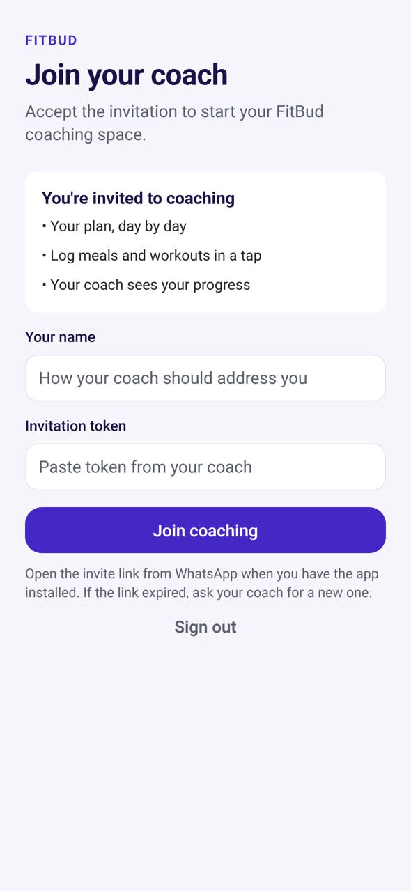

# TR-02 · Invite acceptance

**ID:** TR-02 · **Name:** Invite acceptance · **Priority:** P0 · **Route/screen:** `Invite` · **Batch:** M-1 (see `../BATCHES.md`)

**Files to touch:**
- `apps/mobile/src/screens/AcceptInviteScreen.tsx` (exists: old code. Rebuild it to the target; do not patch it)

**API (from the guide):** `POST /invitations/accept`

**Code status:** old code exists (the guide labelled it "Implemented (paste-token)"). **That code is LEGACY. Rebuild the screen to the target design below; don't patch the old UI.**

**Read first:** `../00-foundations.md` · `../01-product-rules.md` · `../02-navigation.md` (routes, IA) · `../03-api-changes.md` · `../09-demo-data.md`

---

## (b) Guide section (verbatim)

> **Read every line of this section.** Item 3, **"Legacy (do not keep)"**, describes the OLD UI that you must **REPLACE**. Never preserve or restyle it. Item 4, **"Gaps to close"**, lists what's wrong. The target is item 5 onward. Copied from FitBud UI/UX Implementation Guide v1.2, lines 2639–2681. Changes: the misleading "Status" label is dropped, two subsections are renamed, and image paths point to `../img/`. Nothing else is changed.

<!-- BEGIN VERBATIM TR-02 -->
### TR-02 · Invite acceptance

> **Priority:** P0 · **Screen:** `Invite` · **Files:** `src/screens/AcceptInviteScreen.tsx` (paste-token field, optional display name) · **API:** `POST /invitations/accept`

1. **Purpose.** Join a coach in one tap from WhatsApp.
2. **Entry.** The invite link `https://{appHost}/i/{token}`, or manual code entry.
3. **Legacy (do not keep).** A paste-token field.
4. **Gaps to close.** Asking people to paste tokens is a big drop-off point. There's no trainer context and no link handling.
5. **Target design.**
   - **Landing card:** trainer initials and name, "Rahul invited you to coaching on FitBud", and three bullets:
     - "Your plan, day by day"
     - "Log meals and workouts in a tap"
     - "Rahul sees your progress"
   - **Your name** (prefilled from the invite display name, editable).
   - **Mobile number** (prefilled from the invite if the trainer entered it, editable) and **email** (prefilled from the invite, read-only).
   - **Create a password** (minimum 8 characters, show/hide). Helper: "You'll sign in with your mobile number or email and this password."
   - **Verify:** the first acceptance sends a 6-digit code **by email** to prove ownership before the password is set. WhatsApp is added when `wa_otp` turns on (D18). A user who's already signed in skips this step.
   - Primary: **Join Rahul**.
   - A small link: "Have a code instead?" opens manual entry.
   - **Web landing** (app not installed): the same card plus Play Store and App Store buttons. The token carries through install via a deferred deep link, or the page offers "Copy code" and the app prompts "Paste your invite code" on first open with the clipboard prefilled (only with user consent).
6. **States.**
   - Invalid or used token: "This invite link has expired or was already used. Ask Rahul for a new one." plus *Message Rahul on WhatsApp* (when the trainer's number is known from the invite preview API-NEW).
   - Network error.
7. **Edge cases.**
   - The user already has an active relationship (MVP allows one): "You're already coaching with Asha. To join Rahul, end coaching with Asha first." It offers *End coaching with Asha* (confirm), then continues. (Decision G: one active relationship.)
   - **A returning trainee with a new coach:** their account exists, so they sign in and skip the password step. The new relationship starts blank for the trainer. The trainee keeps their history (D21).
   - **A reactivation request** from the same coach is not an invite. It appears as TR-22's confirmation card.
   - Wrong account signed in.
8. **Deep links.** `/i/:token` (web) and `/invite/:token` (app).
9. **References.**
   - Everfit public client invite link [R14].
   - Expo linking into your app [R61] https://docs.expo.dev/linking/into-your-app
10. **UX decisions.** Showing the trainer's identity builds trust. The link-first flow removes the paste step.
11. **Implementation.**
    - API-NEW: an invite preview `GET /invitations/preview?token=` (public, rate-limited) returning the trainer display name only. No PII beyond that.
    - API-CHG: `POST /invitations/accept` accepts `{token, displayName, mobileE164?, password, otpProof}` for new accounts.
    - Universal links and App Links on the host (OQ-2).
12. **Acceptance criteria.**
    - [ ] Tapping the WhatsApp invite opens the app on the join card.
    - [ ] The manual code path works.
    - [ ] The expired-token copy is shown.
    - [ ] A new account sets a password during acceptance.
13. **Priority:** P0.
<!-- END VERBATIM TR-02 -->

---

## (c) Reference images

Open **every** image below before you write code. LEGACY images show what to remove. REFERENCE images show the target or inspiration.

- **LEGACY: 18 Oct QA capture of the current build at 7f74108 (iPhone 15 profile), do not copy** (Invite acceptance, anita.invite (test invite token)): `mobile-qa/TR-02-invite-acceptance.jpg`

  

## (d) Acceptance checks (verifiable)

Every check needs a PASS or FAIL line in your report, citing a screenshot in `docs/spec/evidence/`. Cite checks by ID (e.g. `TR-02.3`). Where a QA check restates a guide criterion, both must pass. A check you can't prove is FAIL, not ✅.

1. **TR-02.1** [guide §12] Tapping the WhatsApp invite opens the app on the join card.
2. **TR-02.2** [guide §12] The manual code path works.
3. **TR-02.3** [guide §12] The expired-token copy is shown.
4. **TR-02.4** [guide §12] A new account sets a password during acceptance.
5. **TR-02.5** [18 Oct QA] The invite opens a landing card with the trainer's name ("Rahul invited you…"); a token paste field is only behind "Have a code instead?".
6. **TR-02.6** [product rule] The banned-strings check (01-product-rules.md §B) finds no match on this screen in any captured state.
7. **TR-02.7** [guide §1.1 DoD] Loading, empty, error, offline and partial states exist as specified in "States" (one evidence screenshot per state, or a named test).

## (e) Observed in 18 Oct QA

These failures were seen on branch `cursor/stage1-foundation-a3da` @ `7f74108`. Fix every one, and prove the fix in the checks above.

- Mobile QA index: "Join your coach" with a **token paste field**. The guide calls the paste step a big drop-off point and wants a link-first landing card with the trainer's name.

## (f) Demo state to verify

Local stack: web http://localhost:5173 (proxies `/api` to http://127.0.0.1:8787). Expo web runs on :8081 with `EXPO_PUBLIC_SCREEN_CAPTURE=1`. Every demo password is `FitBud-demo-2026`. Reset with `pnpm db:reset` (stop the API first). See `../09-demo-data.md` for all IDs.

- Account **anita.invite (test invite token)** · route `accept_invite (needsAccountLink)` · 18 Oct capture `fitbud-mobile-shots/ios/TR-02-invite-acceptance.png`

## (g) Viewport for evidence

**393×852** (iPhone 15 profile, Expo web or a device). Save it as `docs/spec/evidence/TR-02.png`. Save extra states as `docs/spec/evidence/TR-02--<state>.png` (e.g. `--empty`, `--error`, `--offline`).

