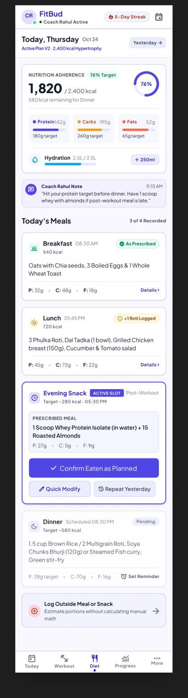
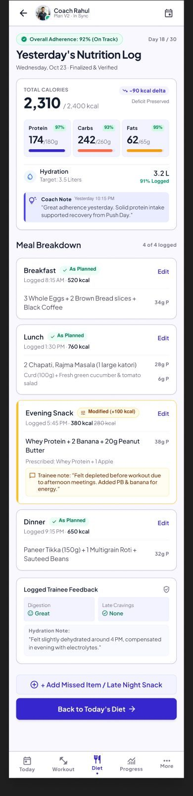
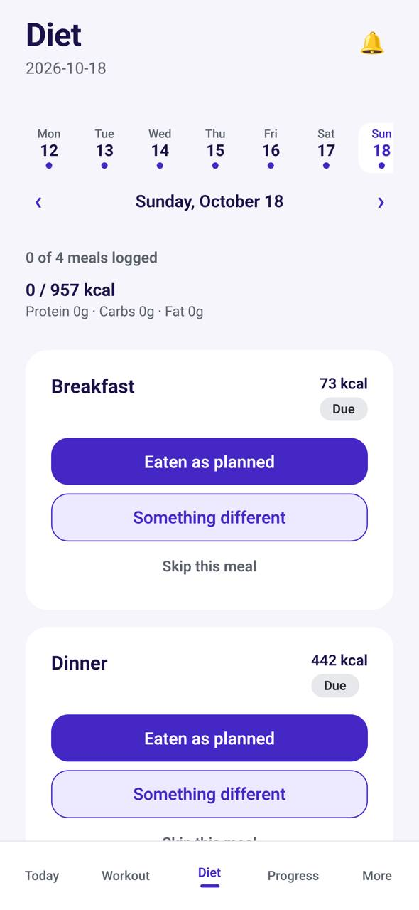
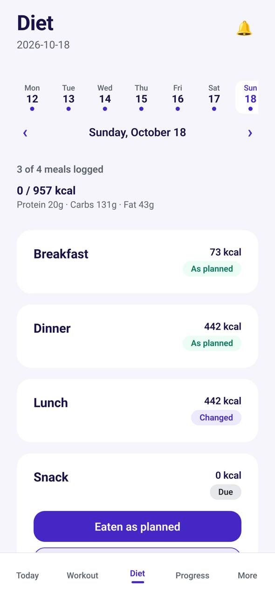

# TR-07 · Diet: today's meals and logging

**ID:** TR-07 · **Name:** Diet: today's meals and logging · **Priority:** P0 · **Route/screen:** `Diet` · **Batch:** M-2 (see `../BATCHES.md`)

**Files to touch:**
- `apps/mobile/src/trainee/DietTab.tsx` (exists: old code. Rebuild it to the target; do not patch it)

**API (from the guide):** meal assignments list, confirm, deviate, skip; files upload target, put, confirm

**Code status:** old code exists (the guide labelled it "Implemented (needs redesign)"). **That code is LEGACY. Rebuild the screen to the target design below; don't patch the old UI.**

**Read first:** `../00-foundations.md` · `../01-product-rules.md` · `../02-navigation.md` (routes, IA) · `../03-api-changes.md` · `../05-notifications.md` · `../04-flows.md` (§3.7 Late logging) · `../09-demo-data.md`

---

## (b) Guide section (verbatim)

> **Read every line of this section.** Item 3, **"Legacy (do not keep)"**, describes the OLD UI that you must **REPLACE**. Never preserve or restyle it. Item 4, **"Gaps to close"**, lists what's wrong. The target is item 5 onward. Copied from FitBud UI/UX Implementation Guide v1.2, lines 2905–2974. Changes: the misleading "Status" label is dropped, two subsections are renamed, and image paths point to `../img/`. Nothing else is changed.

<!-- BEGIN VERBATIM TR-07 -->
### TR-07 · Diet: today's meals and logging

> **Priority:** P0 · **Screen:** `Diet` · **Files:** `src/trainee/DietTab.tsx` ("Confirm eaten as planned", "Quick modify", "Skip", "Photo required", photo upload; calls `generateMealAssignments` on load) · **API:** meal assignments list, confirm, deviate, skip; files upload target, put, confirm

1. **Purpose.** Log each meal in one tap when it went as planned, and quickly when it didn't.
2. **Entry.** Tab, meal push (the action button logs without opening the app), Today's hero, a deep link `/diet/:date` or `/meal/:id`.
3. **Legacy (do not keep).**
   - Code: a list with three equal buttons per meal, a "Photo required" note and the subtitle "confirm what you ate, then move on."
   - Figma `trainee_05_today_diet.png` and `trainee_06_yesterday_diet.png`: rich meal cards, but with % on-plan, a streak, "Photo Proof" and "Set Reminder".

   {.phone} {.phone}

4. **Gaps to close.**
   - The three equal buttons make no action primary.
   - "Photo required" reads as a barrier.
   - There's no date navigation (yesterday, for logging late).
   - Day totals are missing.
   - Logs go online-only, without the outbox.
5. **Target design.**
   - **Date header**, using the same week strip as TR-06 (shared `DateNavigator`). Today is interactive. Past days are read-only except items that can be logged late (D23). Future days are a read-only preview.
   - **Day summary** (D25): "3 of 5 meals logged", plus the compact **NutritionRings** (kcal, P, C, F: logged vs assigned, as on TR-06) and the line "1,240 of 1,850 kcal". Values use "≥" when unknown. There's no % text and no colour judgement.
   - **MealCard** for each slot:
     - Header: time · meal label (for example "Lunch · 1:30 pm") · state chip (Due, Logged ✓, Changed, Skipped, Logged late, Overdue).
     - Header right: **kcal for this meal** ("520 kcal"). After "Something different" it shows the logged value against the plan: "610 kcal · plan 520" (D25).
     - Body: the planned items ("2 roti · 1 katori dal · salad") with "P 18 · C 72 · F 14 g", and *See details* (opens items and instructions from TR-09). After a food log, the body lists the **foods actually logged** instead, with the plan behind a "Planned" toggle.
     - **Primary: "Eaten as planned"** (56 dp, indigo).
     - Secondary text button: **"Something different"**, which opens TR-08.
     - Overflow ⋯: *Skip this meal* (reason optional), *Ask coach* (TR-18).
     - When photos are requested: the chip "📷 Photo requested" and, after confirm, the inline prompt "Add a photo for Rahul?" with Camera and Gallery buttons. **Photo is never a hard gate on logging.** If configuration requires it, the log saves with `photoIntent` and the photo can follow.
   - **Logged card:** collapses to "Lunch · Eaten as planned · 1:52 pm · 520 kcal" with a *Change* link. Edits are allowed until the end of that day, in the trainee's time.
   - **Late logging (D23):** a past meal that wasn't logged stays loggable **until the trainer has resolved its exception**. The card shows "Log late" with the same actions, and the state becomes **Logged late**. Once the trainer resolves the exception, the card locks: "Closed by Rahul · can't be logged now". **Optional meals aren't late-loggable** (D34, OQ-26): after their day they show "Not logged" (read-only).
   - "Coach answered" marker if relevant.
6. **States.**
   - Offline: "Eaten as planned" is written to the outbox, the card shows a "Saved on phone" glyph, and it syncs later.
   - Upload pending: the photo thumbnail shows a progress ring and retries automatically.
   - Error on sync: the card shows "Not sent yet · Retry" (TR-19).
   - No meals today: "No meals planned today."
   - Ended: read-only.
7. **Interactions and edge cases.**
   - **Undo snackbar** for 5 s after confirm or skip ([R50]).
   - A late log shows the "Logged late" chip with no guilt copy. If the trainer resolves the exception while a late log sits in the outbox, the server accepts the log when it's stamped before the resolve; otherwise it returns `409 locked`, and the card shows "Rahul closed this meal before your log was sent." (TR-19).
   - Double taps are de-duplicated by the idempotency key per assignment.
   - Logging from the notification action (§4) updates the card on the next open.
8. **Notifications and deep links.**
   - Meal reminder **P-MEAL** has the actions *Eaten as planned* (background log through the outbox) and *Snooze 30 min*.
   - Deep link `/meal/:assignmentId` opens Diet on that date with the card highlighted, or TR-08 when `?action=change`.
9. **References.**
   - Adopt: MyFitnessPal "Copy meal" and "Quick Add" speed patterns [R31] https://support.myfitnesspal.com/hc/en-us/articles/360032622131-How-do-I-copy-a-meal-from-one-day-to-another and [R32] https://support.myfitnesspal.com/hc/en-us/articles/360032621971-What-is-Quick-Add
   - Adapt: Trainerize meal photos [R22].
   - Adapt: HealthifyMe Indian meal logging [R34] https://www.healthifyme.com/smart/features.html
   - Avoid: Figma's "Photo Proof", % on-plan and per-meal "Set Reminder".
10. **UX decisions.**
    - One dominant action for the normal path (P5).
    - Photos are optional context, never proof (UX §9; the code already says "Photos are evidence context, not proof").
    - Late logging until resolution captures real behaviour honestly, and the trainer's resolve is the clear end point (D23).
    - Per-meal kcal answers "how big was this meal" at a glance (D25).
11. **Implementation.**
    - The `MealCard` component.
    - Route mutations through `sync/engine.ts` (an outbox with SQLite).
    - Remove `generateMealAssignments` from the tab.
    - Photo upload is a background task with retry.
12. **Acceptance criteria.**
    - [ ] Eaten as planned is one tap and works offline.
    - [ ] Undo works.
    - [ ] Photo never blocks logging.
    - [ ] A past unlogged meal can be logged until its exception is resolved, and shows Logged late. After the resolve it's locked.
    - [ ] Every meal card shows kcal, and the day shows total kcal and the rings.
    - [ ] No % or colour judgement.
    - [ ] The notification action logs without opening the app.
13. **Priority:** P0.
<!-- END VERBATIM TR-07 -->

---

## (c) Reference images

Open **every** image below before you write code. LEGACY images show what to remove. REFERENCE images show the target or inspiration.

- **REFERENCE: target/inspiration (Figma). Remove every banned element listed in this section and in §1.5** (embedded in the guide section): `figma_trainee_05_today_diet.jpg`

  

- **REFERENCE: target/inspiration (Figma). Remove every banned element listed in this section and in §1.5** (embedded in the guide section): `figma_trainee_06_yesterday_diet.jpg`

  

- **LEGACY: 18 Oct QA capture of the current build at 7f74108 (iPhone 15 profile), do not copy** (Diet logging, rohan.slipping@demo.fitbud.test): `mobile-qa/TR-07-diet-logging--rohan-slipping.jpg`

  

- **LEGACY: 18 Oct QA capture of the current build at 7f74108 (iPhone 15 profile), do not copy** (Diet logging, lakshmi.foods@demo.fitbud.test): `mobile-qa/TR-07-diet-logging.jpg`

  

## (d) Acceptance checks (verifiable)

Every check needs a PASS or FAIL line in your report, citing a screenshot in `docs/spec/evidence/`. Cite checks by ID (e.g. `TR-07.3`). Where a QA check restates a guide criterion, both must pass. A check you can't prove is FAIL, not ✅.

1. **TR-07.1** [guide §12] Eaten as planned is one tap and works offline.
2. **TR-07.2** [guide §12] Undo works.
3. **TR-07.3** [guide §12] Photo never blocks logging.
4. **TR-07.4** [guide §12] A past unlogged meal can be logged until its exception is resolved, and shows Logged late. After the resolve it's locked.
5. **TR-07.5** [guide §12] Every meal card shows kcal, and the day shows total kcal and the rings.
6. **TR-07.6** [guide §12] No % or colour judgement.
7. **TR-07.7** [guide §12] The notification action logs without opening the app.
8. **TR-07.8** [18 Oct QA] The date header is formatted ("Today · Sun 18 Oct"), never "2026-10-18".
9. **TR-07.9** [product rule] Lists refresh by **pull-to-refresh** (the shared Screen wrapper). There's no manual "Refresh" button.
10. **TR-07.10** [product rule] The banned-strings check (01-product-rules.md §B) finds no match on this screen in any captured state.
11. **TR-07.11** [guide §1.1 DoD] Loading, empty, error, offline and partial states exist as specified in "States" (one evidence screenshot per state, or a named test).

## (e) Observed in 18 Oct QA

These failures were seen on branch `cursor/stage1-foundation-a3da` @ `7f74108`. Fix every one, and prove the fix in the checks above.

- Mobile QA index: the header subtitle is raw ISO "2026-10-18" (Today uses "Sunday, October 18"); for Rohan, 0 of 4 logged with Due chips. Console: 403 errors.

## (f) Demo state to verify

Local stack: web http://localhost:5173 (proxies `/api` to http://127.0.0.1:8787). Expo web runs on :8081 with `EXPO_PUBLIC_SCREEN_CAPTURE=1`. Every demo password is `FitBud-demo-2026`. Reset with `pnpm db:reset` (stop the API first). See `../09-demo-data.md` for all IDs.

- Account **rohan.slipping@demo.fitbud.test** · route `trainee_shell › tab diet` · 18 Oct capture `fitbud-mobile-shots/ios/TR-07-diet-logging--rohan-slipping.png`
- Account **lakshmi.foods@demo.fitbud.test** · route `trainee_shell › tab diet` · 18 Oct capture `fitbud-mobile-shots/ios/TR-07-diet-logging.png`

## (g) Viewport for evidence

**393×852** (iPhone 15 profile, Expo web or a device). Save it as `docs/spec/evidence/TR-07.png`. Save extra states as `docs/spec/evidence/TR-07--<state>.png` (e.g. `--empty`, `--error`, `--offline`).

