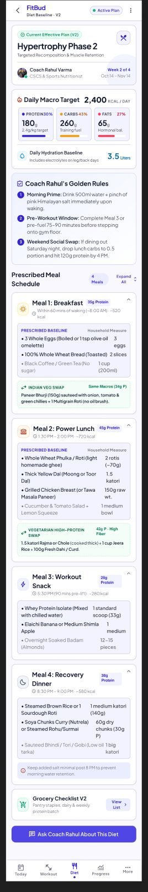
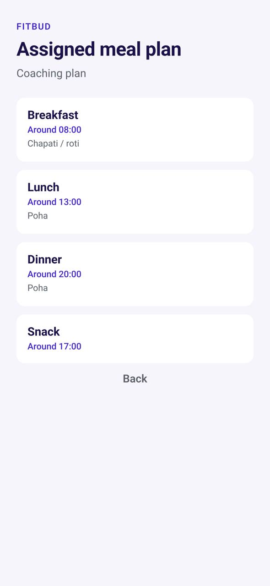

# TR-09 · Assigned meal plan (read-only)

**ID:** TR-09 · **Name:** Assigned meal plan (read-only) · **Priority:** P2 · **Route/screen:** `MealPlan` · **Batch:** M-2 (see `../BATCHES.md`)

**Files to touch:**
- `src/trainee/MealPlanScreen.tsx` [new]
- `apps/mobile/src/trainee/AssignedMealPlanScreen.tsx` (exists)

**API (from the guide):** the effective plan (nutrition content)

**Code status:** the guide says "Figma-only" (no code, or only partial code). Build it to the target. If you find code already in the repo, treat it as unverified legacy.

**Read first:** `../00-foundations.md` · `../01-product-rules.md` · `../02-navigation.md` (routes, IA) · `../03-api-changes.md` · `../05-notifications.md` · `../09-demo-data.md`

---

## (b) Guide section (verbatim)

> **Read every line of this section.** Item 3, **"Legacy (do not keep)"**, describes the OLD UI that you must **REPLACE**. Never preserve or restyle it. Item 4, **"Gaps to close"**, lists what's wrong. The target is item 5 onward. Copied from FitBud UI/UX Implementation Guide v1.2, lines 3031–3059. Changes: the misleading "Status" label is dropped, two subsections are renamed, and image paths point to `../img/`. Nothing else is changed.

<!-- BEGIN VERBATIM TR-09 -->
### TR-09 · Assigned meal plan (read-only)

> **Priority:** P2 · **Screen:** `MealPlan` · **Files:** `src/trainee/MealPlanScreen.tsx` [new] · **API:** the effective plan (nutrition content)

1. **Purpose.** See the whole diet plan: slots, items, servings and swaps the trainer allows (if the plan defines alternatives).
2. **Entry.** Diet › "See full plan", meal card "See details", P-PLAN "See what changed".
3. **Legacy (do not keep).** Figma `trainee_07_assigned_diet_plan.png` (with "Ask Coach" chat and a grocery list, both banned).

   {.phone}

4. **Gaps to close.** Not built. Figma includes banned elements.
5. **Target design.**
   - A day-pattern switcher (Training day / Rest day, or Every day).
   - A **day total** header: "1,850 kcal · P 90 · C 210 · F 55 g" (D25).
   - Slot sections showing the time (the trainee's own time when changed, with "plan 1:30 pm" muted, D24), label, items with servings, instructions, and **kcal per meal** plus P, C and F (with the unknown rule).
   - A **"What changed"** banner after a new version: "From Mon 19 Oct: Dinner now includes paneer instead of chicken."
   - *Ask Rahul* opens TR-18 (WhatsApp).
   - No grocery list, no chat.
6. **States.** Offline: cached. No plan: hidden.
7. **Edge cases.** The diff is computed against the previous effective version (API-NEW `GET /plans/:planId/versions/:vid/diff`, or a client-side diff of the content).
8. **Deep links.** `/plan/diet`.
9. **References.** Trainerize flexible meal planner [R23].
10. **UX decisions.** "What changed" turns a new version into something the trainee can understand. Version numbers are never shown to the trainee.
11. **Implementation.** Content renderer, plus a diff helper in `packages/core`.
12. **Acceptance criteria.**
    - [ ] A read-only plan view.
    - [ ] The diff banner appears after replacement.
    - [ ] kcal per meal and per day are shown.
13. **Priority:** P2.
<!-- END VERBATIM TR-09 -->

---

## (c) Reference images

Open **every** image below before you write code. LEGACY images show what to remove. REFERENCE images show the target or inspiration.

- **REFERENCE: target/inspiration (Figma). Remove every banned element listed in this section and in §1.5** (embedded in the guide section): `figma_trainee_07_assigned_diet_plan.jpg`

  

- **LEGACY: 18 Oct QA capture of the current build at 7f74108 (iPhone 15 profile), do not copy** (Assigned meal plan, aarav.ontrack@demo.fitbud.test): `mobile-qa/TR-09-assigned-meal-plan.jpg`

  

## (d) Acceptance checks (verifiable)

Every check needs a PASS or FAIL line in your report, citing a screenshot in `docs/spec/evidence/`. Cite checks by ID (e.g. `TR-09.3`). Where a QA check restates a guide criterion, both must pass. A check you can't prove is FAIL, not ✅.

1. **TR-09.1** [guide §12] A read-only plan view.
2. **TR-09.2** [guide §12] The diff banner appears after replacement.
3. **TR-09.3** [guide §12] kcal per meal and per day are shown.
4. **TR-09.4** [18 Oct QA] Meal times read "8:00 am", not "Around 08:00".
5. **TR-09.5** [product rule] The banned-strings check (01-product-rules.md §B) finds no match on this screen in any captured state.
6. **TR-09.6** [guide §1.1 DoD] Loading, empty, error, offline and partial states exist as specified in "States" (one evidence screenshot per state, or a named test).

## (e) Observed in 18 Oct QA

These failures were seen on branch `cursor/stage1-foundation-a3da` @ `7f74108`. Fix every one, and prove the fix in the checks above.

- Mobile QA index: the meal list shows "Around 08:00" (24 h time, no am/pm). Use `h:mm am/pm`.

## (f) Demo state to verify

Local stack: web http://localhost:5173 (proxies `/api` to http://127.0.0.1:8787). Expo web runs on :8081 with `EXPO_PUBLIC_SCREEN_CAPTURE=1`. Every demo password is `FitBud-demo-2026`. Reset with `pnpm db:reset` (stop the API first). See `../09-demo-data.md` for all IDs.

- Account **aarav.ontrack@demo.fitbud.test** · route `overlay meal_plan` · 18 Oct capture `fitbud-mobile-shots/ios/TR-09-assigned-meal-plan.png`

## (g) Viewport for evidence

**393×852** (iPhone 15 profile, Expo web or a device). Save it as `docs/spec/evidence/TR-09.png`. Save extra states as `docs/spec/evidence/TR-09--<state>.png` (e.g. `--empty`, `--error`, `--offline`).

