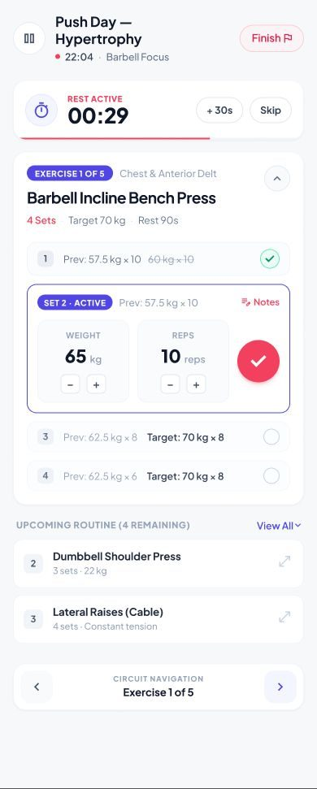
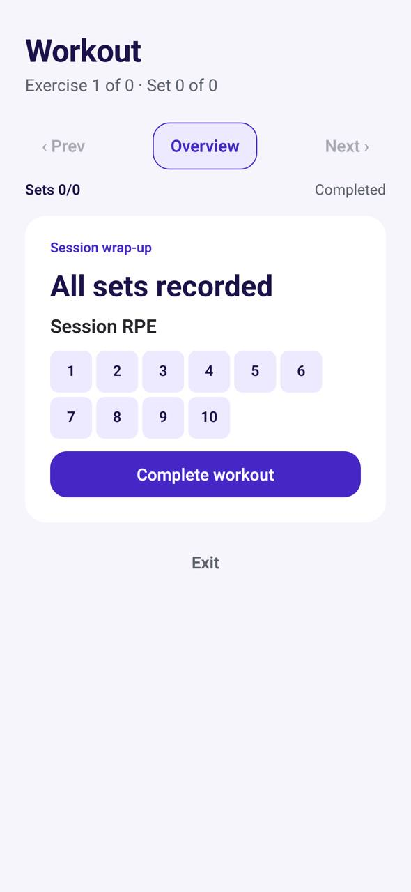

# TR-11 · Active workout

**ID:** TR-11 · **Name:** Active workout · **Priority:** P0 · **Route/screen:** `ActiveWorkout` · **Batch:** M-3 (see `../BATCHES.md`)

**Files to touch:**
- `apps/mobile/src/trainee/ActiveWorkoutScreen.tsx` (exists: old code. Rebuild it to the target; do not patch it)

**API (from the guide):** complete set, skip set, pause, resume, complete session, get execution

**Code status:** old code exists (the guide labelled it "Implemented (needs redesign)"). **That code is LEGACY. Rebuild the screen to the target design below; don't patch the old UI.**

**Read first:** `../00-foundations.md` · `../01-product-rules.md` · `../02-navigation.md` (routes, IA) · `../03-api-changes.md` · `../09-demo-data.md`

---

## (b) Guide section (verbatim)

> **Read every line of this section.** Item 3, **"Legacy (do not keep)"**, describes the OLD UI that you must **REPLACE**. Never preserve or restyle it. Item 4, **"Gaps to close"**, lists what's wrong. The target is item 5 onward. Copied from FitBud UI/UX Implementation Guide v1.2, lines 3095–3155. Changes: the misleading "Status" label is dropped, two subsections are renamed, and image paths point to `../img/`. Nothing else is changed.

<!-- BEGIN VERBATIM TR-11 -->
### TR-11 · Active workout

> **Priority:** P0 · **Screen:** `ActiveWorkout` · **Files:** `src/trainee/ActiveWorkoutScreen.tsx` (Done, Skip set, Pause, Resume, Complete workout, Exit; session RPE text input, required or optional) · **API:** complete set, skip set, pause, resume, complete session, get execution

1. **Purpose.** Log sets fast, with the phone in one hand between sets.
2. **Entry.** Start or Continue, the Live Activity or notification tap.
3. **Legacy (do not keep).**
   - Code: per-set Done and Skip buttons, Pause and Resume, an RPE text input, and refetching the execution after every action (online round trips).
   - Figma `trainee_03_active_workout.png` is a strong reference (big numbers, rest timer).

   {.phone}

4. **Gaps to close.**
   - A network round trip on every set is slow, and fails in the gym basement.
   - No rest timer.
   - No previous values.
   - The RPE text field is awkward.
   - There's no way to change load or reps before marking a set Done.
5. **Target design.**
   - **Header:** session name, elapsed time, a **Pause** icon and ⋯ (Finish early, Ask coach about this exercise).
   - **Current exercise card**, in focus:
     - Name, media thumbnail (tap for the video or GIF if a `LinkedMedia` URL exists), and the trainer note.
     - **Set rows** (`SetRow`): set #, prescribed "10 reps · 20 kg", and **Stepper** inputs prefilled with the prescription (reps and load). The caption shows "Last time: 10 × 17.5 kg".
     - The current set is highlighted, with a big **✓ Done** button (72 dp, indigo).
     - Changing a value before Done marks the set "Modified" (recorded as executed values versus prescribed).
     - Row overflow: *Skip set*.
   - **Rest timer:** starts automatically after Done, using the prescribed rest seconds, or 90 s when unspecified (OQ-18). A ring progress bar with −15 s, +15 s and Skip. A haptic and sound fire at the end, respecting silent mode.
   - **Exercise navigation:** swipe or "Next exercise ›", plus an overview list sheet showing ✓ for completed exercises.
   - **Finish:** "Finish workout" shows **Session RPE** as 1–10 big tappable chips with anchors ("1 · Very easy … 10 · Max effort"). It's required or optional according to configuration. A "How did it feel?" note is optional. Then TR-12.
6. **States.**
   - **Offline-first:** every set action is written locally (outbox) and the UI updates immediately. Sync runs in the background, and the `SyncIndicator` shows its state.
   - App killed mid-session: on reopen, "Continue your workout? Started 6:42 pm" with *Continue* or *Finish now*.
   - Paused: a banner with Resume. Paused time is excluded from the duration.
7. **Edge cases.**
   - Screen stays awake during the session (`expo-keep-awake`).
   - Accidental Done: tapping a completed set offers Undo or Edit.
   - Finishing with skipped or pending sets: "4 sets not logged. Finish anyway?" (they're recorded as skipped or pending, never invented).
8. **Notifications and deep links.**
   - An **ongoing notification or Live Activity** (TR-21) shows the current exercise and the rest timer.
   - `/workout/:id/active`.
9. **References.**
   - Adopt: the Hevy rest timer [R27] https://www.hevyapp.com/features/workout-rest-timer/ and workout log [R29] https://www.hevyapp.com/features/workout-log/
   - Adapt: the Hevy teardown [R30] https://www.tarunrai.com/post/hevy-app-teardown
   - Adapt: Everfit tracking [R9].
10. **UX decisions.**
    - Prefilled steppers plus one big Done button make the normal path a single tap per set.
    - The "Modified" state preserves honesty (decision D: record modifications).
    - Offline-first is mandatory in gyms.
11. **Implementation.**
    - Replace the `api.*` calls with outbox mutations (`set_complete`, `set_skip`, `pause`, `resume`, `session_complete`), each with a client mutation id (`sync_mutations` de-duplicates).
    - Local state comes from SQLite.
    - Previous values: from the local execution history (last execution of the same exercise), API-NEW if it isn't synced.
    - `expo-keep-awake` and `expo-haptics`.
12. **Acceptance criteria.**
    - [ ] Marking a set Done is a single tap, with no network wait (<100 ms UI response).
    - [ ] The rest timer auto-starts.
    - [ ] Modified values are recorded.
    - [ ] The RPE chip picker is shown.
    - [ ] Kill-and-resume works.
    - [ ] Fully usable in airplane mode.
13. **Priority:** P0.
<!-- END VERBATIM TR-11 -->

---

## (c) Reference images

Open **every** image below before you write code. LEGACY images show what to remove. REFERENCE images show the target or inspiration.

- **REFERENCE: target/inspiration (Figma). Remove every banned element listed in this section and in §1.5** (embedded in the guide section): `figma_trainee_03_active_workout.jpg`

  

- **LEGACY: 18 Oct QA capture of the current build at 7f74108 (iPhone 15 profile), do not copy** (Active workout, aarav.ontrack@demo.fitbud.test): `mobile-qa/TR-11-active-workout.jpg`

  

## (d) Acceptance checks (verifiable)

Every check needs a PASS or FAIL line in your report, citing a screenshot in `docs/spec/evidence/`. Cite checks by ID (e.g. `TR-11.3`). Where a QA check restates a guide criterion, both must pass. A check you can't prove is FAIL, not ✅.

1. **TR-11.1** [guide §12] Marking a set Done is a single tap, with no network wait (<100 ms UI response).
2. **TR-11.2** [guide §12] The rest timer auto-starts.
3. **TR-11.3** [guide §12] Modified values are recorded.
4. **TR-11.4** [guide §12] The RPE chip picker is shown.
5. **TR-11.5** [guide §12] Kill-and-resume works.
6. **TR-11.6** [guide §12] Fully usable in airplane mode.
7. **TR-11.7** [18 Oct QA] With an already-completed or empty assignment, the screen shows a clear state ("This workout is already done · View summary"), never "Exercise 1 of 0 · Set 0 of 0".
8. **TR-11.8** [product rule] The banned-strings check (01-product-rules.md §B) finds no match on this screen in any captured state.
9. **TR-11.9** [guide §1.1 DoD] Loading, empty, error, offline and partial states exist as specified in "States" (one evidence screenshot per state, or a named test).

## (e) Observed in 18 Oct QA

These failures were seen on branch `cursor/stage1-foundation-a3da` @ `7f74108`. Fix every one, and prove the fix in the checks above.

- Mobile QA index: broken state "Exercise 1 of 0 · Set 0 of 0", "Sets 0/0". The capture assignment was already completed and no exercises loaded. There's no empty/invalid state handling.

## (f) Demo state to verify

Local stack: web http://localhost:5173 (proxies `/api` to http://127.0.0.1:8787). Expo web runs on :8081 with `EXPO_PUBLIC_SCREEN_CAPTURE=1`. Every demo password is `FitBud-demo-2026`. Reset with `pnpm db:reset` (stop the API first). See `../09-demo-data.md` for all IDs.

- Account **aarav.ontrack@demo.fitbud.test** · route `active workout (capture start)` · 18 Oct capture `fitbud-mobile-shots/ios/TR-11-active-workout.png`

## (g) Viewport for evidence

**393×852** (iPhone 15 profile, Expo web or a device). Save it as `docs/spec/evidence/TR-11.png`. Save extra states as `docs/spec/evidence/TR-11--<state>.png` (e.g. `--empty`, `--error`, `--offline`).

