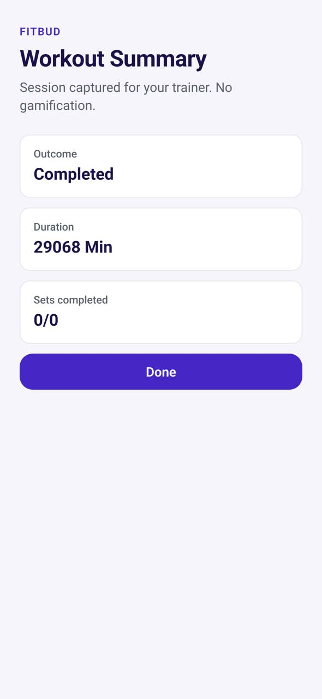

# TR-12 · Workout summary

**ID:** TR-12 · **Name:** Workout summary · **Priority:** P1 · **Route/screen:** `WorkoutSummary` · **Batch:** M-3 (see `../BATCHES.md`)

**Files to touch:**
- `apps/mobile/src/trainee/WorkoutSummaryScreen.tsx` (exists: old code. Rebuild it to the target; do not patch it)

**Code status:** old code exists (the guide labelled it "Implemented"). **That code is LEGACY. Rebuild the screen to the target design below; don't patch the old UI.**

**Read first:** `../00-foundations.md` · `../01-product-rules.md` · `../02-navigation.md` (routes, IA) · `../09-demo-data.md`

---

## (b) Guide section (verbatim)

> **Read every line of this section.** Item 3, **"Legacy (do not keep)"**, describes the OLD UI that you must **REPLACE**. Never preserve or restyle it. Item 4, **"Gaps to close"**, lists what's wrong. The target is item 5 onward. Copied from FitBud UI/UX Implementation Guide v1.2, lines 3157–3183. Changes: the misleading "Status" label is dropped, two subsections are renamed, and image paths point to `../img/`. Nothing else is changed.

<!-- BEGIN VERBATIM TR-12 -->
### TR-12 · Workout summary

> **Priority:** P1 · **Screen:** `WorkoutSummary` · **Files:** `src/trainee/WorkoutSummaryScreen.tsx` (dev copy "Session captured for your trainer. No gamification.")

1. **Purpose.** Close the session with a sense of completion and the coach's presence.
2. **Entry.** Finishing a workout, and the completed workout row.
3. **Legacy (do not keep).** Session RPE and Done, with dev copy.
4. **Gaps to close.** Dev copy. No recap. No weekly context.
5. **Target design.**
   - Title "Workout done", with a subtle coral accent line (the one place coral is allowed near completion).
   - Recap: duration, exercises done (6 of 6), sets done (22 of 24 · 2 skipped), modified sets ("Bench press: 20 kg → 22.5 kg").
   - **This week:** "3 of 4 workouts".
   - "Rahul will see this." Later, a "Coach reviewed" marker appears here if the trainer acknowledges or adds a note (P2).
   - Optional note to coach (stored as a session note, visible to the trainer).
   - Primary: **Done**.
   - No PR badges, no confetti, no share-to-social in MVP.
6. **States.** Offline: "Saved on phone. Will sync when you're online."
7. **Edge cases.** A finish-early summary shows skipped counts plainly.
8. **Deep links.** `/workout/:executionId/summary`.
9. **References.** Hevy workout log [R29] (recap structure). Avoid: gamified badges.
10. **UX decisions.** Use weekly consistency rather than streaks (D13).
11. **Implementation.** Compute from local execution data.
12. **Acceptance criteria.**
    - [ ] No dev copy.
    - [ ] The recap is accurate.
    - [ ] Weekly count shown.
13. **Priority:** P1.
<!-- END VERBATIM TR-12 -->

---

## (c) Reference images

Open **every** image below before you write code. LEGACY images show what to remove. REFERENCE images show the target or inspiration.

- **LEGACY: 18 Oct QA capture of the current build at 7f74108 (iPhone 15 profile), do not copy** (Workout summary, aarav.ontrack@demo.fitbud.test): `mobile-qa/TR-12-workout-summary.jpg`

  

## (d) Acceptance checks (verifiable)

Every check needs a PASS or FAIL line in your report, citing a screenshot in `docs/spec/evidence/`. Cite checks by ID (e.g. `TR-12.3`). Where a QA check restates a guide criterion, both must pass. A check you can't prove is FAIL, not ✅.

1. **TR-12.1** [guide §12] No dev copy.
2. **TR-12.2** [guide §12] The recap is accurate.
3. **TR-12.3** [guide §12] Weekly count shown.
4. **TR-12.4** [18 Oct QA] Duration is plausible and excludes paused time (never thousands of minutes); "Sets completed" is never "0/0" for a finished workout; no dev copy.
5. **TR-12.5** [product rule] The banned-strings check (01-product-rules.md §B) finds no match on this screen in any captured state.
6. **TR-12.6** [guide §1.1 DoD] Loading, empty, error, offline and partial states exist as specified in "States" (one evidence screenshot per state, or a named test).

## (e) Observed in 18 Oct QA

These failures were seen on branch `cursor/stage1-foundation-a3da` @ `7f74108`. Fix every one, and prove the fix in the checks above.

- Mobile QA index: "Duration 29068 Min" (≈20 days) and "Sets completed 0/0" (bogus stub values). `WorkoutSummaryScreen.tsx:30` computes minutes from `startedAt` without bounds, and its subtitle is the banned dev copy "Session captured for your trainer. No gamification."

## (f) Demo state to verify

Local stack: web http://localhost:5173 (proxies `/api` to http://127.0.0.1:8787). Expo web runs on :8081 with `EXPO_PUBLIC_SCREEN_CAPTURE=1`. Every demo password is `FitBud-demo-2026`. Reset with `pnpm db:reset` (stop the API first). See `../09-demo-data.md` for all IDs.

- Account **aarav.ontrack@demo.fitbud.test** · route `workout summary (capture stub)` · 18 Oct capture `fitbud-mobile-shots/ios/TR-12-workout-summary.png`

## (g) Viewport for evidence

**393×852** (iPhone 15 profile, Expo web or a device). Save it as `docs/spec/evidence/TR-12.png`. Save extra states as `docs/spec/evidence/TR-12--<state>.png` (e.g. `--empty`, `--error`, `--offline`).

