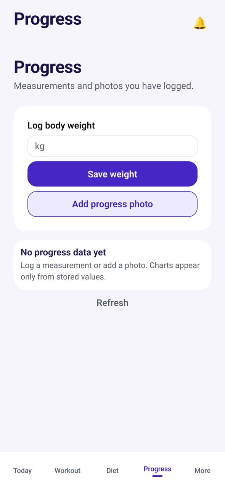

# TR-13 · Progress

**ID:** TR-13 · **Name:** Progress · **Priority:** P1 · **Route/screen:** `Progress` · **Batch:** M-4 (see `../BATCHES.md`)

**Files to touch:**
- `apps/mobile/src/trainee/ProgressTab.tsx` (exists: old code. Rebuild it to the target; do not patch it)

**API (from the guide):** progress summary, measurements, entries, files

**Code status:** old code exists (the guide labelled it "Implemented (no charts)"). **That code is LEGACY. Rebuild the screen to the target design below; don't patch the old UI.**

**Read first:** `../00-foundations.md` · `../01-product-rules.md` · `../02-navigation.md` (routes, IA) · `../03-api-changes.md` · `../09-demo-data.md`

---

## (b) Guide section (verbatim)

> **Read every line of this section.** Item 3, **"Legacy (do not keep)"**, describes the OLD UI that you must **REPLACE**. Never preserve or restyle it. Item 4, **"Gaps to close"**, lists what's wrong. The target is item 5 onward. Copied from FitBud UI/UX Implementation Guide v1.2, lines 3185–3212. Changes: the misleading "Status" label is dropped, two subsections are renamed, and image paths point to `../img/`. Nothing else is changed.

<!-- BEGIN VERBATIM TR-13 -->
### TR-13 · Progress

> **Priority:** P1 · **Screen:** `Progress` · **Files:** `src/trainee/ProgressTab.tsx` (weight input, photo upload, "Photos on file", Refresh) · **API:** progress summary, measurements, entries, files

1. **Purpose.** Log body metrics and photos, and see the trend.
2. **Entry.** Tab, check-in completion.
3. **Legacy (do not keep).** A weight input, photo upload and the text "Charts appear only from stored…".
4. **Gaps to close.** No charts. No measurement types beyond weight. No compare view.
5. **Target design.**
   - **Weight card:** latest value, change since start ("−2.4 kg since 5 Oct"), and a 12-week sparkline. Primary: **Log weight** (a stepper sheet with a default of the last value, plus a date).
   - **Measurements:** waist, hip and chest (only the ones the configuration requires, plus "Add other").
   - **Photos:** a grid by date, *Add photos* (front, side and back guidance with an overlay outline), and *Compare*.
   - Copy is neutral. Weight up is never red. Tip: "Weigh in at the same time each week for a clearer trend."
   - **History across coaches (D21):** charts include every measurement the trainee has ever logged, across past and current coaches. A subtle vertical marker shows where coaching changed ("Started with Rahul · 5 Oct"). **Past coaching** (TR-20) lists earlier relationships, read-only.
6. **States.**
   - Empty: "Your progress will show here. Start with your weight today."
   - Offline logging goes to the outbox. Photo uploads are queued.
7. **Edge cases.** Unit preference. Values that look implausible ("740 kg?") get a confirm prompt. A new coach sees only measurements logged during their relationship. The trainee sees everything (D21).
8. **Deep links.** `/progress`.
9. **References.** Trainerize progress tracking within Client Insights [R17]. Avoid strength-KPI dashboards (deferred).
10. **UX decisions.** Neutral, honest trends support long-term motivation without judgement.
11. **Implementation.** `TrendChart` with `react-native-svg`. Photo privacy: stored in R2 behind signed targets, never shown in notifications.
12. **Acceptance criteria.**
    - [ ] Charts with 2 or more points.
    - [ ] Offline logging.
    - [ ] Compare.
    - [ ] Neutral colours.
13. **Priority:** P1.
<!-- END VERBATIM TR-13 -->

---

## (c) Reference images

Open **every** image below before you write code. LEGACY images show what to remove. REFERENCE images show the target or inspiration.

- **LEGACY: 18 Oct QA capture of the current build at 7f74108 (iPhone 15 profile), do not copy** (Progress, aarav.ontrack@demo.fitbud.test): `mobile-qa/TR-13-progress.jpg`

  

## (d) Acceptance checks (verifiable)

Every check needs a PASS or FAIL line in your report, citing a screenshot in `docs/spec/evidence/`. Cite checks by ID (e.g. `TR-13.3`). Where a QA check restates a guide criterion, both must pass. A check you can't prove is FAIL, not ✅.

1. **TR-13.1** [guide §12] Charts with 2 or more points.
2. **TR-13.2** [guide §12] Offline logging.
3. **TR-13.3** [guide §12] Compare.
4. **TR-13.4** [guide §12] Neutral colours.
5. **TR-13.5** [18 Oct QA] The "Progress" title appears once.
6. **TR-13.6** [18 Oct QA] Pull-to-refresh; no "Refresh" button.
7. **TR-13.7** [product rule] Lists refresh by **pull-to-refresh** (the shared Screen wrapper). There's no manual "Refresh" button.
8. **TR-13.8** [product rule] The banned-strings check (01-product-rules.md §B) finds no match on this screen in any captured state.
9. **TR-13.9** [guide §1.1 DoD] Loading, empty, error, offline and partial states exist as specified in "States" (one evidence screenshot per state, or a named test).

## (e) Observed in 18 Oct QA

These failures were seen on branch `cursor/stage1-foundation-a3da` @ `7f74108`. Fix every one, and prove the fix in the checks above.

- Mobile QA index: the "Progress" title renders twice (top bar plus screen header).
- Code at 7f74108: `ProgressTab.tsx:281` has a manual "Refresh" button.

## (f) Demo state to verify

Local stack: web http://localhost:5173 (proxies `/api` to http://127.0.0.1:8787). Expo web runs on :8081 with `EXPO_PUBLIC_SCREEN_CAPTURE=1`. Every demo password is `FitBud-demo-2026`. Reset with `pnpm db:reset` (stop the API first). See `../09-demo-data.md` for all IDs.

- Account **aarav.ontrack@demo.fitbud.test** · route `tab progress` · 18 Oct capture `fitbud-mobile-shots/ios/TR-13-progress.png`

## (g) Viewport for evidence

**393×852** (iPhone 15 profile, Expo web or a device). Save it as `docs/spec/evidence/TR-13.png`. Save extra states as `docs/spec/evidence/TR-13--<state>.png` (e.g. `--empty`, `--error`, `--offline`).

