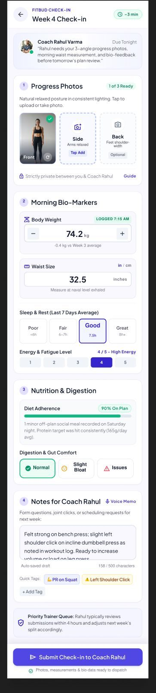
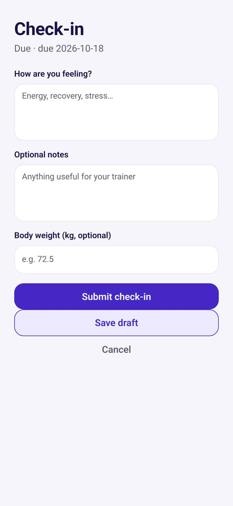

# TR-14 · Check-in

**ID:** TR-14 · **Name:** Check-in · **Priority:** P0 · **Route/screen:** `Checkin` · **Batch:** M-4 (see `../BATCHES.md`)

**Files to touch:**
- `apps/mobile/src/trainee/CheckinScreen.tsx` (exists: old code. Rebuild it to the target; do not patch it)

**API (from the guide):** ensure-due, draft, submit, get check-in (pinned form version)

**Code status:** old code exists (the guide labelled it "Implemented (hard-coded fields)"). **That code is LEGACY. Rebuild the screen to the target design below; don't patch the old UI.**

**Read first:** `../00-foundations.md` · `../01-product-rules.md` · `../02-navigation.md` (routes, IA) · `../03-api-changes.md` · `../05-notifications.md` · `../09-demo-data.md`

---

## (b) Guide section (verbatim)

> **Read every line of this section.** Item 3, **"Legacy (do not keep)"**, describes the OLD UI that you must **REPLACE**. Never preserve or restyle it. Item 4, **"Gaps to close"**, lists what's wrong. The target is item 5 onward. Copied from FitBud UI/UX Implementation Guide v1.2, lines 3214–3262. Changes: the misleading "Status" label is dropped, two subsections are renamed, and image paths point to `../img/`. Nothing else is changed.

<!-- BEGIN VERBATIM TR-14 -->
### TR-14 · Check-in

> **Priority:** P0 · **Screen:** `Checkin` · **Files:** `src/trainee/CheckinScreen.tsx` (Wellbeing, Notes, Body weight; "Check-in submitted / Your trainer can review this when ready.") · **API:** ensure-due, draft, submit, get check-in (pinned form version)

1. **Purpose.** A weekly reflection and measurements for the coach.
2. **Entry.** The Today check-in card, push P-CHK, `/checkin/:id`.
3. **Legacy (do not keep).**
   - Code: three hard-coded fields.
   - Figma `trainee_02_checkin.png` includes sleep and HRV and a "Priority Trainer Queue" (both banned).

   {.phone}

4. **Gaps to close.** Ignores the check-in templates (decision E). No progress through sections. No prefill.
5. **Target design.**
   - **Intro:** "Weekly check-in · takes about 3 min · due Fri 11:59 pm".
   - Then **sections** rendered by `FormRenderer` from the pinned form version:
     1. **Measurements:** weight prefilled with the last value and adjusted with a stepper; waist, if required.
     2. **Photos:** front, side and back slots with guidance, each optional unless required.
     3. **How was your week:** 1–5 scales with labelled anchors (energy, hunger, stress), as defined by the template.
     4. **Reflection:** "What went well?", "What was hard?", "Anything for Rahul?".
   - A **Review** step, then **Send to Rahul**.
   - **After submit:** "Sent. Rahul will review this." There's no review-time promise. A trainer-set review expectation is **out of MVP scope** (D29).
   - **After review:** the screen shows "Rahul reviewed this · Thu", the outcome in trainee-friendly words (Acknowledged → "Reviewed", Needs follow-up → "Rahul will follow up", Adjust coaching → "Rahul is updating your plan"), and **the coach's note when Rahul marked it visible to you** (D20). Private notes never show.
6. **States.**
   - Draft autosave.
   - Offline: the draft is local and submit is queued.
   - Overdue: "This was due yesterday. You can still send it." (no guilt).
   - Not yet due: shows the date and lets the trainee start early (only if the API's ensure-due allows it).
7. **Edge cases.**
   - A measurement creates a linked measurement record (decision E).
   - Photo upload failures don't block submit. They retry on their own.
8. **Notifications and deep links.**
   - P-CHK (due), P-CHK-LATE (once, when overdue), P-CHK-REV (reviewed).
   - `/checkin/:id`.
9. **References.**
   - Everfit forms [R16].
   - Everfit check-in insights [R7].
   - Avoid: Figma's sleep and HRV and the "Priority Trainer Queue".
10. **UX decisions.**
    - Prefill and a time estimate lower the effort.
    - Visible review closes the loop (P10).
11. **Implementation.** Replace the hard-coded fields with `FormRenderer` using the pinned definition from the API. Outbox for the draft and submit.
12. **Acceptance criteria.**
    - [ ] Renders any check-in template version.
    - [ ] Weight is prefilled.
    - [ ] Offline submit works.
    - [ ] The reviewed state shows the outcome, plus the visible note when there is one.
    - [ ] No review-time promise appears anywhere.
13. **Priority:** P0.
<!-- END VERBATIM TR-14 -->

---

## (c) Reference images

Open **every** image below before you write code. LEGACY images show what to remove. REFERENCE images show the target or inspiration.

- **REFERENCE: target/inspiration (Figma). Remove every banned element listed in this section and in §1.5** (embedded in the guide section): `figma_trainee_02_checkin.jpg`

  

- **LEGACY: 18 Oct QA capture of the current build at 7f74108 (iPhone 15 profile), do not copy** (Check-in, aarav.ontrack@demo.fitbud.test): `mobile-qa/TR-14-check-in.jpg`

  

## (d) Acceptance checks (verifiable)

Every check needs a PASS or FAIL line in your report, citing a screenshot in `docs/spec/evidence/`. Cite checks by ID (e.g. `TR-14.3`). Where a QA check restates a guide criterion, both must pass. A check you can't prove is FAIL, not ✅.

1. **TR-14.1** [guide §12] Renders any check-in template version.
2. **TR-14.2** [guide §12] Weight is prefilled.
3. **TR-14.3** [guide §12] Offline submit works.
4. **TR-14.4** [guide §12] The reviewed state shows the outcome, plus the visible note when there is one.
5. **TR-14.5** [guide §12] No review-time promise appears anywhere.
6. **TR-14.6** [18 Oct QA] The subtitle reads like "Due Sun 18 Oct, 11:59 pm", with no duplicated "Due · due" and no ISO.
7. **TR-14.7** [product rule] The banned-strings check (01-product-rules.md §B) finds no match on this screen in any captured state.
8. **TR-14.8** [guide §1.1 DoD] Loading, empty, error, offline and partial states exist as specified in "States" (one evidence screenshot per state, or a named test).

## (e) Observed in 18 Oct QA

These failures were seen on branch `cursor/stage1-foundation-a3da` @ `7f74108`. Fix every one, and prove the fix in the checks above.

- Mobile QA index: subtitle "Due · due 2026-10-18" (duplicated word plus raw ISO).

## (f) Demo state to verify

Local stack: web http://localhost:5173 (proxies `/api` to http://127.0.0.1:8787). Expo web runs on :8081 with `EXPO_PUBLIC_SCREEN_CAPTURE=1`. Every demo password is `FitBud-demo-2026`. Reset with `pnpm db:reset` (stop the API first). See `../09-demo-data.md` for all IDs.

- Account **aarav.ontrack@demo.fitbud.test** · route `tab today › open check-in` · 18 Oct capture `fitbud-mobile-shots/ios/TR-14-check-in.png`

## (g) Viewport for evidence

**393×852** (iPhone 15 profile, Expo web or a device). Save it as `docs/spec/evidence/TR-14.png`. Save extra states as `docs/spec/evidence/TR-14--<state>.png` (e.g. `--empty`, `--error`, `--offline`).

