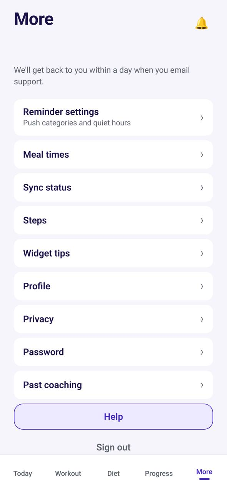

# TR-20 · More: profile and settings

**ID:** TR-20 · **Name:** More: profile and settings · **Priority:** P1 · **Route/screen:** `Profile` / More tab · **Batch:** M-5 (see `../BATCHES.md`)

**Files to touch:**
- `apps/mobile/src/trainee/TraineeShell.tsx` (exists: old code. Rebuild it to the target; do not patch it)
- `apps/mobile/src/trainee/MoreScreen.tsx` (exists: old code. Rebuild it to the target; do not patch it)

**Code status:** old code exists (the guide labelled it "Implemented (placeholder)"). **That code is LEGACY. Rebuild the screen to the target design below; don't patch the old UI.**

**Read first:** `../00-foundations.md` · `../01-product-rules.md` · `../02-navigation.md` (routes, IA) · `../09-demo-data.md`

---

## (b) Guide section (verbatim)

> **Read every line of this section.** Item 3, **"Legacy (do not keep)"**, describes the OLD UI that you must **REPLACE**. Never preserve or restyle it. Item 4, **"Gaps to close"**, lists what's wrong. The target is item 5 onward. Copied from FitBud UI/UX Implementation Guide v1.2, lines 3452–3490. Changes: the misleading "Status" label is dropped, two subsections are renamed, and image paths point to `../img/`. Nothing else is changed.

<!-- BEGIN VERBATIM TR-20 -->
### TR-20 · More: profile and settings

> **Priority:** P1 · **Screen:** `Profile` / More tab · **Files:** `src/trainee/TraineeShell.tsx` More tab (shows userId, "Switch to trainer mode", Sign out) → `src/trainee/MoreScreen.tsx` [new]

1. **Purpose.** Account and preferences.
2. **Entry.** Tab.
3. **Legacy (do not keep).** A placeholder with the userId (dev copy).
4. **Gaps to close.** Not a real settings screen.
5. **Target design.**
   - Rows:
     - **Profile** (name, date of birth, gender, units).
     - **My coach** (Rahul, coaching since 5 Oct, WhatsApp).
     - **Reminders** (TR-16).
     - **Meal times** (TR-24).
     - **Quiet hours** (TR-17).
     - **Time zone** ("India Standard Time · from your phone", with *Change*; D22).
     - **Steps** (TR-25, P2; shown only on devices where Health Connect or HealthKit is available).
     - **Password and sign-in** (change password; the sign-in mobile and email are read-only, with "Ask your coach to update these", D18).
     - **Past coaching** (shown only when there's at least one ended relationship): each past coach with the dates, opening a read-only history of that period (D21).
     - **Language** (English, Hinglish later).
     - **Sync status** (TR-19).
     - **Lock-screen widget** (TR-21 setup tips).
     - **Help**: opens `mailto:tech@thefitbud.com` with the subject "FitBud help · Trainee · v1.4.0 (212)" and a body prefilled with the app version, role, screen ("More"), the device model and the OS version, plus a blank line for the message (D19, §1.6.10). There's no support page. If no mail app is set up, copy the address and show "Email address copied: tech@thefitbud.com". Under the row, the reply promise (D33, §1.6.10): "We'll get back to you within a day." (Hinglish: "Hum ek din ke andar aapko reply karenge.")
     - **Privacy** (what your coach can see; data requests later).
     - **Switch to coach view** (dual-role only).
     - **Sign out**.
   - No user ids.
6. **States.** Standard.
7. **Edge cases.** Ended coaching: "My coach" shows "Coaching ended 3 Oct".
8. **Deep links.** `/settings/profile`.
9. **References.** No strong external reference.
10. **UX decisions.** "What your coach can see" supports trust and DPDP transparency [R60].
11. **Implementation.** `PUT /me/trainee-profile` for date of birth and gender.
12. **Acceptance criteria.**
    - [ ] No dev copy.
    - [ ] All rows navigate.
    - [ ] Help opens a prefilled email.
    - [ ] Past coaching appears only when it applies.
13. **Priority:** P1.
<!-- END VERBATIM TR-20 -->

---

## (c) Reference images

Open **every** image below before you write code. LEGACY images show what to remove. REFERENCE images show the target or inspiration.

- **LEGACY: 18 Oct QA capture of the current build at 7f74108 (iPhone 15 profile), do not copy** (More and profile, aarav.ontrack@demo.fitbud.test): `mobile-qa/TR-20-more-profile.jpg`

  

## (d) Acceptance checks (verifiable)

Every check needs a PASS or FAIL line in your report, citing a screenshot in `docs/spec/evidence/`. Cite checks by ID (e.g. `TR-20.3`). Where a QA check restates a guide criterion, both must pass. A check you can't prove is FAIL, not ✅.

1. **TR-20.1** [guide §12] No dev copy.
2. **TR-20.2** [guide §12] All rows navigate.
3. **TR-20.3** [guide §12] Help opens a prefilled email.
4. **TR-20.4** [guide §12] Past coaching appears only when it applies.
5. **TR-20.5** [18 Oct QA] No large empty gap under the title; the reply promise line sits under Help.
6. **TR-20.6** [product rule] The banned-strings check (01-product-rules.md §B) finds no match on this screen in any captured state.
7. **TR-20.7** [guide §1.1 DoD] Loading, empty, error, offline and partial states exist as specified in "States" (one evidence screenshot per state, or a named test).

## (e) Observed in 18 Oct QA

These failures were seen on branch `cursor/stage1-foundation-a3da` @ `7f74108`. Fix every one, and prove the fix in the checks above.

- Mobile QA index: rows list, with a large empty gap under the "More" title before the support line.

## (f) Demo state to verify

Local stack: web http://localhost:5173 (proxies `/api` to http://127.0.0.1:8787). Expo web runs on :8081 with `EXPO_PUBLIC_SCREEN_CAPTURE=1`. Every demo password is `FitBud-demo-2026`. Reset with `pnpm db:reset` (stop the API first). See `../09-demo-data.md` for all IDs.

- Account **aarav.ontrack@demo.fitbud.test** · route `tab more` · 18 Oct capture `fitbud-mobile-shots/ios/TR-20-more-profile.png`

## (g) Viewport for evidence

**393×852** (iPhone 15 profile, Expo web or a device). Save it as `docs/spec/evidence/TR-20.png`. Save extra states as `docs/spec/evidence/TR-20--<state>.png` (e.g. `--empty`, `--error`, `--offline`).

