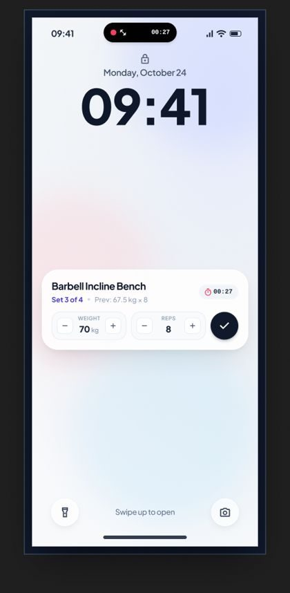
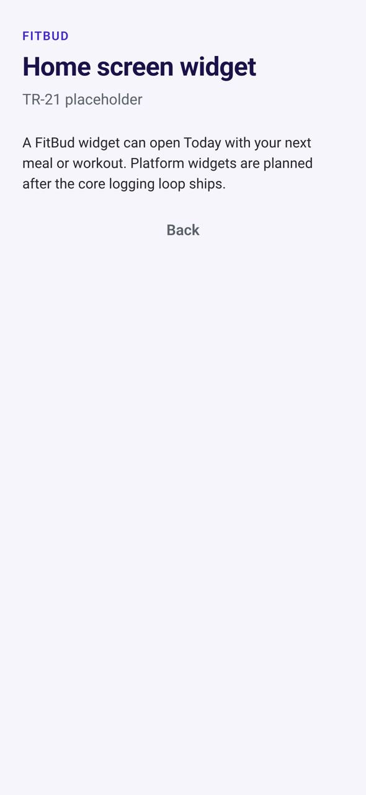

# TR-21 · Lock-screen widget and Live Activity

**ID:** TR-21 · **Name:** Lock-screen widget and Live Activity · **Priority:** P2 · **Route/screen:** — · **Batch:** M-6 (see `../BATCHES.md`)

**Files to touch:**
- `apps/mobile/src/trainee/WidgetTipsScreen.tsx` (placeholder copy)

**Code status:** the guide says "Figma-only" (no code, or only partial code). Build it to the target. If you find code already in the repo, treat it as unverified legacy.

**Read first:** `../00-foundations.md` · `../01-product-rules.md` · `../02-navigation.md` (routes, IA) · `../09-demo-data.md`

---

## (b) Guide section (verbatim)

> **Read every line of this section.** Item 3, **"Legacy (do not keep)"**, describes the OLD UI that you must **REPLACE**. Never preserve or restyle it. Item 4, **"Gaps to close"**, lists what's wrong. The target is item 5 onward. Copied from FitBud UI/UX Implementation Guide v1.2, lines 3492–3520. Changes: the misleading "Status" label is dropped, two subsections are renamed, and image paths point to `../img/`. Nothing else is changed.

<!-- BEGIN VERBATIM TR-21 -->
### TR-21 · Lock-screen widget and Live Activity

> **Priority:** P2 · **Files:** native modules (Android widget, iOS WidgetKit and ActivityKit) via an Expo config plugin [new]

1. **Purpose.** Glanceable "next up" and one-tap meal confirm without opening the app. A live rest timer during workouts.
2. **Entry.** Home or lock screen.
3. **Legacy (do not keep).** Figma `trainee_04_lockscreen_live_activity.png` (it includes "WhatsApp Live Sync" style claims, which are banned).

   {.phone}

4. **Gaps to close.** Not built. Needs native work.
5. **Target design.**
   - **Home widget (small and medium):** "Next: Lunch · 1:30 pm" with an **Eaten as planned** button (Android widgets support buttons; iOS 17+ interactive widgets). The medium size adds "3 of 5 meals today".
   - **During a workout:** an Android ongoing notification (live update style [R55]) and an iOS Live Activity, showing the exercise, set 2 of 4 and the rest timer countdown, with a *Done* button where the platform allows it.
   - **Privacy:** no food names on the lock screen if "Hide details on lock screen" is on (default off; OQ-22).
6. **States.** Not signed in: "Open FitBud to get started." Stale: "Updated 1 h ago".
7. **Edge cases.** Widget actions write to the shared outbox (an App Group on iOS).
8. **Deep links.** Tap opens `/today` or `/workout/:id/active`.
9. **References.**
   - Apple HIG Live Activities [R58] https://developer.apple.com/design/human-interface-guidelines/live-activities and widgets https://developer.apple.com/design/human-interface-guidelines/widgets
   - Android live updates [R55] https://developer.android.com/develop/ui/views/notifications/live-update and app widgets https://developer.android.com/develop/ui/views/appwidgets/overview
   - The Hevy Live Activity [R28] https://www.hevyapp.com/features/live-activity/
10. **UX decisions.** A one-tap confirm from the widget is the shortest possible logging path. It's P2 because of the native cost.
11. **Implementation.** Expo config plugins plus native targets (requires a dev client, which is already a dependency: `expo-dev-client`).
12. **Acceptance criteria.**
    - [ ] The widget shows the next item.
    - [ ] Confirm logs through the outbox.
    - [ ] The workout Live Activity shows the rest timer.
13. **Priority:** P2.
<!-- END VERBATIM TR-21 -->

---

## (c) Reference images

Open **every** image below before you write code. LEGACY images show what to remove. REFERENCE images show the target or inspiration.

- **REFERENCE: target/inspiration (Figma). Remove every banned element listed in this section and in §1.5** (embedded in the guide section): `figma_trainee_04_lockscreen_live_activity.jpg`

  

- **LEGACY: 18 Oct QA capture of the current build at 7f74108 (iPhone 15 profile), do not copy** (Widget tips, aarav.ontrack@demo.fitbud.test): `mobile-qa/TR-21-widget-tips.jpg`

  

## (d) Acceptance checks (verifiable)

Every check needs a PASS or FAIL line in your report, citing a screenshot in `docs/spec/evidence/`. Cite checks by ID (e.g. `TR-21.3`). Where a QA check restates a guide criterion, both must pass. A check you can't prove is FAIL, not ✅.

1. **TR-21.1** [guide §12] The widget shows the next item.
2. **TR-21.2** [guide §12] Confirm logs through the outbox.
3. **TR-21.3** [guide §12] The workout Live Activity shows the rest timer.
4. **TR-21.4** [18 Oct QA] No "TR-21 placeholder" or any screen ID visible.
5. **TR-21.5** [product rule] The banned-strings check (01-product-rules.md §B) finds no match on this screen in any captured state.
6. **TR-21.6** [guide §1.1 DoD] Loading, empty, error, offline and partial states exist as specified in "States" (one evidence screenshot per state, or a named test).

## (e) Observed in 18 Oct QA

These failures were seen on branch `cursor/stage1-foundation-a3da` @ `7f74108`. Fix every one, and prove the fix in the checks above.

- Mobile QA index: the dev placeholder text **"TR-21 placeholder"** is visible (`apps/mobile/src/trainee/WidgetTipsScreen.tsx:12`).

## (f) Demo state to verify

Local stack: web http://localhost:5173 (proxies `/api` to http://127.0.0.1:8787). Expo web runs on :8081 with `EXPO_PUBLIC_SCREEN_CAPTURE=1`. Every demo password is `FitBud-demo-2026`. Reset with `pnpm db:reset` (stop the API first). See `../09-demo-data.md` for all IDs.

- Account **aarav.ontrack@demo.fitbud.test** · route `overlay widget_tips` · 18 Oct capture `fitbud-mobile-shots/ios/TR-21-widget-tips.png`

## (g) Viewport for evidence

**393×852** (iPhone 15 profile, Expo web or a device). Save it as `docs/spec/evidence/TR-21.png`. Save extra states as `docs/spec/evidence/TR-21--<state>.png` (e.g. `--empty`, `--error`, `--offline`).

