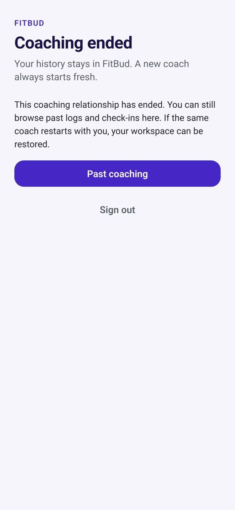

# TR-22 · Ended coaching, reactivation and a new coach

**ID:** TR-22 · **Name:** Ended coaching, reactivation and a new coach · **Priority:** P1 · **Route/screen:** the trainee shell in the ended state; the reactivation confirmation card · **Batch:** M-6 (see `../BATCHES.md`)

**Files to touch:**
- `apps/mobile/src/trainee/EndedCoachingScreen.tsx` (exists)

**API (from the guide):** relationship read; API-NEW `POST /relationships/:rid/reactivate/confirm`

**Code status:** the guide says "Missing" (no code, or only partial code). Build it to the target. If you find code already in the repo, treat it as unverified legacy.

**Read first:** `../00-foundations.md` · `../01-product-rules.md` · `../02-navigation.md` (routes, IA) · `../03-api-changes.md` · `../04-flows.md` (§3.8) · `../05-notifications.md` · `../09-demo-data.md`

---

## (b) Guide section (verbatim)

> **Read every line of this section.** Item 3, **"Legacy (do not keep)"**, describes the OLD UI that you must **REPLACE**. Never preserve or restyle it. Item 4, **"Gaps to close"**, lists what's wrong. The target is item 5 onward. Copied from FitBud UI/UX Implementation Guide v1.2, lines 3522–3559. Changes: the misleading "Status" label is dropped, two subsections are renamed, and image paths point to `../img/`. Nothing else is changed.

<!-- BEGIN VERBATIM TR-22 -->
### TR-22 · Ended coaching, reactivation and a new coach

> **Priority:** P1 · **Where:** the trainee shell in the ended state; the reactivation confirmation card · **API:** relationship read; API-NEW `POST /relationships/:rid/reactivate/confirm` · **Decision:** D21

1. **Purpose.** Tell the trainee clearly that coaching ended, keep their history accessible (decision G), and let them say yes when the same coach wants to restart.
2. **Entry.** App open after the trainer ends coaching, push P-END, and push P-REACT ("Rahul wants to restart coaching with you").
3. **Legacy (do not keep).** Not handled in the UI.
4. **Gaps to close.** Not built.
5. **Target design.**
   - **Ended:**
     - A banner on every tab: "Coaching with Rahul ended on 3 Oct. Your history is still here."
     - Today shows the history summary in place of tasks.
     - Logging is disabled, and reminders stop.
     - More › My coach shows the ended state, and More › Past coaching lists it.
     - "Got an invite from a new coach? Open the link, or *enter a code*" (P1).
   - **Reactivation card** (same coach): "Rahul wants to restart coaching with you."
     - What comes back: "Your history and settings stay as they are. Rahul will send your plan."
     - Primary: **Restart coaching**. Secondary: *Not now*, which keeps the request until it expires in 14 days.
     - If an intake update was requested, the next screen is TR-03 with the previous answers prefilled.
   - **New coach:** accepting a new coach's invite (TR-02) starts a new relationship. The trainee's history (logs, measurements, photos, past check-ins) stays visible to the trainee under Progress and Past coaching. **The new coach sees none of it** and starts blank (D21).
6. **States.** Read-only everywhere while ended. Request expired: "This request has expired. Ask Rahul to send a new one."
7. **Edge cases.**
   - Queued outbox items for the ended relationship are rejected by the server. Show "Couldn't send. Coaching has ended."
   - The trainee has an active coach and gets a reactivation request from a past coach: "You're coaching with Asha right now. Restarting with Rahul will end coaching with Asha." There's a confirm step.
8. **Deep links.** Any `/go/` link opens the read-only item. `/go/reactivate/:requestId` opens the card.
9. **References.** Trainerize deactivate and reactivate [R24].
10. **UX decisions.**
    - Use respectful, clear copy, with no upsell.
    - The trainee's one tap keeps consent with them (OQ-25, default accepted).
    - History belongs to the trainee and follows them. Coaching data belongs to the relationship.
11. **Implementation.** `relationship.status === 'ended'` gates the routing. The reactivation request is a row with a 14-day expiry. Confirming flips the same relationship to `coaching_ready` (§3.8).
12. **Acceptance criteria.**
    - [ ] No logging controls while ended.
    - [ ] Banner shown.
    - [ ] History visible.
    - [ ] Restart coaching restores the same relationship.
    - [ ] A new coach's workspace shows no earlier data, while the trainee still sees all their history.
13. **Priority:** P1.
<!-- END VERBATIM TR-22 -->

---

## (c) Reference images

Open **every** image below before you write code. LEGACY images show what to remove. REFERENCE images show the target or inspiration.

- **LEGACY: 18 Oct QA capture of the current build at 7f74108 (iPhone 15 profile), do not copy** (Ended coaching, nikhil.reactivate@demo.fitbud.test): `mobile-qa/TR-22-ended-coaching--nikhil-reactivate.jpg`

  

- **LEGACY: 18 Oct QA capture of the current build at 7f74108 (iPhone 15 profile), do not copy** (Ended coaching, kavya.ended@demo.fitbud.test): `mobile-qa/TR-22-ended-coaching.jpg`

  

## (d) Acceptance checks (verifiable)

Every check needs a PASS or FAIL line in your report, citing a screenshot in `docs/spec/evidence/`. Cite checks by ID (e.g. `TR-22.3`). Where a QA check restates a guide criterion, both must pass. A check you can't prove is FAIL, not ✅.

1. **TR-22.1** [guide §12] No logging controls while ended.
2. **TR-22.2** [guide §12] Banner shown.
3. **TR-22.3** [guide §12] History visible.
4. **TR-22.4** [guide §12] Restart coaching restores the same relationship.
5. **TR-22.5** [guide §12] A new coach's workspace shows no earlier data, while the trainee still sees all their history.
6. **TR-22.6** [18 Oct QA] nikhil.reactivate sees the reactivation card "Rahul wants to restart coaching with you" with **Restart coaching** and *Not now*.
7. **TR-22.7** [product rule] The banned-strings check (01-product-rules.md §B) finds no match on this screen in any captured state.
8. **TR-22.8** [guide §1.1 DoD] Loading, empty, error, offline and partial states exist as specified in "States" (one evidence screenshot per state, or a named test).

## (e) Observed in 18 Oct QA

These failures were seen on branch `cursor/stage1-foundation-a3da` @ `7f74108`. Fix every one, and prove the fix in the checks above.

- Mobile QA index: Kavya sees Coaching ended + Past coaching (fine). **Nikhil (reactivation pending) shows the same screen with no reactivation card.**

## (f) Demo state to verify

Local stack: web http://localhost:5173 (proxies `/api` to http://127.0.0.1:8787). Expo web runs on :8081 with `EXPO_PUBLIC_SCREEN_CAPTURE=1`. Every demo password is `FitBud-demo-2026`. Reset with `pnpm db:reset` (stop the API first). See `../09-demo-data.md` for all IDs.

- Account **nikhil.reactivate@demo.fitbud.test** · route `ended coaching` · 18 Oct capture `fitbud-mobile-shots/ios/TR-22-ended-coaching--nikhil-reactivate.png`
- Account **kavya.ended@demo.fitbud.test** · route `ended coaching` · 18 Oct capture `fitbud-mobile-shots/ios/TR-22-ended-coaching.png`

## (g) Viewport for evidence

**393×852** (iPhone 15 profile, Expo web or a device). Save it as `docs/spec/evidence/TR-22.png`. Save extra states as `docs/spec/evidence/TR-22--<state>.png` (e.g. `--empty`, `--error`, `--offline`).

