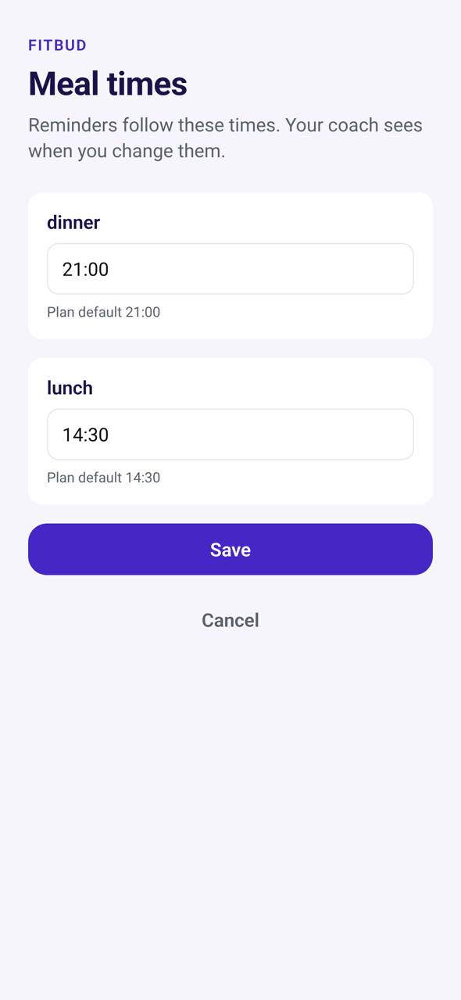
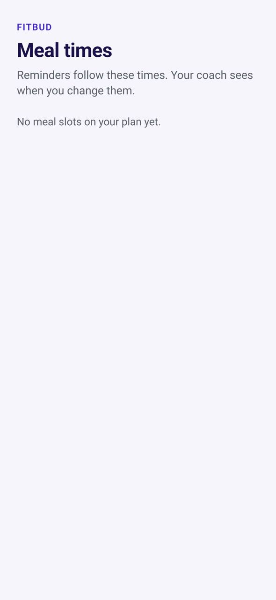

# TR-24 · My meal times

**ID:** TR-24 · **Name:** My meal times · **Priority:** P1 · **Route/screen:** `MealTimes` · **Batch:** M-5 (see `../BATCHES.md`)

**Files to touch:**
- `apps/mobile/src/trainee/settings/MealTimesScreen.tsx` (exists: old code. Rebuild it to the target; do not patch it)

**API (from the guide):** API-NEW `GET/PUT /me/meal-times` (per relationship and slot key)

**Code status:** the guide says "New-proposed" (no code, or only partial code). Build it to the target. If you find code already in the repo, treat it as unverified legacy.

**Read first:** `../00-foundations.md` · `../01-product-rules.md` · `../02-navigation.md` (routes, IA) · `../03-api-changes.md` · `../04-flows.md` (§3.6) · `../05-notifications.md` · `../09-demo-data.md`

---

## (b) Guide section (verbatim)

> **Read every line of this section.** Item 3, **"Legacy (do not keep)"**, describes the OLD UI that you must **REPLACE**. Never preserve or restyle it. Item 4, **"Gaps to close"**, lists what's wrong. The target is item 5 onward. Copied from FitBud UI/UX Implementation Guide v1.2, lines 3598–3640. Changes: the misleading "Status" label is dropped, two subsections are renamed, and image paths point to `../img/`. Nothing else is changed.

<!-- BEGIN VERBATIM TR-24 -->
### TR-24 · My meal times

> **Priority:** P1 · **Screen:** `MealTimes` · **Files:** `src/trainee/settings/MealTimesScreen.tsx` [new] · **API:** API-NEW `GET/PUT /me/meal-times` (per relationship and slot key) · **Decision:** D24

1. **Purpose.** Let the trainee set meal times that match their real day, so reminders and windows fit them. The trainer's plan stays unchanged.
2. **Entry.**
   - More › Meal times.
   - TR-16 "Change".
   - The meal card overflow: *Change this meal's time*.
   - TR-05 last step.
3. **Legacy (do not keep).** None. Meal times come only from the plan.
4. **Gaps to close.** Reminders fire at plan times that may not match the trainee's routine, which causes noise and opt-outs.
5. **Target design.**
   - Title "Your meal times". Subtitle: "Reminders follow these times. Rahul will see that you changed them."
   - A list of the plan's meal slots, for example "Breakfast · 8:00 am", "Lunch · 1:30 pm", "Snack · 5:00 pm" and "Dinner · 8:30 pm". Each row has:
     - the plan time, muted, when changed ("plan 1:30 pm");
     - a time picker (15-minute steps);
     - *Reset to plan*.
   - Applies to: **Every day** (default) or a day-pattern switch when the plan has training and rest day patterns ("Training days / Rest days").
   - **Save** shows the toast "Meal times updated. Rahul has been told." It applies from **today's unlogged meals onward**. Logged meals keep their time.
6. **States.** Saving, offline (saved locally, synced later; reminders rescheduled on sync), error.
7. **Edge cases.**
   - Validation: times must be between 05:00 and 22:00, in slot order (Breakfast before Lunch), and at least 60 minutes apart; otherwise "Lunch needs to be at least an hour after Breakfast."
   - A new plan version with different slots: overrides for slots that still exist (by slot key) carry over. Removed slots drop their override. The trainee gets "Your plan changed. Check your meal times."
   - Quiet hours still win over reminders (TR-17), and the D7 rule (nothing after 22:00) still holds.
   - Windows shift with the time: the due, overdue and logged-late states use the overridden time.
8. **Notifications.**
   - P-MEAL is scheduled from the override time (§3.6, §4.1).
   - The trainer gets an **activity entry** (TW-17, TM-09), the "Custom meal times" indicator (TW-09a, TW-12) and the bell item **T-MEALTIME** ("Priya changed her meal times").
9. **References.** No strong external reference for trainee-owned times within a trainer plan. This is FitBud-specific (decision C: clients own reminder preferences).
10. **UX decisions.**
    - The trainee owns *when*. The trainer owns *what*.
    - Telling the trainer keeps the change visible without asking for permission.
11. **Implementation.**
    - API-NEW table `meal_time_overrides` (relationship_id, slot_key, day_pattern|null, time HH:MM, updated_at) and a history kind `meal_times_changed`.
    - The reminder engine anchor reads the override first (§3.6).
    - The assignment due window is recomputed for today's unlogged meals and future ones.
12. **Acceptance criteria.**
    - [ ] Changing Lunch to 2:30 pm moves today's unlogged Lunch reminder to about 3:10 pm.
    - [ ] The trainer sees the activity entry and the indicator.
    - [ ] Reset to plan works.
    - [ ] The validation rules hold.
13. **Priority:** P1.
<!-- END VERBATIM TR-24 -->

---

## (c) Reference images

Open **every** image below before you write code. LEGACY images show what to remove. REFERENCE images show the target or inspiration.

- **LEGACY: 18 Oct QA capture of the current build at 7f74108 (iPhone 15 profile), do not copy** (My meal times, deepak.dubai@demo.fitbud.test): `mobile-qa/TR-24-my-meal-times--deepak-dubai.jpg`

  

- **LEGACY: 18 Oct QA capture of the current build at 7f74108 (iPhone 15 profile), do not copy** (My meal times, aarav.ontrack@demo.fitbud.test): `mobile-qa/TR-24-my-meal-times.jpg`

  

## (d) Acceptance checks (verifiable)

Every check needs a PASS or FAIL line in your report, citing a screenshot in `docs/spec/evidence/`. Cite checks by ID (e.g. `TR-24.3`). Where a QA check restates a guide criterion, both must pass. A check you can't prove is FAIL, not ✅.

1. **TR-24.1** [guide §12] Changing Lunch to 2:30 pm moves today's unlogged Lunch reminder to about 3:10 pm.
2. **TR-24.2** [guide §12] The trainer sees the activity entry and the indicator.
3. **TR-24.3** [guide §12] Reset to plan works.
4. **TR-24.4** [guide §12] The validation rules hold.
5. **TR-24.5** [18 Oct QA] aarav lists the same meal slots as TR-09 (4 meals); slot labels are title-cased ("Lunch", "Dinner").
6. **TR-24.6** [product rule] The banned-strings check (01-product-rules.md §B) finds no match on this screen in any captured state.
7. **TR-24.7** [guide §1.1 DoD] Loading, empty, error, offline and partial states exist as specified in "States" (one evidence screenshot per state, or a named test).

## (e) Observed in 18 Oct QA

These failures were seen on branch `cursor/stage1-foundation-a3da` @ `7f74108`. Fix every one, and prove the fix in the checks above.

- Mobile QA index: aarav shows **"No meal slots on your plan yet"** although TR-09 shows 4 meals. Deepak's slot labels are lowercase enums "dinner"/"lunch", with only 2 slots.

## (f) Demo state to verify

Local stack: web http://localhost:5173 (proxies `/api` to http://127.0.0.1:8787). Expo web runs on :8081 with `EXPO_PUBLIC_SCREEN_CAPTURE=1`. Every demo password is `FitBud-demo-2026`. Reset with `pnpm db:reset` (stop the API first). See `../09-demo-data.md` for all IDs.

- Account **deepak.dubai@demo.fitbud.test** · route `overlay meal_times` · 18 Oct capture `fitbud-mobile-shots/ios/TR-24-my-meal-times--deepak-dubai.png`
- Account **aarav.ontrack@demo.fitbud.test** · route `overlay meal_times` · 18 Oct capture `fitbud-mobile-shots/ios/TR-24-my-meal-times.png`

## (g) Viewport for evidence

**393×852** (iPhone 15 profile, Expo web or a device). Save it as `docs/spec/evidence/TR-24.png`. Save extra states as `docs/spec/evidence/TR-24--<state>.png` (e.g. `--empty`, `--error`, `--offline`).

