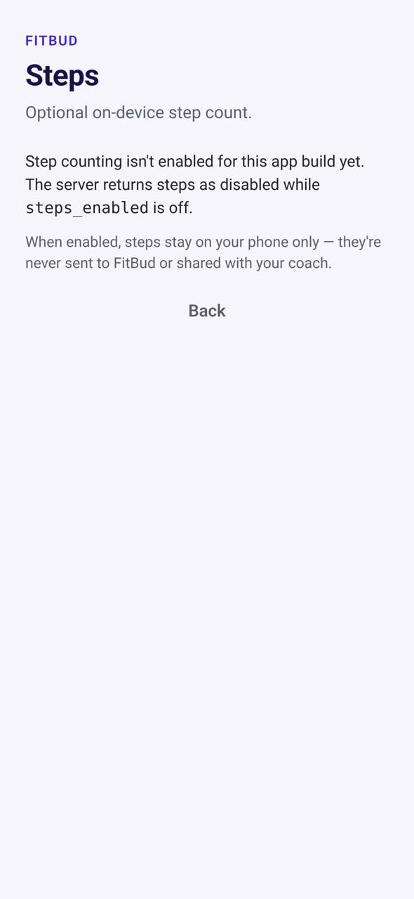

# TR-25 · Steps (optional, Health Connect / HealthKit)

**ID:** TR-25 · **Name:** Steps (optional, Health Connect / HealthKit) · **Priority:** P1 if the spike is Go; otherwise P2, after MVP · **Route/screen:** `StepsSettings` + the TR-06 steps card · **Batch:** M-6 (see `../BATCHES.md`)

**Files to touch:**
- `apps/mobile/src/trainee/steps/StepsCard.tsx` (exists: old code. Rebuild it to the target; do not patch it)
- `apps/mobile/src/trainee/settings/StepsSettingsScreen.tsx`

**API (from the guide):** none (on-device only, never sent to FitBud, never shared with the trainer)

**Code status:** the guide says "New-proposed" (no code, or only partial code). Build it to the target. If you find code already in the repo, treat it as unverified legacy.

**Read first:** `../00-foundations.md` · `../01-product-rules.md` · `../02-navigation.md` (routes, IA) · `../03-api-changes.md` · `../09-demo-data.md`

---

## (b) Guide section (verbatim)

> **Read every line of this section.** Item 3, **"Legacy (do not keep)"**, describes the OLD UI that you must **REPLACE**. Never preserve or restyle it. Item 4, **"Gaps to close"**, lists what's wrong. The target is item 5 onward. Copied from FitBud UI/UX Implementation Guide v1.2, lines 3642–3699. Changes: the misleading "Status" label is dropped, two subsections are renamed, and image paths point to `../img/`. Nothing else is changed.

<!-- BEGIN VERBATIM TR-25 -->
### TR-25 · Steps (optional, Health Connect / HealthKit)

> **Priority:** **MVP (P1) only if the go/no-go spike passes, otherwise after MVP (P2)** · **Screen:** `StepsSettings` + the TR-06 steps card · **Files:** `src/trainee/steps/*` [new] · **API:** none (on-device only, never sent to FitBud, never shared with the trainer) · **Decision:** D27, D35

1. **Purpose.** Show the trainee their daily steps next to the plan, as gentle context.
2. **Entry.** More › Steps (setup), and the TR-06 card once it's connected.
3. **Legacy (do not keep).** None.
4. **Gaps to close.** Not built.
5. **Target design.**
   - **Setup screen:** "See your steps on Today". It explains: "FitBud reads your step count from Health Connect (Android) or Apple Health (iPhone). Steps stay on your phone and aren't shared with Rahul." Primary: **Connect**, which opens the OS permission sheet for **steps, read-only**.
   - **Today card:** "6,240 steps today" with a 7-day mini bar chart. There's no target, no % and no colour judgement.
   - **Disconnect** is in the same settings screen.
6. **States.**
   - Not granted or denied: the Today card is **hidden**, and settings shows "Not connected · Connect".
   - Health Connect not installed (Android 13 and below): "Install Health Connect from Play Store" with a link.
   - No data today: "No steps recorded yet today."
7. **Edge cases.**
   - Permission revoked in OS settings: hide the card on the next foreground.
   - Several sources: use the platform's aggregated total.
8. **Deep links.** `/settings/steps`.
9. **References.**
   - Android Health Connect [R89].
   - Apple HealthKit [R90].
   - The React Native wrappers `react-native-health-connect` and `react-native-health` [R91].
   - The `react-native-health-connect` npm package [R98] https://www.npmjs.com/package/react-native-health-connect
   - `@kingstinct/react-native-healthkit` [R99] https://github.com/kingstinct/react-native-healthkit
   - There's no strong UX reference for a steps card without a target. The design follows P12 (no judgement colours).
10. **UX decisions.**
    - It's optional, on-device only and hidden unless granted, so it adds value without consent or privacy debt.
    - **Never shared with the trainer** (OQ-30, decided 17 Oct), because steps aren't part of the plan contract (Confluence conflict C-10).
11. **Implementation and the go/no-go evaluation (D35).**
    - **Candidate libraries** (checked 17 Oct 2026):

      | Platform | Library | Expo fit | Notes |
      |---|---|---|---|
      | Android | `react-native-health-connect` v4+ [R98] (the matinzd repo [R91]) | **Config plugin built in** since v4 (Aug 2026). The separate `expo-health-connect` package is deprecated and mustn't be installed alongside it. | Needs `expo-build-properties` with **compileSdk and targetSdk 36 and minSdk 26** per its README. That's above Expo 52's defaults, so the spike must prove the bump builds cleanly. It reads the aggregated `Steps` record. |
      | iOS | `@kingstinct/react-native-healthkit` [R99] | **Config plugin** (entitlement plus `NSHealthShareUsageDescription`) | Needs `react-native-nitro-modules`. It uses statistics queries (`cumulativeSum` for step count). It's actively maintained. |
      | iOS (alternative) | `react-native-health` [R91] | Config plugin available | An older API surface. Fall back to it only if the Nitro dependency blocks Expo 52. |

    - **Unavoidable work on either path:**
      - No Expo Go: EAS dev builds only. `expo-dev-client` is already a dependency.
      - Android: the `android.permission.health.READ_STEPS` declaration, a privacy-policy rationale activity (provided by the plugin) and the **Play Console Health Connect permissions declaration** at release.
      - iOS: the HealthKit capability and App Store review of the health-data usage text.
    - **Go/no-go criterion.** Run a **time-boxed spike of at most 2 developer-days in total**. It's **Go for MVP** only if **all** of these hold:
      1. Both libraries install into the current Expo 52 app through config plugins only, with no ejecting and no hand-edited native files. EAS dev builds succeed for both platforms.
      2. The Android SDK bump (compile and target 36) doesn't break any existing dependency build or test.
      3. Today's aggregated step count reads correctly against the platform's own app (within 1%) on at least one Android 14+ device (Pixel or Samsung), one Android device on the OEM list (TR-05), and one iPhone on iOS 17+.
      4. Permission grant, deny and revoke all behave as specified in States, with no crash.
      5. No new background, server or sharing requirement appears.

      If any check fails, it's **No-go**: hide TR-25 for MVP, keep the TR-06 card code path behind `steps_enabled=false`, and revisit after the beta. Record the spike result in the PR description.
    - **Implementation if Go:** `src/trainee/steps/stepsSource.ts` exposes one interface, `getTodaySteps()` and `getLast7Days()`, with an Android implementation and an iOS implementation. Read on foreground only, with no background delivery.
12. **Acceptance criteria.**
    - [ ] The card is hidden without permission.
    - [ ] Steps show after the grant.
    - [ ] No steps data leaves the device, and none appears in any trainer view or API.
    - [ ] The spike result (Go or No-go, against the five checks) is recorded before MVP scope is frozen.
13. **Priority:** P1 if the spike is Go; otherwise P2, after MVP.
<!-- END VERBATIM TR-25 -->

---

## (c) Reference images

Open **every** image below before you write code. LEGACY images show what to remove. REFERENCE images show the target or inspiration.

- **LEGACY: 18 Oct QA capture of the current build at 7f74108 (iPhone 15 profile), do not copy** (Steps, aarav.ontrack@demo.fitbud.test): `mobile-qa/TR-25-steps.jpg`

  

## (d) Acceptance checks (verifiable)

Every check needs a PASS or FAIL line in your report, citing a screenshot in `docs/spec/evidence/`. Cite checks by ID (e.g. `TR-25.3`). Where a QA check restates a guide criterion, both must pass. A check you can't prove is FAIL, not ✅.

1. **TR-25.1** [guide §12] The card is hidden without permission.
2. **TR-25.2** [guide §12] Steps show after the grant.
3. **TR-25.3** [guide §12] No steps data leaves the device, and none appears in any trainer view or API.
4. **TR-25.4** [guide §12] The spike result (Go or No-go, against the five checks) is recorded before MVP scope is frozen.
5. **TR-25.5** [18 Oct QA] No internal flag names (`steps_enabled`) in any copy.
6. **TR-25.6** [product rule] The banned-strings check (01-product-rules.md §B) finds no match on this screen in any captured state.
7. **TR-25.7** [guide §1.1 DoD] Loading, empty, error, offline and partial states exist as specified in "States" (one evidence screenshot per state, or a named test).

## (e) Observed in 18 Oct QA

These failures were seen on branch `cursor/stage1-foundation-a3da` @ `7f74108`. Fix every one, and prove the fix in the checks above.

- Mobile QA index: the copy exposes the internal flag name `steps_enabled` (`apps/mobile/src/trainee/settings/StepsSettingsScreen.tsx:46`).

## (f) Demo state to verify

Local stack: web http://localhost:5173 (proxies `/api` to http://127.0.0.1:8787). Expo web runs on :8081 with `EXPO_PUBLIC_SCREEN_CAPTURE=1`. Every demo password is `FitBud-demo-2026`. Reset with `pnpm db:reset` (stop the API first). See `../09-demo-data.md` for all IDs.

- Account **aarav.ontrack@demo.fitbud.test** · route `overlay steps_settings` · 18 Oct capture `fitbud-mobile-shots/ios/TR-25-steps.png`

## (g) Viewport for evidence

**393×852** (iPhone 15 profile, Expo web or a device). Save it as `docs/spec/evidence/TR-25.png`. Save extra states as `docs/spec/evidence/TR-25--<state>.png` (e.g. `--empty`, `--error`, `--offline`).

