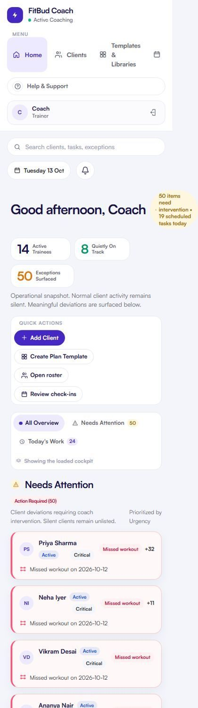

# TW-03 · App shell and navigation

**ID:** TW-03 · **Name:** App shell and navigation · **Priority:** P0 (responsive, navigation order), P1 (bell, palette) · **Route/screen:** all authenticated routes · **Batch:** TW-A (see `../BATCHES.md`)

**Files to touch:**
- `apps/trainer-web/src/layout/AppShell.tsx` (exists: old code. Rebuild it to the target; do not patch it)
- `apps/trainer-web/src/styles.css` (exists: old code. Rebuild it to the target; do not patch it)
- `packages/brand/logo/mark.svg` (Honest Week logo)

**Code status:** old code exists (the guide labelled it "Implemented (needs rework)"). **That code is LEGACY. Rebuild the screen to the target design below; don't patch the old UI.**

**Read first:** `../00-foundations.md` · `../01-product-rules.md` · `../02-navigation.md` (routes, IA) · `../03-api-changes.md` · `../05-notifications.md` · `../09-demo-data.md`

---

## (b) Guide section (verbatim)

> **Read every line of this section.** Item 3, **"Legacy (do not keep)"**, describes the OLD UI that you must **REPLACE**. Never preserve or restyle it. Item 4, **"Gaps to close"**, lists what's wrong. The target is item 5 onward. Copied from FitBud UI/UX Implementation Guide v1.2, lines 753–809. Changes: the misleading "Status" label is dropped, two subsections are renamed, and image paths point to `../img/`. Nothing else is changed.

<!-- BEGIN VERBATIM TW-03 -->
### TW-03 · App shell and navigation

> **Priority:** P0 (responsive) · **Files:** `apps/trainer-web/src/layout/AppShell.tsx`, `styles.css` · **Routes:** all authenticated routes

1. **Purpose.** Gives the trainer persistent orientation, global search and access to the five areas.
2. **Entry.** Every authenticated route.
3. **Legacy (do not keep).**
   - Sidebar order: Home, Clients, Templates & Libraries, Check-ins.
   - "Help & Support" is static text.
   - The bell links to `#attention-heading`.
   - Search goes to `/clients?q=`.
   - A brand lockup "FitBud Coach · Active Coaching" with a live dot.
   - At 390 px the sidebar stacks above the content and "Check-ins" is clipped (`shots/m390_02_home.png`).
   - The sidebar background ends at about 640 px on tall pages.
4. **Gaps to close.**
   - The navigation order and labels don't match UX §5.
   - There's no More or Settings entry.
   - The live dot implies a live status that doesn't exist.
   - The layout isn't responsive.
   - The bell has no notification surface.
5. **Target design.**
   - **Sidebar (≥1280, 240 px, sticky, full height):**
     - Logo.
     - Nav items: Home (badge = active attention count *when the API returns a total*; otherwise no badge), Clients, Check-ins (badge = submitted awaiting review), Templates, More.
     - At the bottom: the trainer's name and initials linking to `/settings/profile`, and **Help**, which opens the support `mailto:tech@thefitbud.com` with the screen context (D19, §1.6.10).
   - **Top bar:**
     - Page title.
     - Global search, which opens a command palette (⌘K or `/`) that searches clients by name and goal through `GET /clients?q=`, with Enter opening the workspace.
     - A **bell** that opens a 360 px popover listing trainer notifications (asked-coach items, check-ins submitted, renewals), each linking by deep link.
   - **Rail (1024–1279):** icons with tooltips.
   - **<768:** a top bar with the title and search icon, plus a **bottom navigation bar** of five items ([R47]).
6. **States.**
   - Offline: a banner at the top of the content area.
   - Counts are hidden while they load. Never show "0" before the data arrives.
7. **Interactions.**
   - Keyboard shortcuts: G then H goes Home, G then C to Clients, G then K to Check-ins, G then T to Templates, `/` focuses search, `?` opens the help sheet.
   - Navigation items show `aria-current="page"`.
8. **Notifications.** The bell popover is the web surface for trainer-side events (§4.3). Mark-read goes through `POST /notifications/:id/read`. The exact path follows the existing "mark read" route in `routes/notifications.ts`.
9. **References.**
   - Adopt: Material 3 navigation rail [R48] https://m3.material.io/components/navigation-rail/overview and navigation bar [R47] https://m3.material.io/components/navigation-bar/guidelines
   - Adopt: the TrueCoach dashboard's left navigation density [R1] https://truecoach.co/features/dashboard/
10. **UX decisions.**
    - The order Home, Clients, Check-ins, Templates, More follows UX §5 and puts daily tasks first.
    - Libraries live under Templates (as a sub-tab), not in the top-level navigation.
    - Remove the "Active Coaching" dot (banned, see §1.5).
11. **Implementation.**
    - Rework `AppShell.tsx` into `Sidebar`, `TopBar`, `BottomNav` and `CommandPalette` components.
    - Use CSS `position: sticky; height: 100dvh` for the sidebar.
    - Breakpoints use container queries or media queries at 768, 1024 and 1280.
    - Bell data: `GET /notifications?audience=trainer` [API-CHG: the list currently serves the recipient's own notifications, so check that trainer-recipient notifications exist for check-in submitted and asked-coach. If they don't, add those types, see §4.3].
12. **Acceptance criteria.**
    - [ ] No horizontal scroll at 360, 390, 768, 1024 or 1440.
    - [ ] The sidebar background fills the full viewport height on long pages.
    - [ ] The navigation order and labels match the target, and More reaches `/settings`.
    - [ ] The command palette finds a client by partial name in under 300 ms after the API responds.
    - [ ] The live dot is removed.
13. **Priority:** P0 (responsive, navigation order), P1 (bell, palette).
<!-- END VERBATIM TW-03 -->

---

## (c) Reference images

Open **every** image below before you write code. LEGACY images show what to remove. REFERENCE images show the target or inspiration.

- **LEGACY: shows old UI, do not copy** (cited by the section or by guide Appendix D): `impl_m390_02_home.jpg`

  

## (d) Acceptance checks (verifiable)

Every check needs a PASS or FAIL line in your report, citing a screenshot in `docs/spec/evidence/`. Cite checks by ID (e.g. `TW-03.3`). Where a QA check restates a guide criterion, both must pass. A check you can't prove is FAIL, not ✅.

1. **TW-03.1** [guide §12] No horizontal scroll at 360, 390, 768, 1024 or 1440.
2. **TW-03.2** [guide §12] The sidebar background fills the full viewport height on long pages.
3. **TW-03.3** [guide §12] The navigation order and labels match the target, and More reaches `/settings`.
4. **TW-03.4** [guide §12] The command palette finds a client by partial name in under 300 ms after the API responds.
5. **TW-03.5** [guide §12] The live dot is removed.
6. **TW-03.6** [QA checklist #1] Sidebar order: **Home · Clients · Check-ins · Templates · More**. It says "Templates", not "Templates & Libraries", and has no separate Libraries item.
7. **TW-03.7** [QA checklist #2] Logo is the four-dot Honest Week mark. **No "Active Coaching" live dot.**
8. **TW-03.8** [QA checklist #3] At the bottom: trainer name and initials (link to `/settings/profile`) and **Help** = `mailto:tech@thefitbud.com…`.
9. **TW-03.9** [QA checklist #4] The sidebar background fills the full viewport height on a long page (scroll `/templates/libraries`).
10. **TW-03.10** [QA checklist #5] Top bar: page title, global search (⌘K or `/` opens a palette that finds "rohan"), and a bell that opens a popover.
11. **TW-03.11** [QA checklist #6] Badges never show "0" while loading. The current nav item has `aria-current="page"`.
12. **TW-03.12** [QA checklist #7] Resize: 1024–1279 → icon rail. <768 (390 px) → top bar plus a 5-item bottom nav, with no horizontal scroll and no clipped "Check-ins" label.
13. **TW-03.13** [QA checklist #8] DevTools → Network → Offline: an offline banner appears at the top of the content.
14. **TW-03.14** [18 Oct QA] The logo is the Honest Week four-dot mark (`packages/brand/logo/mark.svg`: three filled `#1A1248` dots, then an outlined `#FF587D` ring). No `favicon-32.png` glyph, no "FitBud Coach · Active Coaching" lockup.
15. **TW-03.15** [product rule] The banned-strings check (01-product-rules.md §B) finds no match on this screen in any captured state.
16. **TW-03.16** [guide §1.1 DoD] Loading, empty, error, offline and partial states exist as specified in "States" (one evidence screenshot per state, or a named test).

## (e) Observed in 18 Oct QA

These failures were seen on branch `cursor/stage1-foundation-a3da` @ `7f74108`. Fix every one, and prove the fix in the checks above.

- Code at 7f74108: `apps/trainer-web/src/layout/AppShell.tsx:71` still renders "Active Coaching" with a `live-dot`; `:95` still labels the nav item "Templates & Libraries". The brand glyph is `/favicon-32.png`, not the Honest Week mark.
- RCA.md §4: `AppShell.tsx` got +16/−7 lines only; the guide asks for a split into `Sidebar`, `TopBar`, `BottomNav` and `CommandPalette`. It is still the old shell.
- Code fact: no icon library is installed (no `lucide-react` in any package.json); icons are ad-hoc inline SVG components.
- Guide legacy screenshot `impl_m390_02_home` shows the 390 px failure (stacked sidebar, clipped "Check-ins").

## (f) Demo state to verify

Local stack: web http://localhost:5173 (proxies `/api` to http://127.0.0.1:8787). Expo web runs on :8081 with `EXPO_PUBLIC_SCREEN_CAPTURE=1`. Every demo password is `FitBud-demo-2026`. Reset with `pnpm db:reset` (stop the API first). See `../09-demo-data.md` for all IDs.

- **URL:** any signed-in page, e.g. `/checkins` · **Account:** rahul.coach
- `R` = `/clients/c422296e-ed7b-4196-a2b4-647096af3002` (Rohan, slipping)

## (g) Viewport for evidence

**1440×900** (desktop, Chromium). Save it as `docs/spec/evidence/TW-03.png`. This screen has mobile-web rules, so also save **390×844** as `docs/spec/evidence/TW-03-390.png`. Save extra states as `docs/spec/evidence/TW-03--<state>.png` (e.g. `--empty`, `--error`, `--offline`).

