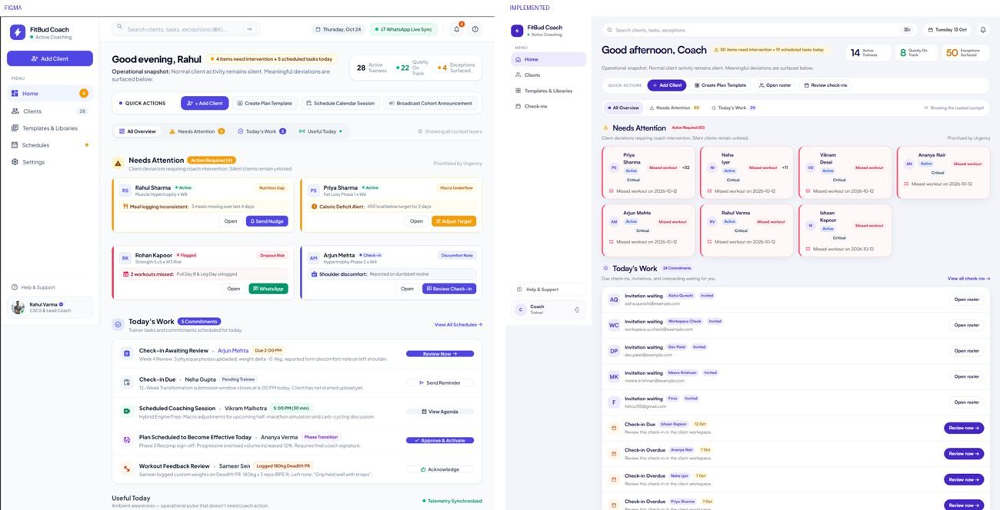
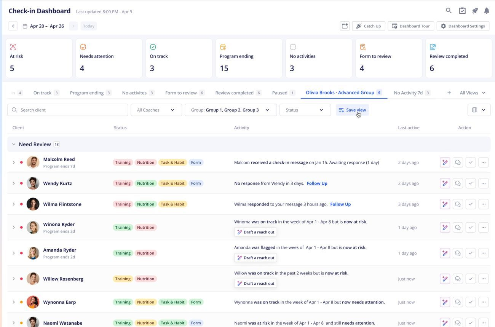
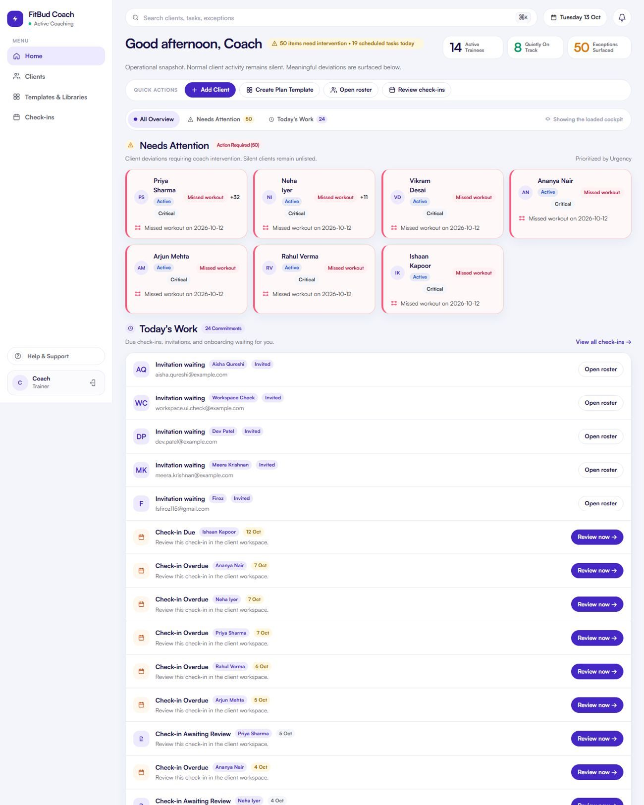
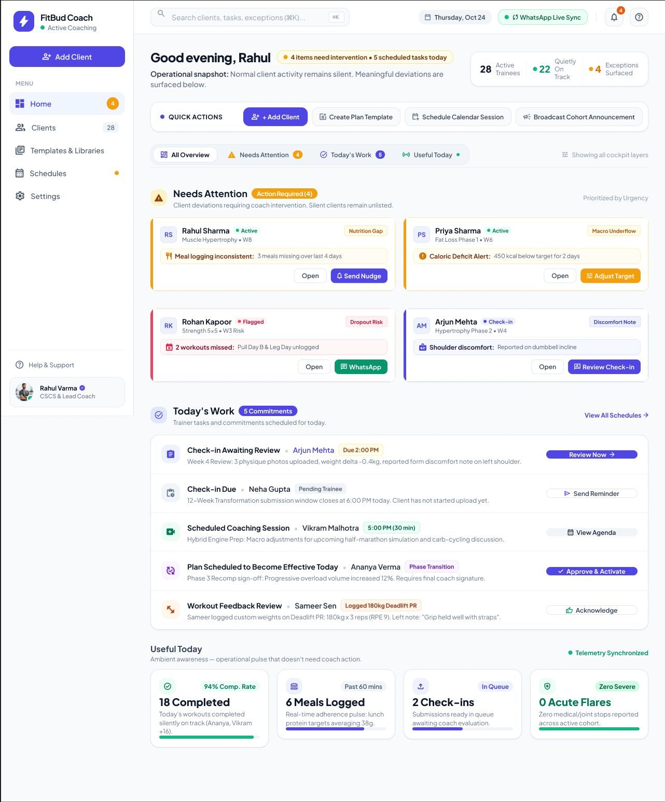
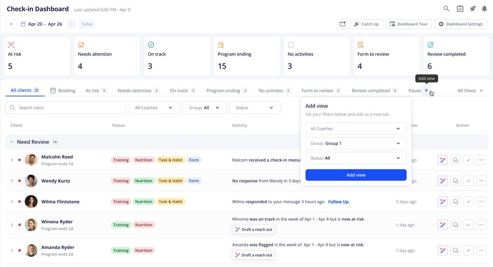

# TW-04 · Home triage

**ID:** TW-04 · **Name:** Home triage · **Priority:** P0 (bounded, grouped, responsive, formatted). P1 (Asked-coach, Re-engage, Renewals) · **Route/screen:** `/` · **Batch:** TW-A (see `../BATCHES.md`)

**Files to touch:**
- `apps/trainer-web/src/pages/HomePage.tsx` (exists: old code. Rebuild it to the target; do not patch it)
- `apps/trainer-web/src/styles/home.css` (exists: old code. Rebuild it to the target; do not patch it)

**API (from the guide):** `GET /exceptions/attention` (limit 50), `GET /subscriptions/attention`, `GET /checkins/inbox` (trainer inbox route), `GET /relationships`, `GET /invitations`, plus `GET /coach-asks?status=open` [API-NEW, see TW-32]

**Code status:** old code exists (the guide labelled it "Implemented (needs rework)"). **That code is LEGACY. Rebuild the screen to the target design below; don't patch the old UI.**

**Read first:** `../00-foundations.md` · `../01-product-rules.md` · `../02-navigation.md` (routes, IA) · `../03-api-changes.md` · `../05-notifications.md` · `../09-demo-data.md`

---

## (b) Guide section (verbatim)

> **Read every line of this section.** Item 3, **"Legacy (do not keep)"**, describes the OLD UI that you must **REPLACE**. Never preserve or restyle it. Item 4, **"Gaps to close"**, lists what's wrong. The target is item 5 onward. Copied from FitBud UI/UX Implementation Guide v1.2, lines 813–940. Changes: the misleading "Status" label is dropped, two subsections are renamed, and image paths point to `../img/`. Nothing else is changed.

<!-- BEGIN VERBATIM TW-04 -->
### TW-04 · Home triage

> **Priority:** P0 · **Route:** `/` · **Files:** `pages/HomePage.tsx`, `styles/home.css` · **API:** `GET /exceptions/attention` (limit 50), `GET /subscriptions/attention`, `GET /checkins/inbox` (trainer inbox route), `GET /relationships`, `GET /invitations`, plus `GET /coach-asks?status=open` [API-NEW, see TW-32]

1. **Purpose and user.** The trainer's first screen each morning, plus quick checks during the day. It answers "who needs me, why, and what do I do next".
2. **Entry.** Sign-in, the navigation, the bell, and push or email links to `/`.
3. **Legacy (do not keep).** `shots/d1440_02_home.png` and `m390_02_home.png`, with the side-by-side in `sbs/home.png`.
   - A greeting, 3 KPI tiles, filter chips (All / Needs Attention 50 / Today's Work 26), then an unbounded list of exception cards (50) with repeated "Active / Critical / Missed workout" pills.
   - The page is about 2,630 px tall and overflows at 390.

   {.shot}

4. **Gaps to close.**
   - It's unbounded: there's no grouping by client and no "View all".
   - There are no Acknowledged, Renewals or Asked-coach groups.
   - Pills repeat on every card.
   - The KPI tiles push the queue down.
   - Figma's version has banned elements: Live Sync, Dropout Risk and % rates.
5. **Target design.**
   - **Header row:**
     - H1 "Today", with the local date in the caption ("Wed, 14 Oct").
     - On the right, three **count tiles** that act as filters: *Needs attention N* · *Check-ins to review N* · *Renewals due N*. Clicking a tile filters the page.
     - Counts come only from API totals or bounded lists. Show "50+" when a list hits its cap.
   - **Sections** in fixed priority order. Needs attention shows up to **8** rows; the other sections show up to 5. Each ends with "View all (N)".
     1. **Needs attention, not yet reviewed: a row list, one row per client (D32).**
        - **Row anatomy**, left to right, in fixed columns so the eye scans straight down:
          1. **Avatar and name**: initials, then "Priya Sharma" (semibold).
          2. **The issue in plain words**: the most severe open reason as a sentence, for example "Missed 2 workouts (Mon, Wed)", "Lunch and Dinner not logged yesterday" or "Check-in 2 days overdue". If the client has more, add "+2 more" in muted text, with the full list in a tooltip.
          3. **One status chip**: the severity, *Critical* or *Attention*, with an icon. Only one chip per row: no lifecycle, adherence or "Active" chips here.
          4. **Age**: "since 2 d", meaning the time since the oldest open item for that client. The absolute date is in the tooltip.
          5. **One primary action**: **Review** (a button), which opens the TW-05 drawer on the most severe item. Secondary actions live in ⋯ (Acknowledge, Nudge, Open client, WhatsApp).
        - **Ordering:** severity (Critical before Attention), then age (oldest first), then name. The ordering is deterministic and shown in the section header's tooltip: "Sorted by severity, then how long it's been open."
        - **Cap:** about **8 rows**, then "View all (23)" opens the full list (`/?group=attention&all=1`), which uses the same rows, is paged and has a filter by severity.
        - **Wireframe (1280 px):**

          ```
          Needs attention · 23                    Sorted: severity, then age (i)
          ┌────────────────────────────────────────────────────────────────────┐
          │ (PS) Priya S.  Missed 2 workouts  +1  [Critical]   3 d  [Review] ⋯ │
          │ (AK) Arjun K.  Check-in 2 d overdue   [Critical]   2 d  [Review] ⋯ │
          │ (NR) Neha R.   Lunch, Dinner missed   [Attention]  1 d  [Review] ⋯ │
          │ …  up to 8 rows                                                    │
          └────────────────────────────────────────────────────────────────────┘
          View all (23) →
          ```

          Rows are 56 px tall with a 1 px divider, and the whole row is a hover target (`surface.hover`). The focused row has a 2 px indigo focus ring. Below 768 px the row wraps to two lines: name plus chip on the first, then issue plus age plus action. It's still a row, not a card.
        - **Keyboard** (WAI-ARIA grid pattern [R96]): the list is one tab stop.
          - ↑ and ↓ (or J and K) move between rows. Home and End jump to the first and last row.
          - Enter opens Review. A acknowledges, with Undo. N nudges. O opens the client. `.` opens the ⋯ menu.
          - Esc closes the drawer and returns focus to the same row.
          - Focus is restored after a refetch.
          - Screen readers hear "Priya Sharma, Critical, missed 2 workouts Monday and Wednesday, plus 1 more, open 3 days. Review button."
     2. **Asked you on WhatsApp** (TW-32). Rows read "Priya asked about *Lunch · Tue*". Primary: **Mark answered**. Overflow: Add note, Open item.
     3. **Check-ins to review.** Shows submitted check-ins awaiting a review, each with **Review** as the primary action.
     4. **Renewals.** Shows upcoming, due and expired renewals as a chip plus the date. Primary: **Open settings**, which opens TW-11. No amounts.
     5. **Reviewed, still open.** Acknowledged exceptions, collapsed by default ("4 reviewed items still open"). Each row shows the `ReviewedMarker`, with **Resolve** as the primary action.
     6. **Getting started.** Pending invitations and onboarding submitted for review, shown compactly. Primary actions: **Review intake** or **Resend invite** (the latter through WhatsApp or by copying the link).
     7. **Re-engage on WhatsApp** (D10, D31). Lists clients with no logs for 2–3 days whose reminders went unanswered.
        - Primary: **Open WhatsApp**, which opens `wa.me` with a **trainer-signed text** prefilled (W-RE-M, §4.2): a text message written as the trainer, which the trainer can edit. **FitBud never sends it.** The trainer presses Send in their own WhatsApp, so it costs nothing. It's text only, with no voice notes.
        - Opening WhatsApp records "Opened WhatsApp · today", so the row stays hidden for 3 days. FitBud can't know whether the message was sent, so it never says "Sent".
        - There's no automated re-engagement message, even when `wa_automation` is on (D31).
        - Max 5 rows.
   - Remove the greeting copy and the separate KPI tile row. The count tiles replace both.
   - **Copy:**
     - Empty all-clear: "You're all caught up. Nothing needs your attention right now."
     - Section empty states are hidden entirely (sections only appear when they have items).
6. **States.**
   - Skeletons per section.
   - A section error shows inline ("Couldn't load check-ins · Retry") while the other sections render.
   - Offline banner.
   - Partial: if the attention feed is capped at 50, show "Showing the 50 most recent. View all" linking to a full list view (`/?group=attention&all=1`).
7. **Interactions and edge cases.**
   - Grouping happens on the client (`traineeDisplayName` plus `relationshipId`) over the first page of attention items.
   - **Acknowledge from the overflow** is optimistic: the row moves to "Reviewed" with an undo toast.
   - Keyboard: J/K, Enter and A.
   - Clients whose relationship has ended never appear.
   - Realtime events are refetch hints only (Tech Arch). Refetch quietly, and keep the scroll position.
8. **Notifications and deep links.**
   - Trainer push and bell items deep-link to `/?exception=:id` (opens the drawer), `/?ask=:id` and `/clients/:rid/check-ins/:cid`.
   - The `/go/exception/:id` resolver maps to these.
9. **References.**
   - Adopt: the TrueCoach "Needs Attention" and "Due Soon" dashboard [R1] https://truecoach.co/features/dashboard/: a client-per-line triage list with the reason and a single action.
   - Adopt: the Everfit check-in dashboard's client-list triage [R6] https://help.everfit.io/en/articles/16000579-check-in-dashboard-manage-your-client-list: a tabular list, one client per row, sortable by status. See the image below.
   - Adapt: the Trainerize Client Insights dashboard [R17] https://help.trainerize.com/hc/en-us/articles/46648417703956-Using-the-Client-Insights-Dashboard. Use its grouping of clients by state; avoid its compliance-% tiles, which are banned here.
   - Adopt: the NN/g definition of cards [R95] https://www.nngroup.com/articles/cards-component/ (cards suit heterogeneous, browsable content, not scanning comparable items) and Material 3 lists and cards [R97].
   - Adopt: the WAI-ARIA Authoring Practices grid pattern and keyboard interface [R96] https://www.w3.org/WAI/ARIA/apg/patterns/grid/

   {.shot}

10. **UX decisions and why.**
    - Grouping by client cuts 50 rows to about 15 and matches how trainers think ("Priya", not "exception 32").
    - **Rows, not cards, for web Needs attention (D32).** The comparison:

      | Criterion | Rows (chosen for web) | Cards |
      |---|---|---|
      | The task | Triage means scanning and **comparing many items of the same shape** to pick the next one. Lists are built for this. | Cards suit **heterogeneous** or browsable content, with each item read on its own [R95]. |
      | Density | About 8 clients in 500 px at 1280 px, with no scroll on a laptop | About 3–4 cards in the same space. The old Home was 2,630 px with 50 cards. |
      | Scannability | Fixed columns: name, issue, chip and age line up vertically, so the eye runs down one column at a time | Fields float inside each card, so the eye zig-zags |
      | Action position | The primary action sits in the same x position on every row, so it's muscle memory | It moves with the card's content height |
      | Visual noise | One chip per row, no borders or shadows per item | Card chrome repeats per item. The implemented version repeated three pills on each card. |
      | Keyboard | A natural grid model (↑↓, Enter) [R96] | Usually tab-through, which is slower |
      | Small screens and touch | Wraps to two lines at < 768 px. Acceptable for web. | **Better on phones:** large tap targets and swipe. **So trainer mobile keeps cards (TM-01).** |
      | Competitors | TrueCoach and Everfit use list or table triage [R1] [R6]. Trainerize groups clients by state [R17]. | Mostly marketing dashboards and the Figma mock (with banned % tiles) |

      The trade-off is less room for rich context (photos, sparklines) in each row. That context is one click away in the TW-05 drawer, which is where the decision is made.
    - One chip per row keeps severity as the only colour signal, which follows P12.
    - Fixed section priority means no sorting decisions for the trainer.
    - Re-engagement as trainer-signed text that the trainer sends themselves keeps WhatsApp outreach deliberate, rare and genuinely from the trainer (D10, D31).
    - The "Reviewed" section is collapsed so acknowledged items stay visible, as the contract requires, without dominating the page.
11. **Implementation.**
    - Split `HomePage.tsx` into `AttentionSection`, `AskSection`, `CheckinSection`, `RenewalSection`, `ReviewedSection`, `GettingStartedSection` and `ReengageSection`.
    - Each section uses its own query hook (independent loading and error).
    - API-NEW: `GET /exceptions/attention?groupBy=relationship` would be ideal (it returns counts per client). Without it, group on the client and show "50+".
    - API-NEW for Re-engage: `GET /notifications/reengagement-candidates`, returning clients with no trainee log for 48 h or more and 3 or more consecutive unanswered reminders, from the responsiveness read model (TW-31).
    - Remove the `limit=50` cards-only rendering.
12. **Acceptance criteria.**
    - [ ] Needs attention is a row list (not cards) with at most 8 rows, then "View all (N)". Other sections show at most 5.
    - [ ] One row per client, with exactly one status chip, ordered by severity, then age, then name.
    - [ ] Each row shows the avatar and name, the issue in plain words, the age and one primary action, in fixed columns.
    - [ ] Keyboard: ↑ and ↓ (and J and K), Enter, A, N, O and Esc work, and focus returns to the row after the drawer closes. axe reports no issues.
    - [ ] Re-engage opens `wa.me` with editable trainer-signed text, and nothing is ever sent by FitBud.
    - [ ] Acknowledge from the overflow moves the row to Reviewed without a page reload, with Undo.
    - [ ] There are no % values, no risk labels and no sync claims.
    - [ ] It works at 390 px with no horizontal scroll.
    - [ ] The Re-engage section never lists a client more than once in 3 days.
    - [ ] Every timestamp is relative, with the absolute time in a tooltip.
13. **Priority:** P0 (bounded, grouped, responsive, formatted). P1 (Asked-coach, Re-engage, Renewals).
<!-- END VERBATIM TW-04 -->

---

## (c) Reference images

Open **every** image below before you write code. LEGACY images show what to remove. REFERENCE images show the target or inspiration.

- **LEGACY + REFERENCE (side by side): left = Figma/Stitch reference for density and hierarchy only (its banned elements, per 00-foundations.md §1.5, must not be built); right = old implemented UI, LEGACY: do not copy** (embedded in the guide section): `sbs_home.jpg`

  

- **REFERENCE: external inspiration (competitor help-centre screenshot)** (embedded in the guide section): `ref_everfit_checkin_dashboard_2.jpg`

  

- **LEGACY: shows old UI, do not copy** (cited by the section or by guide Appendix D): `impl_d1440_02_home.jpg`

  

- **LEGACY: shows old UI, do not copy** (cited by the section or by guide Appendix D): `impl_m390_02_home.jpg`

  

- **REFERENCE: target/inspiration (Figma). Remove every banned element listed in this section and in §1.5** (cited by the section or by guide Appendix D): `figma_trainer_01_home.jpg`

  

- **REFERENCE: external inspiration (competitor help-centre screenshot)** (cited by the section or by guide Appendix D): `ref_everfit_checkin_dashboard_1.jpg`

  

## (d) Acceptance checks (verifiable)

Every check needs a PASS or FAIL line in your report, citing a screenshot in `docs/spec/evidence/`. Cite checks by ID (e.g. `TW-04.3`). Where a QA check restates a guide criterion, both must pass. A check you can't prove is FAIL, not ✅.

1. **TW-04.1** [guide §12] Needs attention is a row list (not cards) with at most 8 rows, then "View all (N)". Other sections show at most 5.
2. **TW-04.2** [guide §12] One row per client, with exactly one status chip, ordered by severity, then age, then name.
3. **TW-04.3** [guide §12] Each row shows the avatar and name, the issue in plain words, the age and one primary action, in fixed columns.
4. **TW-04.4** [guide §12] Keyboard: ↑ and ↓ (and J and K), Enter, A, N, O and Esc work, and focus returns to the row after the drawer closes. axe reports no issues.
5. **TW-04.5** [guide §12] Re-engage opens `wa.me` with editable trainer-signed text, and nothing is ever sent by FitBud.
6. **TW-04.6** [guide §12] Acknowledge from the overflow moves the row to Reviewed without a page reload, with Undo.
7. **TW-04.7** [guide §12] There are no % values, no risk labels and no sync claims.
8. **TW-04.8** [guide §12] It works at 390 px with no horizontal scroll.
9. **TW-04.9** [guide §12] The Re-engage section never lists a client more than once in 3 days.
10. **TW-04.10** [guide §12] Every timestamp is relative, with the absolute time in a tooltip.
11. **TW-04.11** [QA checklist #1] Header: H1 **"Today"** with the local date ("Sun, 18 Oct"), plus 3 count tiles: *Needs attention N · Check-ins to review N · Renewals due N*. Tiles act as filters. **No greeting line and no separate KPI row.**
12. **TW-04.12** [QA checklist #2] **Needs attention is a row list, one row per client** (no duplicate client rows, no cards). Each row: initials avatar plus name, the issue in plain words, "+N more", **one** severity chip (Critical/Attention), age ("since 3 d"), **Review** button, ⋯ menu.
13. **TW-04.13** [QA checklist #3] At most 8 rows, then "View all (N)". Order: Critical before Attention, then oldest first. **Rohan should appear** (he has active critical exceptions).
14. **TW-04.14** [QA checklist #4] ⋯ holds Acknowledge, Nudge, Open client, WhatsApp. Acknowledge moves the row to "Reviewed, still open" with an **Undo** toast and no reload.
15. **TW-04.15** [QA checklist #5] Sections in order, and only when they have items: Asked you on WhatsApp (**Mark answered**) → Check-ins to review → Renewals (chip plus date, **no amounts**, "Open settings") → Reviewed, still open (collapsed, Meera, primary **Resolve**) → Getting started (Sneha "Review intake", Anita "Resend invite") → Re-engage on WhatsApp.
16. **TW-04.16** [QA checklist #6] Re-engage "Open WhatsApp" opens `wa.me` with editable trainer-signed text. Nothing is auto-sent and the row never says "Sent".
17. **TW-04.17** [QA checklist #7] No %, no risk labels, no sync claims. Timestamps are relative, with the absolute time in a tooltip. No raw dates such as "(2026-09-21)" or enum text such as "portion_size".
18. **TW-04.18** [QA checklist #8] Keyboard: ↑/↓ or J/K move rows, Enter opens Review, A acknowledges, Esc closes the drawer and returns focus to the row. At 390 px: no horizontal scroll, and rows wrap to two lines (still rows).
19. **TW-04.19** [18 Oct QA] Rohan, Meera (in Reviewed) and Ishita all appear; Kavya and Nikhil (ended) never do.
20. **TW-04.20** [18 Oct QA] No string matches the banned list (01-product-rules.md §B) on `/`, including "Good to see you", "(2026-", "portion_size" and "Renewal expired · 2026-".
21. **TW-04.21** [product rule] The banned-strings check (01-product-rules.md §B) finds no match on this screen in any captured state.
22. **TW-04.22** [guide §1.1 DoD] Loading, empty, error, offline and partial states exist as specified in "States" (one evidence screenshot per state, or a named test).

## (e) Observed in 18 Oct QA

These failures were seen on branch `cursor/stage1-foundation-a3da` @ `7f74108`. Fix every one, and prove the fix in the checks above.

- Checklist pre-observed: **Home Needs attention showed only Ishita**; Rohan and Meera were missing. Root cause (USAGE.md): `apps/api/src/routes/exceptions.ts:115–150` applies `limit` (default 20, max 50) *before* `groupBy=relationship`; the seed created ~108 overdue-meal items per client, so Ishita's 20 fill the page. `?groupBy=relationship` returns 1 group.
- Checklist pre-observed: H1 is the greeting "Good to see you, rahul coach" (`HomePage.tsx:174`, added by the agent in d8e956c). The guide says H1 "Today" + count tiles and "Remove the greeting copy".
- Checklist pre-observed: raw dates/enums: "Required meal still unlogged: Breakfast (2026-09-21)" (the summary string is built in `packages/core/src/exception.ts:140` with the ISO local date baked in), "Asked about portion_size" (`HomePage.tsx:275` renders `ask.topic` raw), "Renewal expired · 2026-10-15".
- Checklist pre-observed: the age chip read "1m": exceptions are re-detected at API start, so `detected_at` resets. Age must be the age of the oldest open item.
- USAGE.md: the seed has 466 exceptions (up to 120 active per client) and the ended relationships (Kavya, Nikhil) still have 13 active exceptions each; ended clients must never appear on Home.
- USAGE.md: the re-engage `waMeUrl` is built from the trainer's own number (`apps/api/src/domain/responsiveness.ts:183–186`), not the client's.
- RCA.md §3: Home was rebuilt from a one-line prompt summary, not from this section; the agent never read TW-04 or opened `img/sbs_home.jpg`.

## (f) Demo state to verify

Local stack: web http://localhost:5173 (proxies `/api` to http://127.0.0.1:8787). Expo web runs on :8081 with `EXPO_PUBLIC_SCREEN_CAPTURE=1`. Every demo password is `FitBud-demo-2026`. Reset with `pnpm db:reset` (stop the API first). See `../09-demo-data.md` for all IDs.

- **URL:** `/` · **Account:** rahul.coach (Rohan = slipping, Meera = acknowledged, Ishita = push off, Sneha = intake submitted, Anita = pending invite)
- `R` = `/clients/c422296e-ed7b-4196-a2b4-647096af3002` (Rohan, slipping)

## (g) Viewport for evidence

**1440×900** (desktop, Chromium). Save it as `docs/spec/evidence/TW-04.png`. This screen has mobile-web rules, so also save **390×844** as `docs/spec/evidence/TW-04-390.png`. Save extra states as `docs/spec/evidence/TW-04--<state>.png` (e.g. `--empty`, `--error`, `--offline`).

