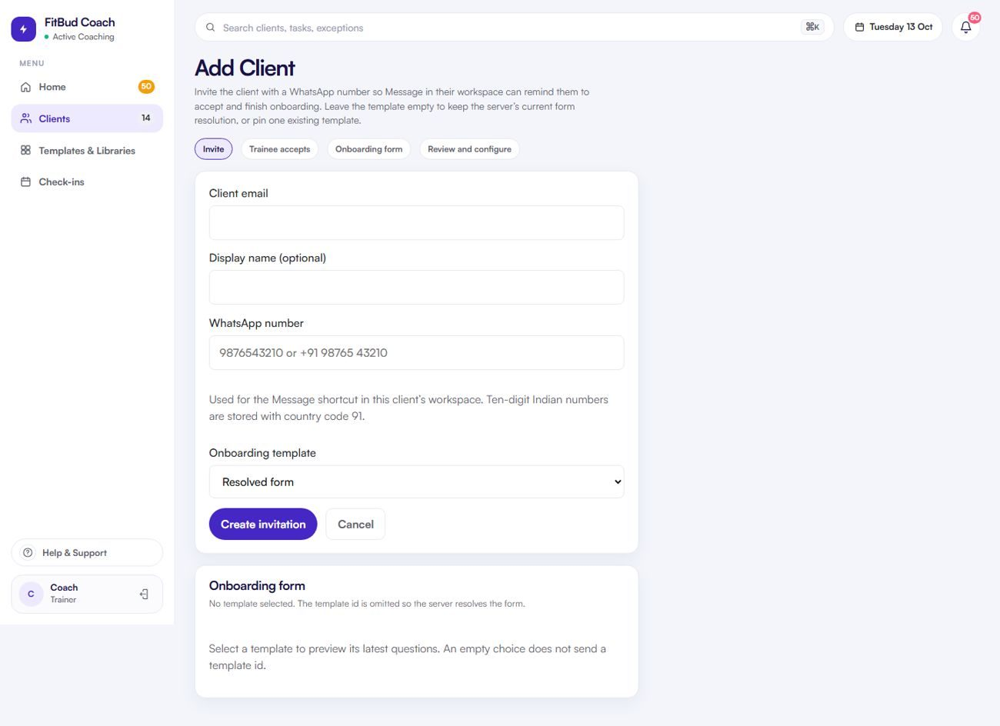

# TW-07 · Add client (invite)

**ID:** TW-07 · **Name:** Add client (invite) · **Priority:** P1 (P0 for the link URL, since the trainee flow depends on it) · **Route/screen:** `/clients/add` (`/clients/new` redirects) · **Batch:** TW-B (see `../BATCHES.md`)

**Files to touch:**
- `apps/trainer-web/src/pages/AddClientPage.tsx` (exists: old code. Rebuild it to the target; do not patch it)

**API (from the guide):** `POST /invitations` (email, displayName, WhatsApp digits, optional `onboardingFormTemplateId`), `GET /onboarding/form-templates`

**Code status:** old code exists (the guide labelled it "Implemented"). **That code is LEGACY. Rebuild the screen to the target design below; don't patch the old UI.**

**Read first:** `../00-foundations.md` · `../01-product-rules.md` · `../02-navigation.md` (routes, IA) · `../03-api-changes.md` · `../05-notifications.md` · `../04-flows.md` (§3.1 Onboarding) · `../09-demo-data.md`

---

## (b) Guide section (verbatim)

> **Read every line of this section.** Item 3, **"Legacy (do not keep)"**, describes the OLD UI that you must **REPLACE**. Never preserve or restyle it. Item 4, **"Gaps to close"**, lists what's wrong. The target is item 5 onward. Copied from FitBud UI/UX Implementation Guide v1.2, lines 1080–1137. Changes: the misleading "Status" label is dropped, two subsections are renamed, and image paths point to `../img/`. Nothing else is changed.

<!-- BEGIN VERBATIM TW-07 -->
### TW-07 · Add client (invite)

> **Priority:** P1 · **Route:** `/clients/add` (`/clients/new` redirects) · **Files:** `pages/AddClientPage.tsx` · **API:** `POST /invitations` (email, displayName, WhatsApp digits, optional `onboardingFormTemplateId`), `GET /onboarding/form-templates`

1. **Purpose.** Invite a client with the right onboarding form.
2. **Entry.** The Clients header, Home "Getting started", the first-run wizard, and the empty roster.
3. **Legacy (do not keep).** `shots/d1440_04_clients_add.png`. A four-step stepper (Invite · Trainee accepts · Onboarding form · Review and configure). Template pinning and a preview of the latest version are present.

   {.shot}

4. **Gaps to close.**
   - After creation there's no share step. The raw token is returned **once** and must be delivered.
   - There's no QR code.
   - There's no invite link URL; the mobile `AcceptInviteScreen` expects a pasted token.
   - The WhatsApp number can't be edited later (a documented gap).
5. **Target design.**
   - **Left column:** the form.
     - Client name.
     - Email (required, because it's one of the two OTP channels and the account email, D18).
     - Mobile / WhatsApp number (+91 prefilled, strongly recommended). Helper: "Your client can sign in with this number, and you can message them on WhatsApp from FitBud." (When the WhatsApp flags are on, the helper adds "…and get sign-in codes and reminders on WhatsApp.") It's stored as the client's sign-in mobile and contact number. It can be edited later (OQ-24 default).
     - Onboarding form: a select with "FitBud standard intake (global)" as the default, plus the trainer's own forms. A "Preview" link opens the trainee-view preview in a modal.
   - **Right column:** a "What happens next" stepper, kept from today.
   - **After submit, a success panel replaces the form:**
     - "Invite ready for Priya".
     - Primary: **Send on WhatsApp**, opening wa.me with the prefilled invite (§4.4 W-INV).
     - The prefill is **trainer-signed text** that the trainer can edit. FitBud never sends it on the trainer's behalf (D31).
     - Secondary: **Copy invite link**, **Email invite** (E-INV, sent from `SYSTEM_EMAIL_FROM`, D30) and a **QR code** (for in-person gym sign-up).
     - A note: "This link works once and expires in 14 days. Your client will set a password when they join."
     - A link to "Invite another client".
6. **States.**
   - Submitting.
   - A duplicate active invite for the same email: "Priya already has a pending invite · Resend instead".
   - **The email or mobile belongs to a client you coached before** (ended relationship with you): "Priya coached with you until 3 Oct. Reactivate instead? Her history and your notes come back." The primary action becomes **Reactivate**, which runs the TW-30 flow (D21).
   - The client is currently coached by another trainer: "This client already has an active coach." The invite is still created. On acceptance the trainee is asked to end the other coaching first (one active relationship, decision G).
   - A validation error appears inline.
   - Offline: disabled.
7. **Edge cases.**
   - Losing the token: if the trainer navigates away before sharing, TW-08 offers "Create a new link" (API-NEW: re-issue the token, invalidating the old one).
   - With no WhatsApp number, only Copy, Email invite and QR are offered.
8. **Deep links.** The invite link is `https://{appHost}/i/{token}` [API-NEW host, OQ-2]. It opens the app if installed (TR-02); otherwise a web landing page with store links that carries the token through install (deferred deep link, or manual paste as a fallback).
9. **References.**
   - Adopt: the Everfit public client invite link [R14] https://help.everfit.io/en/articles/5369004-public-client-invite-link
   - Adapt: Trainerize "How to add clients" [R19] https://help.trainerize.com/hc/en-us/articles/208689066-How-To-Add-Clients-To-ABC-Trainerize
   - Reference: WhatsApp click to chat [R41] https://faq.whatsapp.com/5913398998672934/?locale=en_US
10. **UX decisions.**
    - Most Indian trainers onboard over WhatsApp, so sending the link is the primary action after create.
    - The QR code covers walk-in gym clients.
11. **Implementation.**
    - Add `InviteShareCard` in `components/invite/`.
    - Build the wa.me link with the shared `packages/core/src/whatsapp.ts` helper.
    - Generate the QR code client-side, for example with `qrcode` (an npm package).
    - API-NEW: return an `inviteUrl` (built on the server from a configured host) instead of making the client concatenate it.
12. **Acceptance criteria.**
    - [ ] After create, the trainer can send the invite on WhatsApp in one click, and the message contains the link.
    - [ ] Copy link and QR code work.
    - [ ] A duplicate email is handled.
    - [ ] Template pinning is unchanged.
13. **Priority:** P1 (P0 for the link URL, since the trainee flow depends on it).
<!-- END VERBATIM TW-07 -->

---

## (c) Reference images

Open **every** image below before you write code. LEGACY images show what to remove. REFERENCE images show the target or inspiration.

- **LEGACY: shows old UI, do not copy** (embedded in the guide section): `impl_d1440_04_clients_add.jpg`

  

## (d) Acceptance checks (verifiable)

Every check needs a PASS or FAIL line in your report, citing a screenshot in `docs/spec/evidence/`. Cite checks by ID (e.g. `TW-07.3`). Where a QA check restates a guide criterion, both must pass. A check you can't prove is FAIL, not ✅.

1. **TW-07.1** [guide §12] After create, the trainer can send the invite on WhatsApp in one click, and the message contains the link.
2. **TW-07.2** [guide §12] Copy link and QR code work.
3. **TW-07.3** [guide §12] A duplicate email is handled.
4. **TW-07.4** [guide §12] Template pinning is unchanged.
5. **TW-07.5** [QA checklist #1] Left: form with Client name, Email (required), Mobile/WhatsApp (+91 prefilled) with helper "Your client can sign in with this number, and you can message them on WhatsApp from FitBud." Onboarding form select with default "FitBud standard intake (global)"/"Default onboarding", plus **Preview**.
6. **TW-07.6** [QA checklist #2] Right: a "What happens next" stepper.
7. **TW-07.7** [QA checklist #3] Submit with a new test email: a success panel replaces the form, "Invite ready for <name>".
8. **TW-07.8** [QA checklist #4] Primary **Send on WhatsApp** opens `wa.me` with editable invite text that contains the link (not auto-sent). Secondary: **Copy invite link**, **Email invite**, **QR code**.
9. **TW-07.9** [QA checklist #5] Note: "This link works once and expires in 14 days. Your client will set a password when they join." Plus "Invite another client".
10. **TW-07.10** [QA checklist #6] Using `anita.invite@demo.fitbud.test` again shows the duplicate state ("…already has a pending invite · Resend instead"). Using `kavya.ended@demo.fitbud.test` should offer **Reactivate** instead.
11. **TW-07.11** [QA checklist #7] No WhatsApp OTP or automation promise in the helper while the flags are off.
12. **TW-07.12** [product rule] The banned-strings check (01-product-rules.md §B) finds no match on this screen in any captured state.
13. **TW-07.13** [guide §1.1 DoD] Loading, empty, error, offline and partial states exist as specified in "States" (one evidence screenshot per state, or a named test).

## (e) Observed in 18 Oct QA

These failures were seen on branch `cursor/stage1-foundation-a3da` @ `7f74108`. Fix every one, and prove the fix in the checks above.

- No screen-specific failure recorded. RCA.md: most trainer-web screens FAIL or are PARTIAL, so treat this one as not to spec until proven.

## (f) Demo state to verify

Local stack: web http://localhost:5173 (proxies `/api` to http://127.0.0.1:8787). Expo web runs on :8081 with `EXPO_PUBLIC_SCREEN_CAPTURE=1`. Every demo password is `FitBud-demo-2026`. Reset with `pnpm db:reset` (stop the API first). See `../09-demo-data.md` for all IDs.

- **URL:** `/clients/add` (`/clients/new` should redirect here) · **Account:** rahul.coach
- `R` = `/clients/c422296e-ed7b-4196-a2b4-647096af3002` (Rohan, slipping)

## (g) Viewport for evidence

**1440×900** (desktop, Chromium). Save it as `docs/spec/evidence/TW-07.png`. Save extra states as `docs/spec/evidence/TW-07--<state>.png` (e.g. `--empty`, `--error`, `--offline`).

