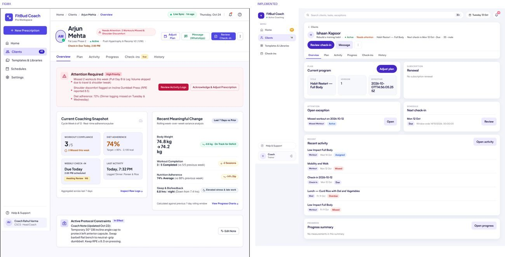
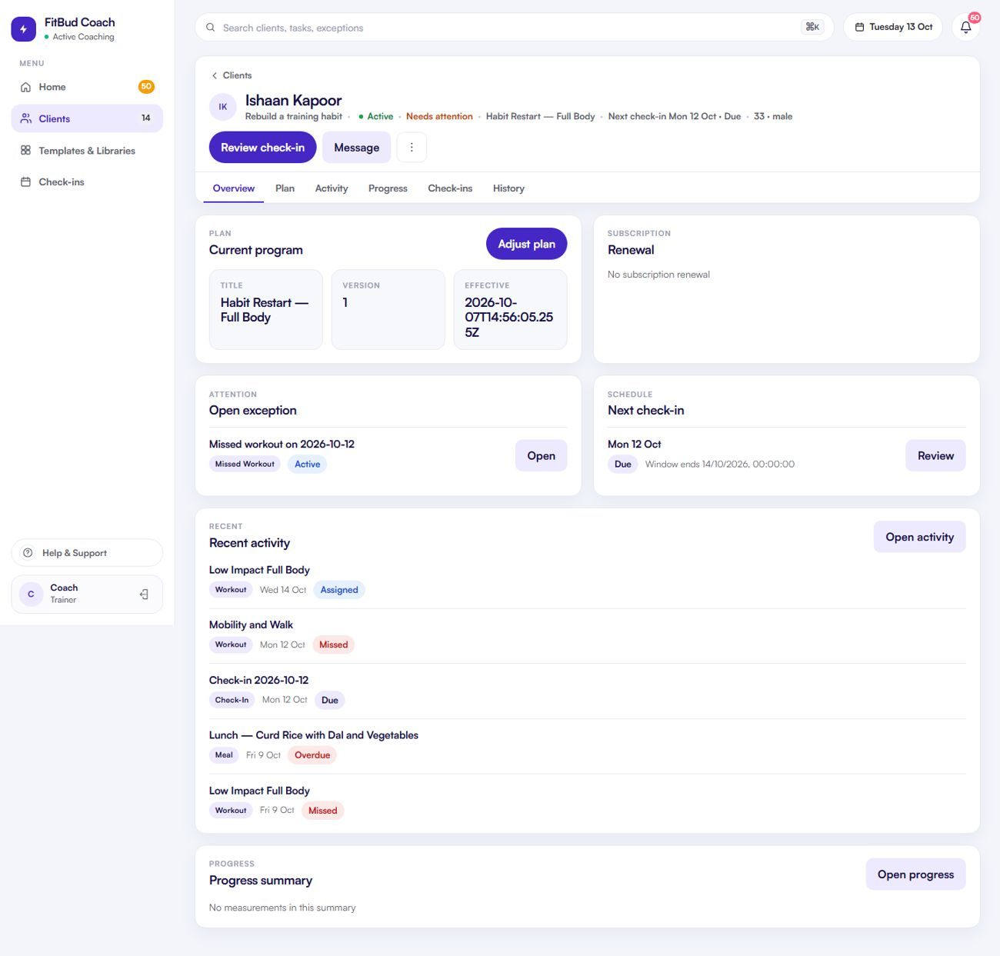
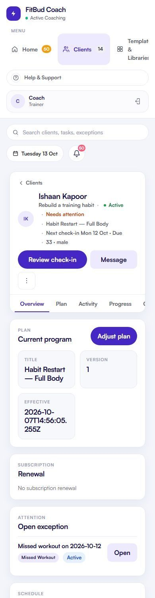
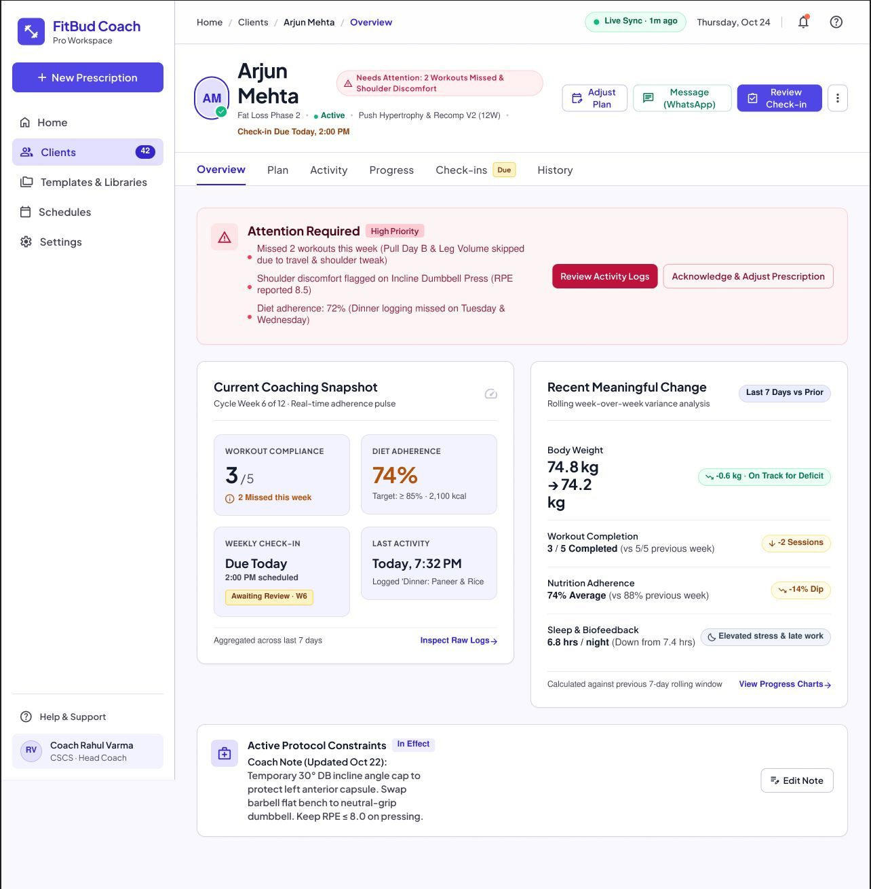
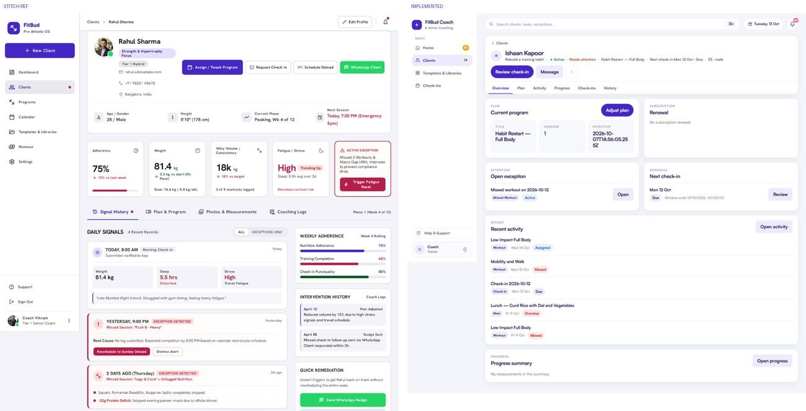

# TW-09 · Client overview

**ID:** TW-09 · **Name:** Client overview · **Priority:** P0 (formatting, hierarchy), P1 (week card, reminders card) · **Route/screen:** `/clients/:rid` and `/clients/:rid/overview` · **Batch:** TW-C (see `../BATCHES.md`)

**Files to touch:**
- `apps/trainer-web/src/pages/ClientOverviewPage.tsx` (exists: old code. Rebuild it to the target; do not patch it)

**API (from the guide):** the workspace read (overview: plan, renewal, one open exception, next check-in, ≤5 recent activity, progress summary)

**Code status:** old code exists (the guide labelled it "Implemented (needs rework)"). **That code is LEGACY. Rebuild the screen to the target design below; don't patch the old UI.**

**Read first:** `../00-foundations.md` · `../01-product-rules.md` · `../02-navigation.md` (routes, IA) · `../03-api-changes.md` · `../09-demo-data.md`

---

## (b) Guide section (verbatim)

> **Read every line of this section.** Item 3, **"Legacy (do not keep)"**, describes the OLD UI that you must **REPLACE**. Never preserve or restyle it. Item 4, **"Gaps to close"**, lists what's wrong. The target is item 5 onward. Copied from FitBud UI/UX Implementation Guide v1.2, lines 1225–1270. Changes: the misleading "Status" label is dropped, two subsections are renamed, and image paths point to `../img/`. Nothing else is changed.

<!-- BEGIN VERBATIM TW-09 -->
### TW-09 · Client overview

> **Priority:** P0 · **Route:** `/clients/:rid` and `/clients/:rid/overview` · **Files:** `pages/ClientOverviewPage.tsx` · **API:** the workspace read (overview: plan, renewal, one open exception, next check-in, ≤5 recent activity, progress summary)

1. **Purpose.** A one-screen "how is this client doing and what's next".
2. **Entry.** Roster, Home, search.
3. **Legacy (do not keep).** `shots/d1440_10_client1_overview.png`, `m390_10_client1_overview.png`. Equal-weight tiles. Raw ISO text "2026-10-07T14:56:05.25Z" and "Window ends 14/10/2026, 00:00:00".

   {.shot}

4. **Gaps to close.** No visual priority. Raw timestamps. No weekly consistency. No reminder responsiveness. No asked-coach items. No trainer note.
5. **Target design.** A two-column grid at ≥1024 (8/4), one column below that.
   - **Left column (8):**
     1. **Needs attention** card, only when it applies: the one open exception (contract: show one, not a counted backlog), using the `ReasonLine`, a severity chip and *Review*, which opens the TW-05 drawer.
     2. **This week** card: `WeeklyConsistency` dots, "3 of 4 workouts · 17 of 21 meals · Check-in due Fri". Counts, never %. Under the dots is a compact **Today's nutrition** line in the client's day: "1,240 / 1,850 kcal · P 62/90 g · C 140/210 g · F 38/55 g", with "≥" when there are unknown values. It uses the same totals as the trainee rings (D25, D28).
     3. **Recent activity:** up to 5 rows (logged, changed, skipped, logged late, missed), each with a status chip and relative time, plus "View all activity".
   - **Right column (4):**
     1. **Next check-in** (date, form name, *Open*).
     2. **Plan** (title, "Effective since Mon 5 Oct", version caption "v3", *Open plan*). When the trainee has changed meal times: "Priya changed 2 meal times · Lunch 1:30 → 2:30 pm" (D24).
     3. **Reminders** (TW-31 summary line: "Responds to reminders · 5 of 7 this week" or "Reminders paused by client", with *Details*).
     4. **Progress** (latest weight and change since start, with a sparkline when ≥2 points; otherwise "No weigh-ins yet").
     5. **Renewal** (chip and date, only when not current).
     6. **Coach notes** (latest 3 notes, each with a "Private" or "Visible to client" badge, plus *Add note*, which opens TW-34 with the visibility switch, D20).
6. **States.**
   - Each card loads independently.
   - Empty plan: "No plan yet · Set up plan".
   - Empty activity: "No activity logged yet. Activity appears once Priya starts logging."
   - Not available (coaching not ready): replace the left column with a guided "Next step" card (Review intake or Configure coaching).
7. **Interactions.** Card titles link to their tab. Everything else is read-only here.
8. **Deep links.** `/go/client/:rid`.
9. **References.**
   - Adapt: the Trainerize Client Insights layout [R17] https://help.trainerize.com/hc/en-us/articles/46648417703956-Using-the-Client-Insights-Dashboard, using its grouping only and **not** its % scores.
   - Adopt: Figma's overview card density (`screens/trainer_05_client_overview.png`) once the banned metrics are removed.
10. **UX decisions.** Ordering attention, then this week, then activity answers "is there a problem, how's the week, what happened". Static plan info moves to the side.
11. **Implementation.**
    - Split into `OverviewAttentionCard`, `WeekCard`, `RecentActivityCard`, `SideCards`.
    - Weekly consistency needs API-NEW `GET /workspaces/relationships/:rid/week?start=YYYY-MM-DD` returning `{workouts:{assigned,completed}, meals:{assigned,logged}, days:[{date, state}]}`, or derive it from the activity pages. A server read model is preferred so trainee and trainer always agree.
    - Use `format.ts` for every date.
12. **Acceptance criteria.**
    - [ ] No raw ISO.
    - [ ] The attention card is first when present.
    - [ ] Weekly counts match the trainee TR-06 numbers for the same week.
    - [ ] Today's kcal and macros match the trainee rings for the same day.
    - [ ] No % anywhere.
    - [ ] Single column at 390.
13. **Priority:** P0 (formatting, hierarchy), P1 (week card, reminders card).
<!-- END VERBATIM TW-09 -->

---

## (c) Reference images

Open **every** image below before you write code. LEGACY images show what to remove. REFERENCE images show the target or inspiration.

- **LEGACY + REFERENCE (side by side): left = Figma/Stitch reference for density and hierarchy only (its banned elements, per 00-foundations.md §1.5, must not be built); right = old implemented UI, LEGACY: do not copy** (embedded in the guide section): `sbs_overview.jpg`

  

- **LEGACY: shows old UI, do not copy** (cited by the section or by guide Appendix D): `impl_d1440_10_client1_overview.jpg`

  

- **LEGACY: shows old UI, do not copy** (cited by the section or by guide Appendix D): `impl_m390_10_client1_overview.jpg`

  

- **REFERENCE: target/inspiration (Figma). Remove every banned element listed in this section and in §1.5** (cited by the section or by guide Appendix D): `figma_trainer_05_client_overview.jpg`

  

- **LEGACY + REFERENCE (side by side): left = Figma/Stitch reference for density and hierarchy only (its banned elements, per 00-foundations.md §1.5, must not be built); right = old implemented UI, LEGACY: do not copy** (cited by the section or by guide Appendix D): `sbs_client_detail_stitch.jpg`

  

## (d) Acceptance checks (verifiable)

Every check needs a PASS or FAIL line in your report, citing a screenshot in `docs/spec/evidence/`. Cite checks by ID (e.g. `TW-09.3`). Where a QA check restates a guide criterion, both must pass. A check you can't prove is FAIL, not ✅.

1. **TW-09.1** [guide §12] No raw ISO.
2. **TW-09.2** [guide §12] The attention card is first when present.
3. **TW-09.3** [guide §12] Weekly counts match the trainee TR-06 numbers for the same week.
4. **TW-09.4** [guide §12] Today's kcal and macros match the trainee rings for the same day.
5. **TW-09.5** [guide §12] No % anywhere.
6. **TW-09.6** [guide §12] Single column at 390.
7. **TW-09.7** [QA checklist #1] Two columns at ≥1024 (8/4), one column at 390.
8. **TW-09.8** [QA checklist #2] Left: the **Needs attention** card comes first, showing ONE open item (reason line, severity chip, *Review* opens the TW-05 drawer). It's not a counted backlog.
9. **TW-09.9** [QA checklist #3] "This week" card: Mon–Sun consistency dots plus counts ("3 of 4 workouts · 17 of 21 meals"), and a nutrition line "1,240 / 1,850 kcal · P …/… g …". **No %.**
10. **TW-09.10** [QA checklist #4] Recent activity: ≤5 rows, each with a chip and a sensible relative time (no negative "-10h ago"), plus "View all activity".
11. **TW-09.11** [QA checklist #5] Right column: Next check-in, Plan ("Effective since Mon 22 Sep", **not** an ISO string, version caption), Reminders (TW-31 summary plus *Details*), Progress ("No weigh-ins yet" or a sparkline), Renewal (only when not current), Coach notes (latest 3 with Private/Visible badges plus *Add note*).
12. **TW-09.12** [QA checklist #6] No raw ISO timestamps anywhere on the page.
13. **TW-09.13** [18 Oct QA] No negative relative time anywhere ("-10h ago").
14. **TW-09.14** [product rule] The banned-strings check (01-product-rules.md §B) finds no match on this screen in any captured state.
15. **TW-09.15** [guide §1.1 DoD] Loading, empty, error, offline and partial states exist as specified in "States" (one evidence screenshot per state, or a named test).

## (e) Observed in 18 Oct QA

These failures were seen on branch `cursor/stage1-foundation-a3da` @ `7f74108`. Fix every one, and prove the fix in the checks above.

- Checklist pre-observed: Overview shows "Effective since 2026-09-22T00:00:00.000Z" (raw ISO).
- Checklist pre-observed: recent activity shows negative relative times ("-10h ago").
- RCA.md §5: TW-09 was ⚠️ in run 3 and became ✅ in run 4 with no review.

## (f) Demo state to verify

Local stack: web http://localhost:5173 (proxies `/api` to http://127.0.0.1:8787). Expo web runs on :8081 with `EXPO_PUBLIC_SCREEN_CAPTURE=1`. Every demo password is `FitBud-demo-2026`. Reset with `pnpm db:reset` (stop the API first). See `../09-demo-data.md` for all IDs.

- **URL:** `R/overview` (also check Aarav `/clients/30e514e1-e3f4-4dac-ae4b-5f45e72c3df6/overview`) · **Account:** rahul.coach
- `R` = `/clients/c422296e-ed7b-4196-a2b4-647096af3002` (Rohan, slipping)

## (g) Viewport for evidence

**1440×900** (desktop, Chromium). Save it as `docs/spec/evidence/TW-09.png`. This screen has mobile-web rules, so also save **390×844** as `docs/spec/evidence/TW-09-390.png`. Save extra states as `docs/spec/evidence/TW-09--<state>.png` (e.g. `--empty`, `--error`, `--offline`).

---

## Design amendment · 21 Oct 2026 (mockups redesign)

**This week navigation** (mockups 03, 03b; iPad 192):
- Card header: title ("This week" / "Week 5"), date range, ‹ previous week and › next week (› disabled on the current week), and a *This week* pill when another week is shown. Week 1 is the coaching start; ‹ is disabled before it.
- Day selection: tapping a day column selects it (outlined). The nutrition line under the counts shows the **selected day** ("Wed 7 Oct · 3 of 4 meals" with kcal and macros) and has its own ‹ › to step one day; it crosses week boundaries and moves the strip.
- Counts (workouts done, meals logged, check-in) always describe the **selected week**. Default = current week, today selected. Read-only; other cards (Needs attention, Plan, Notes) stay current.
