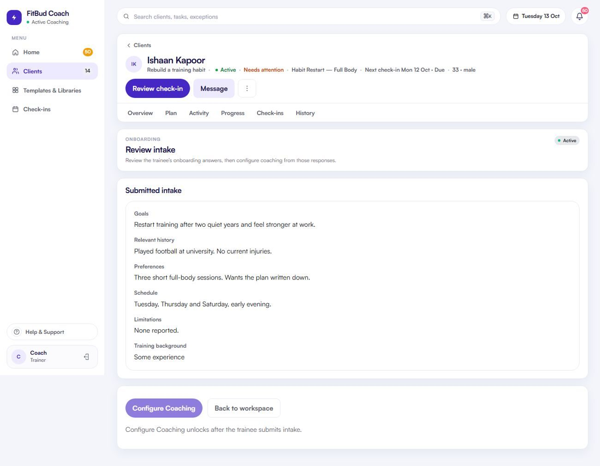

# TW-10 · Onboarding review

**ID:** TW-10 · **Name:** Onboarding review · **Priority:** P1 · **Route/screen:** `/clients/:rid/onboarding` · **Batch:** TW-C (see `../BATCHES.md`)

**Files to touch:**
- `apps/trainer-web/src/pages/OnboardingReviewPage.tsx` (exists: old code. Rebuild it to the target; do not patch it)

**API (from the guide):** `GET /onboarding/relationships/:rid`, `POST /onboarding/relationships/:rid/review` (outcome `coaching_ready`)

**Code status:** old code exists (the guide labelled it "Implemented"). **That code is LEGACY. Rebuild the screen to the target design below; don't patch the old UI.**

**Read first:** `../00-foundations.md` · `../01-product-rules.md` · `../02-navigation.md` (routes, IA) · `../03-api-changes.md` · `../09-demo-data.md`

---

## (b) Guide section (verbatim)

> **Read every line of this section.** Item 3, **"Legacy (do not keep)"**, describes the OLD UI that you must **REPLACE**. Never preserve or restyle it. Item 4, **"Gaps to close"**, lists what's wrong. The target is item 5 onward. Copied from FitBud UI/UX Implementation Guide v1.2, lines 1274–1308. Changes: the misleading "Status" label is dropped, two subsections are renamed, and image paths point to `../img/`. Nothing else is changed.

<!-- BEGIN VERBATIM TW-10 -->
### TW-10 · Onboarding review

> **Priority:** P1 · **Route:** `/clients/:rid/onboarding` · **Files:** `pages/OnboardingReviewPage.tsx` · **API:** `GET /onboarding/relationships/:rid`, `POST /onboarding/relationships/:rid/review` (outcome `coaching_ready`)

1. **Purpose.** Read the intake answers and mark the client ready for coaching.
2. **Entry.** Home "Getting started", the roster action *Review intake*, the header CTA, and a push "Priya finished her intake".
3. **Legacy (do not keep).** `shots/d1440_10_client1_onboarding.png`. Answers are listed. The primary action is Configure Coaching.

   {.shot}

4. **Gaps to close.**
   - Answers are a flat list.
   - Key safety answers (injuries, medical conditions, if present in the form) are not surfaced.
   - The order "mark ready, then configure" isn't explained.
   - The pinned form version isn't shown.
5. **Target design.**
   - **Header:** "Intake · submitted Mon 12 Oct · FitBud standard intake v3".
   - **Answers grouped by form section**, shown as definition rows (question label, answer). Yes/No answers render as text, not toggles. Multiple-choice answers render as chips.
   - **"Worth noting" summary at the top:** answers to questions the template flags as `highlight` (for example injuries or medications), shown verbatim. API-NEW: a per-question `highlight` flag in the form schema. Without it, show nothing; never infer.
   - **Sticky footer:** primary **Mark ready & configure** (performs the review, then routes to TW-11). Secondary: *WhatsApp client* (prefilled "Thanks for filling your intake…").
6. **States.**
   - Not submitted yet: "Priya hasn't submitted her intake yet. Last saved 2 h ago." (only if the draft time is available), plus *Remind on WhatsApp*.
   - Already reviewed: read-only, "Marked ready 13 Oct".
7. **Edge cases.** Long text answers are clamped to 6 lines with *Show more*. Number answers show the unit if the question defines one.
8. **Deep links.** `/go/intake/:rid`.
9. **References.**
   - Adapt: Trainerize onboarding forms [R20] https://help.trainerize.com/hc/en-us/articles/48660477450388-How-to-Create-and-Manage-Onboarding-Forms
   - Adapt: Everfit forms [R16] https://everfit.io/forms/
10. **UX decisions.** Combining review and configure removes a dead-end. The review is still recorded separately, per the contract.
11. **Implementation.** Reuse the `FormRenderer` in read mode. The CTA calls review and then navigates.
12. **Acceptance criteria.**
    - [ ] Answers are grouped and typed.
    - [ ] One click marks ready and opens Configure.
    - [ ] The pinned version is shown.
13. **Priority:** P1.
<!-- END VERBATIM TW-10 -->

---

## (c) Reference images

Open **every** image below before you write code. LEGACY images show what to remove. REFERENCE images show the target or inspiration.

- **LEGACY: shows old UI, do not copy** (embedded in the guide section): `impl_d1440_10_client1_onboarding.jpg`

  

## (d) Acceptance checks (verifiable)

Every check needs a PASS or FAIL line in your report, citing a screenshot in `docs/spec/evidence/`. Cite checks by ID (e.g. `TW-10.3`). Where a QA check restates a guide criterion, both must pass. A check you can't prove is FAIL, not ✅.

1. **TW-10.1** [guide §12] Answers are grouped and typed.
2. **TW-10.2** [guide §12] One click marks ready and opens Configure.
3. **TW-10.3** [guide §12] The pinned version is shown.
4. **TW-10.4** [QA checklist #1] Header "Intake · submitted <date> · <form name> v<N>" (the pinned version is shown).
5. **TW-10.5** [QA checklist #2] Answers are grouped by section as label/answer rows. Yes/No shows as text (no toggles), and multiple choice shows as chips.
6. **TW-10.6** [QA checklist #3] A "Worth noting" summary at the top only if the form flags highlight questions (otherwise nothing is inferred).
7. **TW-10.7** [QA checklist #4] Sticky footer: primary **Mark ready & configure** (one click, lands on Configure). Secondary *WhatsApp client* (wa.me prefill "Thanks for filling your intake…").
8. **TW-10.8** [QA checklist #5] Vikram: "Vikram hasn't submitted his intake yet…" plus *Remind on WhatsApp* (wa.me).
9. **TW-10.9** [QA checklist #6] After review: read-only "Marked ready <date>". Long answers are clamped to 6 lines with *Show more*.
10. **TW-10.10** [product rule] The banned-strings check (01-product-rules.md §B) finds no match on this screen in any captured state.
11. **TW-10.11** [guide §1.1 DoD] Loading, empty, error, offline and partial states exist as specified in "States" (one evidence screenshot per state, or a named test).

## (e) Observed in 18 Oct QA

These failures were seen on branch `cursor/stage1-foundation-a3da` @ `7f74108`. Fix every one, and prove the fix in the checks above.

- No screen-specific failure recorded. Sneha has a submitted intake and Vikram has none (use both).

## (f) Demo state to verify

Local stack: web http://localhost:5173 (proxies `/api` to http://127.0.0.1:8787). Expo web runs on :8081 with `EXPO_PUBLIC_SCREEN_CAPTURE=1`. Every demo password is `FitBud-demo-2026`. Reset with `pnpm db:reset` (stop the API first). See `../09-demo-data.md` for all IDs.

- **URLs:** `/clients/6a68b615-c47c-4bfc-a7f8-550becf7878a/onboarding` (Sneha, submitted); `/clients/2fe7a6d8-4c61-443d-9614-18b4210186ee/onboarding` (Vikram, not submitted)
- `R` = `/clients/c422296e-ed7b-4196-a2b4-647096af3002` (Rohan, slipping)

## (g) Viewport for evidence

**1440×900** (desktop, Chromium). Save it as `docs/spec/evidence/TW-10.png`. Save extra states as `docs/spec/evidence/TW-10--<state>.png` (e.g. `--empty`, `--error`, `--offline`).

