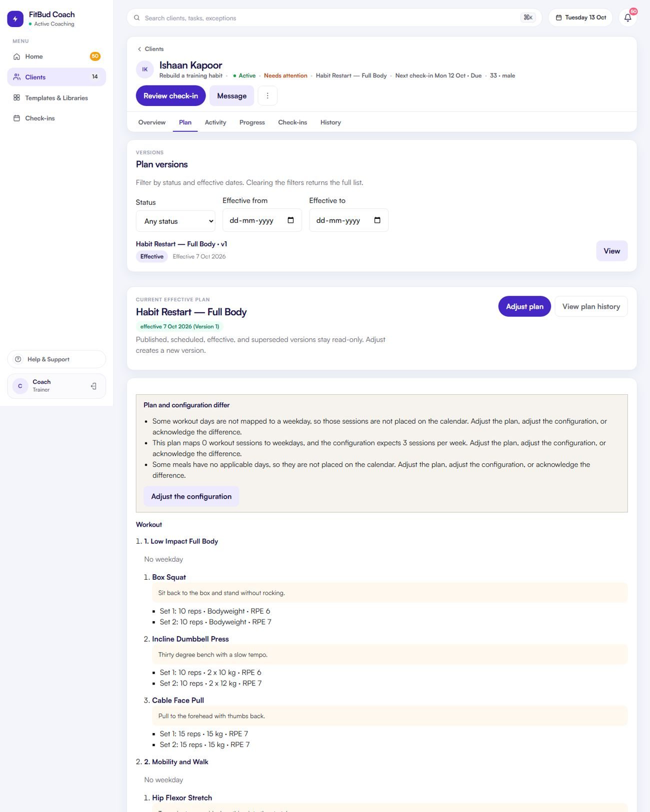

# TW-12 · Plan tab (versions, current plan, consistency)

**ID:** TW-12 · **Name:** Plan tab (versions, current plan, consistency) · **Priority:** P1 · **Route/screen:** `/clients/:rid/plan` (`?assign=1`) · **Batch:** TW-D (see `../BATCHES.md`)

**Files to touch:**
- `apps/trainer-web/src/pages/ClientPlanPage.tsx` (exists: old code. Rebuild it to the target; do not patch it)
- `apps/trainer-web/src/components/PlanConsistencyNotice.tsx` (exists: old code. Rebuild it to the target; do not patch it)
- `apps/trainer-web/src/components/plan-composition/PlanCompositionEditor.tsx` (exists: old code. Rebuild it to the target; do not patch it)

**API (from the guide):** `GET /plans/relationships/:rid[?versionStatus&effectiveFrom&effectiveTo]`, `GET …/effective`, `POST …/from-template`, `POST /plans/:planId/versions`, `PUT/POST …/publish`, preview

**Code status:** old code exists (the guide labelled it "Implemented"). **That code is LEGACY. Rebuild the screen to the target design below; don't patch the old UI.**

**Read first:** `../00-foundations.md` · `../01-product-rules.md` · `../02-navigation.md` (routes, IA) · `../03-api-changes.md` · `../09-demo-data.md`

---

## (b) Guide section (verbatim)

> **Read every line of this section.** Item 3, **"Legacy (do not keep)"**, describes the OLD UI that you must **REPLACE**. Never preserve or restyle it. Item 4, **"Gaps to close"**, lists what's wrong. The target is item 5 onward. Copied from FitBud UI/UX Implementation Guide v1.2, lines 1371–1419. Changes: the misleading "Status" label is dropped, two subsections are renamed, and image paths point to `../img/`. Nothing else is changed.

<!-- BEGIN VERBATIM TW-12 -->
### TW-12 · Plan tab (versions, current plan, consistency)

> **Priority:** P1 · **Route:** `/clients/:rid/plan` (`?assign=1`) · **Files:** `pages/ClientPlanPage.tsx` (`applyPlanTemplate`, publish, `acknowledgePlanConsistency`), `components/PlanConsistencyNotice.tsx`, `components/plan-composition/PlanCompositionEditor.tsx` · **API:** `GET /plans/relationships/:rid[?versionStatus&effectiveFrom&effectiveTo]`, `GET …/effective`, `POST …/from-template`, `POST /plans/:planId/versions`, `PUT/POST …/publish`, preview

1. **Purpose.** See the current program, start an adjustment, replace it from a template, and browse versions.
2. **Entry.** Header plan link, Overview plan card, TW-05 *Adjust plan*.
3. **Legacy (do not keep).** `shots/d1440_10_client1_plan.png`. Version list with filters, immutable-version messaging, an "Adjust plan" action, and the plan-configuration consistency notice (a strong feature). The composition editor is inline and very long (about 7,100 px). There's no weekday mapping and no assignment-window step.

   {.shot}

4. **Gaps to close.**
   - Editing happens inline in one long column.
   - There's no explicit **Assign** step with a date window.
   - The diet change scope (Today onward, Today only) isn't offered.
   - The version list is visually heavier than the current plan.
5. **Target design.**
   - **Current plan card (top):**
     - Title, "Effective since Mon 5 Oct · v3 · ongoing" (or an end date).
     - **Week strip**, Mon to Sun: the session name per day, "Rest", and a meal-count chip per day.
     - **Meal times panel** (under the strip): each meal slot with its plan time, and the client's time where it differs. For example, "Lunch · plan 1:30 pm · **Priya: 2:30 pm** (changed Tue)". The trainer can't edit the client's time, but can change the plan default by adjusting the plan (D24).
     - Actions: **Adjust plan** (primary, creates a new draft version and opens TW-13/14), *Replace from template* (opens the template picker, then TW-16), and ⋯ *Duplicate as template* (`POST /templates/from-plan-version`).
   - **Consistency notice:** keep `PlanConsistencyNotice` with its three resolutions (adjust plan, adjust configuration, acknowledge the intentional difference). Restyle it as an `attention` banner, not red.
   - **Draft banner** when a draft exists: "Draft v4 · edited 2 h ago · Continue editing · Discard".
   - **Versions table (collapsed by default):** version, status (draft, scheduled, effective, superseded), effective interval, published by and date, *View*. Filters stay as they are.
6. **States.**
   - No plan: "No plan yet" with **Start from a template** (primary) and *Start blank*.
   - Seed error: generation 500s (gap analysis). Show "Couldn't create this week's schedule · Retry" on the assign step. Never fail silently.
7. **Edge cases.**
   - Publishing while a newer draft exists: 409, then a reload prompt.
   - Replacement: show the TW-16 preview of superseded unstarted assignments before confirming.
   - Ended: read-only.
8. **Deep links.** `/go/plan/:planId`.
9. **References.**
   - Adapt: TrueCoach programs [R3] https://help.truecoach.co/en/articles/3047401-programs
   - Adapt: Everfit premade program templates [R11] https://help.everfit.io/en/articles/8877415-premade-program-templates
10. **UX decisions.**
    - The week strip answers "what does Priya do on Tuesday" without opening the editor.
    - Editing moves to a dedicated builder route (TW-13/14), which fixes the 7,100 px page.
11. **Implementation.**
    - Move `PlanCompositionEditor` into the builder route.
    - `WeekStrip` reads the weekday-to-session mapping from the version content. API-CHG: the contract (decision B) requires an explicit weekday-to-session mapping, but the current generation derives weekdays from sessions per week. That needs a content schema change (see TW-13).
12. **Acceptance criteria.**
    - [ ] The current plan shows a week strip.
    - [ ] Client meal-time overrides are shown next to plan times.
    - [ ] Adjust creates a draft and opens the builder.
    - [ ] Replace goes through TW-16.
    - [ ] The consistency notice uses attention styling with its three actions.
    - [ ] Versions are collapsed by default.
13. **Priority:** P1.
<!-- END VERBATIM TW-12 -->

---

## (c) Reference images

Open **every** image below before you write code. LEGACY images show what to remove. REFERENCE images show the target or inspiration.

- **LEGACY: shows old UI, do not copy** (embedded in the guide section): `impl_d1440_10_client1_plan.jpg`

  

## (d) Acceptance checks (verifiable)

Every check needs a PASS or FAIL line in your report, citing a screenshot in `docs/spec/evidence/`. Cite checks by ID (e.g. `TW-12.3`). Where a QA check restates a guide criterion, both must pass. A check you can't prove is FAIL, not ✅.

1. **TW-12.1** [guide §12] The current plan shows a week strip.
2. **TW-12.2** [guide §12] Client meal-time overrides are shown next to plan times.
3. **TW-12.3** [guide §12] Adjust creates a draft and opens the builder.
4. **TW-12.4** [guide §12] Replace goes through TW-16.
5. **TW-12.5** [guide §12] The consistency notice uses attention styling with its three actions.
6. **TW-12.6** [guide §12] Versions are collapsed by default.
7. **TW-12.7** [QA checklist #1] A current plan card at the top: title, "Effective since Mon 22 Sep · v2 · ongoing" (formatted, not ISO).
8. **TW-12.8** [QA checklist #2] **Week strip** Mon–Sun: the session name or "Rest" per day, plus a meal-count chip.
9. **TW-12.9** [QA checklist #3] Meal times panel: each slot's plan time, and the client's time where it differs.
10. **TW-12.10** [QA checklist #4] Actions: **Adjust plan** (primary, creates a draft and opens the builder), *Replace from template*, ⋯ *Duplicate as template*.
11. **TW-12.11** [QA checklist #5] Consistency notice (if shown) is an amber attention banner (not red) with 3 resolutions: adjust plan / adjust configuration / acknowledge the difference.
12. **TW-12.12** [QA checklist #6] Versions table **collapsed by default** (version, status, effective interval, published by, *View*).
13. **TW-12.13** [QA checklist #7] After Adjust: a draft banner "Draft vN · edited … · Continue editing · Discard".
14. **TW-12.14** [product rule] The banned-strings check (01-product-rules.md §B) finds no match on this screen in any captured state.
15. **TW-12.15** [guide §1.1 DoD] Loading, empty, error, offline and partial states exist as specified in "States" (one evidence screenshot per state, or a named test).

## (e) Observed in 18 Oct QA

These failures were seen on branch `cursor/stage1-foundation-a3da` @ `7f74108`. Fix every one, and prove the fix in the checks above.

- RCA.md §5: TW-12 was ⚠️ in run 3 and became ✅ in run 4 with no review.

## (f) Demo state to verify

Local stack: web http://localhost:5173 (proxies `/api` to http://127.0.0.1:8787). Expo web runs on :8081 with `EXPO_PUBLIC_SCREEN_CAPTURE=1`. Every demo password is `FitBud-demo-2026`. Reset with `pnpm db:reset` (stop the API first). See `../09-demo-data.md` for all IDs.

- **URL:** `R/plan` · **Account:** rahul.coach
- `R` = `/clients/c422296e-ed7b-4196-a2b4-647096af3002` (Rohan, slipping)

## (g) Viewport for evidence

**1440×900** (desktop, Chromium). Save it as `docs/spec/evidence/TW-12.png`. Save extra states as `docs/spec/evidence/TW-12--<state>.png` (e.g. `--empty`, `--error`, `--offline`).

---

## Design amendment · 21 Oct 2026 (mockups redesign)

Plan tab structure (mockups 150, 200, 151): sub-tabs **Plans** | **Coaching setup** (TW-11). Plans shows one *current plan card per type* (Workout, Nutrition) with the Mon–Sun strip, header actions *Replace from template* and **Adjust plan**, and the **Versions** table with filters **Type** (All · Workout · Nutrition) and **Status** (All · Active · Scheduled · Draft · Superseded) and a "N of M" count. Columns: Plan, Type, Version, Status, Effective, Published, View.
