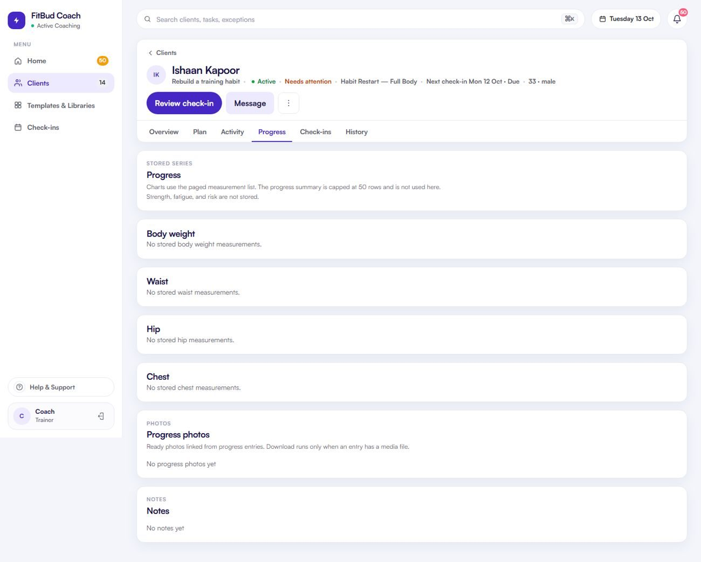

# TW-18 · Progress

**ID:** TW-18 · **Name:** Progress · **Priority:** P1 · **Route/screen:** `/clients/:rid/progress` · **Batch:** TW-E (see `../BATCHES.md`)

**Files to touch:**
- `apps/trainer-web/src/pages/ClientProgressPage.tsx` (exists: old code. Rebuild it to the target; do not patch it)
- `apps/trainer-web/src/components/MeasurementTrend.tsx` (exists: old code. Rebuild it to the target; do not patch it)

**API (from the guide):** progress summary, `GET /progress/…/measurements`, entries, file download

**Code status:** old code exists (the guide labelled it "Implemented (text-only, needs charts)"). **That code is LEGACY. Rebuild the screen to the target design below; don't patch the old UI.**

**Read first:** `../00-foundations.md` · `../01-product-rules.md` · `../02-navigation.md` (routes, IA) · `../03-api-changes.md` · `../09-demo-data.md`

---

## (b) Guide section (verbatim)

> **Read every line of this section.** Item 3, **"Legacy (do not keep)"**, describes the OLD UI that you must **REPLACE**. Never preserve or restyle it. Item 4, **"Gaps to close"**, lists what's wrong. The target is item 5 onward. Copied from FitBud UI/UX Implementation Guide v1.2, lines 1635–1670. Changes: the misleading "Status" label is dropped, two subsections are renamed, and image paths point to `../img/`. Nothing else is changed.

<!-- BEGIN VERBATIM TW-18 -->
### TW-18 · Progress

> **Priority:** P1 · **Route:** `/clients/:rid/progress` · **Files:** `pages/ClientProgressPage.tsx`, `components/MeasurementTrend.tsx` · **API:** progress summary, `GET /progress/…/measurements`, entries, file download

1. **Purpose.** See body measurement trends and progress photos over time.
2. **Entry.** Workspace tab, Overview progress card, check-in review.
3. **Legacy (do not keep).** `shots/d1440_10_client1_progress.png`. Text such as "No stored body weight measurements". No chart scaffolding and no photo comparison.

   {.shot}

4. **Gaps to close.** No graphs. No photo comparison. Empty states are plain text.
5. **Target design.**
   - **Metric tabs:** Weight · Waist · Hip · Chest · Other. Only metrics that have data or are required are shown.
   - **TrendChart:** line and points, with a range of 4 weeks, 12 weeks or All. It shows start, latest and change ("−2.4 kg since 5 Oct"). Gaps break the line. Weekly averages are an optional toggle (P2).
   - **Data table** under a disclosure (date, value, source: check-in or manual).
   - **Photos:** a gallery grid by date. **Compare** picks two dates and shows them side by side with dates (`PhotoCompare`).
   - No strength charts (deferred) and no body-fat estimates.
6. **States.**
   - No data: "No weigh-ins yet. Weight is collected in check-ins." plus *Open check-in settings*.
   - One point: show the value with "Add more weigh-ins to see a trend".
   - Photo loading skeletons. A photo error shows "Couldn't load photo · Retry".
7. **Edge cases.**
   - Values display in the trainer's chosen units, stored as kg and cm.
   - Measurements captured from a check-in show a "From check-in · 9 Oct" link.
8. **Deep links.** `/go/progress/:rid`.
9. **References.**
   - Adopt: the Trainerize Client Insights charts [R17] (the charts only, not the % compliance).
   - Adapt: Figma's graph-first progress (Progress frame, metadata audit), minus the strength KPIs.
10. **UX decisions.** Use honest, raw trends. Use language like "change", not "good" or "bad". Never colour weight gain red.
11. **Implementation.** Extend `MeasurementTrend.tsx` into `TrendChart` (SVG or `recharts`). `PhotoCompare` uses signed download targets.
12. **Acceptance criteria.**
    - [ ] A chart renders with 2 or more points.
    - [ ] The empty states are designed.
    - [ ] Photo compare works with any two photos.
    - [ ] No red or green value judgement.
13. **Priority:** P1.
<!-- END VERBATIM TW-18 -->

---

## (c) Reference images

Open **every** image below before you write code. LEGACY images show what to remove. REFERENCE images show the target or inspiration.

- **LEGACY: shows old UI, do not copy** (embedded in the guide section): `impl_d1440_10_client1_progress.jpg`

  

## (d) Acceptance checks (verifiable)

Every check needs a PASS or FAIL line in your report, citing a screenshot in `docs/spec/evidence/`. Cite checks by ID (e.g. `TW-18.3`). Where a QA check restates a guide criterion, both must pass. A check you can't prove is FAIL, not ✅.

1. **TW-18.1** [guide §12] A chart renders with 2 or more points.
2. **TW-18.2** [guide §12] The empty states are designed.
3. **TW-18.3** [guide §12] Photo compare works with any two photos.
4. **TW-18.4** [guide §12] No red or green value judgement.
5. **TW-18.5** [QA checklist #1] Metric tabs (Weight · Waist · Hip · Chest · Other), showing only metrics with data or required ones.
6. **TW-18.6** [QA checklist #2] A TrendChart with a 4 w / 12 w / All range and start, latest and change ("−2.4 kg since 5 Oct"). Gaps break the line.
7. **TW-18.7** [QA checklist #3] A data table under a disclosure (date, value, source; "From check-in · 9 Oct").
8. **TW-18.8** [QA checklist #4] A photo gallery by date, plus **Compare** (two dates side by side).
9. **TW-18.9** [QA checklist #5] No data: "No weigh-ins yet. Weight is collected in check-ins." plus *Open check-in settings*. One point: "Add more weigh-ins to see a trend".
10. **TW-18.10** [QA checklist #6] No red or green value judgement, and no strength charts or body-fat estimates.
11. **TW-18.11** [product rule] The banned-strings check (01-product-rules.md §B) finds no match on this screen in any captured state.
12. **TW-18.12** [guide §1.1 DoD] Loading, empty, error, offline and partial states exist as specified in "States" (one evidence screenshot per state, or a named test).

## (e) Observed in 18 Oct QA

These failures were seen on branch `cursor/stage1-foundation-a3da` @ `7f74108`. Fix every one, and prove the fix in the checks above.

- RCA.md §5: TW-18 was ⚠️ in run 3 and became ✅ in run 4 with no review.

## (f) Demo state to verify

Local stack: web http://localhost:5173 (proxies `/api` to http://127.0.0.1:8787). Expo web runs on :8081 with `EXPO_PUBLIC_SCREEN_CAPTURE=1`. Every demo password is `FitBud-demo-2026`. Reset with `pnpm db:reset` (stop the API first). See `../09-demo-data.md` for all IDs.

- **URL:** `R/progress` (also Aarav `/clients/30e514e1-e3f4-4dac-ae4b-5f45e72c3df6/progress`)
- `R` = `/clients/c422296e-ed7b-4196-a2b4-647096af3002` (Rohan, slipping)

## (g) Viewport for evidence

**1440×900** (desktop, Chromium). Save it as `docs/spec/evidence/TW-18.png`. Save extra states as `docs/spec/evidence/TW-18--<state>.png` (e.g. `--empty`, `--error`, `--offline`).

