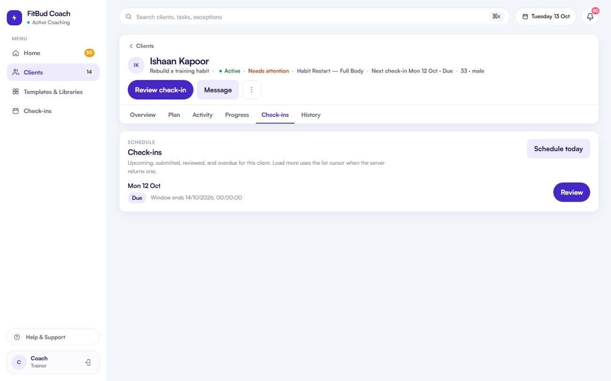

# TW-19 · Client check-ins list

**ID:** TW-19 · **Name:** Client check-ins list · **Priority:** P2 · **Route/screen:** `/clients/:rid/check-ins` · **Batch:** TW-E (see `../BATCHES.md`)

**Files to touch:**
- `apps/trainer-web/src/pages/ClientCheckinsPage.tsx` (exists: old code. Rebuild it to the target; do not patch it)

**API (from the guide):** check-in list (cursor), schedule, schedule-next

**Code status:** old code exists (the guide labelled it "Implemented"). **That code is LEGACY. Rebuild the screen to the target design below; don't patch the old UI.**

**Read first:** `../00-foundations.md` · `../01-product-rules.md` · `../02-navigation.md` (routes, IA) · `../03-api-changes.md` · `../09-demo-data.md`

---

## (b) Guide section (verbatim)

> **Read every line of this section.** Item 3, **"Legacy (do not keep)"**, describes the OLD UI that you must **REPLACE**. Never preserve or restyle it. Item 4, **"Gaps to close"**, lists what's wrong. The target is item 5 onward. Copied from FitBud UI/UX Implementation Guide v1.2, lines 1674–1695. Changes: the misleading "Status" label is dropped, two subsections are renamed, and image paths point to `../img/`. Nothing else is changed.

<!-- BEGIN VERBATIM TW-19 -->
### TW-19 · Client check-ins list

> **Priority:** P2 · **Route:** `/clients/:rid/check-ins` · **Files:** `pages/ClientCheckinsPage.tsx` · **API:** check-in list (cursor), schedule, schedule-next

1. **Purpose.** See this client's check-in history and upcoming check-ins.
2. **Entry.** Workspace tab.
3. **Legacy (do not keep).** `shots/d1440_10_client1_check-ins.png`. A list. The cursor isn't passed (contract note).
4. **Gaps to close.** No paging. Weak status chips. No review outcome shown.
5. **Target design.**
   - A table: due window · form name · status chip (Scheduled, Due, Overdue, Submitted, Reviewed) · review outcome chip (Acknowledged, Needs follow-up, Adjust coaching) · *Open*.
   - Header action: **Schedule check-in** (date and form), for one-off check-ins. The date and time picker works in the **client's timezone**, with a `TimezoneBadge` and a live preview such as "Due Fri 16 Oct, 11:59 pm Priya's time (Sat 1:29 am your time)" (D22).
6. **States.** Empty: "No check-ins yet. They'll appear here based on Priya's weekly schedule." Error.
7. **Edge cases.** Paging with "Load more". Overdue items show the attention chip.
8. **Deep links.** `/go/checkin/:id`.
9. **References.** Everfit check-in dashboard [R7].
10. **UX decisions.** The outcome chip shows the coaching follow-through at a glance.
11. **Implementation.** Pass the cursor. Reuse `StatusChip(kind='checkin')`.
12. **Acceptance criteria.**
    - [ ] Paged.
    - [ ] Statuses are derived (never written).
    - [ ] Outcome chips shown.
13. **Priority:** P2.
<!-- END VERBATIM TW-19 -->

---

## (c) Reference images

Open **every** image below before you write code. LEGACY images show what to remove. REFERENCE images show the target or inspiration.

- **LEGACY: shows old UI, do not copy** (cited by the section or by guide Appendix D): `impl_d1440_10_client1_check-ins.jpg`

  

## (d) Acceptance checks (verifiable)

Every check needs a PASS or FAIL line in your report, citing a screenshot in `docs/spec/evidence/`. Cite checks by ID (e.g. `TW-19.3`). Where a QA check restates a guide criterion, both must pass. A check you can't prove is FAIL, not ✅.

1. **TW-19.1** [guide §12] Paged.
2. **TW-19.2** [guide §12] Statuses are derived (never written).
3. **TW-19.3** [guide §12] Outcome chips shown.
4. **TW-19.4** [QA checklist #1] Table: due window · form name · status chip (Scheduled/Due/Overdue/Submitted/Reviewed) · review outcome chip · *Open*.
5. **TW-19.5** [QA checklist #2] Header action **Schedule check-in** (date plus form), with a client-timezone preview and a TimezoneBadge (try Deepak `/clients/f2a64fdb-96ad-46f3-a95e-99151b4a25f1/check-ins`).
6. **TW-19.6** [QA checklist #3] Overdue rows get the amber attention chip.
7. **TW-19.7** [QA checklist #4] "Load more" paging. Empty copy: "No check-ins yet. They'll appear here based on …'s weekly schedule."
8. **TW-19.8** [QA checklist #5] Formatted dates only (no ISO).
9. **TW-19.9** [product rule] The banned-strings check (01-product-rules.md §B) finds no match on this screen in any captured state.
10. **TW-19.10** [guide §1.1 DoD] Loading, empty, error, offline and partial states exist as specified in "States" (one evidence screenshot per state, or a named test).

## (e) Observed in 18 Oct QA

These failures were seen on branch `cursor/stage1-foundation-a3da` @ `7f74108`. Fix every one, and prove the fix in the checks above.

- RCA.md §5: TW-19 was ⚠️ in run 3 and became ✅ in run 4 with no review.

## (f) Demo state to verify

Local stack: web http://localhost:5173 (proxies `/api` to http://127.0.0.1:8787). Expo web runs on :8081 with `EXPO_PUBLIC_SCREEN_CAPTURE=1`. Every demo password is `FitBud-demo-2026`. Reset with `pnpm db:reset` (stop the API first). See `../09-demo-data.md` for all IDs.

- **URL:** `R/check-ins`
- `R` = `/clients/c422296e-ed7b-4196-a2b4-647096af3002` (Rohan, slipping)

## (g) Viewport for evidence

**1440×900** (desktop, Chromium). Save it as `docs/spec/evidence/TW-19.png`. Save extra states as `docs/spec/evidence/TW-19--<state>.png` (e.g. `--empty`, `--error`, `--offline`).

