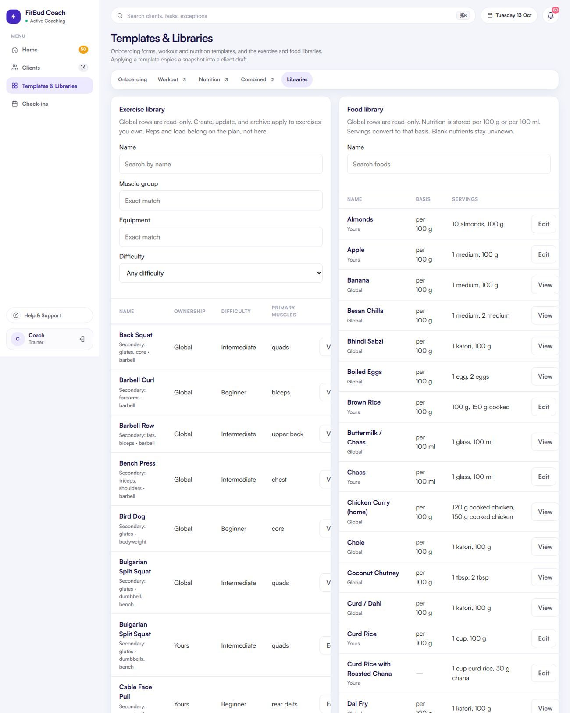

# TW-26 · Libraries (exercises, foods)

**ID:** TW-26 · **Name:** Libraries (exercises, foods) · **Priority:** P2 (the schema migration is P1 on the backend) · **Route/screen:** `/templates/libraries/exercises`, `/templates/libraries/foods` · **Batch:** TW-F (see `../BATCHES.md`)

**Files to touch:**
- `apps/trainer-web/src/pages/templates/LibrariesPanel.tsx` (exists: old code. Rebuild it to the target; do not patch it)
- `apps/trainer-web/src/pages/templates/LibrarySearch.tsx` (exists: old code. Rebuild it to the target; do not patch it)

**API (from the guide):** `/libraries` exercises (q, muscleGroup, equipment, difficulty), foods (q); create, update, archive

**Code status:** old code exists (the guide labelled it "Implemented (needs paging)"). **That code is LEGACY. Rebuild the screen to the target design below; don't patch the old UI.**

**Read first:** `../00-foundations.md` · `../01-product-rules.md` · `../02-navigation.md` (routes, IA) · `../03-api-changes.md` · `../09-demo-data.md`

---

## (b) Guide section (verbatim)

> **Read every line of this section.** Item 3, **"Legacy (do not keep)"**, describes the OLD UI that you must **REPLACE**. Never preserve or restyle it. Item 4, **"Gaps to close"**, lists what's wrong. The target is item 5 onward. Copied from FitBud UI/UX Implementation Guide v1.2, lines 1959–1993. Changes: the misleading "Status" label is dropped, two subsections are renamed, and image paths point to `../img/`. Nothing else is changed.

<!-- BEGIN VERBATIM TW-26 -->
### TW-26 · Libraries (exercises, foods)

> **Priority:** P2 · **Route:** `/templates/libraries/exercises`, `/templates/libraries/foods` · **Files:** `pages/templates/LibrariesPanel.tsx`, `LibrarySearch.tsx` · **API:** `/libraries` exercises (q, muscleGroup, equipment, difficulty), foods (q); create, update, archive

1. **Purpose.** Browse and maintain exercises and foods. Items are identity and metadata only, with no prescription defaults.
2. **Entry.** Templates, Libraries, and the builder drawers.
3. **Legacy (do not keep).** `shots/d1440_06_templates_2_Libraries.png`. A 6,200 px table with filters and paging, but no sticky header.

   {.shot}

4. **Gaps to close.** Very long page. No virtualisation. The UI may still show `defaultReps` and `defaultLoadLabel` (remove them per 10 Oct). Foods show per-portion macros, which needs migrating to the canonical basis plus servings.
5. **Target design.**
   - **Exercises table:** name · primary muscles · secondary muscles · equipment · difficulty · media · owner (FitBud or Mine) · ⋯. Sticky header, 25 rows per page, filters in a FilterBar.
   - **Create or edit exercise drawer:** name, primary and secondary muscle multiselects, equipment, difficulty, instructions, media link. No reps or load.
   - **Foods table:** name · classification (raw, generic, prepared, branded) · basis ("per 100 g") · kcal, P, C, F (unknown values shown as "—") · servings count · owner.
   - **Food drawer:** identity and classification; a basis selector (100 g or 100 ml); nullable nutrients; a **servings editor** (label "1 katori", unit, grams or ml equivalent) with stable ids; and an **aliases** field (Hindi and regional names and transliterations, for example "dal, daal, dhal, paruppu"). Aliases power the trainee food search (TR-26, D28).
   - **"Logged by clients, not in library" list** (D28): custom foods your trainees typed in, with the count and last date. Actions are **Add to library** (opens the drawer prefilled, after which past logs can be re-linked to it) and *Dismiss*.
   - Referenced items are **Archived**, not deleted.
6. **States.** Empty search: "No exercises match 'bulgarian'. Create it?"
7. **Edge cases.** Global items are read-only. "Duplicate to mine" creates an independent trainer record (provenance only).
8. **Deep links.** None.
9. **References.**
   - Everfit create or edit an exercise [R12] https://help.everfit.io/en/articles/2945296-create-or-edit-an-exercise
   - IFCT 2017 [R70] for Indian foods.
10. **UX decisions.** Servings are food-specific, because household measures don't convert universally (contract).
11. **Implementation.**
    - Table virtualisation is optional. Paging at 25 is enough.
    - API-CHG: foods gain `aliases: string[]` (search-indexed).
    - API-NEW: `GET /libraries/foods/custom-logged?rid=` (custom trainee entries) and `POST /libraries/foods/:id/relink-custom` (optional, P2).
12. **Acceptance criteria.**
    - [ ] Sticky header and paging.
    - [ ] No prescription defaults.
    - [ ] Foods use basis plus servings.
    - [ ] Archive instead of delete when referenced.
13. **Priority:** P2 (the schema migration is P1 on the backend).
<!-- END VERBATIM TW-26 -->

---

## (c) Reference images

Open **every** image below before you write code. LEGACY images show what to remove. REFERENCE images show the target or inspiration.

- **LEGACY: shows old UI, do not copy** (embedded in the guide section): `impl_d1440_06_templates_2_Libraries.jpg`

  

## (d) Acceptance checks (verifiable)

Every check needs a PASS or FAIL line in your report, citing a screenshot in `docs/spec/evidence/`. Cite checks by ID (e.g. `TW-26.3`). Where a QA check restates a guide criterion, both must pass. A check you can't prove is FAIL, not ✅.

1. **TW-26.1** [guide §12] Sticky header and paging.
2. **TW-26.2** [guide §12] No prescription defaults.
3. **TW-26.3** [guide §12] Foods use basis plus servings.
4. **TW-26.4** [guide §12] Archive instead of delete when referenced.
5. **TW-26.5** [QA checklist #1] Exercises table: name · primary muscles · secondary · equipment · difficulty · media · owner · ⋯. **Sticky header**, 25 per page.
6. **TW-26.6** [QA checklist #2] **No default reps or load** columns or fields.
7. **TW-26.7** [QA checklist #3] Foods table: name · classification · basis ("per 100 g") · kcal, P, C, F ("—" when unknown) · servings count · owner.
8. **TW-26.8** [QA checklist #4] Food drawer: basis selector, nullable nutrients, servings editor ("1 katori"), aliases field.
9. **TW-26.9** [QA checklist #5] Global items are read-only with "Duplicate to mine". Referenced items are **Archived**, not deleted.
10. **TW-26.10** [QA checklist #6] Empty search: "No exercises match 'bulgarian'. Create it?". The page isn't a 6,000 px wall (paging).
11. **TW-26.11** [product rule] The banned-strings check (01-product-rules.md §B) finds no match on this screen in any captured state.
12. **TW-26.12** [guide §1.1 DoD] Loading, empty, error, offline and partial states exist as specified in "States" (one evidence screenshot per state, or a named test).

## (e) Observed in 18 Oct QA

These failures were seen on branch `cursor/stage1-foundation-a3da` @ `7f74108`. Fix every one, and prove the fix in the checks above.

- Guide legacy: a 6,200 px table (`img/impl_d1440_06_templates_2_Libraries.jpg`). It may still show `defaultReps`/`defaultLoadLabel`.

## (f) Demo state to verify

Local stack: web http://localhost:5173 (proxies `/api` to http://127.0.0.1:8787). Expo web runs on :8081 with `EXPO_PUBLIC_SCREEN_CAPTURE=1`. Every demo password is `FitBud-demo-2026`. Reset with `pnpm db:reset` (stop the API first). See `../09-demo-data.md` for all IDs.

- **URL:** `/templates/libraries` (Exercises / Foods segmented control inside the tab)
- `R` = `/clients/c422296e-ed7b-4196-a2b4-647096af3002` (Rohan, slipping)

## (g) Viewport for evidence

**1440×900** (desktop, Chromium). Save it as `docs/spec/evidence/TW-26.png`. Save extra states as `docs/spec/evidence/TW-26--<state>.png` (e.g. `--empty`, `--error`, `--offline`).

