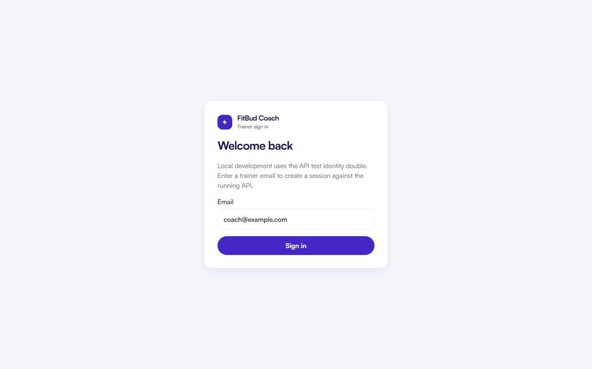
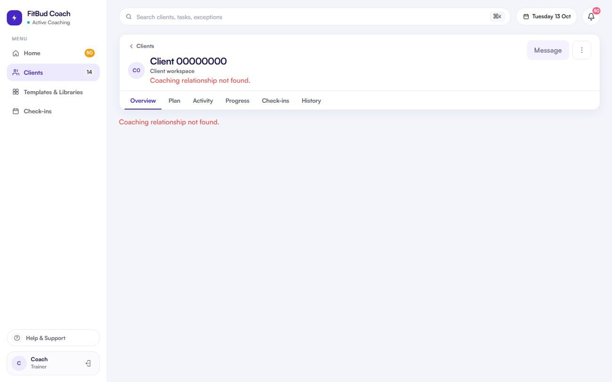

# TW-33 · System states: errors, not found, offline, empty

**ID:** TW-33 · **Name:** System states: errors, not found, offline, empty · **Priority:** P0 · **Route/screen:** global · **Batch:** TW-A (see `../BATCHES.md`)

**Files to touch:**
- `apps/trainer-web/src/App.tsx` (exists: old code. Rebuild it to the target; do not patch it)
- `components/states/*` [new]
- `apps/trainer-web/src/pages/NotFoundPage.tsx`
- `apps/trainer-web/src/components/StatePanels.tsx`

**Code status:** old code exists (the guide labelled it "Implemented (partial)"). **That code is LEGACY. Rebuild the screen to the target design below; don't patch the old UI.**

**Read first:** `../00-foundations.md` · `../01-product-rules.md` · `../02-navigation.md` (routes, IA) · `../09-demo-data.md`

---

## (b) Guide section (verbatim)

> **Read every line of this section.** Item 3, **"Legacy (do not keep)"**, describes the OLD UI that you must **REPLACE**. Never preserve or restyle it. Item 4, **"Gaps to close"**, lists what's wrong. The target is item 5 onward. Copied from FitBud UI/UX Implementation Guide v1.2, lines 2225–2254. Changes: the misleading "Status" label is dropped, two subsections are renamed, and image paths point to `../img/`. Nothing else is changed.

<!-- BEGIN VERBATIM TW-33 -->
### TW-33 · System states: errors, not found, offline, empty

> **Priority:** P0 · **Where:** global · **Files:** `AuthProvider`, `App.tsx` `*` route, `components/states/*` [new]

1. **Purpose.** Consistent, honest handling of failure.
2. **Entry.** Anywhere.
3. **Legacy (do not keep).** `shots/d1440_97_clients_api_error.png` (inline error), `d1440_98_client_not_found.png` (fake header), `d1440_99_unknown_redirect.png` (silent redirect). An unreachable API means sign-out.

   {.shot}

4. **Gaps to close.** Inconsistent. Sign-out on network errors. Silent 404 redirect.
5. **Target design.**
   - `ErrorState` (title, one sentence, Retry, Details showing the request id from the `requestId` envelope, and **Email support**, which opens the support `mailto` with the request id and screen prefilled, §1.6.10).
   - A `NotFound` page ("We couldn't find that page" with Home).
   - An `OfflineBanner`.
   - `EmptyState` (per screen).
   - A `Forbidden` page ("You don't have access to this client").
6. **States.** These are the states.
7. **Edge cases.** Expected-empty 404s, such as a client with no subscription, aren't errors.
8. **Deep links.** An invalid `/go/` link goes to TR-23 or the web equivalent: "This item isn't available anymore."
9. **References.**
   - NN/g empty states [R67] https://www.nngroup.com/articles/empty-state-interface-design/
   - Skeleton screens [R68] https://www.nngroup.com/articles/skeleton-screens/
10. **UX decisions.** Never lose the trainer's session on transient errors.
11. **Implementation.** `api-client` maps errors to `{kind: 'network'|'unauthorized'|'forbidden'|'notFound'|'conflict'|'server', requestId}`.
12. **Acceptance criteria.**
    - [ ] Five error kinds, each rendered distinctly.
    - [ ] Unknown routes show the 404 page.
    - [ ] The request id is visible in Details.
13. **Priority:** P0.
<!-- END VERBATIM TW-33 -->

---

## (c) Reference images

Open **every** image below before you write code. LEGACY images show what to remove. REFERENCE images show the target or inspiration.

- **LEGACY: shows old UI, do not copy** (embedded in the guide section): `impl_d1440_97_clients_api_error.jpg`

  

- **LEGACY: shows old UI, do not copy** (cited by the section or by guide Appendix D): `impl_d1440_98_client_not_found.jpg`

  

## (d) Acceptance checks (verifiable)

Every check needs a PASS or FAIL line in your report, citing a screenshot in `docs/spec/evidence/`. Cite checks by ID (e.g. `TW-33.3`). Where a QA check restates a guide criterion, both must pass. A check you can't prove is FAIL, not ✅.

1. **TW-33.1** [guide §12] Five error kinds, each rendered distinctly.
2. **TW-33.2** [guide §12] Unknown routes show the 404 page.
3. **TW-33.3** [guide §12] The request id is visible in Details.
4. **TW-33.4** [QA checklist #1] Unknown route: a **"We couldn't find that page"** page with a Home link. No silent redirect to `/`.
5. **TW-33.5** [QA checklist #2] ErrorState: title, one sentence, **Retry**, **Details** (shows the request id), **Email support** (`mailto:tech@thefitbud.com` with the request id prefilled).
6. **TW-33.6** [QA checklist #3] Offline: banner "You're offline. Changes can't be saved." and mutating buttons disabled. **The session is not lost.**
7. **TW-33.7** [QA checklist #4] API down (only if allowed: stop the API briefly) shows an error state, **not** the sign-in page.
8. **TW-33.8** [QA checklist #5] Another trainer's client: "You don't have access to this client" (Forbidden) or Not found, with no data leak and no fake header.
9. **TW-33.9** [QA checklist #6] Expected-empty cases (no subscription or config) aren't shown as errors.
10. **TW-33.10** [product rule] The banned-strings check (01-product-rules.md §B) finds no match on this screen in any captured state.
11. **TW-33.11** [guide §1.1 DoD] Loading, empty, error, offline and partial states exist as specified in "States" (one evidence screenshot per state, or a named test).

## (e) Observed in 18 Oct QA

These failures were seen on branch `cursor/stage1-foundation-a3da` @ `7f74108`. Fix every one, and prove the fix in the checks above.

- USAGE.md: the RequireAuth role gap (TW-01) means a trainee-only account doesn't get a proper message.
- Guide legacy: `impl_d1440_97_clients_api_error` (inline error) and `impl_d1440_98_client_not_found` (fake header); the unknown route silently redirects to `/` (code has `pages/NotFoundPage.tsx`, so verify).

## (f) Demo state to verify

Local stack: web http://localhost:5173 (proxies `/api` to http://127.0.0.1:8787). Expo web runs on :8081 with `EXPO_PUBLIC_SCREEN_CAPTURE=1`. Every demo password is `FitBud-demo-2026`. Reset with `pnpm db:reset` (stop the API first). See `../09-demo-data.md` for all IDs.

- **URLs:** `/not-a-real-route` (404); `/clients/00000000-0000-4000-8000-000000000000` (client not found); `/clients/66bb4846-308b-4bb1-9e3f-c41f234cbbdf` (Priya's client, which should be forbidden or not found for Rahul); `/links/resolve?kind=bogus&id=x` (invalid link). Offline: DevTools → Network → Offline.
- `R` = `/clients/c422296e-ed7b-4196-a2b4-647096af3002` (Rohan, slipping)

## (g) Viewport for evidence

**1440×900** (desktop, Chromium). Save it as `docs/spec/evidence/TW-33.png`. Save extra states as `docs/spec/evidence/TW-33--<state>.png` (e.g. `--empty`, `--error`, `--offline`).

